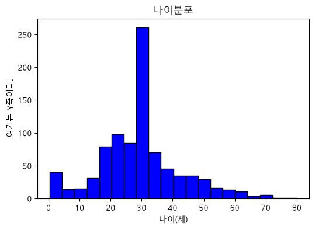
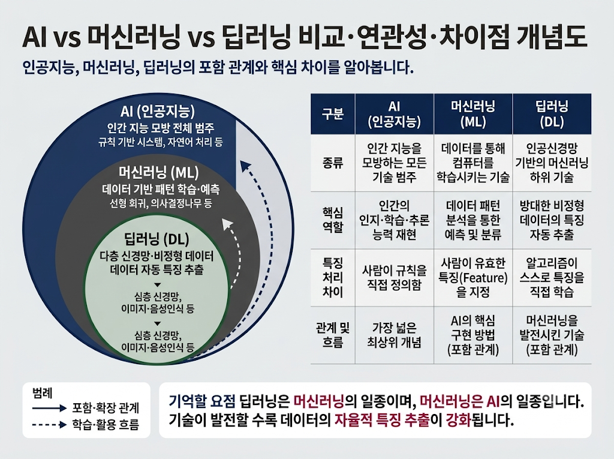
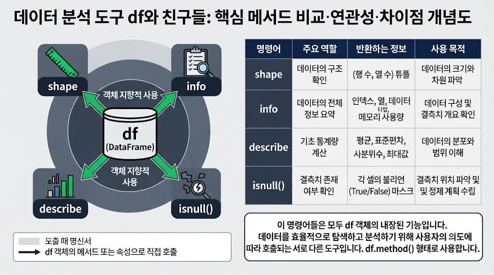

# [YBST] 26년11월23일 TIL

## 1-1. AI 요약│AI 기초 개념 복습과 토큰·임베딩·추론·템퍼러처 강의
---

# Action Items

---

- [ ]  수강생: 오늘 슬라이드를 토큰, 임베딩, 다음 토큰 예측, 템퍼러처, 컨텍스트 윈도우까지 진행 (담당자 명시 안 됨)
- [ ]  템퍼러처를 올리고 내리며 결과를 비교하는 실습 진행 (담당자 명시 안 됨)

## Open Questions

- 템퍼러처 값의 높고 낮음이 결과에 미치는 영향은 무엇인가?
    - 강의 중 설명이 엇갈렸다. 처음에는 "1에 가깝게 유지하면 거의 고정된 답변"이라고 했다. 이어서 값이 높으면 정확한 값이, 낮으면 다양한 답변이 나온다고 했다.
    - 이후 "이거 좀 반대로 된 것 같은데"라는 언급이 나왔다. 정정은 명확히 확정되지 않았다.
    - 실습에서 값을 직접 바꿔 확인할 예정이다.

## Summary

### 앞선 문제 풀이와 개념 복습

- 강사가 틀린 문제를 풀이하며 핵심 개념을 다시 짚었다.
    - AI의 4개 계층은 AI, 머신러닝, 딥러닝, 생성형 AI이다.
    - 머신러닝은 사람이 규칙을 짜지 않는다. 데이터에서 규칙과 패턴을 스스로 찾는다.
    - LLM 성장의 핵심 기술은 트랜스포머와 어텐션이다. 단어 관계를 동시에 병렬 처리하며, 구글 연구진이 개발했다.
- AI 리터러시가 이날 슬라이드의 핵심 개념이다. LLM의 답은 확률적 결과물이므로 한계를 알고 보완해야 한다.

### 오늘 학습 범위와 문제 상황

- 오늘 다룰 용어는 토큰, 임베딩, 다음 토큰 예측, 템퍼러처, 컨텍스트 윈도우이다.
- 답변이 중간에 끊기거나, 존댓말 규칙을 잃거나, 한글 요청에 영어로 답하는 현상은 LLM의 내부 언어 처리 구조 때문이다.
- 대화가 길어지면 초반 지시를 무시하는 경향이 있다.

### 토큰과 임베딩

- 토큰화는 입력 문장을 작은 단위로 쪼개고 번호를 붙이는 과정이다. 토큰은 단어가 아닐 수 있다.
    - 영어 예시는 총 4개 토큰, 한국어 예시는 공백까지 토큰으로 세어 총 6토큰이다.
    - 토크나이저마다 같은 문장도 토큰 수가 다르다. GPT-4 계열은 토큰이 더 많고, GPT-4O 계열은 더 적다.
- 비용은 토큰 수에 따라 책정된다. 토큰이 적을수록 총요금을 아낄 수 있다.
    - ChatGPT나 Claude 같은 상용 AI는 입력 토큰과 출력 토큰을 합산해 과금하는 것이 일반적이다.
- 임베딩은 토큰을 숫자(벡터 좌표)로 바꿔 의미 지도에 배치하는 과정이다.
    - 사과, 바나나, 포도처럼 의미가 가까우면 가깝게, 관련 없으면 멀리 배치한다.
    - 이 배치는 LLM이 방대한 텍스트를 학습하며 스스로 만든다.
    - RAG 시스템의 의미 검색에서 임베딩을 적극 활용하게 된다.

### 추론(Inference) 과정

- 추론은 질문을 받아 답변 문장을 만드는 과정이다.
    - 프롬프트가 신경망을 통과하며 문맥을 인식한다.
    - 다음에 올 후보 토큰의 확률을 계산한다.
    - 확률에 따라 토큰 하나를 골라 출력하고, 이 단계를 반복한다.
    - 문장 끝을 뜻하는 EOS가 나오면 종료한다.
- 컨텍스트 용량을 가득 채우면 앞쪽 지시를 잊거나 답변이 중간에 끊긴다.

### 템퍼러처

- **`temperature` 요약:** AI 응답 창의성·무작위성 조절 설정값이며 철자는 `r` 하나인 `temperature`로 씁니다.
- **값과 역할:** `0.0`에 가까우면 정형 추출·코드 생성처럼 일관·정확하게, 높이면 아이디어 생성처럼 다양·자유롭게 답합니다.
- **가스불 비유:** 약불(`0.0~0.2`)은 안정적 레시피, 센불(`0.8~1.2`)은 색다른 풍미 대신 탈 위험(할루시네이션 증가)이 커집니다.
- **주의·활용:** `0`이어도 100% 동일 출력이 보장되진 않으며, API·에이전트 역할별 설정이나 `top_p`·`max_tokens` 등과 함께 씁니다.

### 환각과 이후 진행

- 검색 시스템과 LLM 생성 시스템을 비교하며 환각을 설명했다. 정보가 부족하면 그럴싸한 문장을 생성하는 현상이다.
- 컨텍스트 윈도우는 아직 다루지 못했다. 뒤에 슬라이드가 많이 남아 있어 휴식 후 이어서 진행하기로 했다.

---

## 1-2. AI 요약│컨텍스트 엔지니어링과 머신러닝 기초 실습
---

## Action Items

- [ ]  수강생 전원: 10분 휴식 후 이어서 나이(Age) 결측값 177개를 채울 평균값·중앙값을 계산하고, 데이터 정제 후 학습(fit)과 예측(predict)까지 진행
- [ ]  수강생 전원: 강의 자료의 AI 리터러시 문서 두 개를 복습

## Decisions

- 오늘 실습은 지도학습과 비지도학습 두 가지만 진행하고, 강화학습은 개념만 다룸
    - 강화학습은 Unity 데모 영상으로 설명하고 실습 대상에서는 뺌
- 실습 환경은 uv 프로젝트, Python 3.15, 주피터 노트북으로 구성함
    - 별도 이유는 언급되지 않음 (no reason given)
- 타이타닉 승객 데이터로 생존 여부 예측 모델을 만듦
    - 결측값이 있는 원본 데이터는 바로 학습할 수 없어서 먼저 정제해야 함

## Open Questions

- 나이(Age) 결측값 177개를 평균값과 중앙값 중 무엇으로 채울 것인가?
    - 평균값과 중앙값을 비교해 보겠다고만 했고, 휴식 전까지 결정되지 않음
- 결측값이 있는 다른 열(예: deck)은 어떻게 처리할 것인가?
    - deck 정보도 비어 있다고 언급했지만 처리 방법은 정해지지 않음

## Summary

### 컨텍스트 윈도우와 프롬프트 엔지니어링

- 컨텍스트 윈도우는 LLM이 현재 사용할 수 있는 텍스트 범위임
    - 범위를 벗어난 내용은 잃어버림
    - 용량이 70~80% 이상 차면 중요하지 않은 내용을 압축함
    - AI는 답변할 때마다 지금까지의 대화를 모두 다시 읽음
- 초반에 정한 Persona나 규칙이 사라지지 않으려면 컨텍스트 용량을 넘기지 않아야 함
    - 용량이 초과되면 오래된 내용부터 밀려남
    - 요약이나 압축 후 새 세션을 여는 것을 권하기도 함 (벤더마다 다름)
- 프롬프트 엔지니어링은 가장 완벽한 한 줄의 질문을 다듬는 작업임
- 초보자와 숙련자의 프롬프트를 비교함
    - 초보자: "아이디어 세 개만 짜줘" 식이라 맥락이 없어 피상적인 답이 나오기 쉬움
    - 숙련자: 역할(Persona), 맥락, 조건(톤앤매너), 결과물 형식을 구체적으로 제시함
- 정확한 역할, 맥락, 리턴 조건을 써주는 것이 가장 좋은 결과를 냄

### 핵심 키워드: 토큰, 임베딩, 온도

- 토크나이저와 임베딩을 명확히 이해해야 함
    - 문장을 토큰으로 쪼개고 벡터(수치 데이터)로 변환해 지도처럼 맵에 표현함
- 온도(temperature)는 다음 토큰 예측의 다양성을 조절함
    - 0에 가까울수록 같은 답변, 1에 가까울수록 다양한 답변
- 컨텍스트 윈도우는 LLM이 해석할 수 있는 용량이며, 넘지 않게 관리하는 것이 중요함

### 머신러닝 개념 복습

- 머신러닝 용어는 1950년대 중반 이후 컴퓨터 과학자 아서 사무엘(Arthur Samuel로 추정, 전사 표기 "아스터 사모엘")이 처음 썼다고 소개함
    - 사람이 코드를 짜지 않아도 기계가 스스로 학습하게 한다는 뜻
- 포함 관계는 AI ⊃ 머신러닝 ⊃ 딥러닝이며 생성형 AI는 딥러닝에 속함
- 지도학습(Supervised Learning)
    - 미리 제공한 트레이닝 데이터(데이터셋)로 학습함
    - 레이블은 정답을 뜻함. 예: cat, dog, mug, hat 이미지
    - 예시로 구글 이미지 데이터셋, 손글씨 MNIST, 톰과 제리 분류를 들었음
    - 학습 후 새 이미지가 어느 클래스인지 판별함
- 비지도학습(Unsupervised Learning)
    - 레이블 없이 유사성과 특징으로 분류·군집함
    - 결과가 무엇인지는 알 수 없어서 나중에 사람이 레이블을 붙임
- 강화학습
    - 반복 훈련으로 올바른 행동에 플러스, 틀린 행동에 마이너스 보상을 줌
    - Unity 데모에서 선물 상자를 먹으면 +1, 차량에 부딪히면 마이너스였음
    - 처음엔 무작위로 움직이다가 약 6시간 학습 후 거의 완벽하게 수행함

### 실습 환경 세팅

- 실습은 타이타닉 승객 데이터를 사용함
    - 나이대, 승선 항구, 객실 등급으로 생존 여부를 추론하는 간단한 예제
- 프로젝트 폴더 생성 및 uv 초기화
    - `uv init --no-package`, Python 3.15 사용
    - 가상환경 활성화(source) 후 패키지 설치
- 설치한 패키지는 numpy, pandas, matplotlib, seaborn, ipykernel임
    - matplotlib과 seaborn은 이번에 처음 설치함
- 주피터 노트북 파일명 앞에 숫자를 붙인 것(예: 01_ML)은 특별한 의미가 없음
- 커널은 프로젝트의 `.venv` Python으로 선택함
- 자동완성이 안 되면 Ctrl+Shift+P(Mac은 Command+Shift+P)로 Developer: Reload Window를 실행함
- 라이브러리 버전을 출력해 import를 확인함
    - 첫 실행은 약 15초로 오래 걸리고 이후엔 빠름
- 일부 수강생이 오류를 겪었고, 위쪽 셀(데이터 불러오기)을 먼저 실행해야 아래 셀이 동작한다고 안내함

### 실습 흐름과 데이터 탐색

- 오늘 작업은 가상 승객의 생존 여부를 예측하는 모델 만들기임
    - 순서: 데이터 불러오기, 정제(가장 시간이 많이 듦), 학습(fit), 예측(predict)
    - 오늘은 이 흐름까지 진행하며 머신러닝 도구는 scikit-learn(전사 표기 "Cycle Run")을 사용
- `sns.load_dataset("titanic")`로 불러온 데이터를 `df`에 저장함
    - seaborn이 연습용으로 제공하는 데이터셋이며 타이타닉과 붓꽃 등이 있음
    - 약 891행, 15열이며 survived는 0과 1로 표시됨
    - 강의에서는 "1이 생존, 2는 생존하지 못했다"라고 말했으나 0과 1 값이라는 설명과 어긋남 (구두 실수로 보임)
- `df.info()`로 열별 데이터 타입(정수, 문자열, 실수)을 확인함
- `df.describe()`로 숫자 열의 통계를 확인함
    - 요금(fare)은 25% 구간 약 7.9달러, 50% 14달러, 75% 31달러임
    - 최댓값은 512로 격차가 커서, 몇몇 극단값이 평균을 끌어올린 것으로 해석함
- `df.isnull().sum()`으로 결측값을 확인함
    - age는 177개가 비어 있음
    - deck 정보도 비어 있음
    - NaN은 "Not a number"를 뜻하며 Null과는 의미가 조금 다름
- age가 빈 승객의 성별, 나이, 등급을 `loc`로 뽑아 head로 확인한 뒤 휴식에 들어감
    - 휴식 후 평균값과 중앙값으로 결측값을 채울 예정

---

## 1-3. AI 요약│타이타닉 데이터 결측치 처리 실습
---

## Action Items

- [ ]  수강생: 오늘 실습 방식(결측치 채우기, 데이터 정리)을 따라 강사가 제공할 다른 데이터셋을 처리해 보기

## Decisions

- 나이(age) 결측치는 평균값(약 29.69세)으로 채운다
    - 평균 29세와 중앙값 28세는 차이가 크지 않아 평균값을 사용하기로 함
- 탑승 항구(embark_town) 결측치 2건은 최빈값으로 채운다
    - 문자열은 평균이나 중앙값을 계산할 수 없어 가장 많이 나온 값(Southampton)을 사용함
- deck 결측치는 앞뒤 승객 값으로 채우지 않고 "Unknown" 카테고리를 추가해 채운다
    - 결측치가 688개로 매우 많아, 강의 교재의 앞뒤 값 채우기 예제는 건너뛰기로 함

## Summary

### 나이 결측치 처리

- 비어 있는 나이에 터무니없는 값을 넣으면 학습 모델 결과가 부정확해질 수 있어 평균값과 중앙값을 먼저 비교함
    - 평균값은 이상치 하나에 크게 흔들리고, 중앙값은 이상치 영향이 상대적으로 적다고 설명함
- `mean()`과 `median()`으로 계산한 결과는 평균 29세, 중앙값 28세였음
- `fillna`로 `age` 열의 결측치를 평균 나이로 채움
    - `loc`를 빠뜨려 오류가 났고, `loc`를 추가해 수정함
    - 확인 결과 결측치가 0으로 나옴. 채운 뒤 평균은 29.69로 표시됨

### 탑승 항구(embark_town) 결측치 처리

- `embark_town`에 결측치가 2건 있음을 확인함
- `value_counts(dropna=False)`로 확인한 결과 Southampton이 677건으로 가장 많았고 NaN은 2건이었음
- `mode()[0]`으로 최빈값을 구해 결측치 2건에 채움
    - 채운 뒤 Southampton이 464건으로 늘고 NaN은 사라짐
- 약자 열 `embarked`(대문자 한 글자)에도 결측치가 있어, `embark_town`의 첫 글자(`str[0]`)로 채움
    - 두 열 모두 `isnull().sum()`이 0임을 확인함

### deck 결측치 처리

- `deck`은 결측치가 688개로 가장 많음
- 열 타입이 category라서 `cat.add_categories`로 "Unknown"을 추가한 뒤 `fillna("Unknown")`을 적용함
    - 카테고리는 기존 A~G 7개에 Unknown이 더해짐
- `add_categories`를 두 번 실행하면 오류가 나므로 한 번만 실행해야 함
    - 카테고리를 지우려면 `remove_categories`를 쓰면 됨
- 최종 확인에서 컬럼별 결측치가 모두 없음을 확인함

### 마무리 및 다음 단계

- 이 작업은 학습용 데이터를 받았을 때 학습 가능한지 검증하는 과정이며, 지루하지만 절차를 지켜 완벽한 데이터셋을 만든 뒤 학습시키라고 강조함
- 과제로 다른 데이터셋이 주어질 예정임
- 이후에는 평균을 끌어올리는 튀는 값(이상치)을 찾아 걸러내는 작업을 진행함
- 데이터 정제는 오늘까지만 하고, 내일부터는 데이터 기반 모델 학습 작업으로 돌아감
- 오전 수업은 여기서 마무리함

---

## 1-4. AI 요약│타이타닉 데이터 전처리: 이상치·중복 확인·차트
---

## Action Items

- [ ]  수강생: 내일(11월 24일) 등급별(1·2·3등석) 요금 박스플롯, 나이와 요금 산점도 차트를 그린다
- [ ]  수강생: 내일(11월 24일) 완성된 데이터로 모델 학습(training)을 진행한다

## Decisions

- 승선 요금(Fare) 이상치 116건 전체는 삭제하지 않는다
    - 비싼 표를 산 승객일 수 있고, 전체 데이터가 흐트러질 수 있다
- 요금이 512달러 이상인 3건(모두 1등석 생존자)은 학습용으로 삭제한다
    - 이 3건은 IQR 기준보다 한참 떨어져 있다
- 원본 `df`는 지우지 않고 복사본(`.copy()`)에서 삭제 작업을 한다
    - 원본 데이터를 보존하기 위해서다
- 중복 행 107개는 삭제하지 않고 개수만 확인한다
    - 고유번호가 없어서 같은 사람이라고 단정하기 어렵다

## Summary

### IQR로 이상치 판단하기

- `df.describe()`의 사분위값(Q1 25%, Q2 50%, Q3 75%)으로 이상한 요금을 찾는다. Fare 최대값은 512달러다
- IQR은 Q3 − Q1이다. Q3 + 1.5 × IQR을 넘으면 이상 수치로 본다
    - 1.5는 경험적으로 많이 쓰는 계수라고 설명했다
- `quantile([0.25, 0.5, 0.75])`과 `describe`의 결과가 같음을 확인했다
- 계산 결과 Q1은 약 7.9, Q3는 31, 상한(Upper)은 약 65달러다. 65달러 초과는 116명이다
    - 강사 발언상 Q1은 7.9와 7.5로 엇갈려 들린다. 전사 오류일 수 있다.

### 이상치 삭제와 복사본 작업

- 512달러 이상은 3명이며 모두 1등석 생존자다
- 원본 891건에서 3건을 빼면 888건이 된다
- 셀을 반복 실행하면 데이터가 중첩될 수 있고 메모리가 쌓이므로 주의하라고 안내했다
- 수강생 일부는 위쪽에 셀을 추가해 데이터 로딩 코드를 넣었다

### 중복 행 확인

- `duplicated()`로 확인한 결과 전체 컬럼이 같은 중복 행은 107개다
- `keep=False`를 쓰면 첫 번째와 두 번째 중복을 모두 표시한다
- 결과에 NaN이 나왔는데, 앞서 주석 처리한 카테고리 변환 코드를 다시 실행해 해결했다
- 지금까지 한 전처리는 결측치를 평균값, 중앙값, 최빈값으로 채우기, 이상치 확인, 중복 확인이다. 가장 중요한 것만 진행했다

### 한글 폰트와 나이 분포 차트

- `platform`으로 OS를 확인해 폰트를 지정했다. Windows는 맑은 고딕, Mac(Darwin)은 애플고딕이다
- matplotlib으로 나이 히스토그램을 그렸다. 20개 구간, 파란색, 검정 테두리, 한글 제목과 x축 레이블을 썼다
- 수강생들의 화면에서 한글이 잘 나오는 것을 확인했다

### 다음 수업 예고

- 내일은 남은 차트를 마저 그리고, 완성된 데이터로 학습을 진행한다

---

## 2. 코드진행 흐름 파악│금일 수업 코드진행 흐름 파악
# 1교시│”01_ml.ipynb” Editor 창 코드진행 흐름파악

```python
import pandas as pd
import numpy as np
import seaborn as sns

print("pandas:", pd.__version__, "numpy:", np.__version__, "seaborn:", sns.__version__)
```

- pandas: 3.1.1 numpy: 2.5.5 seaborn: 0.13.2

---

```python
df = sns.load_dataset('titanic')
df.head(5)
```

| **survived** | **pclass** | **sex** | **age** | **sibsp** | **parch** | **fare** | **embarked** | **class** | **who** | **adult_male** | **deck** | **embark_town** | **alive** | **alone** |  |
| --- | --- | --- | --- | --- | --- | --- | --- | --- | --- | --- | --- | --- | --- | --- | --- |
| 0 | 0 | 3 | male | 22.0 | 1 | 0 | 7.2500 | S | Third | man | True | NaN | Southampton | no | False |
| 1 | 1 | 1 | female | 38.0 | 1 | 0 | 71.2833 | C | First | woman | False | C | Cherbourg | yes | False |
| 2 | 1 | 3 | female | 26.0 | 0 | 0 | 7.9250 | S | Third | woman | False | NaN | Southampton | yes | True |
| 3 | 1 | 1 | female | 35.0 | 1 | 0 | 53.1000 | S | First | woman | False | C | Southampton | yes | False |
| 4 | 0 | 3 | male | 35.0 | 0 | 0 | 8.0500 | S | Third | man | True | NaN | Southampton | no | True |

---

```python
# 데이터 Shape 조회
df.shape
```

- (891, 15)

---

```python
# 자료형 조회
df.info()
```

```python
<class 'pandas.DataFrame'>
RangeIndex: 891 entries, 0 to 890
Data columns (total 15 columns):
 #   Column       Non-Null Count  Dtype   
---  ------       --------------  -----   
 0   survived     891 non-null    int64   
 1   pclass       891 non-null    int64   
 2   sex          891 non-null    str     
 3   age          714 non-null    float64 
 4   sibsp        891 non-null    int64   
 5   parch        891 non-null    int64   
 6   fare         891 non-null    float64 
 7   embarked     889 non-null    str     
 8   class        891 non-null    category
 9   who          891 non-null    str     
 10  adult_male   891 non-null    bool    
 11  deck         203 non-null    category
 12  embark_town  889 non-null    str     
 13  alive        891 non-null    str     
 14  alone        891 non-null    bool    
dtypes: bool(2), category(2), float64(2), int64(4), str(5)
memory usage: 80.7 KB
```

---

```python
df.describe()
```

| **survived** | **pclass** | **age** | **sibsp** | **parch** | **fare** |  |
| --- | --- | --- | --- | --- | --- | --- |
| count | 891.000000 | 891.000000 | 714.000000 | 891.000000 | 891.000000 | 891.000000 |
| mean | 0.383838 | 2.308642 | 29.699118 | 0.523008 | 0.381594 | 32.204208 |
| std | 0.486592 | 0.836071 | 14.526497 | 1.102743 | 0.806057 | 49.693429 |
| min | 0.000000 | 1.000000 | 0.420000 | 0.000000 | 0.000000 | 0.000000 |
| 25% | 0.000000 | 2.000000 | 20.125000 | 0.000000 | 0.000000 | 7.910400 |
| 50% | 0.000000 | 3.000000 | 28.000000 | 0.000000 | 0.000000 | 14.454200 |
| 75% | 1.000000 | 3.000000 | 38.000000 | 1.000000 | 0.000000 | 31.000000 |
| max | 1.000000 | 3.000000 | 80.000000 | 8.000000 | 6.000000 | 512.329200 |

---

```python
# 각 셀의 널(NaN) 여부
df.isnull().sum()
```

```python
survived         0
pclass           0
sex              0
age            177
sibsp            0
parch            0
fare             0
embarked         2
class            0
who              0
adult_male       0
deck           688
embark_town      2
alive            0
alone            0
dtype: int64
```

---

```python
# 나이가 비어있는 승객 수, 성별, 클래스
empty_age = df["age"].isnull()
print("나이 빈칸:", empty_age.sum(), "명")
df.loc[empty_age, ["sex", "age", "class"] ].head()
```

- 나이 빈칸: 177 명

| **sex** | **age** | **class** |  |
| --- | --- | --- | --- |
| 5 | male | NaN | Third |
| 17 | male | NaN | Second |
| 19 | female | NaN | Third |
| 26 | male | NaN | Third |
| 28 | female | NaN | Third |

---

```python
# 평균값, 중앙값 산출
print("평균:", round(df["age"].mean(), 2))
print("중앙값:", round(df["age"].median(), 2))

mean_age = df["age"].mean()
# fillna : 빈칸(NaN)만 주어진 값을 새로운 값으로 채우는 메소드 df["열"] = df["열"].fillna(새로운값)
df.loc[:, "age"] = df["age"].fillna(mean_age)

# df["age"].isnull().sum()
df.loc[empty_age, ["sex", "age", "class"] ].head()
```

- 평균: 29.7
중앙값: 28.0

| **sex** | **age** | **class** |  |
| --- | --- | --- | --- |
| 5 | male | 29.699118 | Third |
| 17 | male | 29.699118 | Second |
| 19 | female | 29.699118 | Third |
| 26 | male | 29.699118 | Third |
| 28 | female | 29.699118 | Third |

---

```python
# 탑승 항구 : 최빈값
df["embark_town"].value_counts(dropna=False)
```

- embark_town
Southampton    644
Cherbourg      168
Queenstown      77
NaN              2
Name: count, dtype: int64

---

```python
# 최빈값 추출 후 빈칸에 채우는 로직
mode_town = df["embark_town"].mode()[0]
print("최빈값;", mode_town)

df.loc[:, "embark_town"] = df["embark_town"].fillna(mode_town)
df["embark_town"].value_counts(dropna=False)
```

- 최빈값 추출 후 빈칸에 채우는 로직
- mode_town = df["embark_town"].mode()[0]
print("최빈값;", mode_town)
- df.loc[:, "embark_town"] = df["embark_town"].fillna(mode_town)
df["embark_town"].value_counts(dropna=False)

---

```python
# embarked town값으로 설정
df.loc[:, "embark_town"] = df["embark_town"].str[0]
df[["embarked", "embark_town"]].isnull().sum()
```

- embarked       2
embark_town    0
dtype: int64

---

```python
# print(df["deck"].dtype)
# df["deck"].cat.categories

# df["deck"].cat.add_categories("Unknown")
# df["deck"].cat.remove_categories("Unknown")
# df["deck"] = df["deck"].fillna("Unknown")

df["deck"] = df["deck"].cat.add_categories("Unknown").fillna("Unknown")

print(df["deck"].cat.categories.to_list())
print(df["deck"].value_counts())
```

```python
['A', 'B', 'C', 'D', 'E', 'F', 'G', 'Unknown']
deck
Unknown    688
C           59
B           47
D           33
E           32
A           15
F           13
G            4
Name: count, dtype: int64
```

---

```python
df.isnull().sum()
```

```python
survived       0
pclass         0
sex            0
age            0
sibsp          0
parch          0
fare           0
embarked       2
class          0
who            0
adult_male     0
deck           0
embark_town    0
alive          0
alone          0
dtype: int64
```

---

```python
# 튀는 값 확인

print(df["fare"].quantile([0.25, 0.5, 0.75]))
df["fare"].describe()[["25%", "50%", "75%"]]

# 이 공식. 가능한 잊지말기
# IQR 계산 (Q3 - Q1)
# 이상수치 Q3 + 1.5*IQR

q1 = df["fare"].quantile(0.25)
q3 = df["fare"].quantile(0.75)
iqr = q3 - q1
upper = q3 + 1.5*iqr

# Q1, Q3, IQR, UPPER
print(f"Q1={q1:.2f}, Q3{q3:.2f} IQR={iqr:.2f} UPPER={upper:.2f}")
print("이상 승선요금:", (df["fare"] > upper).sum(), "명")
```

```python
0.25     7.9104
0.50    14.4542
0.75    31.0000
Name: fare, dtype: float64
Q1=7.91, Q331.00 IQR=23.09 UPPER=65.63
이상 승선요금: 116 명
```

---

```python
before = len(df)
df = df [ df["fare"] < 512 ].copy()
print(before, "=>" , len(df))
```

- 891 => 888

---

```python
# 중복되는 행 확인

print("중복 행:", df.duplicated().sum(), "개")
df[df.duplicated(keep=False)].sort_values(["fare", "age"]).head(5)
```

- 중복 행: 107 개

| **survived** | **pclass** | **sex** | **age** | **sibsp** | **parch** | **fare** | **embarked** | **class** | **who** | **adult_male** | **deck** | **embark_town** | **alive** | **alone** |  |
| --- | --- | --- | --- | --- | --- | --- | --- | --- | --- | --- | --- | --- | --- | --- | --- |
| 277 | 0 | 2 | male | 29.699118 | 0 | 0 | 0.0 | S | Second | man | True | Unknown | S | no | True |
| 413 | 0 | 2 | male | 29.699118 | 0 | 0 | 0.0 | S | Second | man | True | Unknown | S | no | True |
| 466 | 0 | 2 | male | 29.699118 | 0 | 0 | 0.0 | S | Second | man | True | Unknown | S | no | True |
| 481 | 0 | 2 | male | 29.699118 | 0 | 0 | 0.0 | S | Second | man | True | Unknown | S | no | True |
| 674 | 0 | 2 | male | 29.699118 | 0 | 0 | 0.0 | S | Second | man | True | Unknown | S | no | True |

---

```python
import platform
import matplotlib.pyplot as plt

os_name = platform.system()

if os_name == "Windows":
    plt.rcParams["font.family"] = "malgun Gothic"

# 나이 분포 차트
fig, ax = plt.subplots(figsize=(6,4))
ax.hist(df["age"], bins=20, color="blue", edgecolor="black")
ax.set_title("나이분포")
ax.set_xlabel("나이(세)")
ax.set_ylabel("여기는 Y축이다.")
```

- Text(0, 0.5, '여기는 Y축이다.')



---

---

## 1교시│”01_ml.ipynb” 터미널 창 코드진행 흐름파악

```python
miro2@keon UCRT64 ~
$ cd kant_study

miro2@keon UCRT64 ~/kant_study (main)
$ ls
03_ML/  CREDITS.md  kant_pandas/  README.md

miro2@keon UCRT64 ~/kant_study (main)
$ cd 03_ML

miro2@keon UCRT64 ~/kant_study/03_ML (main)
$ mkdir kant_ml

miro2@keon UCRT64 ~/kant_study/03_ML (main)
$ cd kant_ml

miro2@keon UCRT64 ~/kant_study/03_ML/kant_ml (main)
$ code .
```

---

```python
miro2@keon UCRT64 C:/Users/miro2/kant_study/03_ML/kant_ml (main)
$ uv init --no-packackage --python 3.15
error: unexpected argument '--no-packackage' found

  tip: a similar argument exists: '--no-package'

Usage: uv.exe init --no-package [PATH]

For more information, try '--help'.

miro2@keon UCRT64 C:/Users/miro2/kant_study/03_ML/kant_ml (main)
$ uv init --no-package --python 3.15
Initialized project `kant-ml`

miro2@keon UCRT64 C:/Users/miro2/kant_study/03_ML/kant_ml (main)
$ uv sync
Using CPython 3.15.2 interpreter at: C:\Users\miro2\AppData\Local\Programs\Python\Python315\python.exe
Creating virtual environment at: .venv
Resolved 1 package in 2ms
Checked in 0.20ms

miro2@keon UCRT64 C:/Users/miro2/kant_study/03_ML/kant_ml (main)
$ source .venv/Scripts/activate
(kant-ml) 
miro2@keon UCRT64 C:/Users/miro2/kant_study/03_ML/kant_ml (main)
$ uv add numpy pandas matplotlib seaborn ipykernel
Resolved 44 packages in 440ms
Prepared 10 packages in 4.43s
Installed 38 packages in 2.73s
 + asttokens==3.0.2
 + colorama==0.4.6
 + comm==0.2.3
 + contourpy==1.4.0
 + cycler==0.12.1
 + debugpy==1.8.22
 + executing==2.3.0
 + fonttools==4.68.0
 + ipykernel==7.4.0
 + ipython==9.18.1
 + ipython-pygments-lexers==1.1.1
 + jedi==0.20.1
 + jupyter-client==8.10.0
 + jupyter-core==5.9.1
 + kiwisolver==1.5.1
 + matplotlib==3.11.2
 + matplotlib-inline==0.2.2
 + nest-asyncio2==1.7.4
 + numpy==2.5.5
 + packaging==26.3
 + pandas==3.1.1
 + parso==0.8.7
 + pillow==13.0.0
 + platformdirs==4.14.8
$  source /c/Users/miro2/kant_study/03_ML/kant_ml/.venv/Scripts/activate
(kant-ml) 
miro2@keon UCRT64 C:/Users/miro2/kant_study/03_ML/kant_ml (main)
$ ㄴ
bash: ㄴ: command not found
(kant-ml) 
miro2@keon UCRT64 C:/Users/miro2/kant_study/03_ML/kant_ml (main)
$ ls
01_ml.ipynb  main.py  pyproject.toml  README.md  uv.lock
(kant-ml) 
miro2@keon UCRT64 C:/Users/miro2/kant_study/03_ML/kant_ml (main)
$ ls -al
total 175
drwxr-xr-x 1 miro2 197609      0 Nov 23 10:37 ./
drwxr-xr-x 1 miro2 197609      0 Nov 23 10:31 ../
-rw-r--r-- 1 miro2 197609      5 Nov 23 10:33 .python-version
drwxr-xr-x 1 miro2 197609      0 Nov 23 10:35 .venv/
-rw-r--r-- 1 miro2 197609  49968 Nov 23 14:20 01_ml.ipynb
-rw-r--r-- 1 miro2 197609     85 Nov 23 10:33 main.py
-rw-r--r-- 1 miro2 197609    268 Nov 23 10:35 pyproject.toml
-rw-r--r-- 1 miro2 197609      0 Nov 23 10:33 README.md
-rw-r--r-- 1 miro2 197609 110992 Nov 23 10:35 uv.lock
(kant-ml) 
miro2@keon UCRT64 C:/Users/miro2/kant_study/03_ML/kant_ml (main)
$ git init
Initialized empty Git repository in C:/Users/miro2/kant_study/03_ML/kant_ml/.git/
(kant-ml) 
miro2@keon UCRT64 C:/Users/miro2/kant_study/03_ML/kant_ml (main)
$ git status
On branch main

No commits yet

Untracked files:
  (use "git add <file>..." to include in what will be committed)
        .python-version
        01_ml.ipynb
        README.md
        main.py
        pyproject.toml
        uv.lock

nothing added to commit but untracked files present (use "git add" to track)
(kant-ml) 
miro2@keon UCRT64 C:/Users/miro2/kant_study/03_ML/kant_ml (main)
$ git add . 
warning: in the working copy of '.python-version', LF will be replaced by CRLF the next time Git touches it
warning: in the working copy of '01_ml.ipynb', LF will be replaced by CRLF the next time Git touches it
warning: in the working copy of 'main.py', LF will be replaced by CRLF the next time Git touches it
warning: in the working copy of 'pyproject.toml', LF will be replaced by CRLF the next time Git touches it
warning: in the working copy of 'uv.lock', LF will be replaced by CRLF the next time Git touches it
(kant-ml) 
miro2@keon UCRT64 C:/Users/miro2/kant_study/03_ML/kant_ml (main)
$ git add 01_ml.ipynb
(kant-ml) 
miro2@keon UCRT64 C:/Users/miro2/kant_study/03_ML/kant_ml (main)
$ git status
On branch main

No commits yet

Changes to be committed:
  (use "git rm --cached <file>..." to unstage)
        new file:   .python-version
        new file:   01_ml.ipynb
        new file:   README.md
        new file:   main.py
        new file:   pyproject.toml
        new file:   uv.lock

(kant-ml) 
miro2@keon UCRT64 C:/Users/miro2/kant_study/03_ML/kant_ml (main)
$ git commit -m "KANT_ML_AI 기초 개념 복습·실습"
[main (root-commit) 0e2d123] KANT_ML_AI 기초 개념 복습·실습
 6 files changed, 1974 insertions(+)
 create mode 100644 .python-version
 create mode 100644 01_ml.ipynb
 create mode 100644 README.md
 create mode 100644 main.py
 create mode 100644 pyproject.toml
 create mode 100644 uv.lock
(kant-ml) 
miro2@keon UCRT64 C:/Users/miro2/kant_study/03_ML/kant_ml (main)
$ git remote -v
(kant-ml) 
miro2@keon UCRT64 C:/Users/miro2/kant_study/03_ML/kant_ml (main)
$ git remote add origin https://github.com/miro25800/kant_ml.git
(kant-ml) 
miro2@keon UCRT64 C:/Users/miro2/kant_study/03_ML/kant_ml (main)
$ git push origin main
Enumerating objects: 8, done.
Counting objects: 100% (8/8), done.
Delta compression using up to 24 threads
Compressing objects: 100% (6/6), done.
Writing objects: 100% (8/8), 51.62 KiB | 17.21 MiB/s, done.
Total 8 (delta 0), reused 0 (delta 0), pack-reused 0 (from 0)
To https://github.com/miro25800/kant_ml.git
 * [new branch]      main -> main
(kant-ml) 
miro2@keon UCRT64 C:/Users/miro2/kant_study/03_ML/kant_ml (main)
$ ls
01_ml.ipynb  main.py  pyproject.toml  README.md  uv.lock
(kant-ml) 
miro2@keon UCRT64 C:/Users/miro2/kant_study/03_ML/kant_ml (main)
$ ls -al
total 179
drwxr-xr-x 1 miro2 197609      0 Nov 23 14:32 ./
drwxr-xr-x 1 miro2 197609      0 Nov 23 10:31 ../
drwxr-xr-x 1 miro2 197609      0 Nov 23 14:35 .git/
-rw-r--r-- 1 miro2 197609      5 Nov 23 10:33 .python-version
drwxr-xr-x 1 miro2 197609      0 Nov 23 10:35 .venv/
-rw-r--r-- 1 miro2 197609  49350 Nov 23 14:36 01_ml.ipynb
-rw-r--r-- 1 miro2 197609     85 Nov 23 10:33 main.py
-rw-r--r-- 1 miro2 197609    268 Nov 23 10:35 pyproject.toml
-rw-r--r-- 1 miro2 197609      0 Nov 23 10:33 README.md
-rw-r--r-- 1 miro2 197609 110992 Nov 23 10:35 uv.lock
(kant-ml) 
miro2@keon UCRT64 C:/Users/miro2/kant_study/03_ML/kant_ml (main)
$ git init
Reinitialized existing Git repository in C:/Users/miro2/kant_study/03_ML/kant_ml/.git/
(kant-ml) 
miro2@keon UCRT64 C:/Users/miro2/kant_study/03_ML/kant_ml (main)
$  git status
On branch main
Changes not staged for commit:
  (use "git add <file>..." to update what will be committed)
  (use "git restore <file>..." to discard changes in working directory)
        modified:   01_ml.ipynb

no changes added to commit (use "git add" and/or "git commit -a")
(kant-ml) 
miro2@keon UCRT64 C:/Users/miro2/kant_study/03_ML/kant_ml (main)
$ git add 01_ml.ipynb
warning: in the working copy of '01_ml.ipynb', LF will be replaced by CRLF the next time Git touches it
(kant-ml) 
miro2@keon UCRT64 C:/Users/miro2/kant_study/03_ML/kant_ml (main)
$ git add .
(kant-ml) 
miro2@keon UCRT64 C:/Users/miro2/kant_study/03_ML/kant_ml (main)
$ git status
On branch main
Changes to be committed:
  (use "git restore --staged <file>..." to unstage)
        modified:   01_ml.ipynb

(kant-ml) 
miro2@keon UCRT64 C:/Users/miro2/kant_study/03_ML/kant_ml (main)
$ git commit -m "feat: 내용 수정 추가"
[main e40648a] feat: 내용 수정 추가
 1 file changed, 6 insertions(+), 5 deletions(-)
(kant-ml) 
miro2@keon UCRT64 C:/Users/miro2/kant_study/03_ML/kant_ml (main)
$ 
(kant-ml) 
miro2@keon UCRT64 C:/Users/miro2/kant_study/03_ML/kant_ml (main)
$ git remote -v
origin  https://github.com/miro25800/kant_ml.git (fetch)
origin  https://github.com/miro25800/kant_ml.git (push)
(kant-ml) 
miro2@keon UCRT64 C:/Users/miro2/kant_study/03_ML/kant_ml (main)
$ git push origin main
Enumerating objects: 5, done.
Counting objects: 100% (5/5), done.
Delta compression using up to 24 threads
Compressing objects: 100% (3/3), done.
Writing objects: 100% (3/3), 11.02 KiB | 11.02 MiB/s, done.
Total 3 (delta 2), reused 0 (delta 0), pack-reused 0 (from 0)
remote: Resolving deltas: 100% (2/2), completed with 2 local objects.
To https://github.com/miro25800/kant_ml.git
   0e2d123..e40648a  main -> main
(kant-ml)
```

---

---

## 3. 수작업 요약│실습 7회차
---

# **1-1. 필기 요약│**AI 기초 이론 요약 (전제·한계·연결 구조 중심)

#### 1. 한 눈에 보는 연결구조 (큰 그림의 구조)

- **입력 → 쪼개기(토큰) → 좌표화(임베딩) → 확률 계산·선택(추론·템퍼러처 ) → 출력(EOS)**
    - EOS : End of Sequence
        - 자연어 처리(NLP) 및 대규모 언어 모델(LLM)에서 시퀀스(문장, 응답 등)의 끝을 알리는 **특수 토큰**
- 작동 흐름:
    - **토큰화**: 문장을 작은 조각(토큰)과 번호로 나눔 (단어와 다를 수 있고, 모델마다 토큰 수가 다름)
    - **임베딩**: 조각을 숫자 벡터로 바꿔 **의미 거리 지도**에 배치 → 유사 의미 검색(RAG)의 기반
    - **추론 & 템퍼러처**: 문맥을 읽고 다음 토큰 확률을 계산 → 템퍼러처로 선택의 고른 정도/무작위성을 조절 → 끝(EOS)까지 반복

#### 2. 핵심 전제 (이 개념이 성립하기 위한 조건)

- **확률 기반 생성**: LLM은 정답 DB를 꺼내는 것이 아닌, **문맥상 그럴듯한 다음 토큰의 확률**을 계산해 이어 붙입니다.
- **토크나이저·모델 의존성**: 같은 문장이라도 어떤 토크나이저/모델을 쓰느냐에 따라 토큰 수와 비용(입·출력 합산 과금)이 달라집니다.
- **의미의 공간화**: 임베딩 공간에서 의미가 가까운 개념끼리 가까이 놓인다는 전제 위에서 유사도 탐색이 작동합니다.

#### 3. 한계와 주의점 (실습·개발에서 마주칠 문제)

- **할루시네이션(환각)**: 근거 정보가 부족해도 확률적으로 자연스러운 문장을 지어낼 수 있습니다.
- **컨텍스트 한계**: 대화가 길어져 용량을 채우면 앞쪽 지시를 잊거나, 답변이 끊기거나, 형식/언어 규칙이 흔들릴 수 있습니다.
- 템퍼러처 오해 주의:
    - 낮은 값(’0.0’ 근처: 정형 추출·코드 등 일관성 위주(단, ‘0’이어도 100% 고정을 보장하진 않음)
    - 높은 값: 아이디어 등 다양성 위주 대신 엉뚱한 답변·환각 위험 증가

#### 4. 왕초보 개발자를 위한 미해결 체크리스트

- [ ]  **실습 검증:** 템퍼러처를 낮췄을 때와 높였을 때 같은 프롬프트의 결과가 어떻게 달라지는가?
- [ ]  **미진도 보완:** 아직 다루지 못한 **컨텍스트 윈도우**가 실제 긴 입력·대화에서 어떤 한계를 만드는가?
- [ ]  **연계 감각:** 토큰 수·임베딩·템퍼러처 설정이 **비용, 응답 품질, RAG**과 어떻게 맞물리는가?

---



---

# **1-2. 필기 요약│**컨텍스트 엔지니어링 & 머신러닝 기초 실습 요약 (전제·한계·연결 구조 중심)

### 1. 한 눈에 보는 연결구조 (큰 그림 구조)

#### 컨텍스트 관리·프롬프트 설계(LLM 활용) + 데이터 적재·정제·’fit’/’predict’(ML 파이프 라인)

- LLM 활용 구조
    - **컨텍스트 윈도우**: 매번 대화 전체를 다시 읽는 작업 공간(70%~80% 차면 압축, 초과 시 앞쪽 규치
    - **프롬프트 엔지니어링**: 단순 요청 대신 **역할(Persona)·맥락·조건·출력 형식**을 명확히 주는 설계
    - **연결 고리**: 토큰/임베딩/온도(템퍼러처) 개념 위에서 컨텍스트 용량을 넘기지 않아야 초기  지시와 형식이 유지됨
- 머신러닝 실습 구조
    - **학습 패러다임**: 지도학습(정답 레이블)에 있음 / 비지도학습(레이블 없이 군집·분류) / 강화학습(보상 기반 반복 학습, 이번엔 개념·데모 위주)
    - **실습 파이프라인**: ‘uv’ + Python 3.15 + ‘.venv’ 주피터 환경 → 타이타닉(’891행 x 15열’) 탐색 → ‘**결측치 정제**’ → 모델 학습(’fit’) 및 예측(’predict’)

### 2. 핵심 전제 (이 실습과 개념이 성립하기 위한 조건)

- **컨텍스트 재독립 전제**: LLM은 답변할 때마다 주어진 컨텍스트 범위를 읽고 처리하므로, 길어질수록 압축·밀림이 발생한다는 전제를 두고 설계해야 합니다.
- **데이터 정제 선행 전제**: 머신러닝 모델(’scikit-learn)은 결측값(’NaN’)이 섞인 원본 데이터를 그대로 학습하기 어렵기 때문에, 정제 다녜가 먼저 필요합니다.

### 3. 한계와 주의점

- 컨텍스트 초과·압축 한계: 대화가 길어지면 초반 지시나 규칙이 사라질 수 있어, 중요 지침 유지나 새 세션 분리를 고려해야 합니다.
- 데이터 분포·결측치 함정:
    - ‘fare’(요금)처럼 최댓값(’512’)이 큰 극단치가 있으면 **평균**이 왜곡괼 수 있으므로 평균과 **중앙값**을 함계 살펴봐야 합니다.
    - ‘age’(’결측 177개)와 ‘deck’ 등 빈 값의 처리 기준을 정해야 합니다.
    - **survived 타겟 값 확인 :** 타이타닉 데이터의 survived 열은 생존 여부(0 과 1)를 나타내는 예측 대상(타겟)이므로, 모델 학습 전 실제 값 분포와 의미를 코드로 정확히 확인해야 합니다.

#### 4. 왕초보 개발자를 위한 미해결 체크리스트

- [ ]  **결측치 처리 결정:** `age` 결측 177개를 평균값과 중앙값 중 어떤 기준으로 채울지 비교·결정했는가?
- [ ]  **기타 결측 열 처리:** `deck` 등 비어 있는 다른 열은 어떻게 처리(제외·대체 등)할지 정했는가?
- [ ]  **파이프라인 완주:** 정제된 데이터로 `fit`(학습)과 `predict`(예측)까지 에러 없이 실행해 봤는가?
- [ ]  **복습 연계:** 강의 자료의 AI 리터러시 문서 2편을 읽고, 프롬프트/컨텍스트 관리 원칙과 연결해 봤는가?

---

# **1-3. 필기 요약│타이타닉 데이터 결측치 처리 실습 요약 (전제·한계·연결 구조 중심)**

### 1. 한눈에 보는 연결 구조 (큰 그림)

#### 결측치 파악  → 데이터 타입·분포 확인 → 타입별 맞춤 대체(’fillna’ / ‘mode’ / ‘category’) → 학습 전 정제 완료

- **연결 흐름**
    1. **수치형(’age’)**: 평균(’mean’)과 중앙값(’median’) 비교 후 결정 → ‘loc’ + ‘fillna’로 결측치 채우기
    2. **범주형 문자열(’embark_town, ‘embarked’)**: 최빈값(’mode()[0]’)으로 채우고, 파생/약자 열(’str[0]’)도 일관되게 맞춤
    3. **카테고리형(’deck’)**: 결측이 너무 많아 앞뒤 채우기 대신 ‘”Unknown”’ 카테고리 추가 후 채우기
    4. **모델링 연계**: **정제 완료 후 다음 단계**인 **이상치 제거**와 **모델 학습**으로 이어짐

### 2. 핵심 전제 (이 처리 방식이 성립하기 위한 조건)

- **변수 성격별 적합성**: 수치형은 평균/중앙값 비교가 가능하지만, 문자열·범주형은 평균을 낼 수 없으므로 최빈값이나 별도 라벨링이 필요합니다.
- **분포 차이 이해**: 평균은 극단값(이상치)에 흔들릴 수 있고, 중앙값은 상대적으로 덜 흔들리므로 두 값을 함께 봐야 합니다.
- **카테고리 스키마 일치**: ‘category’ 타입 열에는 정의된 카테고리 목록 안에 없는 값을 바로 넣을 수 없으므로 먼저 카테고리를 추가해야 합니다.

### 3. 한계와 주의점 (실습·개발에서 마주칠 문제)

- **코드·API 주의점**:
    - ‘fillna’ 적용 시 ‘loc’ 누락으로 인한 경고/오류 주의
    - ‘add_categories’는 중복 실행 시 오류가 날 수 있으므로 한 번만 실행(제거 시 ‘remove_categories’ 활용)
- **결측 규모에 따른 선택**: 결측치(예: ‘deck’의 688개)가 지나치게 억지로 하기보다 ‘”Uknown”’ 같은 별도 구분 처리가 현실적입니다.

#### 4. 왕초보 개발자를 위한 미해결 체크리스트

- [ ]  **다른 데이터셋 적용:** 오늘 익힌 결측치 채우기·정리 절차를 새 데이터셋에도 스스로 적용해 봤는가?
- [ ]  **결측 처리 기준 판단:** 열마다 결측 비율과 데이터 타입을 보고 평균·중앙값·최빈값·별도 카테고리 중 무엇이 맞는지 설명할 수 있는가?
- [ ]  **다음 단계 준비:** 결측치 제거 후 이어지는 **이상치 탐색/제거**와 **모델 학습** 흐름으로 넘어갈 준비가 되었는가?

---

## 2. 실행할 때 꼭 챙길 포인트

- **`loc[:, 열이름]` 패턴:** pandas에서 열 값을 덮어쓸 때 `loc`를 명시하면 의도치 않은 복사/경고 혼동을 줄이고 가독성을 높일 수 있습니다.
- **`if "Unknown" not in ...` 가드:** `category` 열은 `add_categories`를 같은 이름으로 두 번 호출하면 에러가 납니다. 주피터 노트북에서 셀을 여러 번 다시 실행하더라도 안전하게 돌아가도록 조건문을 넣었습니다.
- **`mode()[0]`:** 최빈값은 동률이 있을 수 있어 시리즈 형태로 반환되므로 `[0]`으로 첫 번째 값을 꺼내어 채웁니다.

---

# **1-4. 필기 요약│타이타닉 데이터 전처리(이상치·중복·차트) 요약 (전제·한계·연결 구조 중심)**

### 1. 한 눈에 보는 연결 구조 (큰 그림 구조)

#### 사분위수(IQR) 이상치 판별 → 선택적 제거(’.copy()’) → 중복 행 점검(’duplicated’) → 시각화(히스토그램/차트) → 모델 학습 준비

- **연결 흐름**:
    - **이상치 탐지**: ‘Q1(약 7.9)’, ‘Q3(31)’로 ‘IQR’을 구하고 ‘Q3 + 1.5 x IQR(약 65)’ 초과치(116건)을 파악
    - **차별 처리**: 116건 전체를 지우지 않고, 극단적으로 튄 512달러 이상 3건(891건 → 888건)만 복사본에서 제거
    - **중복 확인**: OS별(’Windows’ 맑은 고딕 / ‘Mac’ 애플고딕) 한글 폰트 설정 후 나이 분포 히스토그램 확인 → 다음 날 등급별 요금 박스플롯·산점도 및 모델 학습으로 연결

### 2. 핵심 전제 (이 처리 방식이 성립하기 위한 조건)

- **원본 보존 전제**: 데이터를 직접 지우거나 덮어쓰면 되돌리기 어려우므로 ‘.copy()’로 분리해 작업하고, 셀 반복 실행에 따른 중첩·누적 상태를 의식해야 합니다.
- **도메인 맥락 전제**: 통계적 이상치(’> 약 65’)가 곧 잘못된 데이터나 삭제 대상은 아니며, 실제 고가 티켓·생존 패턴 등 도메인 의미를 함께 봐야 합니다.
- **환경 설정 전제**: 시각화의 가독성을 위해 실행 OS에 맞는 한글 폰트 설정과 앞선 전처리/타입 셀의 실행 상태가 전제됩니다.

### 3. 한계와 주의점 (실습·개발에서 마주칠 전제)

- **식별자(ID) 부재 한계**: 고유 승객 ID가 없는 상태에서 열 값이 같다는 이유만으로 중복 행(107건)을 일괄 삭제하면 실제 다른 승객 정보를 잃을 수 있습니다.
- **주석·셀 실행 순서 이슈**: 앞서 주석 처리한 카테고리 변환 코드 미실행드 셀 순서/상태가 꼬이면 ‘NaN’이 보이거나 의도와 다른 결과가 나올 수 있습니다.
- **기록·청취 교차 확인**: ‘Q1’ 수치(’7.9’ vs ‘7.5’)처럼 전사나 구두 발화에서 엇갈릴 수 있는 부분은 코드 출력 값으로 다시 검증해야 합니다.

### 4. 왕초보 개발자를 위한 미해결 체크리스트

- [ ]  **차트 시각화 완료:** 내일(11월 24일) 등급별(1·2·3등석) 요금 박스플롯과 나이·요금 산점도를 그려 분포 차이를 눈으로 확인했는가?
- [ ]  **처리 기준 설명:** 116건 중 512달러 이상 3건만 지운 이유와 중복 107건을 남긴 이유를 스스로 설명할 수 있는가?
- [ ]  **모델 학습 연결:** 최종 정제된 `888건` 데이터로 실제 모델 학습(`training`)을 이어갈 준비가 되었는가?

---

---

## 4. 단어 암기장│단어 암기장
---

# 단어 중요도 목차 (5단계 분배)

### [5단계 : 필수적으로 중요함]

- Shape / 셰이프 (데이터 크기·차원 확인 기본기)
- Info / 인포 (데이터 구조·결측치·타입 점검 기본기)
- Describe / 디스크라이브 (기초 통계 요약 확인 기본기)
- Isnull / 이즈널 (결측치 탐지 기본기)
- Fillna / 필엔에이 (결측치 대체·처리 기본기)
- Location, 로케이션 / Loc, 로크 (라벨·조건 기반 행/열 접근·수정 기본기)

### [4단계 : 매우 중요함]

- Hallucination / 할루시네이션 (AI 응답 허위 생성·검증 핵심 개념)
- Orchestration / 오케스트레이션 (다중 단계·도구·에이전트 흐름 조율 핵심 개념)
- Temperature / 템퍼러처 (LLM 출력 무작위성·창의성 조절 핵심 설정)
- Context engineering / 컨텍스트 엔지니어링 (모델 입력 맥락 구성·최적화 핵심 개념)
- IQR / 아이큐알 (사분위 범위 기반 이상치 탐지 핵심 개념)
- tokenizer / 토크나이저 (텍스트를 토큰 단위로 쪼개어 숫자 ID와 상호 변환하는 도구)
- Histogram / 히스토그램 (연속형 데이터를 구간별로 나누어 빈도를 나타낸 분포 그래프)

### [3단계 : 중요함]

- Seaborn / 시본 (통계 기반 데이터 시각화 라이브러리)
- Sns / 에스엔에스 (Seaborn 표준 임포트 별칭)

### [2단계 : 덜 중요한 것은 아님.]

- Empty / 엠프티 (비어 있음 상태 확인 용어/속성)

### [1단계 : 알고 있으면 나쁘지 않음.]

- Embarked / 엠바크드 (특정 예제 데이터셋 컬럼명)
- Embark_town / 엠바크_타운 (특정 예제 데이터셋 컬럼명)

---

# [5단계 : 필수적으로 중요함]

## Shape / 셰이프

```python
단어: shape (셰이프 / 데이터프레임·배열의 행과 열 개수 등 차원별 크기를 튜플로 알려 주는 속성)
 · 단어 뜻 : 모양 / 형태 / 크기·구조
 · 명령어 뜻 : Pandas `DataFrame`이나 `Series`, NumPy 배열(`ndarray`)에서 **각 차원(행과 열)에 원소가 몇 개씩 있는지 `(행_수, 열_수)` 형태의 튜플(`tuple`)로 보여 주는 속성**이에요. 함수가 아니므로 뒤에 괄호 `()`를 붙이지 않고 `df.shape`처럼 바로 부릅니다.
 · 사용 위치 : Pandas(`df.shape`, `series.shape`), NumPy(`arr.shape`), 데이터 적재·병합(`merge`·`concat`)·필터링 전후 크기 점검 코드
 · 실생활 비유 : 엑셀 표나 좌석표를 펼쳐 놓고 **“이 표는 가로 몇 줄, 세로 몇 칸짜리 판이지?”라고 한눈에 크기(규격)를 재는 것**과 같아요.
 · 주의점 : `df.shape()`처럼 괄호를 붙이면 `TypeError: 'tuple' object is not callable` 오류가 날 수 있고, `Series`는 1차원이므로 `(행_수,)`처럼 쉼표가 붙은 1원소 튜플이 나오며, `merge()`나 이상치 제거(`IQR` 필터링) 뒤 행 수가 기대와 다르게 줄거나 늘었는지 꼭 확인해야 해요.
 · 코드 스니펫 : (import pandas as pd; df = pd.DataFrame({"a": [1, 2, 3], "b": [4, 5, 6]}); print(df.shape))
  · 기본 문법: df.shape  # 반환값: (행_개수, 열_개수) 튜플 (괄호 () 없이 사용)
  · 사용 예시: import pandas as pd\n\ndf = pd.DataFrame({\n    "genre": ["Drama", "Action", "Drama"],\n    "pay_amount": [100000, 150000, 120000],\n})\nprint("전체 (행, 열):", df.shape)\nprint("행 개수:", df.shape[0], "열 개수:", df.shape[1])
  · 실행 위치: Python 스크립트(`.py`), Jupyter Notebook, 터미널(`uv run python ...` 등)
  · 실행 전 확인: 대상 객체가 `DataFrame`·`Series`·`ndarray`인지(일반 Python `list`에는 `.shape` 속성이 없음), 괄호 없이 `shape`로 적었는지 확인해요.
  · 실행 순서:
   1. 원본 데이터 크기 확인: `df.shape`로 초기 행 수와 열 수를 기록해요.
   2. 전처리·병합 수행: `merge()`, `dropna()`·`fillna()`, 이상치 필터링 등을 실행해요.
   3. 변화 검증: 다시 `df.shape`를 찍어 행이 누락되거나 중복 폭증하지 않았는지 확인해요.
 · 어디서 쓰이는지 : 데이터 적재 직후 규모 파악, `merge()`·`groupby()`·필터링 전후 행·열 변화 검증, 모델 입력 텐서·배열 차원 확인부
 · 원하는 연관 명령어 : len, info, head, merge, groupby
```

---

## Info / 인포

```python
단어: info (인포 / DataFrame의 행 수·컬럼 목록·결측치 유무·데이터 타입·메모리 사용량을 한눈에 보여 주는 Pandas 메서드)
 · 단어 뜻 : information(정보)의 줄임말
 · 명령어 뜻 : Pandas `DataFrame`에서 **표가 총 몇 행·몇 열인지, 각 컬럼의 이름이 무엇인지, 빈칸(`Non-Null Count`)이 없는지, 숫자·문자·날짜 중 어떤 타입(`Dtype`)인지, 메모리를 얼마나 쓰는지 요약해 출력하는 메서드**예요.
 · 사용 위치 : Pandas `DataFrame` 탐색(`df.info()`), 데이터 적재 직후 점검, 전처리(`fillna`, 형 변환) 전후 상태 확인
 · 실생활 비유 : 새 책이나 택배 상자를 열기 전에 **겉표지·제품 스펙표를 훑어보며 '총 몇 쪽인지, 어떤 항목이 들었는지, 빠진 부품은 없는지' 먼저 확인하는 것**과 같아요.
 · 주의점 : `.shape`와 달리 **메서드이므로 괄호 `()`를 붙여 `df.info()`로 호출해야 하며**, 반환값이 따로 없고 화면에 바로 출력되므로 변수에 담아 쓰려 하면 `None`이 들어가고, 숫자가 문자(`object`·`str`)로 읽혔는지 꼭 살펴야 해요.
 · 코드 스니펫 : (import pandas as pd; df = pd.DataFrame({"genre": ["Drama", "Action"], "pay_amount": [100000, None]}); df.info())
  · 기본 문법: df.info()
  · 사용 예시: import pandas as pd\n\ndf = pd.DataFrame({\n    "genre": ["Drama", "Action", "Drama"],\n    "pay_amount": [100000, None, 120000],\n})\ndf.info()
  · 실행 위치: Python 스크립트(`.py`), Jupyter Notebook, 터미널(`uv run python ...` 등)
  · 실행 전 확인: `df`가 Pandas `DataFrame`인지, 괄호 `()`를 빠뜨리지 않았는지 확인해요.
  · 실행 순서:
   1. 데이터 불러오기: `pd.read_csv()`나 `DataFrame` 생성으로 표를 만들어요.
   2. 구조 점검: `df.info()`를 실행해 컬럼별 `Non-Null Count`와 `Dtype`을 봐요.
   3. 전처리 계획: 결측치가 있으면 `fillna()`·`dropna()`, 타입이 맞지 않으면 형 변환을 진행해요.
 · 어디서 쓰이는지 : EDA 초기 데이터 건강검진, 결측치(`Non-Null Count` 차이) 및 자료형(`int`/`float`/`object`) 파악, 메모리 사용량 확인부
 · 원하는 연관 명령어 : shape, head, describe, isna, fillna
```

---

## Describe / 디스크라이브

```python
단어: describe (디스크라이브 / DataFrame·Series의 요약 통계량(개수, 평균, 표준편차, 최소·사분위수·최대값 등)을 한눈에 보여 주는 Pandas 메서드)
 · 단어 뜻 : 서술하다 / 묘사하다 / 설명하다
 · 명령어 뜻 : Pandas `DataFrame`이나 `Series`에서 **숫자형 컬럼(또는 지정한 컬럼)의 개수(`count`), 평균(`mean`), 표준편차(`std`), 최소값(`min`), 사분위수(`25%`, `50%`, `75%`), 최대값(`max`) 같은 기초 통계 요약을 표로 뽑아 주는 메서드**예요.
 · 사용 위치 : Pandas `DataFrame`·`Series` 탐색(`df.describe()`, `df["pay_amount"].describe()`), EDA(탐색적 데이터 분석) 및 분포·이상치(`IQR`) 점검 코드
 · 실생활 비유 : 시험 성적표를 보고 **“응시 인원은 몇 명이고, 평균과 중간 점수는 얼마며, 꼴찌와 1등은 몇 점이고, 중간 50%는 어느 구간에 몰렸는지 한 장의 요약표로 받아 보는 것”**과 같아요.
 · 주의점 : 기본적으로 **숫자형(`number`) 컬럼만 요약**하므로 문자열(`genre` 등)이나 범주형을 보려면 `include="object"` 또는 `include="all"` 옵션을 줘야 하고, `count`는 결측치(`NaN`)를 제외한 유효 값 개수이며, 평균(`mean`)은 극단값(`IQR` 상·하한 밖 값)에 크게 끌려갈 수 있으니 중앙값(`50%`)과 함께 봐야 해요.
 · 코드 스니펫 : (import pandas as pd; df = pd.DataFrame({"genre": ["Drama", "Action", "Drama"], "pay_amount": [100000, 150000, 120000]}); print(df.describe()))
  · 기본 문법: df.describe()  # 또는 df.describe(include="all"), df["컬럼명"].describe()
  · 사용 예시: import pandas as pd\n\ndf = pd.DataFrame({\n    "genre": ["Drama", "Action", "Drama", "Action"],\n    "pay_amount": [100000, 150000, 120000, 900000],\n})\nprint(df["pay_amount"].describe())\nprint(df.describe(include="object"))
  · 실행 위치: Python 스크립트(`.py`), Jupyter Notebook, 터미널(`uv run python ...` 등)
  · 실행 전 확인: 대상 컬럼이 숫자형인지 문자형인지, 결측치(`fillna()`·`dropna()` 처리 여부)가 있는지, 극단값(이상치)이 평균을 왜곡하는지 확인해요.
  · 실행 순서:
   1. 구조·타입 선확인: `df.info()`나 `df.shape`로 전체 규모와 자료형을 먼저 봐요.
   2. 요약 통계 출력: `df.describe()`로 평균(`mean`), 중앙값(`50%`), 사분위수(`25%`, `75%`), 최소·최대값을 확인해요.
   3. 분포·이상치 후속 분석: `Q3 - Q1`(`IQR`)과 `Seaborn`(`sns.boxplot`, `sns.histplot`)으로 치우침과 이상치를 정밀 점검해요.
 · 어디서 쓰이는지 : 탐색적 데이터 분석(EDA) 수치 요약, 결제 금액(`pay_amount`·`spend`) 분포·평균 vs 중앙값 비교, 이상치(`IQR`) 경계 파악부
 · 원하는 연관 명령어 : info, shape, quantile, IQR, sns
```

---

## Isnull / 이즈널

```python
단어: isnull (이즈널 / DataFrame·Series 각 칸이 결측치(NaN, None 등)인지 True/False로 판별하는 Pandas 메서드)
 · 단어 뜻 : is(인가요?) + null(빈값·결측치) → '비어 있는 값인가?'
 · 명령어 뜻 : Pandas `DataFrame`이나 `Series`에서 **각 셀이 결측치(`NaN`, `None`, `pd.NA`, `NaT` 등)이면 `True`, 값이 들어 있으면 `False`를 돌려주는 메서드**예요. `isna()`와 완전히 같은 역할을 하며, 보통 뒤에 `.sum()`을 붙여 컬럼별 결측치 개수를 세거나 불리언 필터링에 씁니다.
 · 사용 위치 : Pandas `DataFrame`·`Series` 결측치 점검(`df.isnull().sum()`, `df[df["pay_amount"].isnull()]`), 전처리(`fillna`, `dropna`) 전 상태 확인
 · 실생활 비유 : 출석부나 체크리스트를 한 칸씩 훑어보며 **“여기 빈칸이네(`True`), 여긴 적혀 있네(`False`)”라고 형광펜으로 표시한 뒤 빈칸 개수를 합산하는 것**과 같아요.
 · 주의점 : 빈 문자열(`""`)이나 공백(`" "`), `"결측"` 같은 문자열은 결측치가 아니라서 `isnull()`이 `False`로 판별하며, `df.isnull()`만 쓰면 전체 표 크기의 `True`/`False`가 나오므로 개수 확인에는 `.sum()`을 함께 쓰는 것이 좋고, Pandas에서는 `isna()`와 기능이 동일합니다.
 · 코드 스니펫 : (import pandas as pd; df = pd.DataFrame({"genre": ["Drama", None], "pay_amount": [100000, None]}); print(df.isnull().sum()))
  · 기본 문법: df.isnull()  # 보통 df.isnull().sum() 또는 df["컬럼명"].isnull() 형태로 활용
  · 사용 예시: import pandas as pd\n\ndf = pd.DataFrame({\n    "genre": ["Drama", None, "Action"],\n    "pay_amount": [100000, None, 120000],\n})\nprint("컬럼별 결측치 개수:\n", df.isnull().sum())\nprint("결제액 결측 행:\n", df[df["pay_amount"].isnull()])
  · 실행 위치: Python 스크립트(`.py`), Jupyter Notebook, 터미널(`uv run python ...` 등)
  · 실행 전 확인: 대상이 Pandas `DataFrame`·`Series`인지(순수 파이썬 `list`에는 `.isnull()`이 없음), 빈 문자열(`""`) 등 가짜 빈값이 섞여 있는지 확인해요.
  · 실행 순서:
   1. 결측치 여부·개수 확인: `df.isnull().sum()`으로 컬럼별 빈칸 수를 파악해요.
   2. 결측 행 확인: `df[df["컬럼"].isnull()]`로 어떤 행이 비어 있는지 살펴봐요.
   3. 처리 방법 선택: `fillna()`로 채울지, `dropna()`로 지울지 결정해요.
 · 어디서 쓰이는지 : 데이터 적재 직후 결측치 현황 파악, `merge()` 후 미매칭(`NaN`) 행 추출, `fillna()`·`dropna()` 적용 전후 검증부
 · 원하는 연관 명령어 : isna, fillna, dropna, info, shape
```

---

## Fillna / 필엔에이

```python
단어: fillna (필엔에이 / 결측치(NaN, None 등 비어 있는 값)를 지정한 값이나 방식으로 채우는 Pandas 메서드)
 · 단어 뜻 : fill(채우다) + na(not available / 결측치·빈값)
 · 명령어 뜻 : Pandas `DataFrame`이나 `Series`에서 **비어 있는 칸(결측치, `NaN`·`None`)을 찾아 내가 정한 값(예: `0`, `"미분류"`, 평균·중앙값 등)으로 메워 주는 메서드**예요.
 · 사용 위치 : Pandas `Series`·`DataFrame` 전처리(`df["pay_amount"].fillna(0)`, `df.fillna({"genre": "기타"})`)
 · 실생활 비유 : 설문지나 가계부 표에서 **아직 적지 않아 빈칸으로 남은 칸에 기본값(예: 결제액 빈칸은 `0원`, 장르 빈칸은 `'미분류'`)을 일괄 기입해 구멍을 메우는 것**과 같아요.
 · 주의점 : 결제 금액(`pay_amount`) 빈칸을 `0`으로 채우면 평균 지출(`mean`)이 낮아질 수 있고, 빈 문자열(`""`)이나 `"결측"` 같은 공백 문자는 `NaN`이 아니라서 `fillna()`로 안 채워질 수 있으며, 원본 반영 여부(`df["col"] = df["col"].fillna(...)`)를 꼭 확인해야 해요.
 · 코드 스니펫 : (import pandas as pd; s = pd.Series([120000, None, 80000]); print(s.fillna(0)))
  · 기본 문법: df["컬럼명"].fillna(채울_값)  # 또는 df.fillna({"컬럼1": 값1, "컬럼2": 값2})
  · 사용 예시: import pandas as pd\n\ndf = pd.DataFrame({\n    "genre": ["Drama", None, "Action"],\n    "pay_amount": [120000, None, 80000],\n})\nclean_df = df.fillna({"genre": "미분류", "pay_amount": 0})\nprint(clean_df)
  · 실행 위치: Python 스크립트(`.py`), Jupyter Notebook, 터미널(`uv run python ...` 등)
  · 실행 전 확인: 결측치 개수(`df.isna().sum()`)와 컬럼 성격(`pay_amount`는 `0`이 맞는지, `genre`는 `"미분류"`가 맞는지, 집계 왜곡이 없는지)을 확인해요.
  · 실행 순서:
   1. 결측치 파악: `df.isna().sum()`으로 어느 컬럼에 빈값이 몇 개인지 봐요.
   2. 대체값 적용: `.fillna(...)`로 각 컬럼 특성에 맞는 값으로 채워요.
   3. 결과 검증: `df.isna().sum()`과 기초 통계(`mean`, `sum`)를 다시 확인해 왜곡이 없는지 봐요.
 · 어디서 쓰이는지 : 데이터 전처리·정제(결측치 처리), `merge()` 후 매칭 안 된 행(`NaN`) 보완, 집계(`groupby`, `sum`) 전 빈값 정리부
 · 원하는 연관 명령어 : isna, dropna, merge, groupby, DataFrame
```

---

## Location, 로케이션 / Loc, 로크

```python
단어: loc (로크 / DataFrame·Series에서 인덱스 이름(라벨)과 컬럼 이름으로 행·열을 선택하거나 수정하는 Pandas 인덱서)
 · 단어 뜻 : location(위치·라벨 위치)의 줄임말
 · 명령어 뜻 : Pandas `DataFrame`이나 `Series`에서 **0부터 세는 순번이 아니라 '인덱스 이름(라벨)'과 '컬럼 이름'을 기준으로 원하는 행과 열을 골라 읽거나 값을 수정하는 인덱서**예요. `df.loc[행_라벨, 열_라벨]` 형태로 쓰며, 슬라이싱(`"A":"C"`)을 쓸 때는 끝 라벨도 포함합니다.
 · 사용 위치 : Pandas `DataFrame`·`Series` 조회 및 수정(`df.loc[0, "pay_amount"]`, `df.loc[df["genre"] == "Drama", "pay_amount"]`), 조건부 값 채우기(`fillna` 대체용)
 · 실생활 비유 : 사물함이나 엑셀 표에서 **칸 번호가 아니라 '이름표(행 라벨)'와 '제목줄(열 이름)'을 보고 정확히 그 칸을 집어 꺼내거나 고쳐 적는 것**과 같아요.
 · 주의점 : 정수 인덱스(`0, 1, 2...`)가 붙어 있더라도 `loc`은 '순번'이 아니라 **'라벨' 기준**으로 동작하며, `loc[start:stop]` 슬라이싱에서는 **끝 라벨(`stop`)이 포함**되고, 조건 필터링 후 값을 바꿀 때 체인 인덱싱(`df[cond]["col"] = val`) 대신 `df.loc[cond, "col"] = val`을 써야 안전해요.
 · 코드 스니펫 : (import pandas as pd; df = pd.DataFrame({"genre": ["Drama", "Action"], "pay_amount": [100000, 150000]}, index=["r0", "r1"]); print(df.loc["r0", "pay_amount"]))
  · 기본 문법: df.loc[행_라벨_또는_조건, 열_라벨]
  · 사용 예시: import pandas as pd\n\ndf = pd.DataFrame({\n    "genre": ["Drama", "Action", "Drama"],\n    "pay_amount": [100000, None, 120000],\n}, index=["row_0", "row_1", "row_2"])\nprint(df.loc["row_0":"row_1", ["genre", "pay_amount"]])\ndf.loc[df["pay_amount"].isnull(), "pay_amount"] = 0\nprint(df)
  · 실행 위치: Python 스크립트(`.py`), Jupyter Notebook, 터미널(`uv run python ...` 등)
  · 실행 전 확인: 조회하려는 행 라벨·컬럼명이 실제 `df.index`와 `df.columns`에 있는지, 슬라이싱 끝 라벨 포함 여부가 의도에 맞는지 확인해요.
  · 실행 순서:
   1. 행·열 조건 지정: 라벨, 라벨 리스트, 라벨 구간(`a:b`), 또는 불리언 조건(`df["col"] == ...`)을 정해요.
   2. `df.loc[행, 열]` 조회·수정: 원하는 부분만 추출하거나 조건에 맞는 셀 값을 덮어써요.
   3. 결과 검증: `df.shape`나 `print()`로 선택·수정된 행과 열이 정확한지 확인해요.
 · 어디서 쓰이는지 : 라벨·컬럼명 기반 데이터 선택, 불리언 조건 필터링 및 특정 열 추출, 조건부 값 수정·전처리부
 · 원하는 연관 명령어 : iloc, isnull, fillna, shape, DataFrame
```

---



---

# [4단계 : 매우 중요함]

## Hallucination / 할루시네이션

```python
단어: hallucination (할루시네이션 / AI가 사실이 아닌 내용을 그럴듯하게 지어내서 말하는 현상)
 · 단어 뜻 : 환각 / 존재하지 않는 것을 보거나 느끼는 현상 (AI·LLM 분야에서는 '근거 없는 허위 생성')
 · 명령어 뜻 : 파이썬이나 Git 명령어가 아니라, **AI 모델이 모르는 내용이나 불확실한 사실 앞에서도 멈추지 않고, 학습한 말투와 확률 패턴을 이어 붙여 '그럴듯하지만 실제로는 틀리거나 없는 정보'를 만들어 내는 현상**을 말해요.
 · 사용 위치 : LLM·챗봇 응답 검증, RAG(검색 증강 생성) 및 에이전트 설계, 프롬프트 검증, 데이터·코드 생성 검수 단계
 · 실생활 비유 : 시험 시간에 답을 정확히 모르면서도 **빈칸을 비우기 싫어서, 그동안 외운 단어들을 조합해 가장 그럴듯해 보이는 문장을 자신만만하게 적어 내는 것**과 같아요.
 · 주의점 : AI가 확신에 찬 말투로 답하더라도 사실 여부·수치·법령·라이브러리 함수명이나 인자(`pd.merge` 옵션, SQL 문법 등)를 그대로 믿으면 안 되며, 최신 정보나 내부 데이터는 검색·출처 대조(RAG/검증)를 거쳐 확인해야 해요.
 · 코드 스니펫 : (def safe_answer(context: str, question: str) -> str: return context if context else "근거 자료가 없어 단정할 수 없습니다.")
  · 기본 문법: # AI 응답 -> 출처·근거 대조 -> 검증된 사실만 채택
  · 사용 예시: def answer_with_grounding(verified_facts: list[str], query: str) -> str:\n    if not verified_facts:\n        return "확인된 근거 데이터가 없어 답변을 보류합니다."\n    return f"[{query}] 확인 근거: " + " / ".join(verified_facts)\n\nprint(answer_with_grounding([], "2026년 비공개 내부 매출"))\nprint(answer_with_grounding(["단위: 원", "기준: 결제 건별"], "pay_amount 기준"))
  · 실행 위치: Python 스크립트(`.py`), Jupyter Notebook, AI 에이전트·RAG 파이프라인, 프롬프트 테스트 환경
  · 실행 전 확인: 답변에 근거 문서·데이터가 연결되어 있는지, 최신 시점 정보나 존재하지 않는 API/옵션을 지어낼 위험이 없는지 확인해요.
  · 실행 순서:
   1. 근거·맥락 제공: 모델이 추측하지 않도록 실제 데이터·문서·전제를 함께 줘요.
   2. 응답 생성 및 교차 검증: 출력된 수치·명칭·코드가 원본 데이터나 공식 문서와 맞는지 대조해요.
   3. 불확실 항목 보류·수정: 근거가 없는 부분은 단정하지 않고 확인 불가로 처리하거나 수정해요.
 · 어디서 쓰이는지 : AI 에이전트·RAG 품질 관리, 데이터 분석 리포트 검수, 존재하지 않는 함수·옵션·수치 걸러내기, 프롬프트 설계 및 신뢰성 확보부
 · 원하는 연관 명령어 : RAG, grounding, prompt, validation, assert
```

---

## Orchestration / 오케스트레이션

```python
단어: orchestration (오케스트레이션 / 여러 작업·도구·에이전트·파이프라인을 순서와 규칙에 맞춰 자동 조율·실행하는 체계)
 · 단어 뜻 : 오케스트레이션 / 관현악 편곡·지휘 (여러 악기가 제각기 연주하지 않고 한 곡이 되도록 조율하는 것)
 · 명령어 뜻 : 파이썬 내장 함수 이름이 아니라, **여러 개의 작업(수집·전처리·집계·저장), API·도구, 또는 AI 에이전트 단계들을 정해진 순서·조건·재시도 규칙에 따라 한 흐름으로 연결하고 자동 조율해 실행하는 구조**를 말해요.
 · 사용 위치 : ETL·데이터 파이프라인(Airflow, Prefect, Dagster 등), AI 에이전트 워크플로우, 컨테이너·인프라 운영(Kubernetes 등), 자동화 스크립트
 · 실생활 비유 : 바이올린·첼로·금관악기가 각자 따로 소리를 내는 것이 아니라, **지휘자가 타이밍과 강약을 맞춰 전체 음악이 하나로 흐르게 조율하는 것**과 같아요.
 · 주의점 : 개별 함수나 쿼리(`groupby`, `merge` 등)가 잘 돌아가는 것과 별개로 **실행 순서 의존성, 중간 실패 시 재시도·알림, 중복 실행 방지(멱등성)**가 빠지면 전체 흐름이 꼬이거나 반쪽짜리 데이터가 남을 수 있어요.
 · 코드 스니펫 : (def run_pipeline(): raw = extract(); clean = transform(raw); load(clean))
  · 기본 문법: # 1단계(수집) -> 2단계(변환/집계) -> 3단계(적재/응답) 순서·예외 조율
  · 사용 예시: def extract_data() -> list[int]:\n    return [100000, 120000, 150000]\n\ndef transform_data(amounts: list[int]) -> dict[str, float]:\n    return {"total_spend": float(sum(amounts)), "count": float(len(amounts))}\n\ndef load_result(summary: dict[str, float]) -> None:\n    print("적재 완료:", summary)\n\ndef orchestrate() -> None:\n    raw = extract_data()\n    summary = transform_data(raw)\n    load_result(summary)\n\norchestrate()
  · 실행 위치: Python 스크립트(`.py`), 워크플로우 오케스트레이터·스케줄러, AI 에이전트 실행 엔진, 터미널(`uv run python ...` 등)
  · 실행 전 확인: 각 단계의 입력·출력 스키마가 맞는지, 앞 단계 실패 시 뒷 단계가 잘못된 데이터로 실행되지 않는지, 재실행 시 중복 적재가 안 되는지 확인해요.
  · 실행 순서:
   1. 작업 단위 분리: 수집·전처리·집계·적재 또는 도구 호출 단계를 독립 함수·태스크로 나눠요.
   2. 의존성·흐름 정의: 어떤 단계가 먼저 끝나야 다음 단계가 도는지 순서와 분기 조건을 잡아요.
   3. 실행·오류 제어: 전체 흐름을 실행하고 실패 시 로그 기록·재시도·중단 규칙을 적용해요.
 · 어디서 쓰이는지 : 데이터 엔지니어링 ETL 파이프라인 자동화, 다단계 AI 에이전트·도구 호출 제어, 정기 배치(일별·월별 집계) 운영 관리부
 · 원하는 연관 명령어 : merge, groupby, pipeline, ETL, workflow
```

---

## Temperature / 템퍼러처

```python
단어: temperature (템퍼러처 / AI 응답의 창의성·무작위성 정도를 조절하는 하이퍼파라미터, 오타 주의: temperrature -> temperature)
 · 단어 뜻 : 온도 / 열기 정도 (AI·LLM 설정에서는 '응답의 자유도·창의성 조절 값')
 · 명령어 뜻 : LLM(거대언어모델) API를 호출할 때 **다음 단어를 고르는 확률 분포를 얼마나 평평하게 만들지(즉, 가장 뻔한 정답만 고를지, 의외의 창의적인 표현도 섞을지) 조절하는 설정값**이에요. 보통 `0.0`에 가까우면 일관되고 보수적으로, `1.0` 이상으로 높이면 다양하고 자유롭게 답합니다.
 · 사용 위치 : LLM API 호출 파라미터(`temperature=0.0`, `temperature=0.7`), AI 에이전트·프롬프트 실험 환경(OpenAI/Gemini/LangChain 설정 등)
 · 실생활 비유 : 요리할 때 **가스불 온도 조절 다이얼**과 같아요. 약불(`0.0~0.2`)에서는 레시피대로 일정하고 안정적인 맛이 나오고, 센불(`0.8~1.2`)에서는 재료가 활발히 튀면서 색다른 풍미가 나오지만 자칫 탈(할루시네이션) 위험도 커집니다.
 · 주의점 : 철자는 `r`이 두 개가 아니라 **`temperature`**이며, 값을 너무 높이면(`1.0` 초과) 문장이 엉뚱해지거나 **할루시네이션(근거 없는 지어내기)**이 급증할 수 있고, 반대로 `0`으로 두어도 하드웨어·배치 연산 특성상 100% 동일한 출력이 보장되지는 않아요.
 · 코드 스니펫 : (config = {"model": "gemini-2.5-flash", "temperature": 0.2}; print(config))
  · 기본 문법: client.models.generate_content(..., config={"temperature": 0.2})  # 또는 temperature=0.0
  · 사용 예시: # 작업 성격에 따른 temperature 설정 기준\nextract_config = {"task": "SQL/JSON 추출", "temperature": 0.0}\ncreative_config = {"task": "아이디어 브레인스토밍", "temperature": 0.8}\nprint(extract_config, creative_config)
  · 실행 위치: Python 스크립트(`.py`), Jupyter Notebook, AI 에이전트 설정 파일, API 호출 코드
  · 실행 전 확인: 파라미터 스펠링이 `temperature`인지, 데이터 추출·코드 생성처럼 정확도가 중요한 작업인지(`0.0~0.2`) 창의적 글쓰기인지(`0.7~0.9`) 확인해요.
  · 실행 순서:
   1. 작업 목적 구분: 정형 데이터 추출·분류인지, 다양한 아이디어 생성인지 정해요.
   2. `temperature` 수치 지정: 정확성 위주면 `0.0~0.2`, 다양성 위주면 `0.7~0.9`로 설정해요.
   3. 출력 일관성·품질 점검: 같은 질문을 여러 번 돌려 흔들림이나 할루시네이션이 없는지 확인해요.
 · 어디서 쓰이는지 : JSON·SQL·코드 생성 프롬프트 안정화(`0.0`), 에이전트 단계별 역할 분리(추출기는 낮게, 아이디어 생성기는 높게), 할루시네이션 억제 설정부
 · 원하는 연관 명령어 : hallucination, top_p, max_tokens, prompt, orchestration
```

---

## Context engineering / 컨텍스트 엔지니어링

```python
단어: context engineering (컨텍스트 엔지니어링 / AI가 정확히 일할 수 있도록 필요한 정보·규칙·메모리·도구 결과를 적시에 구성해 넣는 설계)
 · 단어 뜻 : 맥락(문맥, 상황 정보) + 공학(설계·조립·최적화)
 · 명령어 뜻 : 파이썬 내장 함수가 아니라, **LLM이나 AI 에이전트가 한 번의 응답·판단을 내릴 때 '어떤 정보와 규칙을 컨텍스트 창(Context Window)에 담아 줄지'를 설계·조립·관리하는 기술**이에요. 단순 프롬프트 문구 다듬기(프롬프트 엔지니어링)를 넘어, RAG 검색 결과·대화 이력·메모리·도구 출력·시스템 규칙을 필요한 것만 선별해 넣어 주는 일입니다.
 · 사용 위치 : AI 에이전트 아키텍처, RAG 파이프라인, 시스템 프롬프트·메모리 설계, LLM API 호출 페이로드 구성
 · 실생활 비유 : 회의에 들어가는 **참석자 책상 위에 불필요한 잡지는 치우고, 오늘 안건에 딱 맞는 핵심 자료와 결정 규칙만 올려 두는 것**과 같아요.
 · 주의점 : 컨텍스트 창에 정보를 무조건 많이 넣으면 비용·지연이 늘고 핵심 정보가 묻혀 성능이 떨어질 수 있으며, 출처가 불명확한 문서나 상충하는 지침을 섞으면 **할루시네이션**이나 지시 불이행이 생길 수 있어요.
 · 코드 스니펫 : (def build_context(system_rule: str, docs: list[str], query: str) -> str: return f"{system_rule}\n참고자료: {' | '.join(docs)}\n질문: {query}")
  · 기본 문법: context = 시스템_규칙 + 선별된_근거_데이터 + 최근_대화_이력 + 사용자_질문
  · 사용 예시: def build_prompt_context(rules: list[str], retrieved_facts: list[str], user_query: str) -> str:\n    rule_block = "\n".join(f"- {r}" for r in rules)\n    fact_block = "\n".join(f"- {f}" for f in retrieved_facts) if retrieved_facts else "- 확인된 근거 없음"\n    return f"[규칙]\n{rule_block}\n\n[근거 데이터]\n{fact_block}\n\n[질문]\n{user_query}"\n\nprint(build_prompt_context(["추측 금지"], ["단위: 원"], "결제 금액 기준 알려줘"))
  · 실행 위치: Python 스크립트(`.py`), AI 에이전트·RAG 서버, 프롬프트·컨텍스트 빌더 모듈
  · 실행 전 확인: 토큰 한도(Context Window) 초과 여부, 중복·모순 규칙 존재 여부, 검색된 자료가 질문과 실제 관련 있는지 확인해요.
  · 실행 순서:
   1. 필수 맥락 식별: 시스템 규칙, 사용자 전제, 관련 데이터·도구 결과, 최근 이력 중 꼭 필요한 항목을 골라요.
   2. 압축·정렬 구성: 군더더기를 덜어 내고 모델이 읽기 쉬운 구조로 배치해요.
   3. 검증 및 반복 개선: 실제 답변의 정확도·할루시네이션 여부를 보고 담을 정보와 제외할 정보를 조정해요.
 · 어디서 쓰이는지 : RAG 문서 주입 및 근거 고정, 멀티스텝 에이전트 상태·메모리 전달, 프롬프트 엔지니어링의 확장·실무 적용부
 · 원하는 연관 명령어 : prompt engineering, RAG, hallucination, orchestration, context window
```

---

## IQR / 아이큐알

```python
단어: IQR (사분위 범위 / 하위 25%와 상위 75% 사이의 폭으로 데이터 퍼짐과 이상치를 판단하는 통계 지표)
 · 단어 뜻 : Interquartile Range(사분위 범위)의 약자 (`Q3 - Q1`, 제3사분위수에서 제1사분위수를 뺀 값)
 · 명령어 뜻 : 파이썬 내장 함수 이름이 아니라, **데이터를 작은 순서대로 줄 세웠을 때 25% 지점(`Q1`)부터 75% 지점(`Q3`)까지 가운데 50% 데이터가 차지하는 구간 길이(`IQR = Q3 - Q1`)**를 뜻하는 통계 용어예요. 양 끝의 극단값에 덜 흔들리고, 보통 이상치(Outlier) 경계(`Q1 - 1.5*IQR`, `Q3 + 1.5*IQR`)를 잡을 때 널리 씁니다.
 · 사용 위치 : Pandas 분위수 계산(`.quantile(0.25)`, `.quantile(0.75)`), NumPy(`np.percentile`), 박스플롯(Box Plot) 해석, 이상치 탐지·필터링 코드
 · 실생활 비유 : 반 학생 100명의 키를 작은 순으로 세워 놓고 **가장 키가 작은 25명과 가장 키가 큰 25명을 뺀, 가운데 50명(25등~75등)의 키 차이 폭**과 같아요. 맨 앞·맨 뒤의 유난히 작거나 큰 학생 때문에 전체 퍼짐이 과장되는 걸 막아 줍니다.
 · 주의점 : `IQR` 자체가 이상치를 자동으로 삭제하는 함수가 아니며, `1.5 * IQR` 규칙은 어디까지나 관용적인 기준이라 도메인(예: 결제 금액 `pay_amount`은 원래 고액 결제가 섞일 수 있음)에 따라 정상 고액 건을 이상치로 오해해 지우지 않도록 주의해야 해요.
 · 코드 스니펫 : (q1 = s.quantile(0.25); q3 = s.quantile(0.75); iqr = q3 - q1; print(iqr))
  · 기본 문법: q1 = df["컬럼"].quantile(0.25); q3 = df["컬럼"].quantile(0.75); iqr = q3 - q1
  · 사용 예시: import pandas as pd\n\npay = pd.Series([50000, 80000, 100000, 120000, 140000, 900000])\nq1 = pay.quantile(0.25)\nq3 = pay.quantile(0.75)\niqr = q3 - q1\nlower = q1 - 1.5 * iqr\nupper = q3 + 1.5 * iqr\nprint(f"Q1={q1}, Q3={q3}, IQR={iqr}, 범위=[{lower}, {upper}]")\nprint("이상치 후보:", pay[(pay < lower) | (pay > upper)].tolist())
  · 실행 위치: Python 스크립트(`.py`), Jupyter Notebook, 터미널(`uv run python ...` 등)
  · 실행 전 확인: 대상 컬럼이 숫자인지, 결측치(`NaN`)가 섞여 있는지(`fillna()`·`dropna()` 여부), 극단값을 제거할지 따로 분석할지 확인해요.
  · 실행 순서:
   1. 사분위수 계산: `quantile(0.25)`로 `Q1`, `quantile(0.75)`로 `Q3`를 구해요.
   2. `IQR` 및 울타리 계산: `IQR = Q3 - Q1`을 구하고 하한(`Q1 - 1.5*IQR`)·상한(`Q3 + 1.5*IQR`)을 잡아요.
   3. 이상치 점검: 경계를 벗어난 값을 추려 데이터 입력 오류인지 실제 특이 건인지 판단해요.
 · 어디서 쓰이는지 : 이상치(Outlier) 탐지 및 데이터 정제, 박스플롯(Box Plot) 분포 파악, 치우친 수치 데이터(`pay_amount`, `spend` 등)의 산포 확인부
 · 원하는 연관 명령어 : quantile, median, std, var, fillna
```

---

## tokenizer / 토크나이저

```python
단어: tokenizer
 · 단어 뜻 : '토크나이저' / 텍스트를 작은 의미 단위(토큰)로 나누고 숫자 ID로 변환하거나 역변환하는 도구
 · 단어 중요도 : 4단계
 · 명령어 뜻 : 영어로 적힌 같은 개념으로, **사람이 쓰는 글자나 문장을 인공지능(LLM)이 계산할 수 있도록 잘게 자른 조각(토큰)으로 나누고 각 조각마다 고유한 숫자 번호표(ID)를 붙여 주는 도구**예요. 반대로 인공지능이 계산해 내놓은 숫자 번호표들을 다시 우리가 읽을 수 있는 글자로 되돌려 주는 역할도 함께 합니다.
 · 사용 위치 : Python 스크립트·Jupyter Notebook(Hugging Face `transformers`, `tiktoken` 등), LLM 프롬프트·문서 토큰 길이 확인 및 전처리 코드, 터미널(`uv run python ...` 등)
 · 쉬운 비유 : 방금 전 한글로 살펴본 것처럼 **긴 문장을 작은 조각으로 자른 뒤 사전에 적힌 번호표(1번, 2번, 3번…)로 바꿔서 인공지능이 한 칸씩 읽을 수 있게 줄 세우는 자동 번호표 기계**와 같아요.
 · 주의점 : 모델마다 사용하는 어휘 사전(Vocabulary)과 자르는 규칙(BPE, WordPiece 등)이 다르므로 **반드시 대상 모델과 짝이 맞는 `tokenizer`를 써야** 하고, 한글이나 기호는 영어보다 토큰 수가 더 많이 나올 수 있어 입력 길이 제한과 토큰 비용을 미리 점검해야 해요.
 · 코드 스니펫 :
  · 기본 문법: tokenizer.encode("문장") / tokenizer.tokenize("문장") / tokenizer.decode([토큰_ID들])  (기본 가정: Python 환경과 토크나이저 객체 `tokenizer`가 준비된 상태를 기준으로 설명합니다.)
  · 구체적인 사용 예시: from transformers import AutoTokenizer\n\ntokenizer = AutoTokenizer.from_pretrained("bert-base-multilingual-cased")\ntext = "tokenizer converts text into tokens."\ntokens = tokenizer.tokenize(text)\ntoken_ids = tokenizer.encode(text)\nprint("tokens:", tokens)\nprint("token_ids:", token_ids)\nprint("decoded:", tokenizer.decode(token_ids))
  · 실행 위치: Python 스크립트, Jupyter Notebook, 또는 프로젝트 폴더의 터미널·PowerShell·VS Code 터미널
  · 실행 전에 확인할 사항이나 필요한 관련 명령어: 사용할 모델명 또는 토크나이저 이름, 관련 라이브러리(`transformers`, `tiktoken` 등) 설치 및 캐시·네트워크 상태(`uv pip list` 또는 `pip list`로 확인)
  · 실행 순서:
   1. tokenizer 불러오기
   사용하려는 모델과 맞는 `tokenizer` 인스턴스를 불러와요.
   2. tokenize / encode 실행
   문장을 토큰 조각으로 나누고 각 토큰에 대응하는 숫자 ID 리스트를 만들어요.
   3. 길이 확인 및 decode 실행
   토큰 개수가 모델의 최대 입력 길이를 넘지 않는지 확인하고, 숫자 ID를 다시 문장으로 복원해 봐요.
 · 어디서 쓰이는지 : 에디터·Jupyter Notebook·터미널에서 LLM 입력 토큰 수 계산, 텍스트 청킹·전처리, `context engineering` 맥락 관리 및 입출력 변환부
 · 원하는 연관 명령어 : context engineering, temperature, 의미 거리 지도, encode, decode
```

---

# Histogram 히스토그램 / Hist 히스토

```python
단어: Histogram
 · 단어 뜻 : '히스토그램' / 연속된 숫자 데이터의 구간별 분포(빈도)를 막대 높이로 나타낸 그래프
 · 단어 중요도 : 4단계
 · 명령어 뜻 : **나이·키·결제 금액·점수처럼 이어지는 숫자 데이터가 '어느 구간에 몇 개나 몰려 있는지'를 일정한 폭의 구간(bin)으로 나누어 막대그래프처럼 그려 보여 주는 시각화 방법**이에요. 평균만 볼 때는 보이지 않는 데이터 쏠림이나 꼬리 모양(치우침), 이상치 느낌을 한눈에 파악할 수 있게 해 줍니다. (기본 가정: Python/Pandas/Matplotlib·Seaborn 환경에서 숫자형 컬럼 분포를 탐색하는 상황을 기준으로 설명합니다.)
 · 사용 위치 : Python 스크립트·Jupyter Notebook·터미널(`matplotlib`의 `plt.hist()`, `seaborn`의 `sns.histplot()`, `pandas`의 `df["컬럼"].hist()`)
 · 쉬운 비유 : 반 학생들의 시험 점수를 0~19점, 20~39점, 40~59점, 60~79점, 80~100점 구간으로 나눈 뒤 **각 점수대 상자에 해당하는 학생 수만큼 블록을 쌓아 올린 탑**과 같아요.
 · 주의점 : 일반 막대그래프(카테고리별 비교)와 달리 Histogram은 **연속형 숫자의 구간별 빈도**를 나타내며, 구간 개수(`bins`)를 너무 적게 잡으면 뭉개지고 너무 많이 잡으면 뾰족하게 흔들려 모양이 달라질 수 있으므로 `describe()`로 최솟값·최댓값·사분위수를 먼저 확인한 뒤 `bins` 값을 조절해 살펴봐야 해요.
 · 코드 스니펫 :
  · 기본 문법: plt.hist(df["숫자_컬럼"], bins=10)  # 또는 sns.histplot(data=df, x="숫자_컬럼", bins=10, kde=True)
  · 구체적인 사용 예시: import matplotlib.pyplot as plt\nimport pandas as pd\n\ndf = pd.DataFrame({"score": [55, 62, 68, 70, 72, 75, 78, 82, 85, 91, 95, 99]})\nplt.hist(df["score"], bins=5)\nplt.xlabel("score")\nplt.ylabel("count")\nplt.show()
  · 실행 위치: Python 스크립트, Jupyter Notebook, 또는 프로젝트 폴더의 터미널·PowerShell·VS Code 터미널
  · 실행 전에 확인할 사항이나 필요한 관련 명령어: 대상 컬럼이 숫자형인지 및 결측치(`isnull().sum()`) 여부, 데이터 요약 통계(`df["score"].describe()`), `matplotlib` 또는 `seaborn` 설치 여부(`uv pip list` 또는 `pip list`)
  · 실행 순서:
   1. df["컬럼"].describe()와 isnull().sum() 확인
   데이터 범위(최솟값~최댓값), 평균·중앙값, 결측치 개수를 먼저 확인해요.
   2. 구간 수(bins) 정해 plt.hist() 또는 sns.histplot() 실행
   숫자 범위를 나눌 구간 개수를 지정해 막대 높이로 빈도를 그려요.
   3. 축 라벨 지정 및 분포 모양 해석
   한쪽에 치우쳤는지, 가운데에 몰렸는지, 양끝에 동떨어진 값이 있는지 살펴봐요.
 · 어디서 쓰이는지 : 에디터·Jupyter Notebook·터미널에서 EDA 숫자형 변수 분포 확인, 치우침·이상치 파악, 전처리(로그 변환·구간화) 방향 결정부
 · 원하는 연관 명령어 : describe, sns, isnull, IQR, boxplot

단어: Hist
 · 단어 뜻 : '히스트' / 히스토그램(연속형 숫자 데이터의 구간별 분포를 그리는 함수·옵션 약어)
 · 단어 중요도 : 4단계
 · 명령어 뜻 : 파이썬 데이터 시각화·분석 라이브러리에서 **연속된 숫자 데이터가 어느 구간에 얼마나 몰려 있는지 막대 높이로 그려 주는 함수(`plt.hist`, `sns.histplot`, `df.hist`)나 옵션 이름(`hist=True` 등)**이에요. 숫자들이 평균 근처에 모여 있는지, 한쪽으로 치우쳐 있는지, 극단적인 값이 있는지 눈으로 쉽게 살펴보게 해 줍니다. (기본 가정: Python/Pandas/Matplotlib·Seaborn 환경에서 숫자형 컬럼 분포를 그리는 상황을 기준으로 설명합니다.)
 · 사용 위치 : Python 스크립트·Jupyter Notebook·터미널(`matplotlib.pyplot.hist()`, `seaborn.histplot()`, `pandas.DataFrame.hist()`)
 · 쉬운 비유 : 방금 전 본 Histogram처럼 **시험 점수를 10점·20점 단위의 구간 통에 나누어 담고, 각 통에 들어간 학생 수만큼 막대기를 세워 주는 자동 그래프 그리기 버튼**과 같아요.
 · 주의점 : `plt.hist()`는 결측치(`NaN`)를 자동으로 빼고 그리지만 숫자형이 아닌 문자열 컬럼을 넣으면 오류가 날 수 있고, `bins`(구간 수)를 어떻게 잡느냐에 따라 막대 모양이 달라질 수 있으므로 `describe()`로 데이터 범위와 사분위수를 먼저 확인한 뒤 `bins`를 조절해야 해요.
 · 코드 스니펫 :
  · 기본 문법: plt.hist(df["숫자_컬럼"], bins=10)  # 또는 sns.histplot(data=df, x="숫자_컬럼", bins=10) / df["숫자_컬럼"].hist(bins=10)
  · 구체적인 사용 예시: import matplotlib.pyplot as plt\nimport pandas as pd\n\ndf = pd.DataFrame({"age": [18, 22, 24, 27, 31, 35, 39, 44, 52, 61]})\nplt.hist(df["age"], bins=5)\nplt.xlabel("age")\nplt.ylabel("count")\nplt.show()
  · 실행 위치: Python 스크립트, Jupyter Notebook, 또는 프로젝트 폴더의 터미널·PowerShell·VS Code 터미널
  · 실행 전에 확인할 사항이나 필요한 관련 명령어: 대상 컬럼이 숫자형인지 여부(`df.info()`), 요약 통계 및 결측치 확인(`df["age"].describe()`, `df["age"].isnull().sum()`), 시각화 라이브러리 설치 여부(`uv pip list` 또는 `pip list`)
  · 실행 순서:
   1. df["컬럼"].describe()와 isnull().sum() 확인
   최솟값·최댓값·중앙값과 결측치 개수를 먼저 확인해요.
   2. bins 값을 정해 plt.hist() 또는 sns.histplot() 실행
   데이터를 나눌 구간 개수를 지정해 구간별 빈도 막대를 그려요.
   3. 축 라벨 지정 및 분포 모양 확인
   분포가 한쪽으로 기울었는지, 여러 봉우리가 있는지, 이상치가 보이는지 읽어요.
 · 어디서 쓰이는지 : 에디터·Jupyter Notebook·터미널에서 EDA 숫자형 변수 분포 시각화, 데이터 치우침·이상치 파악, 전처리(로그 변환·구간화) 판단부
 · 원하는 연관 명령어 : Histogram, sns, describe, isnull, boxplot
```

---

# [3단계 : 중요함]

## Seaborn / 시본

```python
단어: Seaborn (시본 / Matplotlib 기반으로 통계·데이터프레임 시각화를 깔끔하고 쉽게 그려 주는 파이썬 라이브러리)
 · 단어 뜻 : 시본(Seaborn) / TV 드라마 〈웨스트 윙(The West Wing)〉 속 등장인물 샘 시본(Sam Seaborn)에서 유래한 라이브러리 이름
 · 명령어 뜻 : 파이썬에서 **데이터프레임(`DataFrame`)과 통계 분포(박스플롯·히스토그램·막대그래프·상관관계 히트맵 등)를 적은 코드로 세련된 그래프를 그려 주는 시각화 라이브러리**예요. `matplotlib` 위에서 동작하므로 기본 디자인이 깔끔하고, 카테고리(`genre` 등)나 수치(`pay_amount` 등) 컬럼 이름을 바로 지정해 그리기 편합니다.
 · 사용 위치 : Python 스크립트(`.py`), Jupyter Notebook(`import seaborn as sns`), EDA(탐색적 데이터 분석) 및 시각화 코드
 · 실생활 비유 : 기본 도화지와 붓(`matplotlib`) 위에 **미리 조율된 색감·눈금·통계 요약 틀을 얹어 손쉽게 전시용 차트를 뽑아 주는 디자인 템플릿 도구**와 같아요.
 · 주의점 : `matplotlib`에 의존하므로 `matplotlib.pyplot`(`plt.show()`, `plt.title()` 등)과 함께 쓰는 경우가 많고, 그래프를 그리기 전에 컬럼명(`x`, `y`, `hue`) 오타와 결측치(`NaN`)·이상치 여부를 먼저 점검해야 하며, 한글 폰트 설정이 없으면 그래프 한글이 깨질 수 있어요.
 · 코드 스니펫 : (import seaborn as sns; import matplotlib.pyplot as plt; import pandas as pd; df = pd.DataFrame({"genre": ["Drama", "Action", "Drama"], "pay_amount": [10000, 15000, 12000]}); sns.barplot(data=df, x="genre", y="pay_amount", estimator="sum"); plt.show())
  · 기본 문법: sns.boxplot(data=df, x="분류_컬럼", y="수치_컬럼")  # 또는 sns.histplot(), sns.barplot(), sns.heatmap()
  · 사용 예시: import pandas as pd\nimport seaborn as sns\nimport matplotlib.pyplot as plt\n\ndf = pd.DataFrame({\n    "genre": ["Drama", "Action", "Drama", "Action"],\n    "pay_amount": [100000, 150000, 120000, 900000],\n})\nsns.boxplot(data=df, x="genre", y="pay_amount")\nplt.title("Genre vs pay_amount Distribution")\nplt.show()
  · 실행 위치: Jupyter Notebook, Python 스크립트(`.py`), 터미널(`uv run python ...` 등)
  · 실행 전 확인: `seaborn`·`matplotlib` 설치 여부, `data`로 넘기는 `DataFrame`의 컬럼명과 숫자형(`int`/`float`) 여부, 한글 폰트 설정 여부를 확인해요.
  · 실행 순서:
   1. 라이브러리·데이터 준비: `import seaborn as sns` `import matplotlib.pyplot as plt` 후 정제된 `DataFrame`을 준비해요.
   2. 차트 함수 호출: 분포(`histplot`, `boxplot`), 관계(`scatterplot`, `heatmap`), 집계(`barplot`) 중 목적에 맞는 함수를 골라 `data`, `x`, `y`를 넘겨요.
   3. 꾸미기·출력: `plt.title()`, `plt.xlabel()` 등으로 제목·축을 다듬고 `plt.show()`로 확인해요.
 · 어디서 쓰이는지 : 탐색적 데이터 분석(EDA), `IQR`·박스플롯으로 분포와 이상치 시각화, 카테고리(`genre`)별 수치(`pay_amount`, `spend`) 비교 차트 작성부
 · 원하는 연관 명령어 : matplotlib, plt, boxplot, histplot, heatmap
```

---

## Sns / 에스엔에스

```python
단어: sns (에스엔에스 / Python에서 Seaborn 라이브러리를 불러올 때 쓰는 관용 별칭(alias))
 · 단어 뜻 : Seaborn의 약칭 별칭 (`import seaborn as sns` 형태로 줄여 부르는 이름)
 · 명령어 뜻 : 파이썬 내장 문법이 아니라, **데이터 시각화 라이브러리 `seaborn`을 매번 길게 쓰지 않고 `sns`라는 짧은 별칭으로 부르기 위해 지정하는 이름**이에요. `sns.boxplot(...)`, `sns.histplot(...)`, `sns.barplot(...)`처럼 차트 함수를 호출할 때 앞에 붙입니다.
 · 사용 위치 : Python 스크립트(`.py`), Jupyter Notebook(`import seaborn as sns`), EDA·시각화 코드
 · 실생활 비유 : 이름이 긴 친구를 부를 때 **매번 풀네임 대신 '샘(Sam)'이나 줄임말 별칭으로 부르며 바로 말을 거는 것**과 같아요.
 · 주의점 : `import seaborn as sns`를 먼저 실행하지 않으면 `NameError: name 'sns' is not defined`가 발생하고, 일상 대화에서의 'SNS(소셜네트워크서비스)'와 뜻이 완전히 다르니 데이터 분석 코드 맥락인지 확인해야 하며, `matplotlib.pyplot`(`plt`)과 함께 쓰는 경우가 많아요.
 · 코드 스니펫 : (import seaborn as sns; import matplotlib.pyplot as plt; import pandas as pd; df = pd.DataFrame({"genre": ["Drama", "Action"], "pay_amount": [100000, 150000]}); sns.barplot(data=df, x="genre", y="pay_amount"); plt.show())
  · 기본 문법: import seaborn as sns  # 이후 sns.함수명(...) 형태로 사용
  · 사용 예시: import pandas as pd\nimport seaborn as sns\nimport matplotlib.pyplot as plt\n\ndf = pd.DataFrame({\n    "genre": ["Drama", "Action", "Drama", "Action"],\n    "pay_amount": [100000, 150000, 120000, 180000],\n})\nsns.histplot(data=df, x="pay_amount", bins=5)\nplt.title("pay_amount Distribution")\nplt.show()
  · 실행 위치: Python 스크립트(`.py`), Jupyter Notebook, 터미널(`uv run python ...` 등)
  · 실행 전 확인: `seaborn` 패키지 설치 여부, `import seaborn as sns` 선언 여부, `data`로 넣는 `DataFrame` 컬럼명 일치 여부를 확인해요.
  · 실행 순서:
   1. 별칭 임포트: `import seaborn as sns`와 `import matplotlib.pyplot as plt`를 실행해요.
   2. 차트 함수 호출: `sns.boxplot()`, `sns.histplot()`, `sns.heatmap()` 등으로 그래프를 그려요.
   3. 화면 표시: `plt.show()`로 결과를 확인해요.
 · 어디서 쓰이는지 : 데이터 시각화 코드 작성, 분포·이상치(`IQR`·박스플롯) 탐색, 카테고리(`genre`)별 금액(`pay_amount`, `spend`) 비교 그래프 출력부
 · 원하는 연관 명령어 : Seaborn, as, plt, boxplot, histplot
```

---

# [2단계 : 덜 중요한 것은 아님.]

## Empty / 엠프티

```python
단어: empty (엠티 / DataFrame·Series가 비어 있는지(행이 0개인지) True/False로 알려 주는 Pandas 속성)
 · 단어 뜻 : 비어 있는 / 텅 빈
 · 명령어 뜻 : Pandas `DataFrame`이나 `Series`에 **데이터 행이 하나도 없는 빈 상태(`len(df) == 0` 또는 요소가 0개)이면 `True`, 데이터가 1개 이상 있으면 `False`를 돌려주는 불리언 속성**이에요. 뒤에 괄호 `()`를 붙이지 않고 `df.empty`처럼 바로 읽습니다.
 · 사용 위치 : Pandas `DataFrame`·`Series` 빈 여부 점검(`if df.empty:`, `s.empty`), 필터링·검색·API/DB 조회 결과 유무 확인 코드
 · 실생활 비유 : 상자나 장바구니를 들여다보며 **“안에 물건이 아예 없네(`True`), 뭐라도 하나 들어 있네(`False`)”라고 한눈에 텅 빔 여부를 판별하는 것**과 같아요.
 · 주의점 : `df.empty`는 **행(`0`축)이나 전체 요소가 비었는지**를 보는 것이지 **결측치(`NaN`)가 들어 있는 표를 `True`로 판별하지 않아요**(`pd.DataFrame({"pay_amount": [None]})`는 행이 1개이므로 `df.empty`가 `False`입니다). 또한 속성이므로 `df.empty()`처럼 괄호를 쓰면 안 됩니다.
 · 코드 스니펫 : (import pandas as pd; empty_df = pd.DataFrame(columns=["genre", "pay_amount"]); print(empty_df.empty))
  · 기본 문법: df.empty  # 반환값: True 또는 False (괄호 () 없이 사용)
  · 사용 예시: import pandas as pd\n\nfiltered = pd.DataFrame({"genre": ["Drama", "Action"], "pay_amount": [100000, 150000]})\nmatched = filtered[filtered["genre"] == "Sci-Fi"]\nif matched.empty:\n    print("조건에 맞는 데이터가 비어 있습니다.")\nelse:\n    print("조회 건수:", len(matched))
  · 실행 위치: Python 스크립트(`.py`), Jupyter Notebook, 터미널(`uv run python ...` 등)
  · 실행 전 확인: 대상이 Pandas `DataFrame`·`Series`인지(일반 Python `list`에는 `.empty` 속성이 없음), 행 0개(`빈 표`)와 결측치(`NaN`만 있는 표) 차이를 구분했는지 확인해요.
  · 실행 순서:
   1. 조회·필터링 수행: 조건 필터링이나 외부 데이터 추출 결과를 변수에 담아요.
   2. `df.empty` 점검: 결과가 텅 비었는지 `True`/`False`로 확인해요.
   3. 분기 처리: 비어 있으면 안내·대체 로직을 실행하고, 데이터가 있으면 집계(`groupby`, `describe`)나 시각화를 이어가요.
 · 어디서 쓰이는지 : 필터링·검색 결과 없음 방어 코드, 파이프라인·에이전트 단계에서 빈 데이터셋 조기 종료/예외 처리, 결측치(`isnull`)와 빈 데이터프레임(`empty`) 구분 점검부
 · 원하는 연관 명령어 : shape, len, isnull, fillna, dropna
```

---

# [1단계 : 알고 있으면 나쁘지 않음.]

## Embarked / 엠바크드

```python
단어: embarked (엠바크트 / 승선 항구(C, Q, S 등) 또는 승선·착수 상태를 나타내는 데이터 컬럼·용어)
 · 단어 뜻 : 배·비행기 등에 승선했다 / 어떤 일이나 여정을 시작했다
 · 명령어 뜻 : 파이썬 내장 함수나 명령어가 아니라, **대표적으로 타이타닉(Titanic) 데이터셋 등에서 '승선 항구(`C`, `Q`, `S`)'를 나타내는 범주형 컬럼명**이거나, **이동·물류·프로젝트 기록 데이터에서 '출발·탑승·착수 여부/시점'을 뜻하는 필드명·용어**예요.
 · 사용 위치 : Titanic 실습 데이터셋(`df["embarked"]`), 범주형 집계·결측치 처리(`value_counts`, `isnull`, `fillna`, `groupby`), 시각화(`sns.countplot(data=df, x="embarked")`)
 · 실생활 비유 : 기차나 배를 탈 때 **“어느 역·항구에서 올라탔는지 승선지를 적어 둔 탑승 명부 칸”**과 같아요.
 · 주의점 : 컬럼명 대소문자(`embarked` vs `Embarked`)와 결측치(`NaN`) 여부를 먼저 확인해야 하며, `value_counts(dropna=False)`로 빈칸 개수를 본 뒤 `fillna()`로 최빈값·기본값을 채우거나 원핫/라벨 인코딩을 적용하고, 데이터셋 스키마에 따라 다른 의미일 수 있으니 정의를 먼저 확인해야 해요.
 · 코드 스니펫 : (import pandas as pd; df = pd.DataFrame({"embarked": ["S", "C", "Q", None]}); print(df["embarked"].value_counts(dropna=False)))
  · 기본 문법: df["embarked"].value_counts(dropna=False)  # 또는 df["embarked"].fillna("S")
  · 사용 예시: import pandas as pd\n\ndf = pd.DataFrame({\n    "embarked": ["S", "C", "Q", "S", None],\n    "pay_amount": [72500, 712833, 77500, 531000, 80500],\n})\nprint(df["embarked"].value_counts(dropna=False))\ndf["embarked"] = df["embarked"].fillna(df["embarked"].mode()[0])\nprint(df)
  · 실행 위치: Python 스크립트(`.py`), Jupyter Notebook, EDA·전처리 코드, 터미널(`uv run python ...` 등)
  · 실행 전 확인: 컬럼명(`embarked` / `Embarked`) 존재 여부, 결측치(`isnull().sum()`) 개수, 범주 값(`S`, `C`, `Q` 등) 종류를 확인해요.
  · 실행 순서:
   1. 범주·결측치 점검: `df["embarked"].value_counts(dropna=False)`로 값 분포와 `NaN` 수를 봐요.
   2. 결측치 보완: `fillna()`로 최빈값(`mode()[0]`) 등 적절한 값으로 채워요.
   3. 집계·시각화: `groupby("embarked")`나 `sns.countplot(data=df, x="embarked")`로 패턴을 확인해요.
 · 어디서 쓰이는지 : EDA 범주형 데이터 연습, 결측치(`isnull`·`fillna`) 및 그룹 집계(`groupby`) 전처리, 승선·출발 기준 분포 시각화부
 · 원하는 연관 명령어 : fillna, isnull, groupby, sns, info
```

---

## Embark_town / 엠바크_타운

```python
단어: embark_town (엠바크 타운 / 타이타닉(Seaborn/Pandas) 데이터셋 등에서 승선 항구 도시 이름(Southampton, Cherbourg, Queenstown)을 나타내는 범주형 컬럼명)
 · 단어 뜻 : embark(승선하다·출발하다) + town(도시·마을) → '승선 도시(출발 항구 도시)'
 · 명령어 뜻 : 파이썬 내장 함수나 명령어가 아니라, **대표적으로 Seaborn/타이타닉(Titanic) 데이터셋 등에서 승객이 탑승한 항구 도시의 전체 이름(`Southampton`, `Cherbourg`, `Queenstown`)을 담아 둔 범주형(`object`/`category`) 컬럼명**이에요. `embarked` 컬럼(`S`, `C`, `Q`)의 약어를 사람이 읽기 쉬운 도시 이름으로 풀어 놓은 컬럼과 짝을 이루는 경우가 많습니다.
 · 사용 위치 : Titanic 실습 데이터셋(`df["embark_town"]`), 범주형 집계·결측치 처리(`value_counts`, `isnull`, `fillna`, `groupby`), 시각화(`sns.countplot(data=df, x="embark_town")`)
 · 실생활 비유 : 탑승권이나 승선 명부에 **“단순 기호(`S`, `C`, `Q`) 대신 '사우샘프턴', '셰르부르', '퀸즈타운'처럼 항구 도시 이름을 풀네임으로 적어 둔 칸”**과 같아요.
 · 주의점 : `embarked`와 `embark_town`은 같은 승선 항구 정보를 담고 있어 모델 학습 시 중복 피처(다중공선성·과적합)가 될 수 있고, 결측치(`NaN`)가 함께 나타날 수 있으므로 `isnull()`·`value_counts(dropna=False)`로 먼저 확인한 뒤 `fillna()`로 채우거나 분석 목적에 맞게 한 컬럼만 선택해야 해요.
 · 코드 스니펫 : (import pandas as pd; df = pd.DataFrame({"embarked": ["S", "C", "Q", None], "embark_town": ["Southampton", "Cherbourg", "Queenstown", None]}); print(df[["embarked", "embark_town"]].value_counts(dropna=False)))
  · 기본 문법: df["embark_town"].value_counts(dropna=False)  # 또는 df["embark_town"].fillna("Southampton")
  · 사용 예시: import pandas as pd\n\ndf = pd.DataFrame({\n    "embarked": ["S", "C", "Q", "S", None],\n    "embark_town": ["Southampton", "Cherbourg", "Queenstown", "Southampton", None],\n    "pay_amount": [72500, 712833, 77500, 531000, 80500],\n})\nprint(df["embark_town"].value_counts(dropna=False))\ndf["embark_town"] = df["embark_town"].fillna(df["embark_town"].mode()[0])\nprint(df)
  · 실행 위치: Python 스크립트(`.py`), Jupyter Notebook, EDA·전처리 코드, 터미널(`uv run python ...` 등)
  · 실행 전 확인: 데이터셋에 `embark_town` 컬럼이 있는지, `embarked`와 1:1로 대응되는지, 결측치(`isnull().sum()`) 개수가 몇 개인지 확인해요.
  · 실행 순서:
   1. 범주·결측치 점검: `df["embark_town"].value_counts(dropna=False)`와 `df["embark_town"].isnull().sum()`으로 도시 분포와 `NaN` 수를 봐요.
   2. 결측치 보완·정리: `fillna()`로 최빈값(`mode()[0]`) 등 적절한 값으로 채우거나 중복 컬럼(`embarked`) 처리 방식을 정해요.
   3. 집계·시각화: `groupby("embark_town")`나 `sns.countplot(data=df, x="embark_town")`로 항구 도시별 분포를 확인해요.
 · 어디서 쓰이는지 : EDA 범주형 변수 탐색, `embarked` 약어와 매핑 확인, 결측치(`isnull`·`fillna`) 및 그룹 집계(`groupby`) 전처리부
 · 원하는 연관 명령어 : embarked, fillna, isnull, groupby, sns
```

---

---

## 5. 개인 과제│261123 제6차 개인 과제
금일 과제 없음

---

## 6. 데일리 퀘스트│데일리 퀘스트
---

# 1번 문항

- AI, 머신러닝, 딥러닝의 관계에 대한 설명으로 가장 적절한 것은?
- [ ]  딥러닝은 머신러닝을 포함하는 가장 넓은 개념이다.
- [x]  머신러닝은 인공지능에 포함되며, 딥러닝은 머신어닐의 한 분야이다.
- [ ]  인공지능, 머신러닝, 딥러닝은 서로 전혀 관련이 없는 독립된 기술이다.
- [ ]  생성형 AI는 머신러닝보다 먼저 등장한 가장 기초적인 개념이다.
- 정답 풀이 : 2번
    - 추가 해설 : 교안에 따르면 인공지능이 가장 넓은 개념이고, 머신러닝은 그 내부에 포함되며, 딥러닝은 다시 머신러닝의 한 분야입니다. 따라서 포함 관계를 반대로 설명한 선지나 서로 관련 없다는 선지는 틀렸습니다. 생성형 AI는 머신러닝/딥러닝 이후 발전된 최첨단 기술이므로 가장 먼저 등장했다는 설명도 틀렸습니다.

---

# 2번 문항

- 1970년대와 1990년대애 인공지능 연구에 대한 투자와 관심이 급격히 줄어들었던 침체기를 무엇이라고 부르는가?
- [x]  주관식, 히피 문화의 태동
- 정답 풀이 : **1970년대를 1차 AI 겨울, 1990년대를 2차 AI 겨울**
    - 제1차 추가 해설 : 교안은 1970년대를 1차 AI 겨울, 1990년대를 2차 AI 겨울로 설명하며, 이는 수학적 한계(XOR 문제)나 하드웨어 성능 한계 등으로 인해 투자와 관심이 급감한 침체기를 의미합니다.
    - 제2차 추가 해설 : 히피 문화의 태동,
        - **직접적인 원인은 아니지만, 시대적·문화적 배경으로서 일말의 간접적인 연결고리는 존재합니다.**
            - 완전히 0%의 무관한 사건이라고만 볼 수는 없는 이유는 다음과 같습니다.
        - **기술에 대한 반감과 국방 예산 삭감 (1차 AI 겨울 직전) :** 1960년대 후반~1970년대 초 히피 문화와 반전 운동이 절정에 달하면서, 미국 사회 전반에 **'거대 기술(테크노크라시)과 군사 기술에 대한 반감'**이 퍼졌습니다. 당시 초기 AI 연구 자금의 상당수를 대던 미 국방부(DARPA)가 베트남 전쟁 반전 여론과 의회의 압박(맨스필드 수정안 등)으로 순수 기초 과학 및 AI 연구 예산을 대폭 삭감했는데, 이는 1차 AI 겨울의 결정적 방아쇠 중 하나가 되었습니다.
        - **역설적인 PC 혁명의 씨앗 (2차 AI 겨울의 배경) :** 히피 문화의 일부 흐름(스튜어트 브랜드 등)은 이후 캘리포니아의 **개인용 컴퓨터(PC) 해커 문화**로 이어졌습니다. 1980년대 후반 2차 AI 겨울이 온 핵심 이유 중 하나가 바로 값싸고 성능 좋은 **PC(애플, IBM 등)의 급부상**으로 인해 기존의 고가 AI 전용 컴퓨터(Lisp 머신) 시장이 붕괴한 것이었습니다.

---

# 3번 문항

- 2017년 구글 연구진이 발표한 트랜스포머  아키텍처의 핵심 혁신 기술로, 문장 전체를 한눙에 보며 단어 간 관계를 계산하는 메커니즘은 무엇인가?
- [ ]  셀프 어텐션(Self-Attention
- [ ]  XOR 알고리즘
- [ ]  전문가 시스템
- [ ]  단층 퍼셉트론
- 정답 풀이 : 1번
    - 추가 해설 : 트랜스포머는 셀프 어텐션을 통해 문장 전체를 통째로 내려다보며 단어 간 유기적 관계를 계산하고 병렬 연산을 가능하게 했습니다. XOR 문제는 1차 AI 겨울의 원인이었고, 전문가 시스템은 1980년대 규칙 기반 기술이며, 단층 퍼셉트론은 초기 신경망 모델로 트랜스포머와는 다른 개념입니다.

---

# 4번 문항

- 4번 문제
- [x]  주관식, 생성형 AI가 사실이 아닌 내용을 마치 진실인 것처럼 그럴듯하게 꾸며내어 보여주는 현상을 무엇이라고 하는가?
- 정답 풀이 : 할루시네이션(환각)
    - 추가 해설 : 환각 현상(Hallucination)은 AI가 모호한 프롬프트 등으로 인해 사실이 아닌 내용을 참말처럼 제시하는 현상으로, 이를 줄이기 위해 명확한 구조와 제약 조건을 가진 프롬프트를 사용하고 사용자는 교차 검증(팩트체크)하는 습관이 필요합니다.

---

# 5번 문항

- 전통적 프로그래밍과 머신러닝의 차이에 대한 설명으로 옳은 것은?
- [ ]  전통 프로그래밍은 데이터와 해답을 주면 컴퓨터가 규칙을 스스로 찾아낸다.
- [ ]  머신러닝은 사람이 100% 직접 규칙을 짜서 컴퓨터에게 입력하는 방식이다.
- [x]  전통적 프로그래밍은 규칙과 데이터를 주면 컴퓨터가 해답을 만들어내는 방식이다.
- [ ]  머신어닝은 상황이 바뀌어도 새로운 데이터에 적응하지 못하는 단점이 있다.
- 정답 풀이 : 3번
    - 추가 해설 : 교안의 비유에 따르면 전통적 프로그래밍은 요리책(규칙)과 재료(데이터)를 주면 요리(해답)가 나오는 방식이고, 머신러닝은 반대로 재료(데이터)와 요리(해답)를 주면 요리책(규칙, 모델)을 스스로 만들어내는 방식입니다. 머신러닝은 오히려 새로운 데이터에 쉽게 적응하는 것이 장점입니다.

---

---
