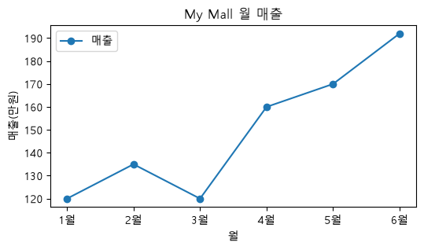
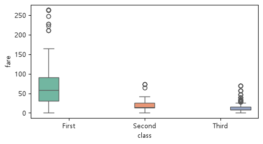

# [YBST] 26년11월24일 TIL
## 1-1. AI 요약│맷플롯립 기초 실습과 USA Housing 데이터 준비
## Action Items

- [ ]  수강생 전원: Slack에 공유된 USA Housing Kaggle 데이터셋을 다운로드해 `데이터셋` 폴더에 넣기
- [ ]  강사: 박스 플롯에서 수치가 살짝 어긋나 보이는 문제를 확인하고 다시 설명하기

## Open Questions

- 박스 플롯의 수치가 왜 어긋나 보이는가?
    - 여러 수강생이 같은 증상을 확인했다. 강사는 "확인을 해보고 말씀을 드릴게요"라고 했다. 글꼴 크기 문제인지 시도했지만 같은 결과가 나왔고 원인은 나오지 않았다.

## Summary

### 실습 환경 설정

- 새 노트북 `02` 파일을 만들고 Python 커널을 선택했다.
- `numpy`(np), `pandas`(pd), `seaborn`(sns), `matplotlib.pyplot`(plt)을 import했다.
    - seaborn은 맷플롯립 위에서 통계 그래프를 더 쉽게 그려 주는 라이브러리라고 설명했다.
- `pyplot` import를 빠뜨려서 `subplots`가 동작하지 않았고, 이후 추가해 해결했다.
- 한글 폰트는 `plt.rc`로 전역 설정했다. Windows는 맑은 고딕, Mac은 애플 고딕이며 둘 중 하나만 설정하면 된다.
- 자동완성이 안 되는 Windows 사용자는 Ctrl+Shift+P로 Reload Window를 실행하도록 안내했다.

### Figure와 Axes 개념

- Figure는 차트의 바탕이 되는 캔버스이고, 가로·세로 크기를 인치로 정한다.
- Axes는 캔버스 위에 그림을 그리는 차트 단위다. 차트가 하나면 `ax` 하나로 충분하다.
- `plt.subplots`는 `fig`와 `ax`를 튜플로 함께 반환한다.
    - 한 수강생(지혜님)이 이해가 안 된다고 하자 다시 설명했다.
    - 캔버스 안에 그림을 그리려면 축이 필요하다. 그래서 `subplots`가 `figsize`와 axes 개수의 기본값(1개)으로 둘을 초기화해 반환한다고 설명했다.

### 선 그래프 실습

- 월 6개(1~6월)와 매출액 리스트(135, 120, 160, 170, 192 등)로 만들었다. 단위는 만원이다.
- `ax.plot`에 `marker="o"`와 `label="매출"`을 넣었다.
- `ax.legend()`로 범례를 표시했다.
- `ax.set_title`로 제목, `set_xlabel`과 `set_ylabel`로 축 이름을 달았다.
- `plt.show()`를 호출해야 차트가 출력된다.

### 산점도와 박스 플롯 (Titanic 데이터)

- 2x3 subplots 구성을 시도했다.
- 산점도는 Titanic 데이터의 나이(x축)와 요금(y축)으로 그렸다. 점 크기 `s`와 투명도 `alpha=0.6`을 설정했다.
    - `ax.set()`으로 x·y 레이블을 한 번에 지정하는 방법도 보여 줬다.
- 노트북 `02`에서 `df`가 없다는 에러가 난 수강생들은 `01` 노트북에서 데이터를 불러오도록 안내했다.
- 파이 차트도 잠깐 시도했다. 수치가 애매해서 후반부에 다시 다루겠다고 했다.
- 박스 플롯은 x축을 클래스, y축을 요금으로 그렸다. `hue`는 클래스로 정하고 팔레트는 `Set1`/`Set2` 계열을 썼다.
    - 25%, 50%, 75% 구간과 IQR을 벗어난 이상치를 볼 수 있다고 설명했다.
    - 실습 중 커밋을 해 두어서 따라오지 못한 사람이 확인할 수 있게 했다.

### 선형회귀 준비

- 오늘은 선형회귀를 진행한다고 안내했다. 어제 만들던 `02` 노트북은 삭제하도록 했다.
- 데이터셋은 Kaggle의 USA Housing이다. 주택 가격, 침실 수, 범죄율 등이 들어 있고 머신러닝 학습에 많이 쓰인다.
- 강사가 Slack에 파일을 올려 주기로 했고, 수강생은 `데이터셋` 폴더를 만들어 CSV를 드래그해 가져오도록 했다.
    - 이후 pandas로 CSV를 불러와 분석할 예정이다.
- 10분 휴식 후 재개했다.

---

## 1-2. AI 요약│머신러닝 수업: 데이터 로딩부터 선형회귀 기초까지
## Action Items

- [ ]  수강생: 실습 코드를 레포지토리에서 받아 따라 하기 (소유자 불명확, 강사가 커밋 후 레포 주소를 질문 채팅방에 공유함)
- [ ]  수강생: 휴식 후 12분에 수업 재개

## Decisions

- 이후 선형회귀 실습은 직접 만든 더미 데이터로 진행하기로 함
    - 정답 규칙을 직접 정할 수 있어서, 학습한 모델이 그 규칙에 맞는지 확인하기 좋기 때문
- 난수 seed는 42로 고정했다가, 시연 중 40으로 바꿈
    - 모두가 같은 결과를 보기 위해서

## Open Questions

- 더미 데이터로 만든 `office` 데이터프레임에서 실제 선형회귀 학습은 어떻게 진행할까?
    - 데이터 생성까지만 끝나고 휴식에 들어감. 학습 단계는 휴식 후 이어질 예정으로 보임

## Summary

### 데이터 로딩과 필터링

- 판다스 수업에서 못 다룬 `pd.read_csv` 로딩을 이번 머신러닝 수업에서 진행함
    - `read_csv` 외에도 클립보드, 엑셀, html, json 등 다양한 포맷을 지원함
- 경로 문제로 일부 수강생이 파일을 불러오지 못함
    - 폴더명이 `datasets`(s 포함)였고, 개발자 창 리로드 후 `run all`로 해결함
- 로딩 결과 `house`는 300행, 10열이며 맨 앞 인덱스는 0~299가 자동으로 붙음
- 건축연도 2015년 초과, 범죄율 40% 미만 조건으로 필터링해 `small`을 만듦
    - 결과는 10행이었음
    - 강사가 코드를 커밋했고 레포 주소를 질문 채팅방에 올림

### 산점도와 상관계수

- 면적(`square feet`)과 가격(`price`)으로 전체 300채와 `small` 10채의 산점도를 그림
    - 전체는 알파 0.4, `small`은 빨간색에 크기 50으로 표시함
    - 면적 단위는 피트 대신 평 개념으로 보라고 안내함
- `corr()`로 상관계수를 계산함
    - 전체 300채는 0.08로, 거의 관계가 없음
    - `small` 10채는 0.89로, 강한 양의 상관관계임
- `small` 데이터는 상관계수를 보여주려고 억지로 만든 데이터라고 설명함
- 우하향이면 강한 음의 상관관계, 고르게 퍼지면 상관관계 없음으로 판단함
- 상관관계가 높아도 면적이 넓을수록 가격이 높다고 100% 보장하는 것은 아님

### 선형회귀 개념

- 선형회귀는 데이터에 가장 잘 맞는 직선의 기울기를 찾아 새 값을 예측하는 가장 기초적인 학습법임
    - 직선을 움직이면서 빨간 선으로 표시된 오차값이 어떻게 변하는지 시연함
    - 이 과정을 사람이 수작업으로 하지 않고 기계에게 학습시킴
- 수식 표기를 일차방정식과 연결해 설명함
    - 수학에서는 `y = ax + b`(기울기 a, 절편 b)임
    - 머신러닝에서는 `y_hat = wx + b`로 쓰며, w는 기울기(가중치), b는 편향임
    - 겁먹지 말고 같은 일차방정식으로 보라고 당부함

### 더미 데이터 생성

- numpy `default_rng`로 난수를 만들고, seed를 고정하면 항상 같은 난수가 나옴
    - seed를 40으로 바꾸니 다른 값이 나왔고, 수강생 결과도 같았음
- `uniform`으로 20 이상 85 미만 범위에서 면적 200개를 뽑음
- 가격은 `w = 450`, `b = 5000`으로 `price = area * 450 + 5000`을 만든 뒤 정규분포 노이즈를 더함
    - 노이즈는 `rng.normal`로 만들고, 표준편차 2500, 개수 200으로 설정함
    - `round(-1)`로 소수점 이하를 정리함
- 학습을 방해하는 특이 매물 5건을 추가함
    - `rng.choice`로 200개 중 5개를 `replace=False`(중복 없음)로 뽑음
    - 해당 5건의 가격은 `uniform`으로 1억 5천~2억 5천 범위 값으로 바꿈
        - 실제 수치(예: 150000~250000)는 전사가 불명확함
- `area`와 `price`로 `office` 데이터프레임을 만들고 `describe()`로 확인함
    - count 200, 평균, 사분위, max에 이상치가 나타남

### 휴식

- 휴식 후 12분에 재개하기로 하고, 마무리 전에 커밋을 한 번 더 하겠다고 안내함

---

## 1-3. AI 요약│오피스텔 시세 데이터 생성과 선형 회귀 실습
## Action Items

- [ ]  수강생 전체: 점심 후 오후 수업에서 새 매물 가격 예측과 예측 결과 차트 그리기 실습 진행 (owner not stated)

## Decisions

- scikit-learn(`sklearn`)으로 선형 회귀 모델을 학습하기로 함
    - 복잡한 수학 알고리즘을 직접 구현하지 않아도 되고 API가 체계적이어서, 요즘 거의 다 사용한다고 설명함
- 새 매물 가격 예측과 차트 그리기는 오전이 아니라 오후 수업에서 진행하기로 함
    - 남은 시간이 애매해서 점심 후에 한 번에 진행하기로 함

## Summary

### 난수 기반 더미 데이터 생성 설명

- RNG는 난수 생성기이며, seed 값이 같으면 언제 실행해도 같은 난수가 나옴
    - 완전한 무작위가 아니라 내부 수학 알고리즘으로 만든 숫자임
    - 이번에는 seed를 40번으로 바꿨음
- 선형 회귀 공식 y = w * x + b와 비슷하게 데이터를 만듦
    - area가 x, 기울기 w는 450, 절편(편향) b는 +5000
    - `uniform`은 범위 안의 값을 고르게 뽑음
    - `normal`은 평균 0, 표준편차 2500인 오차(노이즈)를 더함
- 오차를 주는 이유: 없으면 점들이 완벽한 직선으로 모임
- `choice`로 200건 중 5건을 중복 없이(replace=False) 뽑아 가격에 15000~25000 사이 값을 더해 특이 데이터를 만듦
- area와 price를 묶어 DataFrame으로 만듦

### CSV 저장과 산점도

- `to_csv`로 `./datasets/office.csv`에 저장함
    - `index=False`를 쓰지 않으면 열이 하나 더 생김
    - 저장 후 확인했을 때 area와 price 두 열만 있음
- matplotlib으로 오피스텔 시세 200건 산점도를 그림
    - figsize는 8x5 안팎, alpha 0.6, x축 area, y축 price, 제목과 라벨 추가
    - 절편 5000 부근을 지나는 추세가 보이고, 특이 데이터도 눈에 띔

### 상관계수 확인

- area와 price의 상관계수는 0.89로 높게 나옴
- 강사는 "상관계수가 높다고 해서 반드시 인과관계가 있는 것은 아니라는 것을 주의하셔야 됩니다"라고 강조함

### scikit-learn 설치와 소개

- `uv add scikit-learn`으로 패키지를 설치하고, 설치 후 Developer: Reload Window를 실행함
- import 구문은 `from sklearn.linear_model import LinearRegression`
- scikit-learn은 Python 머신러닝 오픈소스 라이브러리임
    - 회귀, 분류, 군집 알고리즘을 제공함
    - 정규화, 표준화 같은 전처리와 모델 성능 평가 기능도 제공함

### 선형 회귀 모델 학습

- `LinearRegression()` 모델을 만들고 `fit(X, y)`로 학습함
    - 대문자 X는 입력값(area), 소문자 y는 정답(price)
- 처음에는 리로드 때문에 `office` DataFrame이 연결되지 않아 Restart 후 Run All로 해결함
- 처음 에러는 X를 1차원으로 넣었기 때문이며, X는 2차원 데이터로 넣어야 함
- 학습 결과는 `coef_`(기울기)와 `intercept_`(절편)로 확인함
- 정답은 기울기 450, 절편 5000이었고 학습 결과는 기울기 약 439, 절편 약 5916임
    - 강사는 오차가 조금 있지만 최적에 가까운 결과라고 설명함

### 진행 상황과 오후 계획

- 학습된 직선을 앞서 그린 산점도에 겹쳐 그리는 작업은 시간이 애매해 이어서 하지 않음
- 오전 수업은 scikit-learn 학습까지 마치고 종료함

---

## 1-4. AI 요약│선형회귀 모델 정확도 평가 실습
## Action Items

- [ ]  수강생 전원: 오늘 안내된 과제를 수행 (강사가 곧 전달 예정, 내용과 기한은 언급되지 않음) (owner not stated)

## Decisions

- 모델 정확도 판단의 핵심 지표로 R2 score를 사용하고, MAE·MSE·RMSE는 의미 이해 수준까지만 다룸
    - 오차 지표 숫자만으로는 예측이 좋은지 판단하기 어렵지만, R2 score는 0~1 사이 값이라 1에 가까운지로 바로 판단할 수 있음

## Open Questions

- 현우님의 실습 환경 문제는 완전히 해결되었는가?
    - 강사가 "그 뒤로 되셨다고요?"라고 확인했지만, 일부 셀만 안 된다는 답변 후 셀을 지우고 다시 실행하는 정도로 끝나 최종 해결 여부가 불분명함
- 학습 초반 모델이 선형 모델이 아니라고 표시되는 문제는 무엇 때문인가?
    - 강사가 "확인을 해봐야겠네요"라고만 했고 이후 결론은 나오지 않음

## Summary

### 오차 지표 개념 설명

- 시세 예측 모델과 차트를 만든 뒤, 실제로 얼마나 정확한지 지표로 확인하는 단계로 진행함
- 설명한 지표는 다음과 같음
    1. MAE(평균 절대 오차): 오차의 절댓값을 취해 평균을 낸 값. 작을수록 정확하고, 튀는 값에 덜 흔들림  
    2. MSE(평균 제곱 오차): 오차를 제곱해 평균을 낸 값. 작을수록 좋지만 단위가 제곱이라 직관적으로 읽기 어려움  
    3. RMSE: MSE에 루트를 씌워 원래 단위로 되돌린 값. 대략적으로 확인하기 좋은 수치 
    4. R2 score: 평균으로 찍는 것에 비해 오차가 얼마나 줄었는지를 보여주며, 1에 가까울수록 최고 수준  
- 오차를 더하면 플러스와 마이너스가 상쇄되어 0이 되기 때문에 절댓값을 사용한다고 설명함

### scikit-learn으로 지표 계산

- numpy로도 계산할 수 있지만 수학적으로 복잡해, `sklearn.metrics`의 함수들을 사용함
- mean_absolute_error, mean_squared_error, root mean squared error, r2_score를 가져와 실제값과 예측값(`y_predict`)으로 출력함
- 전체 200건 기준 R2 score는 0.803이며, 0.95는 아니지만 "준수한 예측률"로 해석함

### 특이 매물 제거 전후 비교

- 학습 데이터에 특이 매물 5건이 섞여 있어 정확도가 떨어질 수 있다고 보고 제외 후 재평가함
- 전체 200건과 정상 195건을 구분하기 위해 불리언 마스크(`all_rows`, `normal`)를 만들고, 특이 매물 인덱스를 False로 설정함
- for 루프로 두 경우의 MAE와 RMSE를 비교함
    - 코드에서 `y_predict` 대신 `y_hat` 값을 써야 하는 오류를 수정함
    - MAE는 차이가 약 400 정도로 크지 않았음
    - RMSE는 거의 두 배 차이가 나서, 튀는 데이터가 결과를 크게 흔든다고 설명함
    - 회귀분석에서는 잘못된 데이터 몇 건이 치명적일 수 있다고 강조함
- R2 score는 0.803에서 약 0.9(90%)로 상승함

### 다음 수업 안내

- 내일은 경사하강법을 다루며, 미분을 아주 간단히 설명할 예정
- 지도학습 중 분류(classification)를 진행하고, 첫날 사용한 타이타닉 데이터로 실습함
- 오늘 과제가 있으며 곧 전달될 예정이고, 이후 잠시 휴식함

---

# 1교시│”02_ml.ipynb” Editor 창 코드진행 흐름파악

```python
import numpy as np
import pandas as pd
import seaborn as sns # 통계 그래프 라이브러리
import matplotlib.pyplot as plt

# 한글 폰트 설정
plt.rcParams["font.family"] = "Malgun Gothic" # Windows OS

# Figure(캔버스), Axes(그래프)
fig, ax = plt.subplots(figsize=(6, 3))
# x축 데이터 (월)
months = ["1월", "2월", "3월", "4월", "5월", "6월"]
# y축 데이터 (매출액)
sales = [120, 135, 120, 160, 170, 192]

# 선 그래프
ax.plot(months, sales, marker="o", label="매출")
ax.set_title("My Mall 월 매출")      # 그래프 제목
ax.set_xlabel("월")
ax.set_ylabel("매출(만원)")
ax.legend()                         # 범례 표시
plt.show()                          # 차트 그리기
```



# 1교시│”01_ml.ipynb” Editor 창 코드진행 흐름파악

```python
import numpy as np
import pandas as pd
import seaborn as sns # 통계 그래프 라이브러리
import matplotlib.pyplot as plt

fig, ax = plt.subplots(figsize=(6, 3))

sns.boxplot(x="class", y="fare", data=df, ax=ax, hue="class", palette="Set2", legend=False)

# 산점도
# 점을 찍어서 분포된 것을 보는 그래프이다.
# ax.scatter(df["age"], df["fare"], s=12, alpha=0.6)
# ax.set_title("산점도")
# ax.set(xlabel="나이", ylabel="요금")
```

- <Axes: xlabel='class', ylabel='fare'>



---

# 1교시│dataset 폴더 생성 후 ”usa_housing.csv” 복/붙 Editor 창 코드진행 흐름파악

```python
Price,Bedrooms,Bathrooms,SquareFeet,YearBuilt,GarageSpaces,LotSize,ZipCode,CrimeRate,SchoolRating
221958,1,1.9,4827,1979,2,1.45,82240,48.6,5
771155,2,2.0,1035,1987,2,1.75,74315,92.03,9
231932,1,3.0,2769,1982,1,1.46,79249,52.08,3
465838,3,3.3,2708,1907,3,1.62,80587,61.65,1
359178,4,3.4,1175,1994,2,0.74,20756,15.66,4
744167,1,3.4,4330,1920,0,1.65,78011,4.37,9
210268,1,1.3,3435,1980,2,0.25,46378,11.08,4
832180,2,2.5,2370,1986,0,1.8,14255,59.85,2
154886,2,1.2,3360,2000,1,1.14,24484,9.5,5
737147,3,2.6,4191,2017,0,1.65,66549,37.6,3
621430,4,2.3,3765,1979,2,0.96,44503,55.01,9
187498,2,3.7,4443,1969,2,1.32,83794,38.87,4
999159,1,2.1,4650,1971,2,1.1,55113,16.37,6
275203,4,1.4,1672,1924,1,1.49,84069,27.38,2
291335,4,1.4,2052,1981,1,0.26,15249,92.83,6
378167,1,3.3,2114,1988,3,0.21,29201,67.6,3
141090,2,2.9,3698,1911,2,0.57,68576,49.6,9
429365,1,1.3,877,1914,0,0.4,19686,1.27,2
164820,4,1.3,3421,1958,1,1.76,63363,99.24,9
887201,5,3.1,1400,1925,2,0.52,10661,67.15,5
421879,5,1.2,1865,2004,2,1.95,54843,31.69,8
818315,3,3.5,2936,2008,1,0.74,70963,87.93,2
427069,1,3.1,3249,1925,3,0.45,52828,25.84,6
876997,1,1.2,3143,1946,1,1.6,58604,54.4,3
299041,3,1.3,2663,1931,1,1.35,20526,63.61,5
891743,3,4.0,2118,1909,0,1.05,78910,22.11,8
203355,3,2.1,4397,1915,0,1.16,35592,97.84,1
335796,4,2.1,4562,1970,3,1.47,38982,74.82,5
314176,1,3.4,2990,1916,2,0.53,10207,55.78,3
284779,4,3.8,1792,1922,1,1.99,98733,18.06,4
447449,3,4.0,3512,1925,3,1.95,78619,5.39,2
521909,1,3.3,2992,1984,0,1.34,39328,32.01,9
358795,4,2.1,2048,1985,1,0.48,56479,75.32,3
586232,4,1.3,3854,2021,2,1.39,30103,26.93,2
600186,3,3.3,4833,1906,0,0.24,49891,53.96,9
256730,1,2.7,2797,1913,0,0.16,20754,72.79,7
970910,3,2.3,4487,1978,0,0.59,91437,10.79,6
484681,1,3.7,2951,2016,3,0.98,82982,68.53,1
249503,5,1.3,4818,1906,2,1.75,65922,9.19,5
754811,2,2.5,3910,1908,1,1.48,58231,96.51,3
627035,2,1.0,2770,2014,3,1.51,39301,48.84,1
748143,2,2.4,997,1947,3,0.91,72711,15.07,4
552366,3,1.2,3426,1971,3,0.76,51323,34.24,2
165725,5,1.4,2002,2013,0,0.8,28752,41.34,2
229981,1,1.4,2835,1958,2,1.98,92205,75.82,3
184654,4,2.9,1277,1986,3,0.18,23395,74.34,8
691723,1,3.2,2054,1992,1,1.75,95957,61.19,8
419030,4,2.8,1722,1981,2,1.2,66273,10.59,7
428947,1,3.9,1219,1994,1,0.93,14895,15.16,6
655839,5,2.1,3004,1993,2,1.48,86559,9.38,9
373538,4,1.9,3397,2015,1,1.02,20699,57.72,4
431236,3,3.6,1920,1938,0,1.76,75061,87.71,1
628178,1,1.7,3868,1998,3,1.81,19715,43.38,8
665894,1,3.9,1750,1917,1,0.9,29169,16.08,7
589492,4,1.0,3136,1958,2,0.63,26163,55.8,7
356840,3,3.9,3043,2005,3,1.23,15782,81.18,3
573254,3,1.1,3445,2002,3,1.83,98177,74.17,4
449457,5,3.7,2657,1916,2,0.5,94328,88.15,9
765987,3,2.6,2665,1913,1,1.28,45585,27.79,6
370936,3,4.0,3712,1930,0,1.3,40682,19.4,5
339931,3,1.2,3653,1923,0,1.49,57864,87.98,3
339629,2,2.7,4028,1998,1,0.35,94416,65.76,9
305041,5,3.9,4519,2007,3,1.46,65114,31.09,5
798361,1,2.6,4028,1959,3,1.83,48067,74.23,5
831912,4,2.9,3171,1944,3,0.44,52685,81.51,4
517113,1,3.1,3691,1997,3,0.55,28073,61.5,4
168148,5,2.4,4556,1902,1,1.95,46035,68.79,1
877089,4,2.9,894,1936,3,0.44,74977,37.53,7
748531,5,2.8,3474,1942,2,1.72,93362,53.87,9
351995,3,3.7,2755,1939,3,1.04,75450,52.42,3
778843,4,1.1,1593,1989,0,0.57,20382,84.8,2
672843,3,1.8,2634,1954,3,1.75,14437,84.0,3
356508,1,3.9,2916,1986,1,0.95,80971,83.27,1
903591,1,3.7,4906,2007,0,1.08,74612,1.1,6
996942,4,2.4,4125,1938,1,0.78,71929,74.95,7
206530,4,2.9,3719,1914,1,1.23,22329,75.87,2
704365,5,1.8,3397,2019,0,0.41,35169,67.84,8
922352,5,1.6,4005,2012,1,0.84,97468,75.63,6
560337,3,2.4,1614,1903,1,1.94,44594,84.2,4
824839,4,2.1,1145,1992,3,0.59,86957,47.03,5
905889,1,2.8,3149,1985,2,1.35,70631,50.21,8
559773,5,1.2,1162,1924,1,0.72,55033,12.47,3
308261,5,3.9,3243,1912,1,1.57,73133,38.54,3
864469,1,4.0,3065,1981,1,0.35,83165,64.34,4
441097,5,3.1,2988,1932,3,1.94,83861,78.04,1
415139,3,2.6,3805,1915,2,0.96,62290,21.72,9
271829,4,1.9,4081,2008,0,0.55,41750,13.78,8
371836,1,3.4,1784,1941,3,0.24,50461,66.3,8
538974,4,3.1,2439,2007,3,0.42,83800,0.19,6
302283,5,1.5,1627,1965,2,1.09,88222,17.84,7
296769,5,3.7,3530,1954,2,0.74,34226,2.91,6
661353,1,3.5,4331,1998,3,1.67,16721,16.69,9
323165,3,3.8,3735,1941,0,0.92,66154,18.13,3
723587,2,3.2,4676,1933,3,0.57,30609,38.77,3
635822,1,2.8,926,1929,2,1.27,62130,40.23,3
587879,2,2.3,3977,2022,0,1.44,82909,87.43,3
664685,2,3.8,3856,2018,2,0.42,65249,51.01,9
882038,3,3.6,1403,1912,0,0.42,58895,72.34,4
453531,2,1.1,4249,1912,1,0.17,15656,10.41,7
363160,2,1.1,4946,1917,2,1.5,84520,22.54,9
679879,3,2.1,4333,1931,2,1.36,73740,70.29,7
320884,2,3.4,4167,1995,3,1.0,74309,5.28,9
123247,2,4.0,4168,1998,2,1.7,39984,48.66,3
124300,2,1.5,4597,2022,2,1.63,83822,59.94,4
567281,1,2.8,2592,1938,1,1.21,15901,60.21,8
707086,1,2.1,3661,1945,2,1.75,41552,2.29,6
633556,1,3.9,4276,2015,1,0.49,41055,32.21,5
448951,3,3.5,4217,1928,1,0.31,47685,63.65,4
374329,5,3.5,2445,1961,1,0.61,83965,14.9,8
819064,2,2.4,2005,2012,1,0.21,24716,69.54,1
842139,2,2.2,3830,1992,0,1.11,21138,74.59,9
532315,3,1.8,3672,1961,3,1.88,45298,98.2,1
616588,2,1.2,3872,2016,0,0.17,61112,20.98,8
336584,1,3.6,2654,2007,2,0.33,33429,82.51,4
662332,5,3.4,4821,1956,0,0.96,60200,52.03,9
937646,4,4.0,3508,1915,0,1.87,81308,37.35,5
476896,2,4.0,4302,1955,2,0.7,58244,12.24,3
148984,1,2.7,2132,2007,2,1.06,27347,73.55,9
402918,4,3.3,1001,2010,2,0.18,26920,23.59,9
979858,5,3.8,4307,2020,0,0.38,41822,37.14,4
220151,4,3.5,1374,1909,0,1.97,56659,6.25,4
555808,1,1.7,1336,1929,2,1.93,50108,80.14,8
233767,4,2.4,2425,1924,3,0.11,99099,76.66,2
748663,3,1.4,2922,2002,3,1.91,17967,73.36,9
803550,4,3.9,1185,1983,1,1.31,21871,29.94,6
236330,2,2.8,4081,1904,2,1.75,87452,17.35,9
580754,2,1.7,1274,1964,1,0.96,84270,63.76,8
401648,3,3.0,1217,1993,3,1.08,43613,49.62,7
788519,1,2.9,4400,1948,1,1.03,38179,17.83,1
113986,2,2.1,1754,1902,2,1.37,62188,68.59,3
686146,5,1.3,2005,1944,2,0.37,65099,99.11,2
229312,2,3.0,4920,1913,2,0.16,45262,74.72,5
112666,2,2.6,2790,2019,0,0.69,88213,74.0,5
400804,1,3.3,4372,1929,1,1.44,28268,95.03,5
234633,4,2.6,4958,2013,3,0.48,87866,20.29,4
388998,2,3.6,3513,1967,3,1.38,96269,56.55,5
950937,3,2.7,3003,1917,3,1.94,70545,97.96,3
728776,4,2.7,3920,1961,0,0.28,82146,16.53,1
807611,5,3.6,1766,1936,0,1.38,81966,70.03,5
384806,1,2.2,4232,1924,2,0.94,49922,58.58,9
894824,5,1.4,1488,1947,3,1.75,89364,58.65,9
130535,4,1.1,4501,1964,0,0.44,52913,69.77,4
475713,4,3.3,1141,1952,2,1.42,65677,92.96,3
938688,4,2.9,2524,2009,3,1.69,59841,78.26,1
451279,5,3.1,2592,1978,1,1.89,56332,5.61,2
921654,4,1.6,2559,1972,2,1.4,35032,85.27,8
701661,5,1.4,4012,1914,0,1.04,47846,22.55,1
747972,4,1.0,1789,1948,0,1.27,69474,37.69,8
589570,3,2.1,3062,2020,2,1.75,54936,46.17,7
556551,4,2.8,3282,1987,2,1.18,39794,48.09,8
373109,5,2.2,1751,1967,0,0.16,71588,43.52,6
124538,2,2.3,1522,1911,1,1.87,80984,93.74,9
994498,4,3.7,4189,1958,3,1.41,60331,70.6,3
301664,2,2.0,2879,2021,1,1.39,38141,63.12,4
591234,3,2.5,3517,1936,2,0.51,19074,4.98,6
999684,1,3.4,3132,1960,1,1.35,16406,90.39,8
239182,3,2.2,4176,2000,0,0.85,33291,90.94,5
572525,4,2.9,2300,1942,2,1.34,51568,78.02,3
258338,2,3.6,1085,1969,3,0.3,56851,0.7,6
284064,2,3.8,4295,1938,0,1.35,64823,5.73,4
314020,5,1.4,2865,1955,0,2.0,33312,22.52,9
723094,2,3.8,1568,1962,3,0.19,53108,13.13,3
997421,5,2.5,3857,1945,3,1.96,76918,39.88,4
715270,1,1.8,2961,1987,1,0.87,44171,92.26,7
745914,4,2.4,4093,1910,2,1.75,51779,47.21,7
219176,5,3.9,1746,1961,3,1.59,78828,1.34,4
318126,1,2.5,4135,1976,3,1.18,22411,28.27,6
318969,2,2.0,4950,1997,2,1.5,67009,4.46,3
222409,2,2.9,2281,1924,3,1.77,25422,3.63,6
647707,1,1.7,2701,1970,3,0.87,52468,27.57,2
353618,2,1.2,4251,1951,1,0.72,42371,27.56,8
869598,1,1.4,4864,1903,0,1.37,67022,78.71,2
150015,5,1.4,854,1958,0,1.63,81229,97.48,7
872838,5,1.5,2623,1971,0,1.55,61196,37.12,9
222096,1,1.4,4262,1919,0,1.62,90354,42.89,1
731347,5,2.9,3879,1992,3,0.93,36715,84.48,8
285340,5,1.5,1632,1962,2,1.65,37605,26.81,7
210687,5,2.0,3606,1953,2,0.33,41174,15.64,6
974371,3,3.7,3290,2016,1,1.13,19956,85.31,6
511357,4,2.4,1127,2014,1,0.11,86373,4.65,6
835716,2,3.0,4110,2008,3,0.72,79252,61.97,9
205878,3,1.5,4100,2009,2,0.8,71949,56.2,2
827270,5,1.6,4475,1973,2,0.85,72646,34.59,1
298286,1,1.1,3854,2006,0,1.42,80017,31.52,6
873290,5,1.5,2943,1997,3,0.84,73037,77.19,8
874684,4,1.8,2111,1956,3,0.95,99818,8.64,3
264899,5,1.5,3991,1989,0,0.55,16548,23.68,1
424767,1,1.3,3338,1940,3,0.81,83294,73.24,9
961882,4,1.4,4783,2012,3,0.53,33177,54.83,1
161087,5,2.4,964,2021,1,0.24,34022,12.8,3
479989,4,1.6,1622,1902,2,1.25,15542,88.21,8
175766,2,2.1,1743,2019,3,1.37,70428,39.34,3
143585,2,2.5,1574,1905,1,1.28,32740,82.79,4
471369,5,3.1,2998,1904,2,0.98,69353,78.77,8
164044,4,1.1,3956,1904,0,0.82,66532,62.44,1
542296,1,3.4,4495,1953,1,1.74,26052,49.45,6
209556,5,2.9,4252,1946,1,1.09,57076,97.96,1
626981,2,1.2,1714,1986,2,1.01,63420,14.5,1
981691,2,3.6,2108,1948,0,0.15,10671,72.52,8
867595,5,3.8,4977,1908,1,0.75,10163,19.12,4
300235,4,1.2,1313,1998,3,0.82,51424,33.83,1
125939,2,1.8,2720,1919,3,0.86,63744,30.87,7
252906,4,3.4,4394,2021,3,1.2,80331,94.7,5
642335,2,3.2,2209,2012,0,1.11,20634,96.74,5
388249,2,1.6,3990,1960,1,1.26,14798,18.3,1
237337,3,1.6,2355,2022,3,1.55,32420,2.2,6
508923,2,2.1,1604,2005,0,1.64,39300,72.0,9
515192,1,2.5,2079,1934,3,1.46,99881,41.8,9
668550,5,2.9,4377,1949,2,1.92,20749,8.88,8
487261,5,2.1,3701,1981,1,0.13,35121,68.38,5
910208,4,2.4,2187,1961,1,0.47,47487,54.51,1
785440,2,3.2,3561,1916,0,0.11,43361,98.05,9
752664,1,1.1,3479,1987,0,1.33,31223,22.74,1
554589,4,1.8,2906,1902,1,1.81,82930,40.4,8
237848,3,3.1,3568,1931,3,0.56,24056,54.25,5
717075,4,3.7,4753,1998,3,1.86,38380,79.17,3
227948,4,2.5,3986,2001,2,0.21,36035,54.88,7
679304,2,2.6,4080,1912,3,1.88,40620,61.29,7
364712,3,1.3,3373,2019,0,0.77,29877,22.61,9
599046,4,2.3,3399,2010,0,0.29,65316,84.69,7
551269,1,2.6,4833,1988,3,1.02,74041,42.86,3
121959,1,1.7,1036,1972,0,0.59,63352,14.1,1
760890,5,1.8,2104,1967,1,0.64,40911,66.42,8
850216,3,2.1,4230,1913,1,0.68,42784,21.61,3
890180,3,1.1,2101,2000,3,1.63,13191,9.76,8
328576,5,2.0,3341,1997,1,1.12,43160,86.2,8
637833,4,1.6,2851,1910,1,0.69,74641,46.02,5
265838,3,2.0,1241,2004,2,1.26,59723,74.93,1
435674,1,1.4,2876,1955,2,1.46,13631,29.06,7
979989,1,3.7,3980,1966,1,0.62,16172,78.7,5
502690,2,2.8,3457,2022,3,0.89,52080,11.19,8
693128,3,3.0,4598,1991,2,0.33,99097,35.6,9
218451,4,3.4,1604,1928,0,0.44,30281,97.81,7
547600,5,2.5,874,1908,0,1.39,38671,79.4,7
937437,5,1.3,2975,1966,0,0.44,61431,49.73,1
539792,4,2.6,4724,1924,3,1.1,38602,33.98,4
139353,2,2.8,2889,1997,1,1.45,98789,87.21,2
293075,5,3.2,840,1975,0,0.3,61399,54.48,2
314283,3,2.3,2881,1941,3,1.18,33472,75.84,2
414877,2,1.4,2422,1908,2,0.59,59230,75.41,4
165318,3,1.9,1141,1978,1,1.93,83616,1.79,1
865313,1,2.1,4852,1939,2,1.02,17099,12.63,4
582690,2,2.9,2874,1924,3,1.63,35431,65.96,2
516880,5,2.7,1445,1904,0,1.15,66492,16.16,5
691460,2,2.1,1409,1910,0,0.18,57684,25.55,3
840976,2,4.0,1254,1958,3,1.3,40111,94.66,8
881239,2,2.8,3753,1997,0,1.91,73936,56.02,4
193264,2,1.7,2508,1987,1,1.24,32614,75.07,1
870746,3,1.3,4272,1978,3,1.66,51991,55.8,1
913168,1,1.5,3769,1937,2,1.78,80476,55.25,3
325281,4,1.7,3828,1971,3,0.53,70920,9.42,9
515515,2,1.5,3481,2022,1,0.5,73530,34.37,7
998613,5,1.6,4429,1904,1,1.26,46224,28.24,2
494070,2,1.9,3867,1947,3,0.88,17788,39.07,9
452228,5,1.5,2186,1989,3,1.7,38082,79.83,2
531839,3,3.7,4576,1917,0,1.81,99570,37.19,3
369536,5,1.2,3666,1969,1,0.77,86816,45.17,2
417824,4,2.6,4163,1936,3,0.55,93588,39.74,3
357426,1,2.2,4924,1959,3,1.58,26531,9.34,6
277789,5,3.9,948,1947,1,0.62,98340,44.11,9
613153,5,1.3,4650,1976,3,1.66,54857,19.56,9
842452,1,2.2,2858,1927,0,0.91,20142,18.67,7
937291,4,3.9,1936,1968,1,1.37,58355,9.4,3
225657,2,3.6,986,1976,0,0.28,19866,35.67,4
335167,5,3.5,3654,1980,0,1.29,80067,75.75,6
781669,1,1.8,2050,2013,0,0.96,74027,27.64,5
580671,3,1.5,2133,1939,0,1.21,67906,31.23,2
819094,1,3.0,4993,1944,1,0.42,38138,64.27,6
170467,3,3.8,4950,1995,0,1.5,39956,19.58,3
283734,4,2.7,3511,1961,0,1.74,86295,89.7,8
722794,2,2.7,2585,1992,3,0.51,15439,52.02,2
209751,1,1.8,1550,2014,1,0.28,57241,44.76,1
481050,5,3.3,2562,1957,1,0.14,52533,55.78,9
911774,4,1.6,4720,1966,2,1.32,38270,16.6,3
792517,1,2.0,1281,1955,1,1.25,88815,61.35,1
561079,5,2.3,953,1939,1,1.14,49279,36.31,7
468452,1,2.5,2324,1997,2,0.54,33888,89.72,5
206081,3,1.7,2920,1939,1,0.84,27630,16.89,5
713333,1,1.3,3143,1990,1,1.23,71063,50.71,1
658986,1,2.8,2040,1976,1,1.04,45144,59.81,9
210078,1,1.9,860,2008,1,1.98,62161,3.34,7
967055,4,2.7,1738,1932,2,0.36,87360,36.37,8
122671,1,1.5,2439,1905,1,1.42,60979,73.26,9
518400,5,2.4,4920,1987,1,0.87,16979,82.04,6
455528,3,2.6,4369,1918,2,0.91,36189,31.32,5
710490,3,1.2,2052,1979,3,1.46,52600,79.86,6
151663,1,2.0,971,1939,0,1.42,69560,96.78,2
115708,4,1.4,2258,1991,3,1.98,88040,85.69,4
978338,4,1.2,4349,1996,2,0.34,71558,11.76,3
411955,5,4.0,4997,1958,0,0.3,96205,73.97,7
233883,1,2.0,3122,1958,2,1.48,16910,31.97,9
418394,3,3.4,2436,1947,2,1.2,67713,98.84,5
212547,4,1.8,3915,1940,1,0.62,56857,48.54,6
659042,1,3.0,4890,1912,0,0.25,44964,12.24,2
851102,4,3.3,3804,2006,1,0.26,95667,72.52,3
862002,4,2.8,1129,1944,0,1.8,35227,32.3,3
242483,3,2.4,4440,1988,2,0.46,15978,99.71,9
758271,2,2.2,4694,1952,2,0.71,97527,97.98,7
314835,5,2.0,4907,1941,3,0.53,27153,65.61,8
501896,5,3.8,2141,1999,0,0.77,69765,12.98,9

```

---

# 2교시│”02_ml.ipynb” Editor 창 코드진행 흐름파악

```python
import pandas as pd

house = pd.read_csv("./datasets/usa_housing.csv")
print(house.shape)
house
```

- (300, 10)

| **Price** | **Bedrooms** | **Bathrooms** | **SquareFeet** | **YearBuilt** | **GarageSpaces** | **LotSize** | **ZipCode** | **CrimeRate** | **SchoolRating** |  |
| --- | --- | --- | --- | --- | --- | --- | --- | --- | --- | --- |
| 0 | 221958 | 1 | 1.9 | 4827 | 1979 | 2 | 1.45 | 82240 | 48.60 | 5 |
| 1 | 771155 | 2 | 2.0 | 1035 | 1987 | 2 | 1.75 | 74315 | 92.03 | 9 |
| 2 | 231932 | 1 | 3.0 | 2769 | 1982 | 1 | 1.46 | 79249 | 52.08 | 3 |
| 3 | 465838 | 3 | 3.3 | 2708 | 1907 | 3 | 1.62 | 80587 | 61.65 | 1 |
| 4 | 359178 | 4 | 3.4 | 1175 | 1994 | 2 | 0.74 | 20756 | 15.66 | 4 |
| ... | ... | ... | ... | ... | ... | ... | ... | ... | ... | ... |
| 295 | 862002 | 4 | 2.8 | 1129 | 1944 | 0 | 1.80 | 35227 | 32.30 | 3 |
| 296 | 242483 | 3 | 2.4 | 4440 | 1988 | 2 | 0.46 | 15978 | 99.71 | 9 |
| 297 | 758271 | 2 | 2.2 | 4694 | 1952 | 2 | 0.71 | 97527 | 97.98 | 7 |
| 298 | 314835 | 5 | 2.0 | 4907 | 1941 | 3 | 0.53 | 27153 | 65.61 | 8 |
| 299 | 501896 | 5 | 3.8 | 2141 | 1999 | 0 | 0.77 | 69765 | 12.98 | 9 |
- 300 rows × 10 columns

---

```python
small = house[(house["YearBuilt"] > 2015) & (house["CrimeRate"] < 40)]
small.shape
```

- (10, 10)

---

```python
import matplotlib.pyplot as plt

plt.figure(figsize=(8, 4))
plt.scatter(house["SquareFeet"], house["Price"], alpha=0.4, label="전체 300채")
plt.scatter(small["SquareFeet"], small["Price"], color="red", s=50, label="2015년 이후 건축")
plt.xlabel("면적")
plt.ylabel("가격")
plt.legend()
plt.show()

print("전체 300채의 상관계수:", round(house["SquareFeet"].corr(house["Price"]), 2))
print("10채의 상관계수:", round(small["SquareFeet"].corr(small["Price"]), 2))
```


- 전체 300채의 상관계수: 0.08
10채의 상관계수: 0.89

---

```python
# 시드(seed) : 난수발생시 참고하는 데이터, 동일한 seed 값을 적용하는 항상 동일한 난수가 발생
rng = np.random.default_rng(40)

n = 200
area = rng.uniform(20, 85, n) # 20이상 85미만에서 균등하게 n개만큼 난수 발생
# y = wx + b
# w : 기울기 450
# b : 절편(편향) 5000
price = (area * 450 + 5000 + rng.normal(0, 2500, n)).round(-1)

# 특이 매물 5건
special = rng.choice(n, 5,replace=False) # replace = False 같은 번호를 중복해서 뽑지 않는다.
price[special] += rng.uniform(15000, 25000, 5).round(-1)

office = pd.DataFrame({"area":area , "price":price})
office.describe().round(1)
```

| **area** | **price** |  |
| --- | --- | --- |
| count | 200.0 | 200.0 |
| mean | 52.8 | 29138.4 |
| std | 18.6 | 9112.1 |
| min | 22.0 | 11400.0 |
| 25% | 37.4 | 21615.0 |
| 50% | 52.0 | 28965.0 |
| 75% | 67.4 | 36377.5 |
| max | 84.9 | 58460.0 |

---

# 3교시│”02_ml.ipynb” Editor 창 코드진행 흐름파악

```python
# 파일 저장
office.to_csv("./datasets/office.csv", index=False)
```

```python
# 산점도 차트
# 캔버스(Figure) 생성
plt.figure(figsize=(8,5))
# 산점도 차트
plt.scatter(office["area"], office["price"], alpha=0.6)
# 타이틀과 x, y 레이블
plt.title("오피스텔 시세 200건")
plt.xlabel("면적")
plt.ylabel("가격")
plt.show()

print("상관계수:", office["area"].corr(office["price"]))
```


- 상관계수: 0.8963336215680755

---

```python
from sklearn.linear_model import LinearRegression

X = office[["area"]]
y = office["price"]

# 선형 회기 모델 만들기
model = LinearRegression()
# 학습 : X(입력값) , y(정답)
model.fit(X, y)

print(f"기울기 w = {model.coef_[0]} 정답: 450")
print(f"절편 b = {model.intercept_} 정답: 5000")
```

- 기울기 w = 439.45870417134705 정답: 450
절편 b = 5926.680580056112 정답: 5000

---

# 4교시│”02_ml.ipynb” Editor 창 코드진행 흐름파악

```python
# 33, 59 가격 예측
new = pd.DataFrame({"area": [33, 59]})
model.predict(new).round(-1)
```

- array([20430., 31850.])

---

```python
# 학습한 모델로 예측하기
y_pred = model.predict(X)
line = X.sort_values("area")
line_pred = model.predict(line)

# 실제로 계산기 두들겨서 실제값과 생성된 값을 비교해야 한다.
# 산점도 차트
# 캔버스(Figure) 생성
plt.figure(figsize=(8,5))
# 산점도 차트
plt.scatter(office["area"], office["price"], alpha=0.6, label="실제 시세")
# 모델의 wlrtjs
plt.plot(line["area"], line_pred, color="red", label="모델의 직선")
# 타이틀과 x, y 레이블
plt.title("오피스텔 시세 200건 및 예측")
plt.xlabel("면적")
plt.ylabel("가격")
plt.show()

# MSE : 평균 제곱의 오차
# MAE : 평균 절대 오차
# RMSE : 평균 제곱근 오차
```


```python
# MAE, MSE, RSME, R_SCORE
from sklearn.metrics import mean_absolute_error, mean_squared_error, root_mean_squared_error, r2_score

# MAE: 오차 절대값의 표 평균 -> 평균적으로 얼마만큼 틀리나?
print(f"MAE = {mean_absolute_error(y, y_pred):,.0f}")
# MSE: 오차 제곱의 평균 (단위 제곱)
print(f"MSE = {mean_squared_error(y, y_pred):,.0f}")
# RMSE: 오차 제곱 평균의 루트 (원래 단위)
print(f"RMSE = {root_mean_squared_error(y, y_pred):,.0f}")
# R SCORE : 0 ~ 1
print(f"R_SCORE = {r2_score(y, y_pred):.3f}")
```

- MAE = 2,493
MSE = 16,240,971
RMSE = 4,030
R_SCORE = 0.803

```python
normal = np.ones(len(office), dtype=bool)
normal[special] = False
print("특이매물", special)
print("정상매물", normal.sum())
```

- 특이매물 [53 13  2 92 71]
정상매물 195

```python
all_rows = np.ones(len(office), dtype=bool)
cases = [("전체 200건", all_rows), ("특이매물 제외 195건", normal)]

for name, mask in cases:
    y_true = y[mask]        # 실제 가격
    y_hat = y_pred[mask]    # 예측 가격

    # MAE : 오차 절댓값의 평균
    mae = mean_absolute_error(y_true, y_hat)
    # RSME
    rsme = root_mean_squared_error(y_true, y_hat)
    # R2
    r2 = r2_score(y_true, y_hat)
    print(f"{name} MAE {mae} | RSME {rsme} | RScore {r2}")
```

- 전체 200건 MAE 2492.503948887723 | RSME 4030.0088601264406 | RScore 0.8034139611533421
특이매물 제외 195건 MAE 2075.1039768452683 | RSME 2731.5353914457346 | RScore 0.9023854405903358

---

## 4교시│”02_ml.ipynb” 터미널 창 코드진행 흐름파악

```python
miro2@keon UCRT64 ~/kant_study/03_ML/kant_ml (main)
$ ls
01_ml.ipynb  02_ml.ipynb  datasets/  main.py  pyproject.toml  README.md  uv.lock
(kant-ml) 
miro2@keon UCRT64 ~/kant_study/03_ML/kant_ml (main)
$ ls -al
total 383
drwxr-xr-x 1 miro2 197609      0 Nov 24 11:27 ./
drwxr-xr-x 1 miro2 197609      0 Nov 23 10:31 ../
drwxr-xr-x 1 miro2 197609      0 Nov 23 14:38 .git/
-rw-r--r-- 1 miro2 197609      5 Nov 23 10:33 .python-version
drwxr-xr-x 1 miro2 197609      0 Nov 23 10:35 .venv/
-rw-r--r-- 1 miro2 197609  64536 Nov 24 10:52 01_ml.ipynb
-rw-r--r-- 1 miro2 197609 182785 Nov 24 14:05 02_ml.ipynb
drwxr-xr-x 1 miro2 197609      0 Nov 24 11:19 datasets/
-rw-r--r-- 1 miro2 197609     85 Nov 23 10:33 main.py
-rw-r--r-- 1 miro2 197609    295 Nov 24 11:27 pyproject.toml
-rw-r--r-- 1 miro2 197609      0 Nov 23 10:33 README.md
-rw-r--r-- 1 miro2 197609 125152 Nov 24 11:27 uv.lock
(kant-ml) 
miro2@keon UCRT64 ~/kant_study/03_ML/kant_ml (main)
$ git init
Reinitialized existing Git repository in C:/Users/miro2/kant_study/03_ML/kant_ml/.git/
(kant-ml) 
miro2@keon UCRT64 ~/kant_study/03_ML/kant_ml (main)
$ git status
On branch main
Changes not staged for commit:
  (use "git add <file>..." to update what will be committed)
  (use "git restore <file>..." to discard changes in working directory)
        modified:   01_ml.ipynb
        modified:   pyproject.toml
        modified:   uv.lock

Untracked files:
  (use "git add <file>..." to include in what will be committed)
        02_ml.ipynb
        datasets/

no changes added to commit (use "git add" and/or "git commit -a")
(kant-ml) 
miro2@keon UCRT64 ~/kant_study/03_ML/kant_ml (main)
$ git add 02_ml.ipynb
warning: in the working copy of '02_ml.ipynb', LF will be replaced by CRLF the next time Git touches it
(kant-ml) 
miro2@keon UCRT64 ~/kant_study/03_ML/kant_ml (main)
$ git add datasets/
warning: in the working copy of 'datasets/usa_housing.csv', LF will be replaced by CRLF the next time Git touches it
(kant-ml) 
miro2@keon UCRT64 ~/kant_study/03_ML/kant_ml (main)
$ git add .
warning: in the working copy of '01_ml.ipynb', LF will be replaced by CRLF the next time Git touches it
warning: in the working copy of 'pyproject.toml', LF will be replaced by CRLF the next time Git touches it
warning: in the working copy of 'uv.lock', LF will be replaced by CRLF the next time Git touches it
(kant-ml) 
miro2@keon UCRT64 ~/kant_study/03_ML/kant_ml (main)
$ git status
On branch main
Changes to be committed:
  (use "git restore --staged <file>..." to unstage)
        modified:   01_ml.ipynb
        new file:   02_ml.ipynb
        new file:   datasets/office.csv
        new file:   datasets/usa_housing.csv
        modified:   pyproject.toml
        modified:   uv.lock

(kant-ml) 
miro2@keon UCRT64 ~/kant_study/03_ML/kant_ml (main)
$ git commit -m "feat: 261124 수업내용 추가"
[main 99a7ece] feat: 261124 수업내용 추가
 6 files changed, 1371 insertions(+), 5 deletions(-)
 create mode 100644 02_ml.ipynb
 create mode 100644 datasets/office.csv
 create mode 100644 datasets/usa_housing.csv
(kant-ml) 
miro2@keon UCRT64 ~/kant_study/03_ML/kant_ml (main)
$ git remote -v
origin  https://github.com/miro25800/kant_ml.git (fetch)
origin  https://github.com/miro25800/kant_ml.git (push)
(kant-ml) 
miro2@keon UCRT64 ~/kant_study/03_ML/kant_ml (main)
$ git remote add origin https://github.com/miro25800/kant_ml.git
error: remote origin already exists.
(kant-ml) 
miro2@keon UCRT64 ~/kant_study/03_ML/kant_ml (main)
$ git push origin main
Enumerating objects: 13, done.
Counting objects: 100% (13/13), done.
Delta compression using up to 24 threads
Compressing objects: 100% (9/9), done.
Writing objects: 100% (9/9), 149.78 KiB | 13.62 MiB/s, done.
Total 9 (delta 3), reused 0 (delta 0), pack-reused 0 (from 0)
remote: Resolving deltas: 100% (3/3), completed with 3 local objects.
To https://github.com/miro25800/kant_ml.git
   e40648a..99a7ece  main -> main
(kant-ml)
```

---

## 4-1. 암기장│단어 암기장
# 단어 중요도 목차 (5단계 분배)

### [5단계 : 필수적으로 중요함]

- `pandas` (`pd`) — 표(DataFrame) 데이터 처리 핵심 라이브러리
- `numpy` (`np`) — 수치 연산·배열 처리 핵심 기반 라이브러리
- `matplotlib` (`plt`) — 파이썬 시각화 기본 라이브러리
- `seaborn` (`sns`) — 통계 기반 시각화 라이브러리
- `LinearRegression` — 선형 회귀 모델 클래스/개념

### [4단계 : 매우 중요함]

- `fit` (학습 개념) — 입력 `X`와 정답 `y`로 모델 규칙을 맞추는 학습 과정
- `predict` (예측 개념) — 학습된 모델로 새 값/기존 값의 결과를 추론하는 과정
- `MAE` / `MSE` / `RMSE` — 회귀 모델 오차 평가 지표 개념
- `R2` (`r2_score` / R 스퀘어) — 모델 설명력(0~1) 평가 지표 개념
- `상관계수` (`corr` 개념) — 두 변수 간 선형 관계 강도/방향 지표

### [3단계 : 중요함]

- `Figure` (`fig`) / `Axes` (`ax`) — 맷플롯립 캔버스와 실제 그래프 축 영역 개념
- `figsize` — 그래프 가로·세로 크기 지정 파라미터
- `xlabel` / `ylabel` / `title` / `legend` — 축 라벨, 제목, 범례 시각화 요소
- `seed` (`default_rng` 시드) — 난수 재현성을 맞추는 기준값
- `특이매물` (이상치/특이값 맥락) — 전체 패턴/오차에 영향을 주는 튀는 데이터

### [2단계 : 덜 중요한 것은 아님.]

- `alpha` — 점·선의 투명도 조절 옵션
- `marker` — 선 그래프 데이터 포인트 모양 지정 옵션
- `palette` / `hue` — 색상 팔레트 및 그룹별 색상 구분 옵션
- `replace` — 비복원/복원 추출 여부(`False` = 중복 없이 뽑기) 옵션
- `dtype` (`bool`) — 배열·열의 자료형(부울형 등) 지정 개념

### [1단계 : 알고 있으면 나쁘지 않음.]

- `Malgun Gothic` — Windows 한글 폰트 이름 문자열
- `s` (`scatter` 점 크기 인자) — 산점도 점 크기 지정 옵션
- `index=False` — CSV 저장 시 행 번호(`0, 1, 2...`) 제외 옵션

---

# 단어

## [5단계 : 필수적으로 중요함]

### Pandas (Pd) / 판다스 (피디)

```python
단어: pandas (pd)
 · 단어 뜻 : '판다스 (피디)' / 파이썬 표(DataFrame) 데이터 분석·조작 라이브러리와 관례적 별칭(pd)
 · 단어 중요도 : 5단계
 · 명령어 뜻 : `import pandas as pd`처럼 **판다스 라이브러리를 불러올 때 전 세계 개발자·분석가들이 거의 약속처럼 쓰는 짧은 별명(`pd`)**까지 함께 묶은 표현이에요. 매번 `pandas.read_csv()`처럼 길게 치지 않고 `pd.read_csv()`, `pd.DataFrame()`처럼 짧고 빠르게 표 데이터를 불러오고 정리·집계·병합할 수 있게 해 줍니다. (기본 가정: Python/Jupyter Notebook/터미널 환경에서 `import pandas as pd` 형태로 표 데이터를 다루는 상황을 기준으로 설명합니다.)
 · 사용 위치 : Python 스크립트·Jupyter Notebook·터미널 맨 윗부분(`import pandas as pd`, 이후 `pd.read_csv()`, `pd.DataFrame()`, `pd.concat()`, `pd.merge()` 등)
 · 쉬운 비유 : 이름이 긴 **‘판다스 데이터 관리팀’ 대신 현장에서 ‘피디(pd)’라는 짧은 호출 이름으로 부르는 것**과 같아요. 매번 풀네임을 부르지 않아도 바로 알아듣고 표 정리·계산·필터링을 척척 해 줍니다.
 · 주의점 : 별칭을 `pd`가 아닌 다른 이름(`import pandas as p` 등)으로 바꾸면 남의 코드나 강의 자료와 달라져 헷갈리기 쉽고, `pd`라는 변수 이름 자체를 다른 값(`pd = 123` 등)으로 덮어써 버리면 이후 `pd.read_csv()` 같은 함수 호출에서 오류가 날 수 있으므로 `pd`는 판다스 별칭으로만 유지하는 것이 좋아요.
 · 코드 스니펫 :
  · 기본 문법: import pandas as pd  # 이후 pd.함수명(...) 형태로 사용
  · 구체적인 사용 예시: import pandas as pd\n\ndf = pd.DataFrame({\n    "item": ["apple", "banana", "cherry"],\n    "price": [1200, 1800, 2500]\n})\nprint(df.head())\nprint("합계:", df["price"].sum())
  · 실행 위치: Python 스크립트, Jupyter Notebook, 또는 프로젝트 폴더의 터미널·PowerShell·VS Code 터미널
  · 실행 전에 확인할 사항이나 필요한 관련 명령어: `pandas` 패키지 설치 여부(`uv pip list` 또는 `pip list`), 코드 상단에서 `pd` 변수 덮어쓰기 여부, 불러올 파일 경로 및 인코딩(`utf-8` / `cp949`) 확인
  · 실행 순서:
   1. 코드 최상단에서 import pandas as pd 실행
   다른 데이터 가공 코드보다 먼저 `pd` 별칭으로 판다스를 불러와요.
   2. pd.read_csv() 또는 pd.DataFrame()으로 표 생성·로딩
   외부 파일이나 딕셔너리를 행·열이 있는 표(`DataFrame`)로 만들어요.
   3. df 메서드 및 pd 함수로 탐색·가공
   `head()`, `info()`, `describe()`, `pd.merge()` 등으로 데이터를 점검하고 다듬어요.
 · 어디서 쓰이는지 : 에디터·Jupyter Notebook·터미널에서 모든 표 데이터 분석·전처리의 시작점, CSV/Excel 로딩, 특징 가공 및 시각화·학습 데이터 준비부
 · 원하는 연관 명령어 : pandas, merge, describe, isnull, hist
```

---

### Numpy (Np) / 넘파이 (엔피)

```python
단어: numpy (np)
 · 단어 뜻 : '넘파이 (엔피)' / 파이썬 다차원 숫자 배열·수치 계산 라이브러리(Numerical Python)와 관례적 별칭(np)
 · 단어 중요도 : 5단계
 · 명령어 뜻 : `import numpy as np`처럼 **넘파이 라이브러리를 `np`라는 짧은 별명으로 불러와 숫자가 줄지어 들어 있는 배열(`ndarray`)을 빠르게 만들고 수학 계산을 한꺼번에 처리하게 해 주는 핵심 도구**예요. 반복문을 길게 쓰지 않아도 배열 전체에 덧셈·곱셈·평균·제곱근 같은 계산을 빠르게 적용할 수 있고, `pandas`나 머신러닝·딥러닝 라이브러리의 밑바탕이 됩니다. (기본 가정: Python/Jupyter Notebook/터미널 환경에서 `import numpy as np` 형태로 숫자 배열과 수치 연산을 다루는 상황을 기준으로 설명합니다.)
 · 사용 위치 : Python 스크립트·Jupyter Notebook·터미널 맨 윗부분(`import numpy as np`, 이후 `np.array()`, `np.mean()`, `np.sqrt()`, `np.zeros()`, `np.arange()` 등)
 · 쉬운 비유 : 숫자 블록이 줄지어 꽂힌 **초고속 계산기 레일(`np`)**과 같아요. 낱개 숫자를 하나씩 꺼내 계산하는 대신, 줄 세워 둔 숫자 묶음 전체에 한 번에 계산 명령을 내려 빠르게 답을 뽑아 줍니다.
 · 주의점 : 일반 파이썬 리스트(`[1, 2, 3] + [4, 5, 6]`은 이어 붙이기)와 달리 넘파이 배열은 **같은 위치끼리 산술 연산**이 일어나고 모양(`shape`)이 맞지 않으면 브로드캐스팅 오류가 날 수 있으며, `np`라는 변수 이름을 다른 값으로 덮어쓰지 않도록 주의하고 정수 배열인지 실수 배열인지(`dtype`)도 함께 확인해야 해요.
 · 코드 스니펫 :
  · 기본 문법: import numpy as np  # 이후 np.함수명(...) 형태로 사용
  · 구체적인 사용 예시: import numpy as np\n\narr = np.array([10, 20, 30, 40])\nprint("배열:", arr)\nprint("2배 값:", arr * 2)\nprint("평균:", np.mean(arr))\nprint("제곱근:", np.sqrt(arr))
  · 실행 위치: Python 스크립트, Jupyter Notebook, 또는 프로젝트 폴더의 터미널·PowerShell·VS Code 터미널
  · 실행 전에 확인할 사항이나 필요한 관련 명령어: `numpy` 패키지 설치 여부(`uv pip list` 또는 `pip list`), 코드 상단에서 `np` 변수 덮어쓰기 여부, 배열의 길이·모양(`shape`)과 자료형(`dtype`) 확인
  · 실행 순서:
   1. 코드 최상단에서 import numpy as np 실행
   수치 계산 코드보다 먼저 `np` 별칭으로 넘파이를 불러와요.
   2. np.array() 등으로 숫자 배열 생성
   리스트나 범위 숫자를 넘파이 배열(`ndarray`) 형태로 만들어요.
   3. 배열 연산 및 통계 함수 실행
   `arr * 2`, `np.mean()`, `np.sqrt()` 등으로 한꺼번에 계산하고 결과를 확인해요.
 · 어디서 쓰이는지 : 에디터·Jupyter Notebook·터미널에서 수치 배열 생성·연산, `rmse` 계산(`np.sqrt`), 결측치(`np.nan`) 처리, `pandas`·시각화·머신러닝 전처리 및 모델 입력부
 · 원하는 연관 명령어 : pandas (pd), rmse, mse, mae, describeㅡmatplotlib (plt)
****
```

---

### Matplotlib (Plt) / 맷플롯립 (피엘티) / 파이썬 대표 2D 데이터 시각화 라이브러리

```python
단어: matplotlib (plt)
 · 단어 뜻 : '맷플롯립 (피엘티)' / 파이썬 대표 2D 데이터 시각화 라이브러리와 관례적 별칭(plt)
 · 단어 중요도 : 5단계
 · 명령어 뜻 : `import matplotlib.pyplot as plt`처럼 **데이터를 선그래프·산점도·막대그래프·히스토그램 같은 그림으로 그려 보여 주는 파이썬 기본 시각화 도구를 `plt`라는 짧은 별명으로 불러 쓰는 표현**이에요. 숫자와 표로만 볼 때는 놓치기 쉬운 패턴, 추세, 쏠림, 이상치 등을 눈으로 직관적으로 확인할 수 있게 해 줍니다. (기본 가정: Python/Jupyter Notebook/터미널 환경에서 `import matplotlib.pyplot as plt` 형태로 그래프를 그리는 상황을 기준으로 설명합니다.)
 · 사용 위치 : Python 스크립트·Jupyter Notebook·터미널 맨 윗부분(`import matplotlib.pyplot as plt`, 이후 `plt.plot()`, `plt.scatter()`, `plt.hist()`, `plt.subplots()`, `plt.show()` 등)
 · 쉬운 비유 : 숫자 데이터를 예쁜 그림으로 옮겨 주는 **‘그림 그리기 도구함(`plt`)’**과 같아요. 붓(`plot`), 점 찍기 펜(`scatter`), 구간 통 그리기(`hist`), 도화지 나누기(`subplots`), 완성작 보여 주기(`show`) 같은 도구들이 들어 있습니다.
 · 주의점 : 한글 제목이나 축 라벨을 넣을 때 폰트 설정이 안 되어 있으면 **한글이 네모(□□□)로 깨질 수 있고**, `plt`라는 변수 이름을 다른 값으로 덮어쓰지 않도록 주의해야 하며, `x`와 `y` 데이터 길이가 다르거나 `plt.show()` 호출 시점을 잘못 잡으면 그래프가 비거나 의도와 다르게 나올 수 있어요.
 · 코드 스니펫 :
  · 기본 문법: import matplotlib.pyplot as plt  # 이후 plt.plot(x, y) / plt.show() 형태로 사용
  · 구체적인 사용 예시: import matplotlib.pyplot as plt\n\nx = [1, 2, 3, 4]\ny = [10, 20, 15, 30]\nplt.plot(x, y, marker="o")\nplt.title("Trend")\nplt.xlabel("x")\nplt.ylabel("y")\nplt.show()
  · 실행 위치: Python 스크립트, Jupyter Notebook, 또는 프로젝트 폴더의 터미널·PowerShell·VS Code 터미널
  · 실행 전에 확인할 사항이나 필요한 관련 명령어: `matplotlib` 패키지 설치 여부(`uv pip list` 또는 `pip list`), 코드 상단에서 `plt` 변수 덮어쓰기 여부, 그릴 `x`·`y` 데이터의 길이 일치 및 결측치(`NaN`) 여부
  · 실행 순서:
   1. 코드 최상단에서 import matplotlib.pyplot as plt 실행
   시각화 코드보다 먼저 `plt` 별칭으로 pyplot 모듈을 불러와요.
   2. 그래프 종류·데이터·제목·축 라벨 설정
   `plt.plot()`, `plt.scatter()`, `plt.hist()` 등으로 그리고 제목과 축 이름을 지정해요.
   3. plt.show()로 화면 출력(또는 저장)
   완성된 그래프를 화면에 띄우고 필요하면 `plt.savefig(...)`로 파일에 저장해요.
 · 어디서 쓰이는지 : 에디터·Jupyter Notebook·터미널에서 EDA 분포·관계 시각화, 모델 학습 손실·예측 결과 비교, 보고서·발표용 차트 생성부
 · 원하는 연관 명령어 : figure, axes, hist, pandas (pd), numpy (np)
```

---

### LinearRegression / 리니어 리그레션 / 선형회귀

```python
단어: LinearRegression
 · 단어 뜻 : '리니어 리그레션' / 선형회귀(입력 변수와 연속형 출력 변수 사이의 직선 관계를 찾아 숫자를 예측하는 모델)
 · 단어 중요도 : 5단계
 · 명령어 뜻 : 입력값(예: 방 면적, 공부 시간, 광고비)이 바뀔 때 **결과 숫자(예: 임대료, 시험 점수, 매출)가 일정한 비율로 따라 변하는 '직선 공식'을 데이터에서 찾아내 미래·미지의 숫자를 맞히는 머신러닝 회귀 모델**이에요. 구조가 단순하고 빨라서 첫 번째 기준선(Baseline) 모델로 쓰거나 변수 간 영향 방향(`coef_`)을 해석하기에 아주 좋아요. (기본 가정: Python/Scikit-learn 환경에서 `sklearn.linear_model.LinearRegression`으로 연속형 타깃을 예측하는 상황을 기준으로 설명합니다.)
 · 사용 위치 : Python 스크립트·Jupyter Notebook·터미널(`from sklearn.linear_model import LinearRegression`, `model = LinearRegression()`, `model.fit(X_train, y_train)`, `model.predict(X_test)`)
 · 쉬운 비유 : 점들이 흩어진 산점도 위에 **모든 점과의 거리가 최대한 짧아지도록 자를 대고 쓱 그은 '가장 알맞은 대표 직선'**과 같아요. 그 직선 위에 새로운 `x` 값을 대입하면 대응하는 `y` 값을 바로 읽어 낼 수 있습니다.
 · 주의점 : 입력 특성 `X`는 보통 **2차원 형태(`(샘플 수, 특성 수)`, 예: `df[["area"]]`)**로 넣어야 하고 결측치(`NaN`)나 문자열이 섞여 있으면 `fit()`에서 오류가 나며, 실제 관계가 심한 곡선·계단형이거나 극단적 이상치가 많으면 직선만으로는 예측이 부정확할 수 있으므로 산점도 확인과 train/test 분리 후 `mae`·`mse`·`rmse`로 검증해야 해요.
 · 코드 스니펫 :
  · 기본 문법: from sklearn.linear_model import LinearRegression  # model = LinearRegression(); model.fit(X, y); pred = model.predict(X_new)
  · 구체적인 사용 예시: import pandas as pd\nfrom sklearn.linear_model import LinearRegression\n\ndf = pd.DataFrame({"area": [20, 40, 60, 80], "price": [400, 800, 1200, 1600]})\nX = df[["area"]]\ny = df["price"]\n\nmodel = LinearRegression()\nmodel.fit(X, y)\nprint("기울기(coef_):", model.coef_, "절편(intercept_):", model.intercept_)\nprint("예측(50):", model.predict([[50]]))
  · 실행 위치: Python 스크립트, Jupyter Notebook, 또는 프로젝트 폴더의 터미널·PowerShell·VS Code 터미널
  · 실행 전에 확인할 사항이나 필요한 관련 명령어: `scikit-learn` 설치 여부(`uv pip list` 또는 `pip list`), `X`의 2차원 구조 및 `X`·`y` 결측치(`isnull().sum()`) 없음 확인, 학습·평가 데이터 분리(`train_test_split`) 여부
  · 실행 순서:
   1. 입력(X, 2차원)과 정답(y) 준비 및 결측치 확인
   `X`는 2차원 표/배열 형태로, `y`는 예측할 숫자 컬럼으로 준비하고 결측치가 없는지 확인해요.
   2. LinearRegression 모델 생성 및 fit()으로 학습
   `model = LinearRegression()`을 만들고 `model.fit(X_train, y_train)`으로 기울기와 절편을 학습해요.
   3. predict()로 예측 및 mae·mse·rmse로 평가
   `model.predict(X_test)`로 예측값을 뽑고 실제값과 비교해 오차 점수를 확인해요.
 · 어디서 쓰이는지 : 에디터·Jupyter Notebook·터미널에서 연속형 수치 예측(집값·매출·수요 등), 베이스라인 모델 구축, 특성 기울기(`coef_`) 해석부
 · 원하는 연관 명령어 : mae, mse, rmse, pandas (pd), numpy (np)
```

---

## [4단계 : 매우 중요함]

### Fit / 핏 / ○○을 ‘맞추다’

```python
단어: fit
 · 단어 뜻 : '핏' / 맞추다, 적합시키다(데이터 패턴에 맞게 모델이나 변환기를 학습·적용하다)
 · 단어 중요도 : 4단계
 · 명령어 뜻 : 머신러닝 모델이나 전처리 도구(`StandardScaler` 등)에 **학습용 데이터(`X_train`, `y_train`)를 보여 주어 규칙·기울기·평균·표준편차 같은 기준값을 스스로 익히게 하는 학습 명령 메서드**예요. 아직 공부하지 않은 빈 상태의 모델이나 도구에 문제와 정답을 넣어 주어 "어떻게 계산해야 하는지" 감을 잡게 하는 첫 번째 핵심 단계입니다. (기본 가정: Python/Scikit-learn 등 머신러닝·전처리 환경에서 `model.fit(X_train, y_train)` 형태로 학습을 수행하는 상황을 기준으로 설명합니다.)
 · 사용 위치 : Python 스크립트·Jupyter Notebook·터미널(`model.fit(X_train, y_train)`, `scaler.fit(X_train)`, 파이프라인 학습 단계)
 · 쉬운 비유 : 시험을 치르기 전에 **기출문제집과 정답지를 꼼꼼히 풀어 보며 풀이 공식과 요령을 익히는 공부 시간**과 같아요. 이 공부가 끝나야 새 문제(`predict`)를 풀 수 있습니다.
 · 주의점 : 학습 데이터(`X_train`)와 정답(`y_train`)의 **샘플 개수가 맞아야 하고 결측치(`NaN`)나 문자가 섞여 있으면 오류가 날 수 있으며**, 테스트 데이터(`X_test`)까지 `fit()`에 넣어 버리면 데이터 누수(`Data Leakage`)가 생겨 모델 성능을 정직하게 평가할 수 없으므로 반드시 학습용 데이터에만 `fit()`을 써야 해요.
 · 코드 스니펫 :
  · 기본 문법: model.fit(X_train, y_train)  # 전처리기의 경우: scaler.fit(X_train)
  · 구체적인 사용 예시: from sklearn.linear_model import LinearRegression\n\nX_train = [[20], [40], [60], [80]]\ny_train = [400, 800, 1200, 1600]\n\nmodel = LinearRegression()\nmodel.fit(X_train, y_train)\nprint("학습 완료 - 기울기:", model.coef_)
  · 실행 위치: Python 스크립트, Jupyter Notebook, 또는 프로젝트 폴더의 터미널·PowerShell·VS Code 터미널
  · 실행 전에 확인할 사항이나 필요한 관련 명령어: `scikit-learn` 설치 여부(`uv pip list` 또는 `pip list`), `X_train`의 2차원 형태 및 `X_train`·`y_train` 결측치(`isnull().sum()`)·행 개수 일치 확인, train/test 분리(`train_test_split`) 여부
  · 실행 순서:
   1. 학습용 입력(X_train)과 정답(y_train) 점검
   샘플 수가 같고 결측치(`NaN`)나 비숫자 값이 없는지 확인해요.
   2. 모델 또는 전처리기 객체 생성 후 fit() 호출
   `model = LinearRegression()` 뒤 `model.fit(X_train, y_train)`으로 패턴을 학습시켜요.
   3. 학습 상태 확인 후 predict()·transform() 진행
   학습된 파라미터를 확인하고 검증·테스트 데이터에 예측이나 변환을 적용해요.
 · 어디서 쓰이는지 : 에
```

---

### Predict / 프리딕트 / 에측하다

```python
단어: predict
 · 단어 뜻 : '프리딕트' / 예측하다, 미리 추론하다
 · 단어 중요도 : 4단계
 · 명령어 뜻 : `fit()`으로 이미 학습을 마친 모델에게 **아직 답을 보지 않은 새 데이터(`X_test` 또는 새 입력값)를 넣어 주어, 모델이 추론한 예상 정답(`y_pred`)을 계산해 내는 예측 실행 메서드**예요. 회귀 모델이면 예상 숫자(예: 집값·매출)를, 분류 모델이면 예상 클래스·라벨(예: 합격·불합격)을 돌려줍니다. (기본 가정: Python/Scikit-learn 등 머신러닝 환경에서 `model.fit(...)`을 먼저 완료한 뒤 `model.predict(X_test)`로 예측값을 뽑는 상황을 기준으로 설명합니다.)
 · 사용 위치 : Python 스크립트·Jupyter Notebook·터미널(`y_pred = model.predict(X_test)`, `model.predict(X_new)`, 평가 지표 계산 및 결과 제출 직전 단계)
 · 쉬운 비유 : 기출문제로 공부(`fit`)를 끝낸 뒤, **실제 시험지에 새 문제를 받아 답안지에 답을 적어 내는 실전 풀이 단계**와 같아요.
 · 주의점 : **`fit()`을 먼저 하지 않은 모델에 `predict()`를 호출하면 학습된 상태가 없어 오류가 날 수 있고**, `X_test`나 새 입력값의 특성 개수·순서·차원(보통 2차원)이 학습 때 쓴 `X_train`과 다르면 모양 불일치 오류가 나며, 결측치(`NaN`)나 미처리 문자열이 남아 있는지도 미리 확인해야 해요.
 · 코드 스니펫 :
  · 기본 문법: y_pred = model.predict(X_new)
  · 구체적인 사용 예시: from sklearn.linear_model import LinearRegression\n\nX_train = [[20], [40], [60], [80]]\ny_train = [400, 800, 1200, 1600]\n\nmodel = LinearRegression()\nmodel.fit(X_train, y_train)\n\ny_pred = model.predict([[50], [70]])\nprint("예측 결과:", y_pred)
  · 실행 위치: Python 스크립트, Jupyter Notebook, 또는 프로젝트 폴더의 터미널·PowerShell·VS Code 터미널
  · 실행 전에 확인할 사항이나 필요한 관련 명령어: `model.fit(...)` 선행 완료 여부, `X_test` 또는 새 입력 데이터의 열 구조·차원·결측치(`isnull().sum()`) 일치 확인, `scikit-learn` 설치 여부(`uv pip list` 또는 `pip list`)
  · 실행 순서:
   1. 모델 학습(fit) 완료 여부 확인
   `model.fit(X_train, y_train)`이 에러 없이 실행되어 파라미터가 학습되었는지 확인해요.
   2. 입력 데이터(X_test / 새 데이터) 형태 점검
   학습 때와 같은 특성과 2차원 구조, 결측치 없음을 확인한 뒤 `model.predict(...)`를 호출해요.
   3. 예측값(y_pred) 확인 및 성능 평가·활용
   `y_pred`를 출력해 보고 실제값(`y_test`)과 비교해 `mae`·`mse`·`rmse` 등으로 점수를 매겨요.
 · 어디서 쓰이는지 : 에디터·Jupyter Notebook·터미널에서 검증·테스트 세트 예측, 신규 데이터 추론, `mae`·`mse`·`rmse` 평가 및 결과 저장·제출부
 · 원하는 연관 명령어 : fit, LinearRegression, mae, mse, rmse
```

---

### Mae / 엠에이 / 평균절대오차

```python
단어: Mae
 · 단어 뜻 : '엠에이' / 평균절대오차(Mean Absolute Error, 표기 대소문자만 달리 적은 동일 개념)
 · 단어 중요도 : 4단계
 · 명령어 뜻 : 회귀·수치 예측 모델이 예측한 값과 실제 정답 사이의 차이를 **절댓값(부호를 뗀 순수 크기)으로 바꾸어 평균 낸 오차 점수**예요. 소문자 `mae`와 같은 지표이며, 값이 0에 가까울수록 예측이 정확하고 실제 데이터와 같은 단위로 나와서 오차 크기를 직관적으로 파악하기 좋아요. (기본 가정: Python/Scikit-learn 등 머신러닝·데이터 분석 환경에서 회귀·예측 모델의 오차를 평가하는 상황을 기준으로 설명합니다.)
 · 사용 위치 : Python 스크립트·Jupyter Notebook·터미널(`sklearn.metrics.mean_absolute_error(y_true, y_pred)`, 모델 평가 및 검증 성능 기록 코드)
 · 쉬운 비유 : 과녁 중앙을 실제 정답이라고 할 때, 화살이 빗나간 거리를 **마이너스 없이 순수 거리로만 재서 모두 더한 뒤 화살 개수로 나눈 평균 빗나간 거리**와 같아요.
 · 주의점 : `y_true`와 `y_pred`의 **샘플 길이·순서·결측치(`NaN`) 여부를 먼저 확인**해야 하고, 큰 오차(이상치)가 섞였을 때 `mse`·`rmse`보다 둔감하게 반응할 수 있으며, 노션 사전이나 코드 변수명에서는 대소문자 혼용(`Mae` vs `mae`)을 하나로 통일해 두는 것이 헷갈리지 않아요.
 · 코드 스니펫 :
  · 기본 문법: mean_absolute_error(y_true, y_pred)
  · 구체적인 사용 예시: from sklearn.metrics import mean_absolute_error\n\ny_true = [100, 200, 300]\ny_pred = [110, 190, 270]\nmae_score = mean_absolute_error(y_true, y_pred)\nprint("MAE:", mae_score)
  · 실행 위치: Python 스크립트, Jupyter Notebook, 또는 프로젝트 폴더의 터미널·PowerShell·VS Code 터미널
  · 실행 전에 확인할 사항이나 필요한 관련 명령어: `y_true`와 `y_pred`의 데이터 길이 일치 및 결측치(`NaN`) 없음 확인, `scikit-learn` 설치 여부(`uv pip list` 또는 `pip list`), 예측 대상의 단위 확인
  · 실행 순서:
   1. 실제값(y_true)과 예측값(y_pred) 준비 및 길이·결측치 확인
   두 값의 개수가 같은지, 비어 있는 값(`NaN`)이 없는지 먼저 점검해요.
   2. mean_absolute_error(y_true, y_pred) 계산
   각 샘플마다 `|실제값 - 예측값|`을 구해 평균을 내요.
   3. MAE 값 해석 및 모델 비교
   실제 단위로 오차 크기를 확인하며 다른 모델이나 `rmse`와 비교해 봐요.
 · 어디서 쓰이는지 : 에디터·Jupyter Notebook·터미널에서 회귀·수치 예측 모델 성능 평가, 검증·테스트 세트 오차 비교, 모델 개선 여부 판단부
 · 원하는 연관 명령어 : mae, rmse, mse, predict, fit
```

---

### Mse / 엠에스이 / 평균제곱오차

```python
단어: mse
 · 단어 뜻 : '엠에스이' / 평균제곱오차(Mean Squared Error, 예측값과 실제값 차이의 제곱 평균)
 · 단어 중요도 : 4단계
 · 명령어 뜻 : 회귀·수치 예측 모델이 내놓은 예측값과 실제 정답의 차이를 각각 **제곱한 뒤 모두 더해 평균을 낸 오차 점수**예요. 오차를 제곱하기 때문에 **큰 실수(오차가 큰 예측)에는 훨씬 더 큰 패널티(가중치)를 부여**해 모델 학습이나 성능 비교에서 큰 오차를 줄이도록 유도할 때 자주 쓰이고, 0에 가까울수록 예측이 정확합니다. (기본 가정: Python/Scikit-learn 등 머신러닝·데이터 분석 환경에서 회귀·예측 모델의 오차를 평가하는 상황을 기준으로 설명합니다.)
 · 사용 위치 : Python 스크립트·Jupyter Notebook·터미널(`sklearn.metrics.mean_squared_error(y_true, y_pred)`, 모델 평가 및 손실 함수 계산 코드)
 · 쉬운 비유 : 과녁 중앙에서 화살이 빗나간 거리를 **그냥 재지 않고 '거리 × 거리(넓이)'로 크게 키워서 합친 뒤 평균을 낸 점수**와 같아요. 1cm 빗나간 건 `1`이지만 10cm 크게 빗나간 건 `100`으로 확 커지기 때문에, 큰 실수를 저지르지 않도록 더 엄격하게 벌점을 매기는 셈입니다.
 · 주의점 : 오차를 제곱하므로 **단위가 원래 데이터 단위의 제곱(예: `원²`, `만 원²`)이 되어 직관적인 크기 감각이 떨어질 수 있고**, 큰 오차에 민감하게 반응하므로 `y_true`와 `y_pred`의 길이·결측치(`NaN`)를 먼저 확인한 뒤 원래 단위로 읽기 쉬운 `rmse`나 `mae`도 함께 보는 것이 좋아요.
 · 코드 스니펫 :
  · 기본 문법: mean_squared_error(y_true, y_pred)
  · 구체적인 사용 예시: from sklearn.metrics import mean_squared_error\n\ny_true = [100, 200, 300]\ny_pred = [110, 190, 270]\nmse = mean_squared_error(y_true, y_pred)\nprint("MSE:", mse)
  · 실행 위치: Python 스크립트, Jupyter Notebook, 또는 프로젝트 폴더의 터미널·PowerShell·VS Code 터미널
  · 실행 전에 확인할 사항이나 필요한 관련 명령어: `y_true`와 `y_pred`의 데이터 길이 일치 및 결측치(`NaN`) 없음 확인, `scikit-learn` 설치 여부(`uv pip list` 또는 `pip list`), 원래 단위와의 차이(`rmse`·`mae` 병행 확인) 파악
  · 실행 순서:
   1. 실제값(y_true)과 예측값(y_pred) 준비 및 길이·결측치 확인
   두 값의 개수가 같은지, 비어 있는 값(`NaN`)이 없는지 먼저 점검해요.
   2. mean_squared_error(y_true, y_pred) 계산
   각 샘플마다 `(실제값 - 예측값) ** 2`를 구해 평균을 내요.
   3. MSE 값 해석 및 RMSE·MAE와 함께 비교
   제곱 단위라는 점을 염두에 두고 모델 간 오차 크기와 큰 오차 개선 여부를 살펴봐요.
 · 어디서 쓰이는지 : 에디터·Jupyter Notebook·터미널에서 회귀·수치 예측 모델 평가, 큰 오차 억제 여부 확인, `rmse`·`mae`·`r2_score`와 함께 성능 비교부
 · 원하는 연관 명령어 : rmse, mae, r2_score, predict, fit
```

---

### Rmse / 알엠에스이 / 평균제곱근오차

```python
단어: RMSE
 · 단어 뜻 : '알엠에스이' / 평균제곱근오차(Root Mean Squared Error, MSE에 제곱근을 씌워 원래 단위로 되돌린 오차 점수)
 · 단어 중요도 : 4단계
 · 명령어 뜻 : 회귀·수치 예측 모델이 예측한 값과 실제 정답 사이의 차이를 제곱해 평균 낸 `MSE`에 **다시 제곱근(루트)을 씌워 원래 데이터 단위로 되돌린 예측 오차 점수**예요. 큰 오차에 더 크게 반응하면서도 값이 실제 정답과 같은 단위(예: 원, 만 원, 점)로 나와서 모델이 실제로 어느 정도 틀렸는지 감 잡기가 훨씬 쉽고, `0`에 가까울수록 예측이 정확합니다. (기본 가정: Python/Scikit-learn/NumPy 등 머신러닝·데이터 분석 환경에서 회귀·예측 모델의 오차를 평가하는 상황을 기준으로 설명합니다.)
 · 사용 위치 : Python 스크립트·Jupyter Notebook·터미널(`sklearn.metrics.root_mean_squared_error(y_true, y_pred)` 또는 `np.sqrt(mean_squared_error(y_true, y_pred))`, 모델 평가 및 성능 비교 코드)
 · 쉬운 비유 : `MSE`가 오차를 넓이처럼 제곱해서 키운 뒤 평균 낸 점수라면, `RMSE`는 **그 넓이 점수에 다시 한 변의 길이(루트)를 구해 실제 거리·금액·점수 단위로 감 잡기 쉽게 돌려놓은 점수**와 같아요.
 · 주의점 : `y_true`와 `y_pred`의 **길이·순서·결측치(`NaN`) 여부를 먼저 확인**해야 하고, 큰 오차(이상치)가 섞이면 `MAE`보다 값이 더 커질 수 있으므로 두 지표를 나란히 비교해 보면 **“평균적인 오차 크기(`MAE`)와 큰 실수 섞임 정도(`RMSE`)”**를 함께 파악할 수 있으며, 사전 항목 표기(`RMSE` vs `rmse`)도 일관성 있게 정리해 두는 것이 좋아요.
 · 코드 스니펫 :
  · 기본 문법: root_mean_squared_error(y_true, y_pred)  # 또는 np.sqrt(mean_squared_error(y_true, y_pred))
  · 구체적인 사용 예시: import numpy as np\nfrom sklearn.metrics import mean_squared_error\n\ny_true = [100, 200, 300]\ny_pred = [110, 190, 270]\nmse = mean_squared_error(y_true, y_pred)\nrmse = np.sqrt(mse)\nprint("RMSE:", rmse)
  · 실행 위치: Python 스크립트, Jupyter Notebook, 또는 프로젝트 폴더의 터미널·PowerShell·VS Code 터미널
  · 실행 전에 확인할 사항이나 필요한 관련 명령어: `y_true`와 `y_pred`의 데이터 길이 일치 및 결측치(`NaN`) 없음 확인, `scikit-learn`·`numpy` 설치 여부(`uv pip list` 또는 `pip list`), 원래 단위와의 비교 기준 확인
  · 실행 순서:
   1. 실제값(y_true)과 예측값(y_pred) 준비 및 길이·결측치 확인
   두 값의 개수가 같은지, 비어 있는 값(`NaN`)이 없는지 먼저 점검해요.
   2. MSE 계산 후 제곱근(np.sqrt) 적용(또는 root_mean_squared_error 호출)
   제곱 오차 평균에 루트를 씌워 원래 단위의 RMSE 값을 구해요.
   3. RMSE 값 해석 및 MAE·MSE와 비교
   원래 단위로 오차 크기를 체감하고 `MAE`와 비교해 큰 오차 영향을 살펴봐요.
 · 어디서 쓰이는지 : 에디터·Jupyter Notebook·터미널에서 회귀·수치 예측 모델 평가, 원래 단위 기준 오차 체감, `MAE`·`MSE`·`r2_score`와 함께 성능 비교부
 · 원하는 연관 명령어 : MAE, MSE, predict, fit, LinearRegression
```

---

### R2 (r2_score) / 알스퀘어 (알투 스코어) / 결정계수

```python
단어: R2 (r2_score / R 스퀘어)
 · 단어 뜻 : '알스퀘어 (알투 스코어)' / 결정계수(Coefficient of Determination, **모델이 실제값의 변동을 얼마나 설명하는지 나타내는 비율 지표**)
 · 단어 중요도 : 4단계
 · 명령어 뜻 : 회귀·수치 예측 모델이 실제 정답의 퍼짐·변동을 **얼마나 잘 설명해 내는지 상대적 비율로 보여 주는 점수**예요. 보통 `1`에 가까울수록 모델이 데이터를 잘 설명한다는 뜻이고, `0` 근처면 평균값으로 찍는 수준과 비슷하며, 예측이 엉망일 때는 `0`보다 작은 음수(`< 0`)가 나올 수도 있습니다. (기본 가정: Python/Scikit-learn 환경에서 `sklearn.metrics.r2_score(y_true, y_pred)` 또는 `model.score(X_test, y_test)`로 회귀 성능을 평가하는 상황을 기준으로 설명합니다.)
 · 사용 위치 : Python 스크립트·Jupyter Notebook·터미널(`sklearn.metrics.r2_score(y_true, y_pred)`, `model.score(X_test, y_test)`, 회귀 모델 성능 평가 코드)
 · 쉬운 비유 : 반 친구들 점수가 들쭉날쭉할 때, **“우리 모델의 설명 규칙이 점수 차이를 몇 퍼센트나 풀어냈는가?”를 보여 주는 성취 비율 점수**와 같아요. `1.0`이면 점수 변동을 거의 다 설명한 셈이고, `0`이면 그냥 반 평균 점수를 그대로 대답하는 것과 다를 바가 없습니다.
 · 주의점 : `R2`가 높다고 해서 **실제 오차 단위가 작다는 뜻은 아니므로 `mae`·`mse`·`rmse`와 함께 봐야** 하고, 입력 특성(`X`) 개수가 늘어나면 데이터와 무관한 변수라도 `R2`가 올라갈 수 있으며, 테스트 데이터(`X_test`)에서 예측이 매우 나쁘면 음수(`R2 < 0`)가 나올 수 있으니 `y_true`와 `y_pred`의 길이·결측치(`NaN`)를 먼저 확인해야 해요.
 · 코드 스니펫 :
  · 기본 문법: r2_score(y_true, y_pred)  # 또는 model.score(X_test, y_test)
  · 구체적인 사용 예시: from sklearn.metrics import r2_score\n\ny_true = [100, 200, 300]\ny_pred = [110, 190, 270]\nr2 = r2_score(y_true, y_pred)\nprint("R2:", r2)
  · 실행 위치: Python 스크립트, Jupyter Notebook, 또는 프로젝트 폴더의 터미널·PowerShell·VS Code 터미널
  · 실행 전에 확인할 사항이나 필요한 관련 명령어: `y_true`와 `y_pred`의 데이터 길이 일치 및 결측치(`NaN`) 없음 확인, `scikit-learn` 설치 여부(`uv pip list` 또는 `pip list`), `mae`·`mse`·`rmse` 병행 확인 계획
  · 실행 순서:
   1. 실제값(y_true)과 예측값(y_pred) 준비 및 길이·결측치 확인
   두 값의 개수가 같은지, 비어 있는 값(`NaN`)이 없는지 먼저 점검해요.
   2. r2_score(y_true, y_pred) 계산
   실제값의 전체 변동 대비 모델 예측 오차 비율을 계산해 결정계수를 구해요.
   3. R2 값 해석 및 MAE·RMSE와 함께 비교
   `1`에 가까운지, `0` 이하인지 확인하고 실제 단위의 `mae`·`rmse`와 함께 해석해요.
 · 어디서 쓰이는지 : 에디터·Jupyter Notebook·터미널에서 회귀 모델 설명력 확인, `mae`·`mse`·`rmse`와 함께 모델 성능 종합 평가부
 · 원하는 연관 명령어 : LinearRegression, mae, mse, rmse, predict
```

---

### 상관계수 (corr 개념)

```python
단어: 상관계수 (corr 개념)
 · 단어 뜻 : '상관계수 (코르)' / 두 숫자 변수 사이의 선형적 함께 움직임 정도를 -1부터 +1 사이로 나타낸 지표(correlation coefficient, pandas에서는 df.corr())
 · 단어 중요도 : 4단계
 · 명령어 뜻 : 한 변수가 커질 때 다른 변수도 함께 커지는지(`+` 양의 상관), 반대로 작아지는지(`-` 음의 상관), 아니면 별 관련 없이 움직이는지(`0` 근처)를 **-1과 +1 사이의 숫자로 요약해 보여 주는 통계 지표**예요. `1`에 가까울수록 강한 양의 직선 관계, `-1`에 가까울수록 강한 음의 직선 관계, `0` 근처면 직선적 관계가 약하거나 없음을 뜻합니다. (기본 가정: Python/pandas 환경에서 숫자형 열들 간의 선형 상관계수를 `df.corr()`로 계산·탐색하는 상황을 기준으로 설명합니다.)
 · 사용 위치 : Python 스크립트·Jupyter Notebook·터미널(`df.corr()`, `df[["x", "y"]].corr()`, EDA 상관관계 파악 및 변수 선택 검토 코드)
 · 쉬운 비유 : 두 친구가 시소를 탈 때 **한쪽이 올라가면 다른 쪽이 어떻게 움직이는지 보여 주는 움직임 일치 점수**와 같아요. 같이 오르면 `+` 쪽, 한쪽이 오를 때 다른 쪽이 내려가면 `-` 쪽, 제멋대로면 `0`에 가까워집니다.
 · 주의점 : **“상관관계가 높다 = 인과관계(원인과 결과)가 있다”가 아니며**, 직선 관계가 아닌 곡선 관계나 이상치(극단값)가 섞이면 `corr()` 값이 왜곡될 수 있고, 문자열 열이 섞여 있으면 `numeric_only=True` 옵션을 고려하거나 숫자형 열만 골라 확인해야 하며, `df.corr()` 결과는 자기 자신과의 대각선 값이 항상 `1.0`으로 나온다는 점도 함께 기억해야 해요.
 · 코드 스니펫 :
  · 기본 문법: df.corr()  # 또는 df[["col1", "col2"]].corr()
  · 구체적인 사용 예시: import pandas as pd\n\ndf = pd.DataFrame({\n    "area": [20, 40, 60, 80],\n    "price": [400, 800, 1200, 1600],\n    "distance": [50, 35, 20, 10]\n})\nprint(df.corr())\nprint("면적-가격 상관계수:", df["area"].corr(df["price"]))
  · 실행 위치: Python 스크립트, Jupyter Notebook, 또는 프로젝트 폴더의 터미널·PowerShell·VS Code 터미널
  · 실행 전에 확인할 사항이나 필요한 관련 명령어: `pandas` 설치 여부(`uv pip list` 또는 `pip list`), 숫자형 열 확인(`df.info()` 또는 `df.select_dtypes(include="number")`), 결측치(`isnull().sum()`) 및 이상치 분포 확인(`describe()`, 산점도)
  · 실행 순서:
   1. 데이터 자료형·결측치 확인
   `df.info()`와 `df.isnull().sum()`으로 숫자형 열과 결측치 상태를 점검해요.
   2. df.corr() 또는 두 열 간 corr() 계산
   전체 숫자 열의 상관계수 표를 보거나 관심 있는 두 열의 상관계수를 계산해요.
   3. 부호·절댓값 해석 및 산점도·도메인 검증
   `-1 ~ +1` 범위에서 방향과 강도를 읽고, 인과관계로 단정하지 않도록 산점도나 도메인 지식으로 함께 확인해요.
 · 어디서 쓰이는지 : 에디터·Jupyter Notebook·터미널에서 탐색적 데이터 분석(EDA), 입력 변수 후보 탐색, 다중공선성·변수 간 관계 점검부
 · 원하는 연관 명령어 : pandas (pd), LinearRegression, describe, figure, axes
```

---

## [3단계 : 중요함]

### Figure (fig) / 피겨 (피그) / 캔버스

```python
단어: Figure (fig)
 · 단어 뜻 : '피겨 (피그)' / matplotlib에서 그래프 전체를 담는 최상위 도화지·창 객체(보통 변수명 fig로 사용)
 · 단어 중요도 : 3단계
 · 명령어 뜻 : `matplotlib`에서 **하나 이상의 그래프(`Axes`)를 품는 가장 바깥쪽 전체 캔버스(창) 객체**예요. 전체 그림 크기(`figsize`)를 정하거나, 여러 서브플롯 위에 걸치는 전체 제목(`fig.suptitle`)을 달고, 완성된 그림 전체를 이미지 파일(`fig.savefig(...)`)로 저장할 때 중심이 됩니다. (기본 가정: Python/Jupyter Notebook/터미널 환경에서 `matplotlib.pyplot as plt`와 `fig, ax = plt.subplots()` 형태로 시각화 객체를 다루는 상황을 기준으로 설명합니다.)
 · 사용 위치 : Python 스크립트·Jupyter Notebook·터미널(`fig, ax = plt.subplots()`, `fig = plt.figure(figsize=(8, 4))`, `fig.suptitle(...)`, `fig.savefig(...)`)
 · 쉬운 비유 : 그래프를 그리는 **‘도화지 한 장(또는 액자 틀 전체)’**과 같아요. 그 안에 들어가는 실제 눈금과 선이 그려진 칸(`ax`, `Axes`)들을 담고, 전체 크기나 전체 제목, 파일 저장을 담당합니다.
 · 주의점 : **데이터 점이나 선이 직접 그려지는 곳은 `fig`가 아니라 그 안의 `Axes`(`ax`)**이므로 `fig.plot(...)`처럼 쓰지 않도록 주의해야 하고, `fig` 변수 이름을 다른 값으로 덮어쓰지 않으며, Jupyter Notebook에서 그림을 띄운 뒤 `plt.close(fig)`를 제때 안 쓰거나 셀 실행 순서가 꼬이면 메모리나 화면 출력이 헷갈릴 수 있으므로 Restart & Run All로 흐름을 점검하는 것이 좋아요.
 · 코드 스니펫 :
  · 기본 문법: fig, ax = plt.subplots(figsize=(6, 4))  # 또는 fig = plt.figure(figsize=(6, 4))
  · 구체적인 사용 예시: import matplotlib.pyplot as plt\n\nfig, ax = plt.subplots(figsize=(6, 4))\nax.plot([1, 2, 3], [10, 20, 15])\nfig.suptitle("Overall Figure Title")\nax.set_title("Subplot Title")\nplt.show()
  · 실행 위치: Python 스크립트, Jupyter Notebook, 또는 프로젝트 폴더의 터미널·PowerShell·VS Code 터미널
  · 실행 전에 확인할 사항이나 필요한 관련 명령어: `matplotlib` 설치 여부(`uv pip list` 또는 `pip list`), `fig` 변수명 충돌 여부, `figsize` 및 저장 경로(`savefig`) 확인
  · 실행 순서:
   1. matplotlib 불러오기 및 Figure(fig)·Axes(ax) 생성
   `fig, ax = plt.subplots(...)`로 전체 도화지(`fig`)와 그 안의 좌표 영역(`ax`)을 만들어요.
   2. ax에 데이터 플롯 및 fig 전체 제목·크기 조정
   실제 그래프는 `ax.plot()` 등으로 그리고 전체 제목은 `fig.suptitle()`로 설정해요.
   3. plt.show()로 출력 또는 fig.savefig()로 저장
   화면에서 결과를 확인하고 필요하면 그림 파일로 저장해요.
 · 어디서 쓰이는지 : 에디터·Jupyter Notebook·터미널에서 전체 캔버스 크기(`figsize`) 지정, 다중 서브플롯 레이아웃 구성, 보고서·발표용 그림 파일 저장부
 · 원하는 연관 명령어 : matplotlib (plt), axes, hist, pandas (pd), numpy (np)
```

---

### Axes (ax) / 액시스 (엑스)

```python
단어: Axes (ax)
 · 단어 뜻 : '액시스 (엑스)' / matplotlib에서 실제 그래프(좌표축·선·점·막대 등)가 그려지는 개별 플롯 영역 객체(보통 변수명 ax로 사용)
 · 단어 중요도 : 3단계
 · 명령어 뜻 : `matplotlib`의 전체 도화지(`Figure`) 안에 자리 잡은 **실제 데이터 그래프가 그려지는 좌표 영역(x축·y축·눈금·제목·선·점·막대 등이 들어가는 공간) 객체**예요. `ax.plot()`, `ax.scatter()`, `ax.hist()`, `ax.set_title()`, `ax.set_xlabel()`, `ax.set_ylabel()`처럼 각 그래프의 세부 모양과 축 이름을 직접 제어할 때 쓰며, 여러 칸(`nrows`, `ncols`)으로 나눌 때는 `axes` 배열 형태로 여러 개의 `ax`를 다루게 됩니다. (기본 가정: Python/Jupyter Notebook/터미널 환경에서 `fig, ax = plt.subplots()` 형태로 객체지향 방식의 그래프를 그리는 상황을 기준으로 설명합니다.)
 · 사용 위치 : Python 스크립트·Jupyter Notebook·터미널(`fig, ax = plt.subplots()`, `ax.plot()`, `ax.scatter()`, `ax.hist()`, `ax.set_title()`, `ax.set_xlabel()`, `ax.set_ylabel()`)
 · 쉬운 비유 : 도화지(`Figure`) 위에 그려진 **‘실제 그림 칸(가로·세로 눈금이 달린 네모난 화폭)’**과 같아요. 선을 긋고 점을 찍고 칸 제목과 축 이름을 적는 실제 작업은 이 `ax` 칸 안에서 이루어집니다.
 · 주의점 : `plt.title()`·`plt.xlabel()` 같은 상태 기반(`pyplot`) 명령어와 달리 `ax` 객체에서는 **`ax.set_title()`·`ax.set_xlabel()`·`ax.set_ylabel()`처럼 `set_` 접두사 메서드**를 써야 하는 경우가 많고, 여러 서브플롯(`plt.subplots(1, 2)`)을 만들면 `ax`가 단일 객체가 아니라 배열이 되므로 인덱싱(`axes[0]`, `axes[1]`)을 확인해야 하며, `ax` 변수명을 다른 값으로 덮어쓰지 않도록 주의해야 해요.
 · 코드 스니펫 :
  · 기본 문법: fig, ax = plt.subplots()  # 이후 ax.plot(x, y); ax.set_title("Title"); ax.set_xlabel("X"); ax.set_ylabel("Y")
  · 구체적인 사용 예시: import matplotlib.pyplot as plt\n\nfig, ax = plt.subplots(figsize=(6, 4))\nx = [1, 2, 3, 4]\ny = [10, 20, 15, 30]\nax.scatter(x, y)\nax.set_title("Sample Scatter")\nax.set_xlabel("x")\nax.set_ylabel("y")\nplt.show()
  · 실행 위치: Python 스크립트, Jupyter Notebook, 또는 프로젝트 폴더의 터미널·PowerShell·VS Code 터미널
  · 실행 전에 확인할 사항이나 필요한 관련 명령어: `matplotlib` 설치 여부(`uv pip list` 또는 `pip list`), `ax` 변수명 덮어쓰기 및 서브플롯(`nrows`, `ncols`) 개수 확인, `x`·`y` 데이터 길이 일치 및 결측치(`NaN`) 점검
  · 실행 순서:
   1. fig, ax = plt.subplots()로 도화지와 플롯 영역 생성
   전체 캔버스(`fig`)와 실제 그래프가 그려질 영역(`ax`)을 만들어요.
   2. ax 메서드로 데이터 시각화 및 축·제목 설정
   `ax.plot()`·`ax.scatter()`·`ax.hist()`로 그리고 `ax.set_title()`, `ax.set_xlabel()`, `ax.set_ylabel()`로 꾸며요.
   3. plt.show()로 화면 출력 및 Restart & Run All 검증
   완성된 그래프를 확인하고 노트북 셀 실행 순서에 문제가 없는지 점검해요.
 · 어디서 쓰이는지 : 에디터·Jupyter Notebook·터미널에서 단일·다중 서브플롯 그리기, 축 눈금·라벨·제목 세밀 제어, EDA 산점도·히스토그램 시각화부
 · 원하는 연관 명령어 : Figure (fig), matplotlib (plt), hist, pandas (pd), numpy (np)
```

---

### Figsize / 피겨사이즈

```python
단어: figsize
 · 단어 뜻 : '피그사이즈' / matplotlib 그림(Figure)의 가로·세로 크기 지정 매개변수(figure size, 인치 단위 `(width, height)` 튜플)
 · 단어 중요도 : 3단계
 · 명령어 뜻 : `matplotlib`에서 **전체 그림(`Figure`)의 가로 폭과 세로 높이를 `(가로, 세로)` 튜플 형태로 정해 주는 옵션(매개변수)**이에요. 글자가 겹치거나 그래프가 너무 납작·좁아 보일 때 전체 도화지 비율과 크기를 넓히거나 줄여서 가독성을 높이는 데 쓰입니다. (기본 가정: Python/matplotlib 환경에서 `plt.figure(figsize=(w, h))` 또는 `plt.subplots(figsize=(w, h))` 형태로 인치 단위 크기를 지정하는 상황을 기준으로 설명합니다.)
 · 사용 위치 : Python 스크립트·Jupyter Notebook·터미널(`plt.subplots(figsize=(8, 5))`, `plt.figure(figsize=(10, 4))`, 시각화 레이아웃 설정 코드)
 · 쉬운 비유 : 도화지(`Figure`)를 자를 때 **“가로는 몇 인치, 세로는 몇 인치 크기로 재단할지 정하는 크기 지정 값”**과 같아요.
 · 주의점 : 단위가 픽셀(`px`)이나 센티미터(`cm`)가 아니라 **인치(`inch`)**이고 실제 화면·저장 이미지 픽셀 수는 `figsize * dpi`로 결정되므로 지나치게 큰 값을 주면 노트북 출력이 길어지거나 여백이 커질 수 있으며, `figsize=(8, 4)`처럼 **두 숫자를 괄호 `(가로, 세로)` 튜플로 넘겨야** 하고 여러 서브플롯을 둘 때는 칸 수에 맞춰 가로·세로 비율을 조절해야 해요.
 · 코드 스니펫 :
  · 기본 문법: fig, ax = plt.subplots(figsize=(width, height))  # 또는 plt.figure(figsize=(width, height))
  · 구체적인 사용 예시: import matplotlib.pyplot as plt\n\nfig, ax = plt.subplots(figsize=(8, 4))\nax.plot([1, 2, 3, 4], [10, 25, 20, 35])\nax.set_title("Wide Chart")\nplt.show()
  · 실행 위치: Python 스크립트, Jupyter Notebook, 또는 프로젝트 폴더의 터미널·PowerShell·VS Code 터미널
  · 실행 전에 확인할 사항이나 필요한 관련 명령어: `matplotlib` 설치 여부(`uv pip list` 또는 `pip list`), `(가로, 세로)` 튜플 형태 및 인치(`inch`) 단위·`dpi` 확인, 서브플롯 개수(`nrows`, `ncols`)에 맞는 비율 검토
  · 실행 순서:
   1. subplots() 또는 figure() 호출 시 figsize=(가로, 세로) 전달
   원하는 가로·세로 비율과 크기를 인치 단위 튜플로 지정해 그림 객체를 만들어요.
   2. 그래프 그리기 및 제목·라벨 배치
   넓어진 공간에서 글자 겹침이나 비율 왜곡이 없는지 확인하며 플롯을 구성해요.
   3. plt.show()로 출력 후 필요시 수치 미세 조정
   실제 화면 크기를 보고 `figsize`와 `tight_layout()`·`dpi`를 다듬어요.
 · 어디서 쓰이는지 : 에디터·Jupyter Notebook·터미널에서 차트 가독성 개선, 다중 서브플롯 크기 확보, 발표·문서용 시각화 비율 조정부
 · 원하는 연관 명령어 : Figure (fig), Axes (ax), matplotlib (plt), hist, pandas (pd)
```

---

### Xlabel / 엑스레이블 / 가로축 함수(글씨)

```python
단어: xlabel
 · 단어 뜻 : '엑스레이블' / x축 이름표(matplotlib 그래프의 가로축 제목·단위를 달아 주는 함수·메서드)
 · 단어 중요도 : 3단계
 · 명령어 뜻 : `matplotlib` 그래프의 **가로축(x축) 아래에 축 이름이나 단위(예: "면적 (㎡)", "공부 시간", "날짜")를 글자로 붙여 주는 명령**이에요. 숫자 눈금만 있는 그래프에 "이 가로축이 무엇을 뜻하는지" 이름표를 달아 주어서 보는 사람이 한눈에 의미를 이해하게 만듭니다. (기본 가정: Python/matplotlib 환경에서 `plt.xlabel(...)` 또는 객체지향 방식의 `ax.set_xlabel(...)`로 가로축 라벨을 지정하는 상황을 기준으로 설명합니다.)
 · 사용 위치 : Python 스크립트·Jupyter Notebook·터미널(`plt.xlabel("...")`, `ax.set_xlabel("...")`, EDA 차트 라벨링 코드)
 · 쉬운 비유 : 가로줄 자 눈금 아래에 **“이 줄은 시간(단위: 분)을 재는 줄이에요”라고 써 붙인 이름표 스티커**와 같아요.
 · 주의점 : `fig, ax = plt.subplots()`처럼 `ax` 객체를 쓰는 코드에서는 `plt.xlabel()` 대신 **`ax.set_xlabel(...)`을 써야** 원하는 `Axes` 칸에 정확히 들어가고, **한글을 넣을 때 폰트 설정이 안 되어 있으면 글자가 네모(`□□□`)로 깨질 수 있으며**, 문자열 대신 변수나 `None`을 잘못 넘기거나 셀 실행 순서가 꼬이면 기대한 라벨이 안 보일 수 있으므로 `Restart & Run All`로 함께 점검하는 것이 좋아요.
 · 코드 스니펫 :
  · 기본 문법: plt.xlabel("X Axis Label")  # 객체지향(ax) 방식: ax.set_xlabel("X Axis Label")
  · 구체적인 사용 예시: import matplotlib.pyplot as plt\n\nfig, ax = plt.subplots(figsize=(6, 4))\nax.plot([1, 2, 3, 4], [10, 20, 25, 30])\nax.set_xlabel("Study Hours")\nax.set_ylabel("Score")\nplt.show()
  · 실행 위치: Python 스크립트, Jupyter Notebook, 또는 프로젝트 폴더의 터미널·PowerShell·VS Code 터미널
  · 실행 전에 확인할 사항이나 필요한 관련 명령어: `matplotlib` 설치 여부(`uv pip list` 또는 `pip list`), `plt` 방식(`plt.xlabel`)과 `ax` 방식(`ax.set_xlabel`) 혼용 여부, 한글 폰트 설정(`rcParams` 등) 및 `y`축 라벨(`ylabel` / `set_ylabel`) 병기 여부
  · 실행 순서:
   1. 그래프(plt 또는 ax) 생성 및 데이터 플롯
   `fig, ax = plt.subplots()`로 도화지와 축을 만들고 데이터를 그려요.
   2. 가로축 이름표(xlabel / set_xlabel) 지정
   `ax.set_xlabel(...)` 또는 `plt.xlabel(...)`로 가로축이 나타내는 변수와 단위를 적어요.
   3. plt.show()로 출력 및 글자·실행 순서 확인
   라벨이 잘 보이는지 확인하고 노트북에서는 `Restart & Run All`로 전체 흐름을 점검해요.
 · 어디서 쓰이는지 : 에디터·Jupyter Notebook·터미널에서 EDA 차트 가독성 향상, 보고서·발표용 그래프 축 설명 추가, `ylabel`·`title`과 함께 차트 완성부
 · 원하는 연관 명령어 : Axes (ax), Figure (fig), matplotlib (plt), figsize, hist
```

---

### Ylabel / 와이축 함수(글씨)

```python
단어: ylabel
 · 단어 뜻 : '와이레이블' / y축 이름표(matplotlib 그래프의 세로축 제목·단위를 달아 주는 함수·메서드)
 · 단어 중요도 : 3단계
 · 명령어 뜻 : `matplotlib` 그래프의 **세로축(y축) 옆에 축 이름이나 단위(예: "가격 (만 원)", "점수", "빈도수")를 글자로 붙여 주는 명령**이에요. 높이 눈금만 있는 그래프에 "이 세로축 숫자가 무엇을 의미하는지" 설명을 달아 주어 해석 오류를 줄이고 차트를 명확하게 만들어 줍니다. (기본 가정: Python/matplotlib 환경에서 `plt.ylabel(...)` 또는 객체지향 방식의 `ax.set_ylabel(...)`로 세로축 라벨을 지정하는 상황을 기준으로 설명합니다.)
 · 사용 위치 : Python 스크립트·Jupyter Notebook·터미널(`plt.ylabel("...")`, `ax.set_ylabel("...")`, EDA 차트 라벨링 코드)
 · 쉬운 비유 : 세로 높이 자 눈금 옆에 **“이 높이는 점수(단위: 점)를 뜻해요”라고 붙여 두는 이름표 스티커**와 같아요.
 · 주의점 : `fig, ax = plt.subplots()`처럼 `ax` 객체를 쓰는 코드에서는 `plt.ylabel()` 대신 **`ax.set_ylabel(...)`을 써야** 원하는 `Axes` 칸에 정확히 들어가고, **한글 폰트 미설정 시 글자가 네모(`□□□`)로 깨질 수 있으며**, 문자열 대신 변수나 `None`을 잘못 넣거나 셀 실행 순서가 꼬이면 의도한 라벨이 안 보일 수 있으므로 `Restart & Run All`로 전체 실행 흐름을 함께 점검하는 것이 좋아요.
 · 코드 스니펫 :
  · 기본 문법: plt.ylabel("Y Axis Label")  # 객체지향(ax) 방식: ax.set_ylabel("Y Axis Label")
  · 구체적인 사용 예시: import matplotlib.pyplot as plt\n\nfig, ax = plt.subplots(figsize=(6, 4))\nax.plot([1, 2, 3, 4], [10, 20, 25, 30])\nax.set_xlabel("Study Hours")\nax.set_ylabel("Score")\nplt.show()
  · 실행 위치: Python 스크립트, Jupyter Notebook, 또는 프로젝트 폴더의 터미널·PowerShell·VS Code 터미널
  · 실행 전에 확인할 사항이나 필요한 관련 명령어: `matplotlib` 설치 여부(`uv pip list` 또는 `pip list`), `plt` 방식(`plt.ylabel`)과 `ax` 방식(`ax.set_ylabel`) 혼용 여부, 한글 폰트 설정 및 `x`축 라벨(`xlabel` / `set_xlabel`) 병기 여부
  · 실행 순서:
   1. 그래프(plt 또는 ax) 생성 및 데이터 플롯
   `fig, ax = plt.subplots()`로 도화지와 축을 만들고 데이터를 그려요.
   2. 세로축 이름표(ylabel / set_ylabel) 지정
   `ax.set_ylabel(...)` 또는 `plt.ylabel(...)`로 세로축이 나타내는 값과 단위를 적어요.
   3. plt.show()로 출력 및 글자·실행 순서 확인
   라벨 표시와 한글 깨짐 여부를 확인하고 노트북에서는 `Restart & Run All`로 흐름을 점검해요.
 · 어디서 쓰이는지 : 에디터·Jupyter Notebook·터미널에서 EDA 차트 단위·변수명 명시, 예측값·오차·분포 그래프 가독성 개선, `xlabel`·`title`과 함께 차트 완성부
 · 원하는 연관 명령어 : xlabel, Axes (ax), Figure (fig), matplotlib (plt), figsize
```

---

### Title / 타이틀 / 그래프 제목

```python
단어: title
 · 단어 뜻 : '타이틀' / 그래프 제목 달기 함수·메서드(matplotlib에서 plt.title() 또는 ax.set_title()로 플롯 상단 제목 지정)
 · 단어 중요도 : 3단계
 · 명령어 뜻 : `matplotlib` 그래프의 **맨 위쪽에 이 그림이 무엇을 보여 주는지 한 줄 제목을 붙여 주는 명령**이에요. 빈 그래프나 축 이름만 있는 차트보다 "이 그래프가 어떤 주제인지"를 첫눈에 파악하게 도와주며, 전체 도화지(`Figure`) 제목(`fig.suptitle`)과 달리 개별 그래프 칸(`Axes`)의 제목을 다는 데 쓰입니다. (기본 가정: Python/matplotlib 환경에서 `plt.title(...)` 또는 객체지향 방식의 `ax.set_title(...)`로 그래프 제목을 지정하는 상황을 기준으로 설명합니다.)
 · 사용 위치 : Python 스크립트·Jupyter Notebook·터미널(`plt.title("...")`, `ax.set_title("...")`, EDA 차트 제목 지정 코드)
 · 쉬운 비유 : 그림이나 신문 기사 맨 위에 붙이는 **‘핵심 요약 헤드라인(제목)’**과 같아요.
 · 주의점 : `fig, ax = plt.subplots()`처럼 `ax` 객체를 다루는 코드에서는 `plt.title()` 대신 **`ax.set_title(...)`을 써야** 해당 서브플롯 칸에 제목이 들어가고, **한글 폰트 미설정 시 한글 제목이 네모(`□□□`)로 깨질 수 있으며**, 여러 그래프를 한 도화지에 둘 때 전체 제목은 `fig.suptitle(...)`과 구분해야 하고, 노트북 셀 실행 순서가 꼬이면 이전 제목이 남거나 안 바뀔 수 있으므로 `Restart & Run All`로 흐름을 점검하는 것이 좋아요.
 · 코드 스니펫 :
  · 기본 문법: plt.title("Chart Title")  # 객체지향(ax) 방식: ax.set_title("Chart Title")
  · 구체적인 사용 예시: import matplotlib.pyplot as plt\n\nfig, ax = plt.subplots(figsize=(6, 4))\nax.plot([1, 2, 3, 4], [10, 20, 25, 30])\nax.set_title("Monthly Sales Trend")\nax.set_xlabel("Month")\nax.set_ylabel("Sales")\nplt.show()
  · 실행 위치: Python 스크립트, Jupyter Notebook, 또는 프로젝트 폴더의 터미널·PowerShell·VS Code 터미널
  · 실행 전에 확인할 사항이나 필요한 관련 명령어: `matplotlib` 설치 여부(`uv pip list` 또는 `pip list`), `plt.title`과 `ax.set_title`·`fig.suptitle` 구분 확인, 한글 폰트 설정 및 `xlabel`·`ylabel` 병기 여부
  · 실행 순서:
   1. 그래프(plt 또는 ax) 생성 및 데이터 플롯
   `fig, ax = plt.subplots()`로 도화지와 축을 만들고 데이터를 그려요.
   2. 그래프 제목(title / set_title) 지정
   `ax.set_title(...)` 또는 `plt.title(...)`로 차트 주제가 드러나는 제목을 적어요.
   3. plt.show()로 출력 및 글자·실행 순서 확인
   제목 표시와 한글 깨짐 여부를 확인하고 노트북에서는 `Restart & Run All`로 전체 실행 순서를 점검해요.
 · 어디서 쓰이는지 : 에디터·Jupyter Notebook·터미널에서 EDA 차트 주제 명시, 보고서·발표용 그래프 가독성 향상, `xlabel`·`ylabel`과 함께 차트 완성부
 · 원하는 연관 명령어 : xlabel, ylabel, Axes (ax), Figure (fig), matplotlib (plt)
```

---

### Legend  / 레전드 / 범례

```python
단어: legend
 · 단어 뜻 : '레전드' / 범례 표시 함수·메서드(matplotlib에서 각 선·점·막대가 무엇을 뜻하는지 안내 상자를 그려 주는 plt.legend() 또는 ax.legend())
 · 단어 중요도 : 3단계
 · 명령어 뜻 : `matplotlib` 그래프에 **각 선·점·막대(데이터 시리즈)가 무엇을 나타내는지 설명하는 범례 상자를 띄워 주는 명령**이에요. 그래프 안에 여러 데이터 계열이 함께 그려질 때 "파란 선은 A반 점수, 주황 선은 B반 점수"처럼 색깔·모양의 의미를 한눈에 구분하게 해 줍니다. (기본 가정: Python/matplotlib 환경에서 플롯 함수의 `label="..."` 인자와 함께 `plt.legend()` 또는 `ax.legend()`로 범례를 표시하는 상황을 기준으로 설명합니다.)
 · 사용 위치 : Python 스크립트·Jupyter Notebook·터미널(`plt.legend()`, `ax.legend()`, `ax.plot(..., label="...")`, 다중 시리즈 차트 코드)
 · 쉬운 비유 : 지도 구석에 붙어 있는 **‘기호 안내표(예: ★는 관광지, ▲는 산)’**와 같아요. 그래프 속 선이나 점 기호가 무엇을 뜻하는지 알려 줍니다.
 · 주의점 : `plot()`·`scatter()`·`hist()` 등에서 **`label="..."`을 지정하지 않고 `legend()`만 부르면 범례 항목이 안 나타나거나 경고가 뜰 수 있고**, `fig, ax = plt.subplots()`처럼 `ax` 객체를 쓰는 코드에서는 `ax.legend()`를 쓰는 편이 명확하며, 범례 상자가 데이터 곡선을 가리거나 한글 폰트 미설정 시 글자가 깨질 수 있고 노트북 셀 실행 순서가 꼬이면 기대한 범례가 안 보일 수 있으므로 `Restart & Run All`로 전체 흐름을 점검하는 것이 좋아요.
 · 코드 스니펫 :
  · 기본 문법: plt.legend()  # 객체지향(ax) 방식: ax.legend() (각 플롯에 label="..." 지정 필요)
  · 구체적인 사용 예시: import matplotlib.pyplot as plt\n\nfig, ax = plt.subplots(figsize=(6, 4))\nax.plot([1, 2, 3], [10, 20, 25], label="Model A")\nax.plot([1, 2, 3], [12, 18, 28], label="Model B")\nax.legend()\nplt.show()
  · 실행 위치: Python 스크립트, Jupyter Notebook, 또는 프로젝트 폴더의 터미널·PowerShell·VS Code 터미널
  · 실행 전에 확인할 사항이나 필요한 관련 명령어: `matplotlib` 설치 여부(`uv pip list` 또는 `pip list`), 각 플롯 호출 시 `label="..."` 인자 지정 여부, `plt.legend()`와 `ax.legend()`·한글 폰트 설정 확인
  · 실행 순서:
   1. 데이터 플롯 시 label="..." 이름 지정
   `ax.plot(..., label="...")`처럼 각 선이나 점에 범례 이름을 붙여요.
   2. legend() 호출로 범례 상자 표시
   `ax.legend()` 또는 `plt.legend()`를 실행해 범례 상자를 그려요.
   3. 겹침·한글 표시 및 실행 순서 확인
   범례 위치나 한글 폰트 깨짐 여부를 점검하고 노트북에서는 `Restart & Run All`로 흐름을 확인해요.
 · 어디서 쓰이는지 : 에디터·Jupyter Notebook·터미널에서 다중 선·산점도 비교, 학습·검증 곡선 구분, 보고서·발표용 차트 가독성 향상부
 · 원하는 연관 명령어 : Axes (ax), Figure (fig), matplotlib (plt), title, xlabel
```

---

### Seed (default_rng 시드) / 시드 / 난수 생성기 시작 번호

```python
단어: seed (default_rng 시드)
 · 단어 뜻 : '시드 (디폴트 알엔지 시드)' / 난수 생성기 시작 번호(NumPy np.random.default_rng(seed)에 넘기는 초기값·재현성 기준 번호)
 · 단어 중요도 : 3단계
 · 명령어 뜻 : 난수를 뽑을 때마다 결과가 매번 달라지지 않도록 **난수 생성기(`np.random.default_rng`)의 출발점(초기값)을 고정해 주는 숫자**예요. 같은 `seed` 번호를 넣으면 나중에 다시 실행하거나 다른 사람 컴퓨터에서 실행해도 **동일한 난수 순서가 그대로 재현**되어 실험·테스트 결과를 비교하고 디버깅하기 쉬워집니다. (기본 가정: Python/NumPy 환경에서 `rng = np.random.default_rng(seed)` 형태로 난수 생성기를 만들어 쓰는 상황을 기준으로 설명합니다.)
 · 사용 위치 : Python 스크립트·Jupyter Notebook·터미널(`rng = np.random.default_rng(42)`, `rng.normal(...)`, `rng.integers(...)`, `rng.random(...)`, 합성 데이터 생성 및 재현성 고정 코드)
 · 쉬운 비유 : 주사위나 제비뽑기 기계에 **“42번 번호표를 꽂으면 항상 똑같은 순서로 번호가 나오게 세팅된 마스터 키”**와 같아요.
 · 주의점 : 같은 `rng` 객체를 한 번 만든 뒤 `rng.random()`을 여러 번 부르면 다음 난수로 계속 진행되므로 **항상 처음부터 똑같은 난수 줄기를 원할 때는 새 `default_rng(seed)`를 다시 만들어야** 하고, 코드 중간에 셀 실행 순서가 바뀌면 기대한 난수 순서가 어긋날 수 있으니 `Restart & Run All`로 전체 흐름을 점검하는 것이 좋으며, `seed`를 고정했다고 해서 진짜 무작위성(보안·암호화용 난수)을 보장하는 것은 아니라는 점도 함께 기억해야 해요.
 · 코드 스니펫 :
  · 기본 문법: rng = np.random.default_rng(seed)  # 예: rng = np.random.default_rng(42)
  · 구체적인 사용 예시: import numpy as np\n\nrng = np.random.default_rng(42)\nx = rng.normal(loc=50, scale=10, size=5)\nprint("난수 샘플:", x)
  · 실행 위치: Python 스크립트, Jupyter Notebook, 또는 프로젝트 폴더의 터미널·PowerShell·VS Code 터미널
  · 실행 전에 확인할 사항이나 필요한 관련 명령어: `numpy` 설치 여부(`uv pip list` 또는 `pip list`), 정수 `seed` 값 지정 여부, 노트북 셀 실행 순서(`Restart & Run All`) 점검
  · 실행 순서:
   1. np.random.default_rng(seed)로 난수 생성기(rng) 생성
   재현성을 확보할 정수 시드(예: `42`)를 넣어 `rng` 객체를 만들어요.
   2. rng 메서드로 필요한 난수·데이터 생성
   `rng.normal()`, `rng.integers()`, `rng.random()` 등으로 실험용 데이터를 뽑아요.
   3. Restart & Run All로 재현성 검증
   다시 실행했을 때 같은 결과가 나오는지 확인하고 모델·평가 코드와 연결해요.
 · 어디서 쓰이는지 : 에디터·Jupyter Notebook·터미널에서 가상 데이터 생성, 실험 재현성 확보, 노이즈 추가 및 테스트 케이스 구성부
 · 원하는 연관 명령어 : numpy (np), LinearRegression, predict, rmse, mae
```

---

### 특이매물 (이상치/특이값 맥락)

```python
단어: 특이매물 (이상치/특이값 맥락)
 · 단어 뜻 : '특이매물 (이상치·특이값 맥락)' / 일반 시세·표준 범위에서 크게 벗어난 예외적 매물 데이터(outlier, 데이터 분석·회귀 모델링에서 이상치·특이값으로 다루는 사례)
 · 단어 중요도 : 3단계
 · 명령어 뜻 : 부동산·상품·거래 데이터에서 **대부분의 일반 매물과 비교해 가격·면적·조건·오류 값이 비정상적으로 동떨어져 나타나는 예외적 관측치(이상치·특이값)**를 뜻해요. 실제 초고가·특수 조건 매물 같은 진짜 희소 사례일 수도 있고, 입력 단위 실수(`만 원`과 `원` 혼용 등)나 오기입 같은 데이터 오류일 수도 있어서 평균·회귀선·오차 지표(`MSE`·`RMSE`)를 크게 흔들 수 있습니다. (기본 가정: Python/pandas 환경에서 매물·거래 테이블을 탐색·모델링할 때 일반 분포에서 크게 벗어난 행을 이상치·특이값 맥락으로 점검하는 상황을 기준으로 설명합니다.)
 · 사용 위치 : Python 스크립트·Jupyter Notebook·터미널(`df.describe()`, `df[df["price"] > threshold]`, 산점도·박스플롯 탐색 및 이상치 검토 코드)
 · 쉬운 비유 : 비슷한 크기의 집들이 대부분 5억~7억 원대에 거래되는데, **딱 한 건만 30억 원이나 5천만 원으로 튀어나온 매물**과 같아요. 이 한 건을 그대로 두면 평균 시세나 예측선이 한쪽으로 확 끌려갈 수 있습니다.
 · 주의점 : 튀는 값이라고 무조건 삭제하면 **실제 프리미엄 매물이나 희귀 패턴 정보를 잃을 수 있으므로** 먼저 단위 오류·입력 실수인지, 도메인상 진짜 특이매물인지 구분해야 하고, `MSE`·`RMSE`처럼 제곱 오차를 쓰는 지표는 특이매물 오차에 민감하게 반응하므로 `MAE`나 중앙값·산점도와 함께 살피며 데이터 수정·필터링 후에는 노트북 셀 실행 순서를 `Restart & Run All`로 점검하는 것이 좋아요.
 · 코드 스니펫 :
  · 기본 문법: df[df["price"] > high_cut]  # 또는 df.describe() 및 산점도로 극단값·이상치 후보 확인
  · 구체적인 사용 예시: import pandas as pd\n\ndf = pd.DataFrame({\n    "area": [59, 84, 84, 114, 84],\n    "price": [55000, 72000, 74000, 98000, 250000]\n})\nprint(df.describe())\noutliers = df[df["price"] > 150000]\nprint("특이매물(이상치) 후보:\n", outliers)
  · 실행 위치: Python 스크립트, Jupyter Notebook, 또는 프로젝트 폴더의 터미널·PowerShell·VS Code 터미널
  · 실행 전에 확인할 사항이나 필요한 관련 명령어: `pandas` 설치 여부(`uv pip list` 또는 `pip list`), 금액·면적 등 열 단위 통일 및 결측치(`isnull().sum()`) 확인, 분포 요약(`df.describe()`) 및 산점도·`MAE`/`RMSE` 비교 기준 확인
  · 실행 순서:
   1. 요약 통계(describe) 및 단위·오류 점검
   최솟값·최댓값·사분위수와 단위(`만 원`, `㎡` 등)를 확인해 데이터 오류와 진짜 극단값을 구분해요.
   2. 특이매물(이상치 후보) 추출 및 원인 확인
   조건 필터링이나 시각화로 일반 범위에서 벗어난 행을 뽑아 도메인 맥락과 입력 실수를 살펴봐요.
   3. 처리 방침 결정 및 Restart & Run All 검증
   오류 수정·제외 또는 유지 여부를 정한 뒤 `MAE`·`RMSE` 변화와 노트북 전체 실행 순서를 점검해요.
 · 어디서 쓰이는지 : 에디터·Jupyter Notebook·터미널에서 EDA 이상치 탐지, 데이터 정제·전처리 기준 수립, 회귀 모델 오차(`MSE`·`RMSE` vs `MAE`) 원인 분석부
 · 원하는 연관 명령어 : pandas (pd), rmse, mae, mse, LinearRegression
```

---

## [2단계 : 덜 중요한 것은 아님.]

### Alpha / 알파 / 알파값 or 초과수익률

```python
단어: Alpha
 · 단어 뜻 : '알파' / 알파값·초과수익률·유의수준 등 문맥에 따라 쓰이는 그리스 문자 기호(데이터·통계·금융·시각화 맥락에서 알파로 부르는 값)
 · 단어 중요도 : 2단계
 · 명령어 뜻 : 데이터 분석과 AI·통계·시각화에서 **상황에 따라 서로 다른 핵심 기준값이나 투명도 옵션을 뜻하는 기호**예요. 그래프에서는 점·선·막대의 **투명도(`alpha=0.0~1.0`)**를 조절하는 매개변수로 자주 쓰이고, 통계·검정에서는 **유의수준(보통 `0.05`)**, 금융·포트폴리오 분석에서는 **시장 대비 초과수익률**, 회귀·정규화 모델에서는 **규제 강도(`alpha`)** 등으로 불립니다. (기본 가정: Python/matplotlib 시각화에서 `alpha` 투명도 인자를 다루거나 통계·분석 맥락에서 `alpha` 기호를 접하는 상황을 기준으로 설명합니다.)
 · 사용 위치 : Python 스크립트·Jupyter Notebook·터미널(`ax.scatter(..., alpha=0.5)`, `ax.hist(..., alpha=0.6)`, 시각화 투명도 옵션 및 통계·모델링 파라미터 코드)
 · 쉬운 비유 : 유리창이나 색연필 덧칠에서 **“얼마나 진하게 칠하고 얼마나 투명하게 비쳐 보이게 할지 정하는 투명도 조절 눈금”**과 같아요. 점이 겹칠 때 `alpha`를 낮추면 데이터가 몰린 곳이 더 진하게 비쳐 보입니다.
 · 주의점 : matplotlib의 `alpha`는 `0.0`(완전 투명)부터 `1.0`(완전 불투명) 사이의 숫자여야 하며 범위를 벗어나거나 잘못된 타입을 넣으면 오류나 경고가 날 수 있고, **통계·회귀·금융 맥락의 `alpha`와 시각화 투명도 `alpha`는 의미가 전혀 다르므로** 코드나 문서에서 어떤 문맥인지 함께 적어 두는 것이 좋으며, 노트북 셀 실행 순서가 꼬이면 기대한 그래프가 안 보일 수 있으므로 `Restart & Run All`로 전체 흐름을 점검하는 것이 좋아요.
 · 코드 스니펫 :
  · 기본 문법: ax.scatter(x, y, alpha=0.5)  # 0.0(투명) ~ 1.0(불투명) 사이 값 지정
  · 구체적인 사용 예시: import matplotlib.pyplot as plt\nimport numpy as np\n\nrng = np.random.default_rng(42)\nx = rng.normal(0, 1, size=200)\ny = rng.normal(0, 1, size=200)\n\nfig, ax = plt.subplots(figsize=(6, 4))\nax.scatter(x, y, alpha=0.4)\nax.set_title("Scatter with alpha=0.4")\nplt.show()
  · 실행 위치: Python 스크립트, Jupyter Notebook, 또는 프로젝트 폴더의 터미널·PowerShell·VS Code 터미널
  · 실행 전에 확인할 사항이나 필요한 관련 명령어: `matplotlib`·`numpy` 설치 여부(`uv pip list` 또는 `pip list`), `alpha` 값의 `0.0 ~ 1.0` 범위 여부, 해당 코드의 문맥(시각화 투명도 vs 통계 유의수준·모델 하이퍼파라미터) 확인
  · 실행 순서:
   1. 데이터와 도화지·축(fig, ax) 준비
   시각화할 데이터를 준비하고 `fig, ax = plt.subplots()`를 만들어요.
   2. 플롯 함수에 alpha 값 지정
   점이 많이 겹치는 산점도나 히스토그램에는 `0.3 ~ 0.6` 같은 반투명 `alpha` 값을 넣어 밀도를 드러내요.
   3. plt.show()로 출력 및 Restart & Run All 검증
   겹침 표현과 가독성을 확인하고 노트북에서는 `Restart & Run All`로 실행 순서를 점검해요.
 · 어디서 쓰이는지 : 에디터·Jupyter Notebook·터미널에서 산점도·히스토그램 점 겹침(오버플로팅) 완화, 다중 분포 비교 차트, 통계·모델링 문맥 용어 정리부
 · 원하는 연관 명령어 : Axes (ax), Figure (fig), matplotlib (plt), seed (default_rng 시드), figsize
```

---

### Marker / 마커 / 좌표마다 찍히는 기호

```python
단어: Marker
 · 단어 뜻 : '마커' / 데이터 좌표마다 찍히는 점·기호 모양 옵션(matplotlib에서 marker="o", "^", "s" 등으로 점 모양 지정)
 · 단어 중요도 : 2단계
 · 명령어 뜻 : `matplotlib` 선 그래프나 산점도에서 **각 데이터 좌표가 찍히는 자리에 표시할 도형·기호 모양(원 `'o'`, 삼각형 `'^'`, 사각형 `'s'`, 별 `'*'` 등)을 정해 주는 옵션**이에요. 선만 이어진 그래프에 점 기호를 함께 찍어 주면 실제 관측값이 찍힌 지점들을 더 또렷하게 구분할 수 있습니다. (기본 가정: Python/matplotlib 환경에서 `ax.plot(..., marker="o")` 또는 `ax.scatter(..., marker="^")` 형태로 객체지향 방식의 시각화 옵션을 다루는 상황을 기준으로 설명합니다.)
 · 사용 위치 : Python 스크립트·Jupyter Notebook·터미널(`ax.plot(x, y, marker="o")`, `ax.scatter(x, y, marker="^")`, 시계열·선 그래프 관측점 표시 코드)
 · 쉬운 비유 : 선으로만 이어진 길 위에 **“여기가 실제 측정이 이루어진 지점입니다”라고 찍어 두는 핀·도장 모양**과 같아요.
 · 주의점 : `marker`에는 `'o'`, `'^'`, `'s'`처럼 `matplotlib`이 지원하는 **유효한 마커 문자열(또는 빈 문자열 `""`·`None`)을 따옴표로 감싸 넘겨야** 하며 존재하지 않는 기호를 넣으면 오류가 날 수 있고, 데이터가 수만 개 이상으로 매우 많을 때는 마커를 크게 찍으면 화면이 빽빽하게 뭉갤 수 있으므로 `alpha`나 `markersize`와 함께 조절하며, 노트북 셀 실행 순서가 꼬이면 기대한 그래프가 안 보일 수 있으므로 `Restart & Run All`로 전체 흐름을 점검하는 것이 좋아요.
 · 코드 스니펫 :
  · 기본 문법: ax.plot(x, y, marker="o")  # 또는 ax.scatter(x, y, marker="^")
  · 구체적인 사용 예시: import matplotlib.pyplot as plt\n\nfig, ax = plt.subplots(figsize=(6, 4))\nx = [1, 2, 3, 4]\ny = [10, 22, 18, 30]\nax.plot(x, y, marker="o", label="Actual")\nax.set_title("Line Plot with Marker")\nax.legend()\nplt.show()
  · 실행 위치: Python 스크립트, Jupyter Notebook, 또는 프로젝트 폴더의 터미널·PowerShell·VS Code 터미널
  · 실행 전에 확인할 사항이나 필요한 관련 명령어: `matplotlib` 설치 여부(`uv pip list` 또는 `pip list`), 유효한 `marker` 문자열(`"o"`, `"^"`, `"s"` 등) 및 `x`·`y` 데이터 길이 일치 확인, `alpha`·`legend` 병용 여부 점검
  · 실행 순서:
   1. 데이터와 도화지·축(fig, ax) 준비
   시각화할 `x`, `y` 데이터를 준비하고 `fig, ax = plt.subplots()`를 만들어요.
   2. plot 또는 scatter에 marker 옵션 지정
   `ax.plot(x, y, marker="o")`처럼 원하는 도형 기호를 지정해 관측 지점을 표시해요.
   3. plt.show()로 출력 및 Restart & Run All 검증
   마커 모양과 가독성을 확인하고 노트북에서는 `Restart & Run All`로 실행 순서를 점검해요.
 · 어디서 쓰이는지 : 에디터·Jupyter Notebook·터미널에서 선 그래프 실제 관측 지점 강조, 다중 시리즈 모양 구분, EDA 및 모델 결과 시각화부
 · 원하는 연관 명령어 : Axes (ax), Figure (fig), matplotlib (plt), Alpha, legend
```

---

### Palette / 팔레트

```python
단어: Palette
 · 단어 뜻 : '팔레트' / 시각화에서 항목·수치에 입히는 색 조합 모음(color palette, seaborn palette 등 그래프 색상표)
 · 단어 중요도 : 2단계
 · 명령어 뜻 : 데이터 시각화에서 **여러 범주(카테고리)나 연속적인 수치 값에 어떤 색깔들을 차례로 배정할지 정해 둔 색 조합(컬러 팔레트)**을 뜻해요. 그래프마다 색을 임의로 고르지 않고 조화롭거나 의미가 분명한 색 조합을 쓰면 여러 그룹·구간을 구분하기 쉽고 차트 완성도가 높아집니다. (기본 가정: Python 데이터 시각화 환경에서 `seaborn`의 `palette` 옵션이나 `matplotlib` 컬러맵/색 조합을 사용해 그래프 색상을 지정하는 상황을 기준으로 설명합니다.)
 · 사용 위치 : Python 스크립트·Jupyter Notebook·터미널(`sns.barplot(..., palette="Set2")`, `sns.boxplot(..., palette=...)`, 범주·수치 시각화 색상 지정 코드)
 · 쉬운 비유 : 화가가 그림을 그리기 전에 물감을 짜 놓는 **‘색상 팔레트(조화로운 물감 조합 판)’**와 같아요. 어떤 색으로 칠할지 미리 골라 두어 그림 전체의 톤과 구분감을 맞춥니다.
 · 주의점 : 순서가 없는 범주형 데이터에는 구분이 뚜렷한 정성적 팔레트(`Set2`, `tab10` 등)를, 크고 작음의 순서가 있는 수치에는 색 농도가 변하는 순차적 팔레트를 쓰는 것이 좋고 **무지개처럼 무분별한 색 조합을 쓰면 오히려 정보 전달이 흐려질 수 있으며**, 팔레트 이름 오타나 범주 개수 불일치·한글 폰트 깨짐·셀 실행 순서 꼬임이 있을 수 있으므로 `Restart & Run All`로 전체 흐름을 점검하는 것이 좋아요.
 · 코드 스니펫 :
  · 기본 문법: sns.barplot(data=df, x="category", y="value", palette="Set2")  # 또는 matplotlib 색상·컬러맵 지정
  · 구체적인 사용 예시: import pandas as pd\nimport seaborn as sns\nimport matplotlib.pyplot as plt\n\ndf = pd.DataFrame({"group": ["A", "B", "C"], "score": [75, 88, 92]})\nfig, ax = plt.subplots(figsize=(6, 4))\nsns.barplot(data=df, x="group", y="score", palette="Set2", ax=ax)\nax.set_title("Scores by Group")\nplt.show()
  · 실행 위치: Python 스크립트, Jupyter Notebook, 또는 프로젝트 폴더의 터미널·PowerShell·VS Code 터미널
  · 실행 전에 확인할 사항이나 필요한 관련 명령어: `seaborn`·`matplotlib`·`pandas` 설치 여부(`uv pip list` 또는 `pip list`), 데이터 성격(범주형 vs 순서·수치형)에 맞는 팔레트 선택 여부, `ax` 전달 및 노트북 셀 실행 순서(`Restart & Run All`) 점검
  · 실행 순서:
   1. 데이터 성격 파악 및 팔레트 선택
   범주 구분 목적인지 수치 강도 표현 목적인지 보고 적합한 팔레트를 골라요.
   2. 플롯 함수에 palette 옵션 적용
   `ax`와 함께 시각화 함수를 호출해 각 그룹이나 값에 색상을 입혀요.
   3. plt.show()로 출력 및 Restart & Run All 검증
   색상 구분과 가독성을 확인하고 노트북에서는 `Restart & Run All`로 실행 순서를 점검해요.
 · 어디서 쓰이는지 : 에디터·Jupyter Notebook·터미널에서 그룹별 비교 막대·상자 그림, 다중 범주 EDA 차트, 보고서·발표용 시각화 색상 통일부
 · 원하는 연관 명령어 : Axes (ax), Figure (fig), matplotlib (plt), Alpha, legend
```

---

### Hue / 휴

```python
단어: Hue
 · 단어 뜻 : '휴' / 색조·그룹별 색상 구분 기준 열(seaborn hue="열이름" 인자 또는 색조·색상 개념)
 · 단어 중요도 : 2단계
 · 명령어 뜻 : `seaborn` 같은 시각화 함수에서 **특정 열(그룹·범주)의 값에 따라 점·선·막대의 색깔을 나누어 표시하게 해 주는 기준 열 옵션(`hue="컬럼명"`)**이에요. 한 그래프 안에 여러 집단을 함께 올릴 때 각 집단마다 다른 색을 자동으로 입히고 범례(`legend`)까지 함께 정리해 주어 두 변수 간 관계와 집단 차이를 한눈에 비교하게 만듭니다. (기본 가정: Python/seaborn/matplotlib 환경에서 `sns.scatterplot(..., hue="group")` 또는 `sns.boxplot(..., hue="category")` 형태로 그룹별 색상 구분을 지정하는 상황을 기준으로 설명합니다.)
 · 사용 위치 : Python 스크립트·Jupyter Notebook·터미널(`sns.scatterplot(data=df, x="x", y="y", hue="group")`, `sns.boxplot(..., hue="category")`, 다집단 EDA 시각화 코드)
 · 쉬운 비유 : 운동장에서 청팀·백팀·홍팀 선수들이 함께 뛰더라도 **‘팀 조끼 색깔(파랑·하양·빨강)’만 보면 어느 팀 소속인지 단번에 알아볼 수 있게 해 주는 팀 구분 색깔**과 같아요.
 · 주의점 : `hue`에 지정하는 **열 이름이 `DataFrame`에 정확히 존재하는지, 결측치(`NaN`)나 범주 개수가 너무 많지 않은지** 확인해야 하며 범주가 수십 개 이상이면 색 구분과 범례가 복잡해져 읽기 어려울 수 있고, `ax=ax`를 넘겨 객체지향 `Axes` 흐름과 맞추며 `palette`·`alpha`·`Restart & Run All`로 전체 셀 실행 순서와 가독성을 함께 점검하는 것이 좋아요.
 · 코드 스니펫 :
  · 기본 문법: sns.scatterplot(data=df, x="x_col", y="y_col", hue="group_col", ax=ax)
  · 구체적인 사용 예시: import pandas as pd\nimport seaborn as sns\nimport matplotlib.pyplot as plt\n\ndf = pd.DataFrame({\n    "study_hr": [1, 2, 3, 4, 2, 5],\n    "score": [60, 70, 80, 90, 65, 95],\n    "track": ["A", "A", "A", "A", "B", "B"]\n})\nfig, ax = plt.subplots(figsize=(6, 4))\nsns.scatterplot(data=df, x="study_hr", y="score", hue="track", ax=ax)\nax.set_title("Score by Study Hours and Track")\nplt.show()
  · 실행 위치: Python 스크립트, Jupyter Notebook, 또는 프로젝트 폴더의 터미널·PowerShell·VS Code 터미널
  · 실행 전에 확인할 사항이나 필요한 관련 명령어: `seaborn`·`matplotlib`·`pandas` 설치 여부(`uv pip list` 또는 `pip list`), `hue` 열 이름 존재 및 결측치(`isnull().sum()`)·고유값(`nunique()`) 확인, `ax=ax` 및 `palette` 병용 여부 점검
  · 실행 순서:
   1. 데이터와 hue 기준 열·도화지(fig, ax) 확인
   색으로 나눌 기준 열(`hue`)의 값과 결측치 여부를 확인하고 `fig, ax = plt.subplots()`를 만들어요.
   2. hue="열이름"과 ax=ax를 넣어 플롯 생성
   `sns.scatterplot()`·`sns.boxplot()` 등에 `hue`를 지정해 집단별 색상과 범례를 그려요.
   3. plt.show()로 출력 및 Restart & Run All 검증
   범주 색 구분과 겹침 여부를 확인하고 노트북에서는 `Restart & Run All`로 실행 순서를 점검해요.
 · 어디서 쓰이는지 : 에디터·Jupyter Notebook·터미널에서 그룹별 산점도·분포 비교, 범주형 변수에 따른 변수 간 관계 탐색, EDA 다차원 시각화부
 · 원하는 연관 명령어 : Palette, legend, Axes (ax), Figure (fig), matplotlib (plt)
```

---

### Replace / 리플레이스

```python
단어: Replace
 · 단어 뜻 : '리플레이스' / 바꾸다·대체하다(데이터·문자열·표의 특정 값을 찾아 새 값으로 치환하는 기능·메서드)
 · 단어 중요도 : 2단계
 · 명령어 뜻 : 데이터 분석이나 문자열 처리에서 **특정 값이나 패턴을 찾아 다른 값으로 바꾸어 주는 기능**이에요. `pandas`에서는 표(`DataFrame`)나 열(`Series`) 안의 특정 숫자·문자·이상치·오타를 다른 값으로 바꿀 때 `df.replace(...)`를 쓰고, 문자열 열의 글자 일부를 바꿀 때는 `Series.str.replace(...)`를 사용합니다. (기본 가정: Python/pandas 환경에서 `DataFrame`이나 `Series`의 값을 치환하거나 문자열 패턴을 바꾸는 상황을 기준으로 설명합니다.)
 · 사용 위치 : Python 스크립트·Jupyter Notebook·터미널(`df.replace(...)`, `df["col"].replace(...)`, `df["col"].str.replace(...)`, 데이터 정제 및 값 치환 코드)
 · 쉬운 비유 : 문서나 표에서 **잘못 적힌 글자나 숫자를 찾아 수정테이프로 지우고 새 값으로 바꿔 적는 작업**과 같아요.
 · 주의점 : `df.replace(...)`는 기본적으로 **원본을 직접 수정하지 않고 새 `DataFrame`/`Series`를 반환**하므로 결과를 변수에 다시 할당해야 반영되고, `str.replace()`는 기본적으로 **정규표현식(`regex=True`)**을 해석하므로 마침표(`.`)나 괄호 같은 특수문자를 일반 글자로 바꿀 때는 `regex=False`를 명시하는 것이 안전하며, 치환 후 분포 변화와 셀 실행 순서를 `Restart & Run All`로 함께 점검하는 것이 좋아요.
 · 코드 스니펫 :
  · 기본 문법: df_clean = df.replace(old_value, new_value)  # 문자열 부분 치환: df["col"].str.replace("old", "new", regex=False)
  · 구체적인 사용 예시: import pandas as pd\n\ndf = pd.DataFrame({\n    "grade": ["A", "B", "unknown", "A"],\n    "price_text": ["100원", "200원", "300원", "400원"]\n})\ndf["grade"] = df["grade"].replace("unknown", "C")\ndf["price"] = df["price_text"].str.replace("원", "", regex=False).astype(int)\nprint(df)
  · 실행 위치: Python 스크립트, Jupyter Notebook, 또는 프로젝트 폴더의 터미널·PowerShell·VS Code 터미널
  · 실행 전에 확인할 사항이나 필요한 관련 명령어: `pandas` 설치 여부(`uv pip list` 또는 `pip list`), 치환 대상 값·열 타입 확인(`df.info()`, `df["col"].value_counts()`), 정규표현식 사용 여부(`regex=False` vs `regex=True`) 및 결과 재할당 점검
  · 실행 순서:
   1. 치환 대상 값과 열 자료형 확인
   바꿀 값(`old_value`)이 정확히 어떤 형태인지 `value_counts()`나 `head()`로 먼저 확인해요.
   2. replace() 또는 str.replace() 실행 및 변수 할당
   원하는 값으로 치환한 결과를 새 변수나 기존 열에 할당해요.
   3. 치환 결과 검증 및 Restart & Run All 실행
   예상치 못한 값까지 바뀌지 않았는지 확인하고 노트북에서는 `Restart & Run All`로 전체 흐름을 점검해요.
 · 어디서 쓰이는지 : 에디터·Jupyter Notebook·터미널에서 이상치·오타·특수문자 정제, 범주 라벨 통일, 숫자형 변환 전 문자열 기호 제거부
 · 원하는 연관 명령어 : pandas (pd), 특이매물 (이상치/특이값 맥락), corr, describe, numpy (np)
```

---

### Dtype / 디타입

```python
단어: Dtype
 · 단어 뜻 : '디타입' / 데이터 자료형(data type, NumPy 배열이나 pandas 열·표에 담긴 값의 종류와 메모리 표현 방식)
 · 단어 중요도 : 2단계
 · 명령어 뜻 : NumPy 배열이나 `pandas` `Series`·`DataFrame` 열 안에 들어 있는 **데이터가 어떤 자료형(정수 `int64`, 실수 `float64`, 문자열·객체 `object`/`str`, 불리언 `bool`, 날짜시간 `datetime64` 등)으로 저장되어 있는지 알려 주는 속성·개념**이에요. 숫자로 보여도 따옴표가 붙어 `object`로 읽히면 평균이나 상관계수(`corr()`) 계산이 꼬일 수 있으므로, 분석 전에 각 열의 `dtype`을 확인하는 일이 매우 중요합니다. (기본 가정: Python/NumPy/pandas 환경에서 `df.dtypes`, `df["col"].dtype`, `arr.dtype`으로 자료형을 확인·점검하는 상황을 기준으로 설명합니다.)
 · 사용 위치 : Python 스크립트·Jupyter Notebook·터미널(`df.dtypes`, `df["col"].dtype`, `arr.dtype`, `df.info()`, 데이터 타입 확인 및 전처리 점검 코드)
 · 쉬운 비유 : 창고 상자 겉면에 붙은 **‘내용물 형식 라벨(숫자 전용 상자, 글자 상자, 날짜 상자)’**과 같아요. 겉보기엔 비슷해도 상자 라벨이 글자 상자면 덧셈·평균 계산기를 바로 돌릴 수 없습니다.
 · 주의점 : 겉으로 숫자가 적혀 있어도 쉼표(`,`)나 단위(`원`, `만 원`)가 섞여 `object`(`str`)로 잡히면 산술 연산이나 `df.corr(numeric_only=True)` 대상에서 빠질 수 있고, **정수 열에 결측치(`NaN`)가 생기면 `float64`로 바뀔 수 있으며**, 타입을 바꾸려 할 때 변환 불가 값이 섞이면 오류가 날 수 있고 노트북 셀 실행 순서가 꼬이면 이전 상태가 보일 수 있으므로 `Restart & Run All`로 전체 흐름을 점검하는 것이 좋아요.
 · 코드 스니펫 :
  · 기본 문법: df.dtypes  # 단일 열 확인: df["col"].dtype  # NumPy 배열 확인: arr.dtype
  · 구체적인 사용 예시: import pandas as pd\nimport numpy as np\n\ndf = pd.DataFrame({\n    "area": [59, 84, 114],\n    "price_str": ["55000", "72000", "98000"],\n    "is_apt": [True, True, False]\n})\narr = np.array([1.0, 2.5, 3.0])\nprint(df.dtypes)\nprint("arr dtype:", arr.dtype)
  · 실행 위치: Python 스크립트, Jupyter Notebook, 또는 프로젝트 폴더의 터미널·PowerShell·VS Code 터미널
  · 실행 전에 확인할 사항이나 필요한 관련 명령어: `pandas`·`numpy` 설치 여부(`uv pip list` 또는 `pip list`), 문자열에 섞인 단위·쉼표(`Replace`) 및 결측치(`isnull().sum()`) 확인, 형변환(`astype`) 전 값 검증
  · 실행 순서:
   1. df.dtypes 또는 arr.dtype으로 현재 자료형 확인
   표 전체(`df.dtypes`)나 열·배열(`col.dtype`, `arr.dtype`)의 실제 타입을 먼저 읽어요.
   2. 계산·모델링 목적에 맞는지 점검 및 정제
   숫자여야 할 열이 `object`면 `Replace` 등으로 정리한 뒤 알맞은 숫자형(`int`/`float`)으로 맞춰요.
   3. 재확인 및 Restart & Run All 검증
   바뀐 `dtype`을 다시 확인하고 노트북에서는 `Restart & Run All`로 전체 실행 순서를 점검해요.
 · 어디서 쓰이는지 : 에디터·Jupyter Notebook·터미널에서 데이터 적재 직후 자료형 점검, 전처리·형변환 필요 여부 판단, `corr`·`LinearRegression` 입력 준비부
 · 원하는 연관 명령어 : pandas (pd), numpy (np), Replace, corr, LinearRegression
```

---

## [1단계 : 알고 있으면 나쁘지 않음.]

### Malgun Gothic / 맑은 고딕체 (한글 폰트)

```python
단어: Malgun Gothic
 · 단어 뜻 : '맑은 고딕' / Windows 기본 한글 고딕 서체(matplotlib에서 한글 깨짐 방지를 위해 font.family로 지정하는 폰트 이름)
 · 단어 중요도 : 1단계
 · 명령어 뜻 : Windows 운영체제에 기본 설치되어 있는 **깔끔한 한글 산세리프(고딕 계열) 글꼴 이름**이에요. `matplotlib`는 기본 설정만으로는 그래프의 제목·축 이름·범례에 들어간 한글을 제대로 못 그려서 글자가 네모(`□□□`)로 깨질 수 있는데, 이때 `plt.rcParams["font.family"] = "Malgun Gothic"`처럼 지정해 주면 한글이 깔끔하게 출력됩니다. (기본 가정: Windows 환경의 Python/matplotlib 코드에서 한글 라벨·제목·범례 깨짐을 막기 위해 `"Malgun Gothic"`을 글꼴로 설정하는 상황을 기준으로 설명합니다.)
 · 사용 위치 : Python 스크립트·Jupyter Notebook·터미널(`plt.rcParams["font.family"] = "Malgun Gothic"`, `plt.rcParams["axes.unicode_minus"] = False`, 한글 시각화 폰트 설정 코드)
 · 쉬운 비유 : 기본 영문 도장만 들어 있던 글씨 찍는 기계에 **‘한글 맑은 고딕 활자판’을 끼워 넣어 한글이 네모로 깨지지 않고 또박또박 찍히게 만드는 글꼴 설정**과 같아요.
 · 주의점 : **`Malgun Gothic`은 주로 Windows 환경에 기본 내장된 글꼴**이라 macOS나 Linux 환경에서는 설치가 안 되어 있거나 이름이 다를 수 있고, 한글 폰트를 바꾼 뒤 **음수 기호(`-`)가 네모로 깨지는 현상(`axes.unicode_minus`)**이 생길 수 있으므로 `plt.rcParams["axes.unicode_minus"] = False`를 함께 설정하는 것이 좋으며, 노트북 셀 실행 순서가 꼬이면 이전 상태가 보일 수 있으므로 `Restart & Run All`로 전체 흐름을 점검하는 것이 좋아요.
 · 코드 스니펫 :
  · 기본 문법: plt.rcParams["font.family"] = "Malgun Gothic"  # 음수 기호 깨짐 방지: plt.rcParams["axes.unicode_minus"] = False
  · 구체적인 사용 예시: import matplotlib.pyplot as plt\n\nplt.rcParams["font.family"] = "Malgun Gothic"\nplt.rcParams["axes.unicode_minus"] = False\n\nfig, ax = plt.subplots(figsize=(6, 4))\nax.plot([1, 2, 3], [-5, 10, 15], label="추세")\nax.set_title("월별 변화")\nax.set_xlabel("회차")\nax.set_ylabel("값")\nax.legend()\nplt.show()
  · 실행 위치: Python 스크립트, Jupyter Notebook, 또는 프로젝트 폴더의 터미널·PowerShell·VS Code 터미널
  · 실행 전에 확인할 사항이나 필요한 관련 명령어: `matplotlib` 설치 여부(`uv pip list` 또는 `pip list`), 운영체제(Windows vs macOS/Linux) 및 글꼴 지원 여부, `axes.unicode_minus = False` 병기 여부
  · 실행 순서:
   1. matplotlib 불러오기 및 Malgun Gothic·음수 기호 설정
   그래프를 그리기 전에 `plt.rcParams["font.family"] = "Malgun Gothic"`과 `axes.unicode_minus = False`를 먼저 지정해요.
   2. 제목·축 라벨·범례에 한글을 넣어 그래프 생성
   `ax.set_title()`, `ax.set_xlabel()`, `ax.set_ylabel()`, `ax.legend()`로 한글 텍스트를 배치해요.
   3. plt.show()로 출력 및 Restart & Run All 검증
   한글과 마이너스(`-`) 기호가 깨지지 않는지 확인하고 노트북에서는 `Restart & Run All`로 실행 순서를 점검해요.
 · 어디서 쓰이는지 : 에디터·Jupyter Notebook·터미널에서 Windows 환경 한글 차트 제목·축 라벨·범례 표시, 보고서·발표용 시각화 한글 가독성 확보부
 · 원하는 연관 명령어 : matplotlib (plt), Axes (ax), title, xlabel, ylabel
```

---

### S (scatter 점 크기 인자) / 에스

```python
단어: S (scatter 점 크기 인자)
 · 단어 뜻 : '에스 (스캐터 점 크기 인자)' / 산점도 마커 면적 지정 매개변수(size, matplotlib ax.scatter(..., s=...)에서 점의 넓이·크기를 조절하는 인자)
 · 단어 중요도 : 1단계
 · 명령어 뜻 : `matplotlib` 산점도(`scatter`)에서 **각 점(마커)의 크기를 정해 주는 인자(`s=...`)**예요. 모든 점에 같은 숫자를 주면 전체 점 크기가 균일하게 바뀌고, 거래량·인구·면적 같은 수치 배열을 넘기면 **값에 따라 점 크기가 달라지는 버블 차트처럼 세 번째 변수의 크기까지 함께 표현**할 수 있습니다. (기본 가정: Python/matplotlib 환경에서 `ax.scatter(x, y, s=...)` 형태로 점 크기를 지정하는 상황을 기준으로 설명합니다.)
 · 사용 위치 : Python 스크립트·Jupyter Notebook·터미널(`ax.scatter(x, y, s=80)`, `ax.scatter(x, y, s=sizes, alpha=0.5)`, 산점도 및 버블 크기 조절 코드)
 · 쉬운 비유 : 지도 위에 **“중요도나 규모가 큰 곳일수록 더 큰 원 도장을 찍어 주는 크기 조절 다이얼”**과 같아요.
 · 주의점 : `s`는 **점의 지름(`px`)이 아니라 면적(포인트 제곱 단위)**이므로 `s=100`처럼 큰 값을 그대로 배열로 넣으면 원이 지나치게 커져 화면을 덮을 수 있어 적당한 배율(예: `df["vol"] * 10`)로 스케일링하는 것이 좋고, `x`·`y`와 길이가 다른 배열을 주면 오류가 날 수 있으며 `alpha`·`Restart & Run All`로 겹침과 노트북 실행 순서를 함께 점검하는 것이 좋아요.
 · 코드 스니펫 :
  · 기본 문법: ax.scatter(x, y, s=60)  # 데이터 배열 기반 크기 조절: ax.scatter(x, y, s=sizes, alpha=0.5)
  · 구체적인 사용 예시: import matplotlib.pyplot as plt\n\nfig, ax = plt.subplots(figsize=(6, 4))\nx = [1, 2, 3, 4]\ny = [10, 20, 15, 30]\nsizes = [40, 120, 80, 220]\nax.scatter(x, y, s=sizes, alpha=0.6)\nax.set_title("Scatter with Variable Marker Size (s)")\nax.set_xlabel("x")\nax.set_ylabel("y")\nplt.show()
  · 실행 위치: Python 스크립트, Jupyter Notebook, 또는 프로젝트 폴더의 터미널·PowerShell·VS Code 터미널
  · 실행 전에 확인할 사항이나 필요한 관련 명령어: `matplotlib` 설치 여부(`uv pip list` 또는 `pip list`), `x`·`y`·`s` 길이 일치 및 양수 값·결측치(`NaN`) 여부, `s` 스케일 크기 및 `alpha` 병용 여부 확인
  · 실행 순서:
   1. x·y 데이터와 s 크기 값(스칼라 또는 배열) 준비
   고정 크기 숫자를 쓰거나 세 번째 변수에 맞는 크기를 계산해 `fig, ax = plt.subplots()`를 만들어요.
   2. ax.scatter(x, y, s=...) 호출
   점 면적 기준 크기와 `alpha` 투명도를 함께 지정해 산점도를 그려요.
   3. plt.show()로 출력 및 Restart & Run All 검증
   점 크기 비율과 겹침 상태를 확인하고 노트북에서는 `Restart & Run All`로 실행 순서를 점검해요.
 · 어디서 쓰이는지 : 에디터·Jupyter Notebook·터미널에서 산점도 점 크기 조절, 3번째 수치 변수를 반영한 버블 스타일 시각화, EDA 분포 탐색부
 · 원하는 연관 명령어 : Axes (ax), Figure (fig), matplotlib (plt), Alpha, Marker
```

---

### Index=False / 인덱스 폴스

```python
단어: index=False
 · 단어 뜻 : '인덱스 폴스' / 표 저장 시 행 번호(인덱스) 열 제외 옵션(pandas to_csv(..., index=False)에서 DataFrame 인덱스를 파일에 쓰지 않도록 지정하는 인자)
 · 단어 중요도 : 1단계
 · 명령어 뜻 : `pandas`의 `DataFrame`을 CSV 파일 등으로 내보낼 때 **맨 앞의 행 번호(인덱스 `0, 1, 2...`)를 파일에 함께 저장하지 않도록 막아 주는 옵션**이에요. 기본값(`index=True`)으로 저장하면 나중에 파일을 다시 읽을 때 불필요한 `Unnamed: 0` 열이 생기는 경우가 많은데, `index=False`를 쓰면 실제 데이터 열만 깔끔하게 저장됩니다. (기본 가정: Python/pandas 환경에서 `df.to_csv("파일명.csv", index=False)` 형태로 표 데이터를 CSV 파일로 저장하는 상황을 기준으로 설명합니다.)
 · 사용 위치 : Python 스크립트·Jupyter Notebook·터미널(`df.to_csv("output.csv", index=False)`, `df.to_excel("output.xlsx", index=False)`, 전처리·산출물 저장 코드)
 · 쉬운 비유 : 공책 왼쪽 여백에 임시로 적어 둔 **‘줄 번호(1, 2, 3...)’는 빼고 실제 표 내용만 깔끔하게 복사해 파일로 넘기는 설정**과 같아요.
 · 주의점 : 파이썬에서는 불리언 값을 반드시 대문자로 시작하는 **`False`로 써야** 하며(`false`나 따옴표로 감싼 `"False"`는 문법 오류나 다른 의미가 될 수 있음), **날짜나 고유 ID처럼 의미 있는 값을 `DataFrame` 인덱스로 올려둔 상태에서 `index=False`를 쓰면 그 인덱스가 파일에서 통째로 빠질 수 있으므로** 꼭 남겨야 할 값은 일반 열로 둔 뒤 저장해야 하고, 노트북 셀 실행 순서가 꼬이면 이전 상태가 저장될 수 있으므로 `Restart & Run All`로 전체 흐름을 점검하는 것이 좋아요.
 · 코드 스니펫 :
  · 기본 문법: df.to_csv("output.csv", index=False)  # 대문자 False 필수
  · 구체적인 사용 예시: import pandas as pd\n\ndf = pd.DataFrame({\n    "name": ["Alice", "Bob", "Charlie"],\n    "score": [85, 92, 78]\n})\ndf.to_csv("scores.csv", index=False)\nloaded = pd.read_csv("scores.csv")\nprint(loaded)
  · 실행 위치: Python 스크립트, Jupyter Notebook, 또는 프로젝트 폴더의 터미널·PowerShell·VS Code 터미널
  · 실행 전에 확인할 사항이나 필요한 관련 명령어: `pandas` 설치 여부(`uv pip list` 또는 `pip list`), 인덱스에 꼭 보존해야 할 의미 있는 값(`ID`, 날짜 등)이 들어 있는지 확인, 저장 경로 및 파일 덮어쓰기 여부 점검
  · 실행 순서:
   1. 저장할 DataFrame과 의미 있는 열 구성 확인
   보존할 컬럼들이 `df`의 일반 열로 들어 있는지 `head()`와 `index`를 확인해요.
   2. to_csv(..., index=False)로 파일 저장
   불필요한 `Unnamed: 0` 열이 생기지 않도록 `index=False`를 넘겨 CSV로 내보내요.
   3. read_csv() 재확인 및 Restart & Run All 검증
   다시 불러왔을 때 열 구성이 깔끔한지 확인하고 노트북에서는 `Restart & Run All`로 실행 순서를 점검해요.
 · 어디서 쓰이는지 : 에디터·Jupyter Notebook·터미널에서 정제 데이터 CSV 내보내기, 모델 예측 결과·제출 파일 생성, 파이프라인 중간 산출물 저장부
 · 원하는 연관 명령어 : pandas (pd), Dtype, Replace, numpy (np), Restart & Run All
```

---

## 4-2. 암기장│코드 (메서드 · 속성) 암기장
# 코드 (메서드) 중요도 목차 (5단계 분배)

### [5단계 : 필수적으로 중요함]

- `pd.read_csv()` — CSV 파일을 읽어 데이터프레임으로 불러오기
- `df.describe()` — 기초 통계량(개수, 평균, 표준편차, 분위수 등) 요약 확인
- `model.fit(X, y)` — 모델 학습 실행
- `model.predict()` — 학습된 모델로 예측값 계산

### [4단계 : 매우 중요함]

- `plt.subplots()` — `Figure`와 `Axes` 객체를 함께 생성
- `plt.figure()` — 새 그래프 캔버스 생성
- `plt.show()` — 완성된 차트 화면 출력
- `ax.scatter()` / `plt.scatter()` — 산점도 그리기
- `df.corr()` — 상관계수 계산
- `round()` — 소수점 자릿수 또는 자릿수 기준 반올림
- `mean_absolute_error()` / `mean_squared_error()` / `root_mean_squared_error()` / `r2_score()` — 회귀 성능 지표 계산

### [3단계 : 중요함]

- `ax.plot()` / `plt.plot()` — 선 그래프 그리기
- `sns.boxplot()` — 박스플롯(상자그림) 그리기
- `ax.set_title()` / `ax.set_xlabel()` / `ax.set_ylabel()` / `ax.set()` / `ax.legend()` — 축 제목·라벨·범례 설정
- `df.to_csv()` — 데이터프레임을 CSV 파일로 저장
- `sort_values()` — 지정한 열 기준으로 값 정렬

### [2단계 : 덜 중요한 것은 아님.]

- `np.random.default_rng()` — 난수 생성기 객체 생성
- `rng.uniform()` — 균등 분포 난수 생성
- `rng.normal()` — 정규 분포 난수 생성
- `rng.choice()` — 배열/범위에서 무작위 샘플 추출
- `np.ones()` — `1`로 채워진 배열 생성
- `arr.sum()` — `True` 개수나 합계 계산
- `len()` — 길이/행 수 확인

### [1단계 : 알고 있으면 나쁘지 않음.]

- 현재 11월 24일 수업 코드 흐름에 별도로 등장한 1단계 메서드 항목은 해당 없음.

---

# 코드 (속성) 중요도 목차 (5단계 분배)

### [5단계 : 필수적으로 중요함]

- `df.shape` (예: `house.shape`, `small.shape`) — `(행 수, 열 수)` 크기 정보 확인

### [4단계 : 매우 중요함]

- `model.coef_` — 학습된 선형 회귀 모델의 기울기(가중치) 값
- `model.intercept_` — 학습된 선형 회귀 모델의 절편(편향) 값

### [3단계 : 중요함]

- `plt.rcParams` (예: `plt.rcParams["font.family"]`) — 맷플롯립 전역 설정 딕셔너리/값 접근

### [2단계 : 덜 중요한 것은 아님.]

- 현재 11월 24일 수업 코드 흐름에 별도로 등장한 2단계 속성 항목은 해당 없음.

### [1단계 : 알고 있으면 나쁘지 않음.]

- 현재 11월 24일 수업 코드 흐름에 별도로 등장한 1단계 속성 항목은 해당 없음.

---

# 메서드

## [5단계 : 필수적으로 중요함]

### pd.read_csv() / 피디 리드 씨에스브이 / CSV 파일 읽어오기 함수

```python
단어: pd.read_csv()
 · 단어 뜻 : '피디 리드 씨에스브이' / CSV 파일 읽어오기 함수(pandas에서 쉼표 구분 텍스트·표 파일 .csv를 DataFrame으로 불러오는 함수)
 · 단어 중요도 : 5단계
 · 명령어 뜻 : **CSV(`.csv`) 파일을 읽어 와서 파이썬 `pandas`의 표 형태(`DataFrame`)로 만들어 주는 함수**예요. 엑셀·데이터베이스·공공데이터 등에서 내려받은 표 데이터를 분석하기 전에 메모리 속 `DataFrame` 변수로 불러오는 첫 관문 역할을 합니다. (기본 가정: Python/pandas 환경에서 `import pandas as pd` 후 `df = pd.read_csv("파일경로.csv")` 형태로 CSV 파일을 불러오는 상황을 기준으로 설명합니다.)
 · 사용 위치 : Python 스크립트·Jupyter Notebook·터미널(`df = pd.read_csv("data.csv")`, `pd.read_csv("data.csv", encoding="utf-8-sig")`, 데이터 적재 및 초기 탐색 코드)
 · 쉬운 비유 : 책장이나 폴더에 보관된 **‘표가 적힌 CSV 문서’를 꺼내 책상 위 작업판(`DataFrame`)에 펼쳐 놓는 일**과 같아요.
 · 주의점 : 파일 경로가 틀리면 `FileNotFoundError`가 날 수 있고, **한글 CSV 파일이 `cp949`나 `euc-kr`로 인코딩된 경우 기본 `utf-8`로 읽다가 `UnicodeDecodeError`가 발생할 수 있으며**, `index=False` 없이 저장했던 파일을 다시 읽을 때 불필요한 `Unnamed: 0` 열이 생길 수 있고, 각 열의 `dtype`과 결측치 여부를 먼저 확인하며 노트북 셀 실행 순서가 꼬이면 이전 상태가 보일 수 있으므로 `Restart & Run All`로 전체 흐름을 점검하는 것이 좋아요.
 · 코드 스니펫 :
  · 기본 문법: df = pd.read_csv("file_path.csv")  # 한글 인코딩 지정 예: pd.read_csv("file_path.csv", encoding="cp949")
  · 구체적인 사용 예시: import pandas as pd\n\ndf = pd.read_csv("sample.csv")\nprint(df.head())\nprint(df.dtypes)
  · 실행 위치: Python 스크립트, Jupyter Notebook, 또는 프로젝트 폴더의 터미널·PowerShell·VS Code 터미널
  · 실행 전에 확인할 사항이나 필요한 관련 명령어: `pandas` 설치 여부(`uv pip list` 또는 `pip list`), 파일 경로 및 확장자(`.csv`) 존재 여부, 파일 문자 인코딩(`utf-8`, `utf-8-sig`, `cp949`) 확인
  · 실행 순서:
   1. pandas 불러오기 및 파일 경로·인코딩 확인
   `import pandas as pd` 후 불러올 `.csv` 파일 위치와 인코딩을 확인해요.
   2. pd.read_csv()로 DataFrame 적재
   `df = pd.read_csv(...)`를 실행해 표 데이터를 변수에 담아요.
   3. head()·dtypes 점검 및 Restart & Run All 검증
   앞부분 행과 열 자료형(`dtype`)·`Unnamed: 0` 유무를 살피고 노트북에서는 `Restart & Run All`로 실행 순서를 점검해요.
 · 어디서 쓰이는지 : 에디터·Jupyter Notebook·터미널에서 CSV 데이터 로딩, 분석·전처리 파이프라인 시작부, 저장된 산출물 재확인부
 · 원하는 연관 명령어 : pandas (pd), index=False, Dtype, Replace, Restart & Run All
```

---

### df.describe() / 디에프 디스크라이프 / DataFrame 요약 통계량 출력 메서드

```python
단어: df.describe()
 · 단어 뜻 : '디에프 디스크라이브' / DataFrame 요약 통계량 출력 메서드(pandas에서 수치형 열의 개수·평균·표준편차·최솟값·사분위수·최댓값을 한눈에 보여 주는 메서드)
 · 단어 중요도 : 5단계
 · 명령어 뜻 : `pandas` `DataFrame`에 들어 있는 **숫자 열들의 핵심 요약 통계(`count`, `mean`, `std`, `min`, `25%`, `50%`, `75%`, `max`)를 표 형태로 계산해 보여 주는 메서드**예요. 데이터 전체의 대략적인 범위와 중심 경향, 튐(이상치·특이매물) 여부를 탐색적 데이터 분석(EDA) 초반에 빠르게 훑어볼 때 사용합니다. (기본 가정: Python/pandas 환경에서 `df.describe()`로 수치형 열의 요약 통계량을 확인하는 상황을 기준으로 설명합니다.)
 · 사용 위치 : Python 스크립트·Jupyter Notebook·터미널(`df.describe()`, `df.describe(include="all")`, EDA 초기 분포 및 이상치 점검 코드)
 · 쉬운 비유 : 반 학생들의 시험 점수 명단 전체를 한 줄씩 다 읽기 전에 **“응시 인원, 평균 점수, 꼴찌·1등 점수, 중간 구간”을 요약해 둔 성적 요약표**와 같아요.
 · 주의점 : **`df.describe()`는 기본적으로 수치형(`number`) 열만 요약**하므로 문자열 열이 숫자처럼 보여도 `object`로 되어 있으면 빠질 수 있고, 평균(`mean`)과 최댓값·최솟값만 보면 특이매물 같은 극단값 때문에 분포가 왜곡돼 보일 수 있으므로 중앙값(`50%`)과 사분위수(`25%`, `75%`)를 함께 살펴야 하며, 노트북 셀 실행 순서가 꼬이면 이전 상태가 보일 수 있으므로 `Restart & Run All`로 전체 흐름을 점검하는 것이 좋아요.
 · 코드 스니펫 :
  · 기본 문법: df.describe()  # 전체 열 포함 요약 예: df.describe(include="all")
  · 구체적인 사용 예시: import pandas as pd\n\ndf = pd.DataFrame({\n    "area": [59, 84, 84, 114, 250],\n    "price": [55000, 72000, 74000, 98000, 280000]\n})\nprint(df.describe())
  · 실행 위치: Python 스크립트, Jupyter Notebook, 또는 프로젝트 폴더의 터미널·PowerShell·VS Code 터미널
  · 실행 전에 확인할 사항이나 필요한 관련 명령어: `pandas` 설치 여부(`uv pip list` 또는 `pip list`), 열별 `dtype`(`df.dtypes`) 및 결측치(`isnull().sum()`) 확인, 특이매물·단위 오류 여부 함께 점검
  · 실행 순서:
   1. DataFrame 불러오기 및 자료형(dtype) 확인
   분석할 표를 준비하고 수치형 열이 의도대로 잡혔는지 `df.dtypes`로 확인해요.
   2. df.describe()로 요약 통계량 산출
   `count`, `mean`, `std`, `min`, `25%`, `50%`, `75%`, `max`를 출력해 값의 범위를 훑어요.
   3. 이상치·특이매물 점검 및 Restart & Run All 검증
   평균과 중앙값(`50%`) 차이, `min`/`max` 튐을 확인하고 노트북에서는 `Restart & Run All`로 실행 순서를 점검해요.
 · 어디서 쓰이는지 : 에디터·Jupyter Notebook·터미널에서 EDA 초기 수치 분포 파악, 이상치·특이매물(`min`/`max`·사분위수) 탐지, 전처리 전후 비교부
 · 원하는 연관 명령어 : pandas (pd), Dtype, 특이매물 (이상치/특이값 맥락), corr, pd.read_csv()
```

---

### model.fit(X, y) / 모델 핏 엑스 와이 / 입력 특징 X와 정답 y로 모델 학습 메서드

```python
단어: model.fit(X, y)
 · 단어 뜻 : '모델 핏 엑스 와이' / 입력 특징 X와 정답 y로 모델 학습 메서드(scikit-learn 등에서 모델 파라미터를 데이터에 맞춰 학습시키는 메서드)
 · 단어 중요도 : 5단계
 · 명령어 뜻 : 머신러닝 모델에 **입력 데이터(`X`, 문제·특징)와 정답 데이터(`y`, 타깃·레이블)를 넣어 패턴을 학습시키는 메서드**예요. 학습이 끝나면 `model` 객체 안에 가중치·계수 등 학습된 규칙이 저장되어, 이후 `model.predict(X_test)`로 새 데이터의 값을 예측할 수 있게 됩니다. (기본 가정: Python/scikit-learn 환경에서 `X`는 2차원 특징 행렬, `y`는 1차원 타깃 벡터로 준비된 상태에서 `model.fit(X, y)`를 호출해 모델을 학습시키는 상황을 기준으로 설명합니다.)
 · 사용 위치 : Python 스크립트·Jupyter Notebook·터미널(`model.fit(X_train, y_train)`, `reg.fit(X, y)`, 회귀·분류 모델 학습 코드)
 · 쉬운 비유 : 학생에게 **‘문제집(`X`)과 답안지(`y`)를 함께 주고 풀이 규칙을 익히게 하는 공부 과정’**과 같아요. 시험(`predict`)을 보기 전에 먼저 연습으로 규칙을 맞추는 단계입니다.
 · 주의점 : **`X`는 반드시 2차원 형태 `(샘플 수, 특성 수)`여야** 하고 `y`는 `(샘플 수,)` 형태로 길이가 맞아야 하며, 결측치(`NaN`)나 문자열이 섞여 있으면 오류가 날 수 있고, 학습(`fit`)한 `model` 객체 자체가 제자리(in-place)에서 학습 상태를 갱신하므로 노트북 셀 실행 순서가 꼬이면 이전 학습 상태가 남거나 순서가 어긋날 수 있으니 `Restart & Run All`로 전체 흐름을 점검하는 것이 좋아요.
 · 코드 스니펫 :
  · 기본 문법: model.fit(X, y)  # 2차원 X, 1차원 y 전달 후 model.predict(...)로 예측
  · 구체적인 사용 예시: import numpy as np\nfrom sklearn.linear_model import LinearRegression\n\nX = np.array([[1], [2], [3], [4]])\ny = np.array([3, 5, 7, 9])\nmodel = LinearRegression()\nmodel.fit(X, y)\nprint("예측값:", model.predict([[5]]))\nprint("기울기(coef_):", model.coef_, "절편(intercept_):", model.intercept_)
  · 실행 위치: Python 스크립트, Jupyter Notebook, 또는 프로젝트 폴더의 터미널·PowerShell·VS Code 터미널
  · 실행 전에 확인할 사항이나 필요한 관련 명령어: `scikit-learn`·`numpy` 설치 여부(`uv pip list` 또는 `pip list`), `X`의 2차원 구조(`X.ndim == 2`) 및 `X`·`y` 샘플 수 일치·결측치(`NaN`) 여부, 학습(`fit`)과 예측(`predict`) 데이터 분리 여부 확인
  · 실행 순서:
   1. X(2차원)와 y(1차원) 데이터 준비 및 모델 객체 생성
   전처리된 특징 행렬 `X`, 타깃 `y`, 그리고 `LinearRegression()` 같은 모델 인스턴스를 준비해요.
   2. model.fit(X, y) 호출로 패턴 학습
   입력과 정답의 관계를 학습시켜 내부 파라미터를 업데이트해요.
   3. predict()·평가 지표 확인 및 Restart & Run All 검증
   학습된 모델로 예측값과 오차(`RMSE`, `R2` 등)를 확인하고 노트북에서는 `Restart & Run All`로 실행 순서를 점검해요.
 · 어디서 쓰이는지 : 에디터·Jupyter Notebook·터미널에서 회귀·분류 모델 학습, 베이스라인 모델 구축, 학습 후 예측 및 성능 평가 파이프라인부
 · 원하는 연관 명령어 : LinearRegression, predict, rmse, R2, Dtype
```

---

### model.predict() / 모델 프리딕트 / 학습된 모델의 예측값 출력 메서드

```python
단어: model.predict()
 · 단어 뜻 : '모델 프리딕트' / 학습된 모델의 예측값 출력 메서드(scikit-learn 등에서 fit 이후 새 입력 데이터에 대한 예측 결과를 반환하는 메서드)
 · 단어 중요도 : 5단계
 · 명령어 뜻 : `model.fit(X, y)`로 학습을 마친 모델에 **새로운 입력 데이터(`X_new` 또는 `X_test`)를 넣어 예측값(`y_pred`)을 계산해 돌려주는 메서드**예요. 회귀 모델이라면 연속형 숫자 예측값을, 분류 모델이라면 예측된 클래스(범주) 값을 배열 형태로 반환하며, 실제 정답(`y_test`)과 비교해 `RMSE`나 `R2` 같은 성능 지표를 계산할 때 핵심이 됩니다. (기본 가정: Python/scikit-learn 환경에서 `model.fit(X_train, y_train)`으로 이미 학습된 모델 객체에 2차원 입력 `X_test`를 넘겨 예측값을 얻는 상황을 기준으로 설명합니다.)
 · 사용 위치 : Python 스크립트·Jupyter Notebook·터미널(`y_pred = model.predict(X_test)`, `model.predict(X_new)`, 검증·테스트·실전 추론 코드)
 · 쉬운 비유 : 연습문제와 답안지로 공부한 학생이 **‘답안지가 없는 새 시험지(`X_test`)를 받아 답을 적어 내는 실전 풀이 단계’**와 같아요.
 · 주의점 : **`model.fit()`을 먼저 호출하지 않은 상태**에서 부르면 학습이 안 되어 오류가 날 수 있고, 입력 데이터 `X_test`는 **학습 때 쓴 `X`와 같은 특성(열) 개수·순서·전처리 기준을 갖춘 2차원 형태 `(샘플 수, 특성 수)`**여야 하며 결측치(`NaN`)가 있으면 오류가 날 수 있고, 노트북 셀 실행 순서가 꼬이면 이전 상태가 보일 수 있으므로 `Restart & Run All`로 전체 흐름을 점검하는 것이 좋아요.
 · 코드 스니펫 :
  · 기본 문법: y_pred = model.predict(X_test)  # 학습된 model에 2차원 X_test 전달
  · 구체적인 사용 예시: import numpy as np\nfrom sklearn.linear_model import LinearRegression\n\nX_train = np.array([[1], [2], [3], [4]])\ny_train = np.array([3, 5, 7, 9])\nX_test = np.array([[5], [6]])\n\nmodel = LinearRegression()\nmodel.fit(X_train, y_train)\ny_pred = model.predict(X_test)\nprint("예측값:", y_pred)
  · 실행 위치: Python 스크립트, Jupyter Notebook, 또는 프로젝트 폴더의 터미널·PowerShell·VS Code 터미널
  · 실행 전에 확인할 사항이나 필요한 관련 명령어: `scikit-learn`·`numpy` 설치 여부(`uv pip list` 또는 `pip list`), `model.fit()` 선행 실행 여부, `X_test`의 2차원 구조 및 `X_train`과 동일한 특성 열·전처리·결측치(`NaN`) 여부 확인
  · 실행 순서:
   1. 학습 완료 모델과 2차원 예측 입력(X_test) 준비
   `model.fit()`으로 학습한 모델과 동일한 특성의 `X_test`를 확인해요.
   2. model.predict(X_test)로 예측값 계산
   반환된 `y_pred` 배열을 변수에 받아 예측 결과를 확인해요.
   3. 실제값 비교(RMSE·R2) 및 Restart & Run All 검증
   정답(`y_test`)과 비교해 성능을 평가하고 노트북에서는 `Restart & Run All`로 실행 순서를 점검해요.
 · 어디서 쓰이는지 : 에디터·Jupyter Notebook·터미널에서 검증·테스트 세트 예측, 모델 성능 평가(`RMSE`, `R2` 계산) 입력 생성, 신규 데이터 추론부
 · 원하는 연관 명령어 : model.fit(X, y), rmse, R2, Dtype, numpy (np)
```

---

## [4단계 : 매우 중요함]

### plt.subplots() / 피엘티 서브플롯츠

```python
단어: plt.subplots()
 · 단어 뜻 : '피엘티 서브플롯츠' / 그래프 도화지(Figure)와 하위 플롯 축(Axes) 생성 함수(matplotlib에서 한 개 또는 여러 개의 subplot Axes를 한 번에 만들어 반환하는 함수)
 · 단어 중요도 : 4단계
 · 명령어 뜻 : `matplotlib`에서 **전체 그림 틀(`Figure`)과 실제 그래프가 그려지는 좌표축(`Axes`)을 한 번에 만들어 돌려주는 핵심 함수**예요. `fig, ax = plt.subplots()`처럼 쓰면 단일 그래프를 객체지향(`ax.plot()`, `ax.set_title()` 등) 방식으로 깔끔하게 제어할 수 있고, `nrows`, `ncols`를 지정하면 여러 개의 차트를 격자(그리드) 형태로 나란히 배치할 수도 있습니다. (기본 가정: Python/matplotlib 환경에서 `fig, ax = plt.subplots(...)` 형태로 객체지향 시각화 틀을 만드는 상황을 기준으로 설명합니다.)
 · 사용 위치 : Python 스크립트·Jupyter Notebook·터미널(`fig, ax = plt.subplots()`, `fig, ax = plt.subplots(figsize=(6, 4))`, `fig, axes = plt.subplots(1, 2)`, 시각화 시작 코드)
 · 쉬운 비유 : 그림을 그리기 전에 **‘액자·도화지(`fig`) 위에 실제 그림을 채울 칸(`ax`)을 딱 맞게 구획해 놓는 밑그림 틀 짜기’**와 같아요.
 · 주의점 : `plt.subplots()`는 `(fig, ax)` 튜플을 반환하므로 **좌변 변수 두 개(`fig, ax`)로 언패킹**해야 하며, 여러 칸(`nrows > 1` 또는 `ncols > 1`)을 만들면 `ax`가 단일 객체가 아니라 배열(`ndarray`) 형태로 바뀌어 `ax[0]`처럼 인덱싱해야 하고, `ax.set_title()`·`ax.set_xlabel()` 같은 객체지향 메서드로 일관되게 다루며 노트북 셀 실행 순서가 꼬이면 이전 상태가 보일 수 있으므로 `Restart & Run All`로 전체 흐름을 점검하는 것이 좋아요.
 · 코드 스니펫 :
  · 기본 문법: fig, ax = plt.subplots(nrows=1, ncols=1, figsize=(6, 4))  # 여러 칸 예: fig, axes = plt.subplots(1, 2, figsize=(10, 4))
  · 구체적인 사용 예시: import matplotlib.pyplot as plt\n\nfig, ax = plt.subplots(figsize=(6, 4))\nax.plot([1, 2, 3], [10, 20, 15])\nax.set_title("Sample Line Plot")\nax.set_xlabel("Step")\nax.set_ylabel("Value")\nplt.show()
  · 실행 위치: Python 스크립트, Jupyter Notebook, 또는 프로젝트 폴더의 터미널·PowerShell·VS Code 터미널
  · 실행 전에 확인할 사항이나 필요한 관련 명령어: `matplotlib` 설치 여부(`uv pip list` 또는 `pip list`), 단일 축(`ax`)인지 다중 축(`axes` 배열)인지 확인, `figsize` 및 한글 폰트(`Malgun Gothic`) 설정 여부 점검
  · 실행 순서:
   1. fig, ax (또는 axes) 생성 및 크기 지정
   `fig, ax = plt.subplots(figsize=(6, 4))`로 전체 틀과 플롯 축을 만들어요.
   2. ax 메서드(plot, set_title 등)로 그래프 요소 구성
   생성된 `ax` 객체에 데이터와 제목·축 라벨·범례 등을 직접 그려 넣어요.
   3. plt.show()로 출력 및 Restart & Run All 검증
   배치와 크기를 확인하고 노트북에서는 `Restart & Run All`로 실행 순서를 점검해요.
 · 어디서 쓰이는지 : 에디터·Jupyter Notebook·터미널에서 객체지향 시각화 시작, 단일/다중 서브플롯 구성, EDA 및 모델 결과 차트 레이아웃 설계부
 · 원하는 연관 명령어 : Axes (ax), Figure (fig), matplotlib (plt), figsize, Malgun Gothic
```

---

### plt.figure() / 피엘티 피규어

```python
단어: plt.figure()
 · 단어 뜻 : '피엘티 피규어' / 새 그래프 도화지(Figure) 생성 함수(matplotlib에서 전체 그림 틀 Figure 객체를 새로 만들고 활성화하는 함수)
 · 단어 중요도 : 4단계
 · 명령어 뜻 : `matplotlib`에서 **새로운 빈 그래프 도화지(`Figure` 객체)를 하나 만들어 주는 함수**예요. 전체 그림의 크기(`figsize`)나 배경·여백 등 바깥 틀을 먼저 준비할 때 쓰며, 좌표축(`Axes`)까지 한 번에 만들어 주는 `plt.subplots()`와 달리 `Figure` 틀만 단독으로 생성합니다. (기본 가정: Python/matplotlib 환경에서 `fig = plt.figure(figsize=(6, 4))` 형태로 도화지 틀을 만들고 `fig.add_subplot(...)` 또는 `fig, ax = plt.subplots()`와 비교·연계해 쓰는 상황을 기준으로 설명합니다.)
 · 사용 위치 : Python 스크립트·Jupyter Notebook·터미널(`fig = plt.figure(figsize=(6, 4))`, `plt.figure(figsize=(8, 5))`, 새 Figure 캔버스 생성 및 크기 지정 코드)
 · 쉬운 비유 : 그림을 그리기 전에 **‘원하는 크기의 빈 도화지 한 장을 꺼내 책상 위에 올려 두는 작업’**과 같아요. 그 위에 좌표축(`Axes`)이나 차트를 올리는 틀을 먼저 마련합니다.
 · 주의점 : **`plt.figure()`만 호출하면 좌표축(`Axes`)이 자동으로 생기지 않으므로** `fig.add_subplot(1, 1, 1)`이나 `fig.add_axes(...)`로 축을 추가하거나, 실무·학습에서는 한 줄로 `fig, ax = plt.subplots(...)`를 쓰는 편이 더 간결하며, 반복문 안에서 `plt.figure()`를 매번 호출하면 메모리에 창/도화지가 쌓일 수 있으므로 닫기(`plt.close(fig)`)나 셀 실행 순서(`Restart & Run All`)를 함께 점검하는 것이 좋아요.
 · 코드 스니펫 :
  · 기본 문법: fig = plt.figure(figsize=(6, 4))  # 축 추가 예: ax = fig.add_subplot(1, 1, 1)
  · 구체적인 사용 예시: import matplotlib.pyplot as plt\n\nfig = plt.figure(figsize=(6, 4))\nax = fig.add_subplot(1, 1, 1)\nax.plot([1, 2, 3], [4, 8, 6])\nax.set_title("Figure with Subplot")\nplt.show()
  · 실행 위치: Python 스크립트, Jupyter Notebook, 또는 프로젝트 폴더의 터미널·PowerShell·VS Code 터미널
  · 실행 전에 확인할 사항이나 필요한 관련 명령어: `matplotlib` 설치 여부(`uv pip list` 또는 `pip list`), 축(`Axes`) 추가 방식(`add_subplot` vs `plt.subplots()`) 및 `figsize` 값 확인, 한글 폰트(`Malgun Gothic`) 설정 여부 점검
  · 실행 순서:
   1. plt.figure()로 Figure 도화지 생성 및 크기 설정
   `figsize` 등으로 전체 캔버스 크기를 정해 `fig` 객체를 만들어요.
   2. add_subplot() 등으로 Axes 축 추가 및 그래프 그리기
   도화지 위에 실제 좌표축을 올려 선·점 등 원하는 차트를 그려요.
   3. plt.show()로 출력 및 Restart & Run All 검증
   캔버스 크기와 출력 결과를 확인하고 노트북에서는 `Restart & Run All`로 실행 순서를 점검해요.
 · 어디서 쓰이는지 : 에디터·Jupyter Notebook·터미널에서 새 Figure 캔버스 생성, 커스텀 서브플롯 레이아웃 구성, `plt.subplots()`와의 차이 비교·정리부
 · 원하는 연관 명령어 : plt.subplots(), Figure (fig), Axes (ax), figsize, matplotlib (plt)
```

---

### plt.show() / 피엘티 쇼

```python
단어: plt.show()
 · 단어 뜻 : '피엘티 쇼' / 완성된 그래프 화면 출력 함수(matplotlib에서 현재까지 그린 Figure를 화면 창이나 노트북 출력 영역에 띄우는 함수)
 · 단어 중요도 : 4단계
 · 명령어 뜻 : `matplotlib`으로 구성한 **그래프(`Figure`)를 실제 화면 창이나 Jupyter Notebook 출력 영역에 띄워 보여 주는 함수**예요. 그래프를 그리는 설정(`plot`, `set_title`, `legend` 등)을 마친 뒤 마지막에 `plt.show()`를 호출해야 시각화된 결과를 확실히 렌더링해 확인할 수 있습니다. (기본 가정: Python/matplotlib 환경에서 `fig, ax = plt.subplots()` 등으로 그래프를 그린 뒤 `plt.show()`로 화면에 출력하는 상황을 기준으로 설명합니다.)
 · 사용 위치 : Python 스크립트·Jupyter Notebook·터미널(`plt.show()`, 시각화 코드의 마지막 출력 단계)
 · 쉬운 비유 : 그림을 다 그린 뒤 **‘이젤에 올려 관객에게 공개하거나 액자 창을 열어 보여 주는 완성 발표 버튼’**과 같아요.
 · 주의점 : **`plt.show()`를 호출한 뒤에는 현재 활성화된 Figure가 닫히거나 초기화될 수 있으므로**, `plt.savefig()`로 파일 저장을 할 때는 `plt.show()`보다 먼저 실행하는 것이 안전하고, GUI 창 모드로 실행할 때는 창을 닫을 때까지 다음 코드 실행이 멈출 수 있으며, 노트북 셀 실행 순서가 꼬이면 이전 상태가 보일 수 있으므로 `Restart & Run All`로 전체 흐름을 점검하는 것이 좋아요.
 · 코드 스니펫 :
  · 기본 문법: plt.show()  # 그래프 구성 및 저장(savefig) 이후 마지막에 호출
  · 구체적인 사용 예시: import matplotlib.pyplot as plt\n\nfig, ax = plt.subplots(figsize=(6, 4))\nax.plot([1, 2, 3], [10, 20, 15])\nax.set_title("Rendered Chart")\nplt.show()
  · 실행 위치: Python 스크립트, Jupyter Notebook, 또는 프로젝트 폴더의 터미널·PowerShell·VS Code 터미널
  · 실행 전에 확인할 사항이나 필요한 관련 명령어: `matplotlib` 설치 여부(`uv pip list` 또는 `pip list`), `savefig()` 선행 여부 및 한글 폰트(`Malgun Gothic`) 설정 여부, 백엔드·노트북 셀 실행 순서(`Restart & Run All`) 확인
  · 실행 순서:
   1. fig, ax 생성 및 그래프 요소 그리기
   `fig, ax = plt.subplots()`로 틀을 만들고 데이터·제목·축 라벨·범례 등을 그려요.
   2. 파일 저장(필요 시) 후 plt.show() 호출
   이미지로 저장하려면 먼저 `savefig`를 마친 뒤 `plt.show()`로 화면에 띄워요.
   3. 출력 결과 및 Restart & Run All 검증
   차트 표시 상태를 확인하고 노트북에서는 `Restart & Run All`로 실행 순서를 점검해요.
 · 어디서 쓰이는지 : 에디터·Jupyter Notebook·터미널에서 EDA 차트 확인, 모델 학습·평가 시각화 출력, 스크립트·노트북 시각화 마무리부
 · 원하는 연관 명령어 : plt.subplots(), plt.figure(), Figure (fig), Axes (ax), Malgun Gothic
```

---

### ax.scatter() / plt.scatter() / 에이엑스 스캐터 / 피엘티 스캐터 / 산점도 그리기

```python
단어: ax.scatter() / plt.scatter()
 · 단어 뜻 : '에이엑스 스캐터 / 피엘티 스캐터' / 산점도(scatter plot) 그리기 메서드·함수(두 변수 x, y의 좌표마다 점을 찍어 분포와 상관관계·특이값을 시각화하는 메서드/함수)
 · 단어 중요도 : 4단계
 · 명령어 뜻 : 두 수치 변수(`x`, `y`)의 **쌍마다 좌표 자리에 점을 찍어 산점도(scatter plot)를 그려 주는 메서드(`ax.scatter`) 또는 함수(`plt.scatter`)**예요. 점들이 어떤 방향으로 몰려 있는지(`corr`), 군집이 나뉘는지, 혹은 뚝 떨어져 나온 특이값(`특이매물` 등)이 있는지 눈으로 파악할 때 쓰며, `s`(점 면적)나 `alpha`(투명도)를 함께 조절하면 겹침과 규모까지 표현할 수 있습니다. (기본 가정: Python/matplotlib 환경에서 `fig, ax = plt.subplots()` 후 `ax.scatter(x, y)` 객체지향 방식을 기본으로 쓰되, 상태 기반 `plt.scatter(x, y)`와의 차이·사용 맥락을 함께 정리하는 상황을 기준으로 설명합니다.)
 · 사용 위치 : Python 스크립트·Jupyter Notebook·터미널(`ax.scatter(x, y)`, `ax.scatter(x, y, s=80, alpha=0.6)`, `plt.scatter(x, y)`, 상관관계·이상치 EDA 시각화 코드)
 · 쉬운 비유 : 모눈종이(`x`, `y` 좌표축) 위에 **각 데이터의 위치마다 스티커·점을 하나씩 찍어 전체 흩어짐 모양과 튀는 점을 한눈에 보는 작업**과 같아요.
 · 주의점 : **`x`와 `y`의 길이가 다르면 오류**가 나며 숫자형(`int`/`float`)이 아닌 열이나 결측치(`NaN`)·특이매물 여부에 따라 분포가 왜곡될 수 있고, **`ax.scatter()`는 특정 `Axes` 객체를 명시적으로 제어할 수 있어 다중 서브플롯이나 협업 코드에 유리한 반면 `plt.scatter()`는 현재 활성화된 축에 의존**하므로 `fig, ax = plt.subplots()` 기반의 `ax.scatter()`를 일관되게 쓰는 것이 좋으며, 노트북 셀 실행 순서가 꼬이면 이전 상태가 보일 수 있으니 `Restart & Run All`로 전체 흐름을 점검하는 것이 좋아요.
 · 코드 스니펫 :
  · 기본 문법: ax.scatter(x, y, s=60, alpha=0.7)  # 상태 기반 호출 예: plt.scatter(x, y)
  · 구체적인 사용 예시: import matplotlib.pyplot as plt\n\nfig, ax = plt.subplots(figsize=(6, 4))\nx = [59, 84, 114, 250]\ny = [55000, 72000, 98000, 280000]\nax.scatter(x, y, s=80, alpha=0.7)\nax.set_title("Area vs. Price Scatter")\nax.set_xlabel("Area")\nax.set_ylabel("Price")\nplt.show()
  · 실행 위치: Python 스크립트, Jupyter Notebook, 또는 프로젝트 폴더의 터미널·PowerShell·VS Code 터미널
  · 실행 전에 확인할 사항이나 필요한 관련 명령어: `matplotlib` 설치 여부(`uv pip list` 또는 `pip list`), `x`·`y` 데이터 길이 일치 및 `dtype`(수치형) 확인, `s`·`alpha`·특이매물 여부 및 한글 폰트(`Malgun Gothic`) 설정 점검
  · 실행 순서:
   1. x, y 데이터와 fig, ax 준비
   비교할 두 수치 변수의 길이를 확인하고 `fig, ax = plt.subplots()`를 만들어요.
   2. ax.scatter()로 점 찍기 및 축·제목 설정
   `s`와 `alpha`를 조절해 점을 찍고 `set_xlabel()`, `set_ylabel()`, `set_title()`을 지정해요.
   3. plt.show()로 출력 및 Restart & Run All 검증
   분포와 특이점 위치를 확인하고 노트북에서는 `Restart & Run All`로 실행 순서를 점검해요.
 · 어디서 쓰이는지 : 에디터·Jupyter Notebook·터미널에서 두 변수 간 관계·상관(`corr`) 탐색, 이상치·특이매물 시각적 확인, 버블 산점도(`s` 활용) 구성부
 · 원하는 연관 명령어 : plt.subplots(), Axes (ax), S (scatter 점 크기 인자), Alpha, corr
```

---

### df.corr() / 디에프 코어

```python
단어: df.corr()
 · 단어 뜻 : '디에프 코어' / DataFrame 열 간 상관계수 행렬 계산 메서드(pandas에서 수치형 열 쌍의 선형 상관관계 r 값을 -1에서 +1 사이 표로 구하는 메서드)
 · 단어 중요도 : 4단계
 · 명령어 뜻 : `pandas` `DataFrame` 안의 **숫자 열들끼리 얼마나 함께 오르내리는지(선형 상관관계)를 `-1`부터 `+1` 사이의 상관계수(기본 피어슨 r) 표로 계산해 주는 메서드**예요. `+1`에 가까울수록 한 값이 커질 때 다른 값도 함께 커지는 강한 양의 상관, `-1`에 가까울수록 반대로 움직이는 강한 음의 상관, `0`에 가까우면 직선적 선형 관계가 약함을 뜻하며 변수 선택이나 관계 탐색(EDA)에 자주 쓰입니다. (기본 가정: Python/pandas 환경에서 `df.corr(numeric_only=True)` 형태로 수치형 열 간 선형 상관계수 행렬을 계산하는 상황을 기준으로 설명합니다.)
 · 사용 위치 : Python 스크립트·Jupyter Notebook·터미널(`df.corr(numeric_only=True)`, `df.corr(method="spearman", numeric_only=True)`, 특징 탐색 및 상관 분석 코드)
 · 쉬운 비유 : 반 친구들의 **‘국어·수학·영어 점수 쌍끼리 얼마나 같이 오르고 내리는지 짝을 지어 매긴 동행 점수표’**와 같아요.
 · 주의점 : **상관관계(`corr`)는 인과관계(원인과 결과)가 아니며**, 문자열(`object`) 열이 섞여 있으면 `numeric_only=True`를 명시하지 않을 때 경구나 오류가 날 수 있고, 특이매물 같은 극단값이나 비선형 곡선 관계에서는 상관계수가 왜곡되거나 낮게 나올 수 있으므로 산점도(`ax.scatter()`)와 요약 통계(`df.describe()`)를 함께 보며, 노트북 셀 실행 순서가 꼬이면 이전 상태가 보일 수 있으니 `Restart & Run All`로 전체 흐름을 점검하는 것이 좋아요.
 · 코드 스니펫 :
  · 기본 문법: df.corr(numeric_only=True)  # 순위 기반 스피어만 예: df.corr(method="spearman", numeric_only=True)
  · 구체적인 사용 예시: import pandas as pd\n\ndf = pd.DataFrame({\n    "area": [59, 84, 114, 135],\n    "rooms": [2, 3, 4, 4],\n    "price": [55000, 72000, 98000, 125000]\n})\nprint(df.corr(numeric_only=True))
  · 실행 위치: Python 스크립트, Jupyter Notebook, 또는 프로젝트 폴더의 터미널·PowerShell·VS Code 터미널
  · 실행 전에 확인할 사항이나 필요한 관련 명령어: `pandas` 설치 여부(`uv pip list` 또는 `pip list`), 열별 `dtype`(`df.dtypes`) 및 결측치·특이매물 여부 확인, `numeric_only=True` 명시 여부 점검
  · 실행 순서:
   1. 수치형 열의 dtype과 이상치·특이매물 점검
   상관관계를 구할 열들이 숫자형인지 `df.dtypes`로 확인하고 `df.describe()`로 극단값을 살펴요.
   2. df.corr(numeric_only=True)로 상관계수 행렬 계산
   열 쌍별 상관계수(`-1` ~ `+1`)를 구해 변수 간 동행 경향을 읽어요.
   3. 산점도(ax.scatter) 병행 및 Restart & Run All 검증
   실제 점 분포 모양을 산점도로 교차 확인하고 노트북에서는 `Restart & Run All`로 실행 순서를 점검해요.
 · 어디서 쓰이는지 : 에디터·Jupyter Notebook·터미널에서 EDA 변수 간 상관관계 파악, 모델 입력 특징(`X`) 후보 탐색, 다중공선성·특이값 점검부
 · 원하는 연관 명령어 : pandas (pd), Dtype, df.describe(), ax.scatter() / plt.scatter(), 특이매물 (이상치/특이값 맥락)
```

---

### round() / 라운드 / 숫자 반올림

```python
단어: round()
 · 단어 뜻 : '라운드' / 반올림하다(소수점 아래 자릿수를 지정하거나 가장 가까운 정수·자릿수로 반올림해 반환하는 내장 함수·메서드)
 · 단어 중요도 : 4단계
 · 명령어 뜻 : 숫자나 `pandas` `Series`·`DataFrame`의 **소수점 아래 자릿수(또는 지정 자릿수)를 반올림해 깔끔한 숫자로 돌려주는 기능**이에요. 지표 출력(`RMSE`, `R2`, 상관계수 `corr()` 등)에서 소수점이 길게 나올 때 자릿수를 맞춰 읽기 쉽게 만들 때 자주 씁니다. (기본 가정: Python 내장 함수 `round(값, ndigits)` 및 `pandas` 객체의 `.round(decimals)`를 사용해 소수점 자릿수를 반올림해 출력·정리하는 상황을 기준으로 설명합니다.)
 · 사용 위치 : Python 스크립트·Jupyter Notebook·터미널(`round(3.14159, 2)`, `df.corr(numeric_only=True).round(2)`, `df["col"].round(1)`, 지표·표 출력 포맷 정리 코드)
 · 쉬운 비유 : 계산기에 길게 나온 **‘소수점 꼬리 숫자를 약속된 자리까지만 깔끔하게 반올림해 적어 내는 작업’**과 같아요.
 · 주의점 : **파이썬 내장 `round()`는 정확히 중간값(`.5`)일 때 가장 가까운 짝수로 반올림하는 방식(round half to even)**이라 일상적인 ‘5 이상 무조건 올림’과 다르게 보일 수 있고, 이진 부동소수점 표현 오차 때문에 예상과 다른 끝자리가 나올 수 있으며, `round()`는 **출력·표시용으로만 쓰고 중간 계산이나 모델 학습(`model.fit`)에는 원래 정밀도 값을 유지**하는 것이 좋고 노트북 셀 실행 순서가 꼬이면 이전 상태가 보일 수 있으니 `Restart & Run All`로 전체 흐름을 점검하는 것이 좋아요.
 · 코드 스니펫 :
  · 기본 문법: round(number, ndigits)  # pandas 표·열 반올림 예: df.round(2)
  · 구체적인 사용 예시: import pandas as pd\n\nval = 3.14159\nprint("round 2:", round(val, 2))\n\ndf = pd.DataFrame({\n    "area": [59, 84, 114, 135],\n    "price": [55123.456, 72891.234, 98345.678, 125678.901]\n})\nprint(df.round(1))
  · 실행 위치: Python 스크립트, Jupyter Notebook, 또는 프로젝트 폴더의 터미널·PowerShell·VS Code 터미널
  · 실행 전에 확인할 사항이나 필요한 관련 명령어: 대상 값·열의 `dtype`(`df.dtypes`)이 숫자형인지 확인, 반올림 자릿수(`ndigits`) 지정 여부, 중간 계산 정밀도 훼손 여부 및 `pandas` 설치 여부(`uv pip list` 또는 `pip list`) 확인
  · 실행 순서:
   1. 반올림할 숫자 값이나 DataFrame·Series 준비
   출력·보고용으로 자릿수를 줄일 지표나 표 데이터를 준비해요.
   2. round(값, 자릿수) 또는 df.round(자릿수) 실행
   원하는 소수점 자릿수를 지정해 반올림 결과를 확인해요.
   3. 계산 정밀도 분리 및 Restart & Run All 검증
   학습·연산용 원본 데이터는 유지하고 노트북에서는 `Restart & Run All`로 실행 순서를 점검해요.
 · 어디서 쓰이는지 : 에디터·Jupyter Notebook·터미널에서 상관행렬(`df.corr()`)·평가 지표(`RMSE`, `R2`) 가독성 정리, 보고서·콘솔 출력용 숫자 자릿수 맞춤부
 · 원하는 연관 명령어 : df.corr(), Dtype, model.fit(X, y), df.describe(), pandas (pd)
```

---

### mean_absolute_error() / mean_squared_error() / root_mean_squared_error() / r2_score() / 민 앱솔루트 에러 / 민 스퀘어드 에러 / 루트 민 스퀘어드 에러 / 알투 스코어

```python
단어: mean_absolute_error() / mean_squared_error() / root_mean_squared_error() / r2_score()
 · 단어 뜻 : '민 앱솔루트 에러 / 민 스퀘어드 에러 / 루트 민 스퀘어드 에러 / 알투 스코어' / 회귀 모델 예측 오차·설명력 평가 함수 모음(scikit-learn sklearn.metrics에서 MAE, MSE, RMSE, 결정계수 R²를 계산하는 함수들)
 · 단어 중요도 : 4단계
 · 명령어 뜻 : 회귀 모델이 예측한 값(`y_pred`)과 실제 정답(`y_true`)이 얼마나 차이나는지, 또 전체 변동을 얼마나 설명하는지 숫자로 재 주는 `scikit-learn` 평가 함수들이에요.
  - `mean_absolute_error()(MAE)`: 실제값과 예측값 차이의 절댓값 평균(0에 가까울수록 좋으며, 특이값에 덜 민감함).
  - `mean_squared_error()(MSE)`: 차이의 제곱 평균(큰 오차에 더 큰 패널티를 주며, 단위가 제곱되어 직관성이 떨어질 수 있음).
  - `root_mean_squared_error()(RMSE)`: `MSE`에 제곱근을 씌운 값(원래 타깃 단위로 돌아와 직관적이며 큰 오차에 민감함).
  - `r2_score()(R²)`: 모델이 평균 기준 대비 목표 변수의 변동을 설명하는 비율(1에 가까울수록 설명력이 높고, 0 이하면 단순 평균 예측보다 못함).
 (기본 가정: Python/scikit-learn 환경에서 `sklearn.metrics`로부터 각 함수를 불러와 `y_true`, `y_pred`를 넘겨 회귀 성능을 평가하는 상황을 기준으로 설명합니다.)
 · 사용 위치 : Python 스크립트·Jupyter Notebook·터미널(`mean_absolute_error(y_test, y_pred)`, `root_mean_squared_error(y_test, y_pred)`, `r2_score(y_test, y_pred)`, 모델 검증 및 성능 비교 코드)
 · 쉬운 비유 : 과녁 맞히기 채점에서 **‘평균 빗나간 거리(MAE)’, ‘큰 실수에 더 큰 벌점을 주는 제곱 거리(MSE·RMSE)’, 그리고 ‘기준선 대비 얼마나 잘 맞혔는지 알려 주는 설명력 점수(R²)’**와 같아요.
 · 주의점 : **인자 순서(`y_true, y_pred`)가 뒤바뀌어도 대칭인 오차 지표와 달리 `r2_score`는 순서가 바뀌면 결과가 달라질 수 있으므로 항상 `(y_true, y_pred)` 순서로 넣어야** 하며, `MSE`는 타깃 단위의 제곱이라 실제 금액·면적 단위 해석에는 `RMSE`나 `MAE`가 더 직관적이고, 특이매물 같은 극단값이 있으면 오차 지표가 크게 튈 수 있으며 `round()`로 출력 자릿수를 정리하되 중간 비교는 원값을 쓰고, 노트북 셀 실행 순서가 꼬이면 이전 상태가 보일 수 있으니 `Restart & Run All`로 전체 흐름을 점검하는 것이 좋아요.
 · 코드 스니펫 :
  · 기본 문법: mae = mean_absolute_error(y_true, y_pred)  # rmse = root_mean_squared_error(y_true, y_pred), r2 = r2_score(y_true, y_pred)
  · 구체적인 사용 예시: from sklearn.metrics import (\n    mean_absolute_error,\n    mean_squared_error,\n    root_mean_squared_error,\n    r2_score,\n)\n\ny_true = [100, 200, 300, 400]\ny_pred = [110, 190, 290, 430]\n\nprint("MAE:", round(mean_absolute_error(y_true, y_pred), 2))\nprint("MSE:", round(mean_squared_error(y_true, y_pred), 2))\nprint("RMSE:", round(root_mean_squared_error(y_true, y_pred), 2))\nprint("R2:", round(r2_score(y_true, y_pred), 4))
  · 실행 위치: Python 스크립트, Jupyter Notebook, 또는 프로젝트 폴더의 터미널·PowerShell·VS Code 터미널
  · 실행 전에 확인할 사항이나 필요한 관련 명령어: `scikit-learn` 설치 여부(`uv pip list` 또는 `pip list`), `model.predict(X_test)`로 생성된 `y_pred`와 `y_test` 길이·결측치(`NaN`) 여부, `(y_true, y_pred)` 인자 순서 및 특이매물 영향 확인
  · 실행 순서:
   1. y_true와 y_pred 준비 및 지표 함수 import
   실제 정답과 학습된 모델의 예측값(`model.predict()`)을 준비하고 `sklearn.metrics` 함수를 불러와요.
   2. MAE, MSE, RMSE, R2 계산
   `(y_true, y_pred)` 순서로 각 지표를 구해 오차 크기와 설명력을 확인해요.
   3. round()로 출력 정리 및 Restart & Run All 검증
   보고·비교용으로 자릿수를 맞추고 노트북에서는 `Restart & Run All`로 실행 순서를 점검해요.
 · 어디서 쓰이는지 : 에디터·Jupyter Notebook·터미널에서 회귀 모델 성능 평가, 베이스라인 대비 개선 여부 확인, 모델 간 비교·검증 파이프라인부
 · 원하는 연관 명령어 : model.fit(X, y), model.predict(), round(), Dtype, 특이매물 (이상치/특이값 맥락)
```

---

## [3단계 : 중요함]

### ax.plot() / plt.plot() / 에이엑스 플롯 / 피엘티 플롯 / 선 그래프 그리기

```python
단어: ax.plot() / plt.plot()
 · 단어 뜻 : '에이엑스 플롯 / 피엘티 플롯' / 선 그래프(line plot) 그리기 메서드·함수(x·y 좌표 순서대로 선을 이어 추세·변화를 시각화하는 메서드/함수)
 · 단어 중요도 : 3단계
 · 명령어 뜻 : 좌표(`x`, `y`) 값들을 **순서대로 직선으로 이어 선 그래프(line plot)를 그려 주는 메서드(`ax.plot`) 또는 함수(`plt.plot`)**예요. 시간이나 회차에 따른 변화 추세, 학습 곡선, 두 변수 간 추세선 등을 한눈에 살펴볼 때 가장 기본으로 쓰며, `marker`·`linestyle`·`color`·`alpha` 등으로 선과 점의 모양을 꾸밀 수 있습니다. (기본 가정: Python/matplotlib 환경에서 `fig, ax = plt.subplots()` 후 `ax.plot(x, y)` 객체지향 방식을 기본으로 쓰되, 상태 기반 `plt.plot(x, y)`와의 차이·사용 맥락을 함께 정리하는 상황을 기준으로 설명합니다.)
 · 사용 위치 : Python 스크립트·Jupyter Notebook·터미널(`ax.plot(x, y)`, `ax.plot(x, y, marker="o", label="추세")`, `plt.plot(x, y)`, 추세·시계열 시각화 코드)
 · 쉬운 비유 : 모눈종이(`x`, `y` 좌표축) 위에 **점들을 순서대로 찍은 뒤 자를 대고 선으로 쭉 이어 흐름을 보여 주는 작업**과 같아요.
 · 주의점 : **`x`와 `y`의 길이가 다르면 오류**가 나며 `x`의 데이터 순서대로 선이 연결되므로 정렬되지 않은 순서로 넣으면 선이 지그재그로 엉킬 수 있고, **`ax.plot()`은 지정한 `Axes` 객체에 명확히 그려 다중 서브플롯·협업에 유리한 반면 `plt.plot()`은 현재 활성화된 축에 의존**하므로 `fig, ax = plt.subplots()` 기반의 `ax.plot()`을 일관되게 쓰는 것이 좋으며, 노트북 셀 실행 순서가 꼬이면 이전 상태가 보일 수 있으니 `Restart & Run All`로 전체 흐름을 점검하는 것이 좋아요.
 · 코드 스니펫 :
  · 기본 문법: ax.plot(x, y, marker="o", label="Series")  # 상태 기반 호출 예: plt.plot(x, y)
  · 구체적인 사용 예시: import matplotlib.pyplot as plt\n\nfig, ax = plt.subplots(figsize=(6, 4))\nx = [1, 2, 3, 4]\ny = [10, 18, 15, 28]\nax.plot(x, y, marker="o", alpha=0.8, label="Trend")\nax.set_title("Line Plot Example")\nax.set_xlabel("Step")\nax.set_ylabel("Value")\nax.legend()\nplt.show()
  · 실행 위치: Python 스크립트, Jupyter Notebook, 또는 프로젝트 폴더의 터미널·PowerShell·VS Code 터미널
  · 실행 전에 확인할 사항이나 필요한 관련 명령어: `matplotlib` 설치 여부(`uv pip list` 또는 `pip list`), `x`·`y` 길이 일치 및 정렬 순서·`dtype` 확인, 한글 폰트(`Malgun Gothic`) 및 `axes.unicode_minus = False` 설정 점검
  · 실행 순서:
   1. 순서가 맞는 x, y 데이터와 fig, ax 준비
   이어 그릴 순서대로 `x`, `y`를 준비하고 `fig, ax = plt.subplots()`를 만들어요.
   2. ax.plot() 호출 및 라벨·범례·제목 설정
   선·마커 옵션을 지정해 그린 뒤 `set_title()`, `set_xlabel()`, `set_ylabel()`, `legend()`를 구성해요.
   3. plt.show()로 출력 및 Restart & Run All 검증
   선 연결과 축 표시를 확인하고 노트북에서는 `Restart & Run All`로 실행 순서를 점검해요.
 · 어디서 쓰이는지 : 에디터·Jupyter Notebook·터미널에서 시계열·회차별 추세 시각화, 학습/검증 추이 확인, `ax.scatter()`와의 선·점 시각화 역할 구분부
 · 원하는 연관 명령어 : plt.subplots(), ax.scatter() / plt.scatter(), Axes (ax), Malgun Gothic, plt.show()
```

---

### sns.boxplot() / 에스엔에스 박스플롯

```python
단어: sns.boxplot()
 · 단어 뜻 : '에스엔에스 박스플롯' / 상자 수염 그림 그리기 함수(seaborn에서 사분위수·중앙값·범위·이상치를 상자와 수염으로 시각화하는 함수)
 · 단어 중요도 : 3단계
 · 명령어 뜻 : `seaborn`에서 데이터의 **분포 요약(1사분위수 `Q1`, 중앙값 `Q2`/`50%`, 3사분위수 `Q3`, 수염 범위, 그리고 수염 밖으로 튄 이상치·특이매물 점)을 상자 모양으로 그려 주는 함수**예요. 범주별(`x`나 `y`)로 그룹을 나누어 값의 치우침과 특이값 분포를 한눈에 비교할 때 아주 유용합니다. (기본 가정: Python/seaborn/matplotlib 환경에서 `fig, ax = plt.subplots()`를 만든 뒤 `sns.boxplot(data=df, x=..., y=..., ax=ax)` 형태로 객체지향 축(`ax`)에 넘겨 그리는 상황을 기준으로 설명합니다.)
 · 사용 위치 : Python 스크립트·Jupyter Notebook·터미널(`sns.boxplot(data=df, x="group", y="price", ax=ax)`, `sns.boxplot(data=df, y="price", ax=ax)`, 범주별 분포 및 특이매물 탐색 코드)
 · 쉬운 비유 : 데이터 값들을 줄 세운 뒤 **‘가운데 50%가 들어 있는 상자(`Q1`~`Q3`)와 중앙선, 양끝 수염, 그리고 바깥으로 뚝 떨어진 이상치 점’**로 요약해 보여주는 분포 건강검진표와 같아요.
 · 주의점 : **상자 그림만으로는 실제 데이터 개수(`n`)나 봉우리가 여러 개인 다봉 분포 모양을 알기 어렵고**, 기본 수염 기준(`1.5 * IQR`) 밖의 점이 모두 무조건 잘못된 데이터는 아니므로 도메인 맥락(예: 실제 초고가·초대형 특이매물인지 입력 오류인지)을 확인해야 하며, `ax=ax` 인자를 넘겨 `fig, ax = plt.subplots()` 기반 객체지향 방식으로 제어하는 것이 좋고, 노트북 셀 실행 순서가 꼬이면 이전 상태가 보일 수 있으니 `Restart & Run All`로 전체 흐름을 점검하는 것이 좋아요.
 · 코드 스니펫 :
  · 기본 문법: sns.boxplot(data=df, x="category", y="value", ax=ax)  # 단일 수치 열 예: sns.boxplot(data=df, y="price", ax=ax)
  · 구체적인 사용 예시: import matplotlib.pyplot as plt\nimport pandas as pd\nimport seaborn as sns\n\ndf = pd.DataFrame({\n    "region": ["A", "A", "A", "B", "B", "B"],\n    "price": [50000, 54000, 180000, 62000, 65000, 68000]\n})\n\nfig, ax = plt.subplots(figsize=(6, 4))\nsns.boxplot(data=df, x="region", y="price", ax=ax)\nax.set_title("Price Distribution by Region")\nplt.show()
  · 실행 위치: Python 스크립트, Jupyter Notebook, 또는 프로젝트 폴더의 터미널·PowerShell·VS Code 터미널
  · 실행 전에 확인할 사항이나 필요한 관련 명령어: `seaborn`·`matplotlib`·`pandas` 설치 여부(`uv pip list` 또는 `pip list`), `y`(또는 `x`) 대상 열의 `dtype`(수치형) 및 범주 열 구성 확인, 한글 폰트(`Malgun Gothic`) 및 `ax=ax` 전달 여부 점검
  · 실행 순서:
   1. DataFrame과 fig, ax 준비
   분포를 볼 수치형·범주형 열의 `dtype`을 확인하고 `fig, ax = plt.subplots()`를 만들어요.
   2. sns.boxplot(..., ax=ax) 호출 및 제목·축 설정
   `data`, `x`, `y`, `ax=ax`를 지정해 상자 수염 그림을 그리고 축·제목을 다듬어요.
   3. plt.show()로 출력 및 Restart & Run All 검증
   중앙값·사분위수·이상치 점을 살피고 노트북에서는 `Restart & Run All`로 실행 순서를 점검해요.
 · 어디서 쓰이는지 : 에디터·Jupyter Notebook·터미널에서 이상치·특이매물 시각적 탐지, 범주별 분포·중앙값 비교, 전처리 전후 이상치 변화 확인부
 · 원하는 연관 명령어 : df.describe(), ax.scatter() / plt.scatter(), plt.subplots(), Dtype, 특이매물 (이상치/특이값 맥락)
```

---

### ax.set_title() / ax.set_xlabel() / ax.set_ylabel() / ax.set() / ax.legend() / 에이엑스세 타이틀 / 에이엑스 셋 엑스레이블 / 에이엑스 셋 와이레이블 / 에이엑스 셋 / 에이엑스 레전드

```python
단어: ax.set_title() / ax.set_xlabel() / ax.set_ylabel() / ax.set() / ax.legend()
 · 단어 뜻 : '에이엑스 셋 타이틀 / 셋 엑스라벨 / 셋 와이라벨 / 셋 / 레전드' / Axes 제목·축 라벨·일괄 속성·범례 설정 메서드 모음(matplotlib Axes 객체에 그래프 제목, x·y축 이름, 여러 축 속성을 한꺼번에 설정하거나 범례 legend를 표시하는 메서드들)
 · 단어 중요도 : 3단계
 · 명령어 뜻 : `fig, ax = plt.subplots()`로 만든 좌표축(`Axes`) 객체의 **텍스트 정보와 범례를 달아 그래프를 읽기 쉽게 완성해 주는 꾸밈·설명 메서드들**이에요.
  - `ax.set_title()`: 그래프 상단 제목을 설정합니다.
  - `ax.set_xlabel()` / `ax.set_ylabel()`: 가로(`x`)축과 세로(`y`)축이 무엇을 뜻하는지 라벨과 단위를 달아 줍니다.
  - `ax.set()`: `title=...`, `xlabel=...`, `ylabel=...`, `xlim=...`, `ylim=...` 등 여러 `Axes` 속성을 한 번의 호출로 한꺼번에 지정합니다.
  - `ax.legend()`: 그래프에 그려진 선·점 시리즈의 `label`을 모아 범례 상자를 표시합니다.
 (기본 가정: Python/matplotlib 환경에서 `fig, ax = plt.subplots()`로 생성한 객체지향 `ax`에 제목·축 라벨·범례를 달아 완성도 높은 차트를 출력하는 상황을 기준으로 설명합니다.)
 · 사용 위치 : Python 스크립트·Jupyter Notebook·터미널(`ax.set_title("제목")`, `ax.set_xlabel("기간")`, `ax.set_ylabel("가격")`, `ax.set(title="...", xlabel="...", ylabel="...")`, `ax.legend()`, 시각화 마무리 꾸미기 코드)
 · 쉬운 비유 : 그래프라는 **‘지도 위에 간판 제목(`set_title`), 도로 이름(`set_xlabel`/`set_ylabel`), 그리고 색·선 표시가 뜻하는 바를 적은 안내판(`legend`)’**을 붙이는 일과 같아요.
 · 주의점 : **`ax.legend()`를 불렀는데 범례가 안 보이면 `ax.plot(..., label="...")`이나 `ax.scatter(..., label="...")`처럼 `label` 인자를 지정하지 않았거나 `_`로 시작하는 라벨을 썼을 가능성이 높으며**, `ax.set()`은 키워드 인자 오타가 나도 즉시 짚기 어렵거나 가독성이 떨어질 수 있으니 항목이 적을 때는 개별 메서드가 더 명확할 수 있고, 한글 제목·라벨 사용 시 폰트(`Malgun Gothic`)가 미설정이면 글자가 깨질 수 있으며 노트북 셀 실행 순서가 꼬이면 이전 상태가 보일 수 있으니 `Restart & Run All`로 전체 흐름을 점검하는 것이 좋아요.
 · 코드 스니펫 :
  · 기본 문법: ax.set_title("Title"); ax.set_xlabel("X"); ax.set_ylabel("Y"); ax.legend()  # 일괄 지정 예: ax.set(title="Title", xlabel="X", ylabel="Y")
  · 구체적인 사용 예시: import matplotlib.pyplot as plt\n\nfig, ax = plt.subplots(figsize=(6, 4))\nx = [1, 2, 3, 4]\ny1 = [10, 15, 20, 25]\ny2 = [12, 14, 18, 22]\n\nax.plot(x, y1, marker="o", label="Model A")\nax.plot(x, y2, marker="s", label="Model B")\nax.set(title="Comparison Chart", xlabel="Epoch", ylabel="Score")\nax.legend()\nplt.show()
  · 실행 위치: Python 스크립트, Jupyter Notebook, 또는 프로젝트 폴더의 터미널·PowerShell·VS Code 터미널
  · 실행 전에 확인할 사항이나 필요한 관련 명령어: `matplotlib` 설치 여부(`uv pip list` 또는 `pip list`), 플롯 호출 시 `label=...` 지정 여부(`ax.legend()` 사용 시), 한글 폰트(`Malgun Gothic`) 및 `axes.unicode_minus = False` 설정 점검
  · 실행 순서:
   1. fig, ax 생성 및 label이 포함된 데이터 플롯 그리기
   `fig, ax = plt.subplots()`를 만들고 `plot()`·`scatter()`에 `label`을 넣어 데이터를 그려요.
   2. 제목·축 라벨(또는 ax.set())과 ax.legend() 설정
   제목과 `x`/`y`축 설명을 붙이고 `ax.legend()`로 범례를 표시해요.
   3. plt.show()로 출력 및 Restart & Run All 검증
   텍스트 잘림·범례 위치·한글 폰트를 확인하고 노트북에서는 `Restart & Run All`로 실행 순서를 점검해요.
 · 어디서 쓰이는지 : 에디터·Jupyter Notebook·터미널에서 EDA 차트 가독성 향상, 다중 시리즈 비교 시각화 범례 표시, 보고서·발표용 그래프 완성부
 · 원하는 연관 명령어 : plt.subplots(), ax.plot() / plt.plot(), ax.scatter() / plt.scatter(), plt.show(), Malgun Gothic
```

---

### df.to_csv() / 디에프 투 씨에스브이 / DataFrame CSV 파일 내보내기 메서드

```python
단어: df.to_csv()
 · 단어 뜻 : '디에프 투 씨에스브이' / DataFrame CSV 파일 내보내기 메서드(pandas DataFrame 데이터를 쉼표 구분 텍스트 .csv 파일로 저장하는 메서드)
 · 단어 중요도 : 3단계
 · 명령어 뜻 : `pandas`의 `DataFrame`에 담긴 **표 데이터를 CSV(`.csv`) 파일로 저장해 내보내는 메서드**예요. 전처리를 마친 데이터셋, 요약·집계 결과, 모델 예측 결과 등을 디스크 파일로 남겨 공유하거나 다음 파이프라인·분석 단계로 넘길 때 핵심적으로 사용합니다. (기본 가정: Python/pandas 환경에서 `df.to_csv("파일경로.csv", index=False)` 형태로 표 데이터를 CSV 파일로 저장하는 상황을 기준으로 설명합니다.)
 · 사용 위치 : Python 스크립트·Jupyter Notebook·터미널(`df.to_csv("clean_data.csv", index=False)`, `df.to_csv("result.csv", index=False, encoding="utf-8-sig")`, 산출물 저장 코드)
 · 쉬운 비유 : 책상 위 작업판(`DataFrame`)에서 정리한 **‘표 내용을 보관용 CSV 파일로 인쇄·저장해 폴더에 꽂아 두는 일’**과 같아요.
 · 주의점 : **`index=False`를 빼면 기본값(`index=True`)으로 행 번호가 함께 저장되어 나중에 `pd.read_csv()`로 다시 읽을 때 불필요한 `Unnamed: 0` 열이 생길 수** 있고, 엑셀에서 한글 CSV를 열 때 글자가 깨지면 `encoding="utf-8-sig"`를 고려해야 하며, 기존 파일명을 그대로 쓰면 덮어쓰기될 수 있고 노트북 셀 실행 순서가 꼬이면 이전 상태가 저장될 수 있으므로 `Restart & Run All`로 전체 흐름을 점검하는 것이 좋아요.
 · 코드 스니펫 :
  · 기본 문법: df.to_csv("output.csv", index=False)  # 한글 엑셀 호환 예: df.to_csv("output.csv", index=False, encoding="utf-8-sig")
  · 구체적인 사용 예시: import pandas as pd\n\ndf = pd.DataFrame({\n    "id": [101, 102, 103],\n    "region": ["서울", "부산", "대구"],\n    "price": [85000, 42000, 38000]\n})\ndf.to_csv("housing_clean.csv", index=False, encoding="utf-8-sig")\nreloaded = pd.read_csv("housing_clean.csv")\nprint(reloaded.head())
  · 실행 위치: Python 스크립트, Jupyter Notebook, 또는 프로젝트 폴더의 터미널·PowerShell·VS Code 터미널
  · 실행 전에 확인할 사항이나 필요한 관련 명령어: `pandas` 설치 여부(`uv pip list` 또는 `pip list`), 저장 대상 `DataFrame`의 열·`dtype`·`index=False` 적용 여부 확인, 저장 폴더 경로 및 파일 덮어쓰기 여부 점검
  · 실행 순서:
   1. 저장할 DataFrame과 보존할 열 확인
   내보낼 데이터와 남길 컬럼을 확인하고 행 번호를 뺄지(`index=False`) 결정해요.
   2. df.to_csv(..., index=False)로 파일 저장
   파일 경로와 인코딩(`utf-8` 또는 `utf-8-sig`)을 지정해 `.csv` 파일로 저장해요.
   3. pd.read_csv() 재확인 및 Restart & Run All 검증
   다시 불러와 `Unnamed: 0` 유무와 열·값을 확인하고 노트북에서는 `Restart & Run All`로 실행 순서를 점검해요.
 · 어디서 쓰이는지 : 에디터·Jupyter Notebook·터미널에서 전처리 완료 데이터 저장, 예측·평가 결과 CSV 내보내기, 단계 간 데이터 파이프라인 산출물 저장부
 · 원하는 연관 명령어 : index=False, pd.read_csv(), pandas (pd), Dtype, Restart & Run All
```

---

### sort_values() / 소트 밸류즈

```python
단어: sort_values()
 · 단어 뜻 : '소트 밸류즈' / 열(또는 행) 값 기준 정렬 메서드(pandas Series·DataFrame의 값을 오름차순 또는 내림차순으로 정렬해 반환하는 메서드)
 · 단어 중요도 : 3단계
 · 명령어 뜻 : `pandas`의 `DataFrame`이나 `Series`를 **지정한 기준 열(`by`)의 값 크기에 따라 오름차순(`ascending=True`, 기본값) 또는 내림차순(`ascending=False`)으로 줄 세워 정렬된 표를 돌려주는 메서드**예요. 가격·면적 상위/하위 항목이나 특이매물 후보를 빠르게 찾아보거나, 날짜·순서 기준으로 데이터를 가지런히 정리할 때 자주 씁니다. (기본 가정: Python/pandas 환경에서 `df.sort_values(by="열이름", ascending=False)` 형태로 새 정렬 결과를 반환받아 활용하는 상황을 기준으로 설명합니다.)
 · 사용 위치 : Python 스크립트·Jupyter Notebook·터미널(`df.sort_values("price", ascending=False)`, `df.sort_values(by=["region", "price"], ascending=[True, False])`, 상위·하위 값 및 이상치 탐색 코드)
 · 쉬운 비유 : 출석부나 상품 목록을 **‘가격이 낮은 순이나 높은 순으로 번호표를 다시 매겨 줄 세우는 정리 작업’**과 같아요.
 · 주의점 : **기본값은 `ascending=True`(오름차순)**이므로 큰 값부터 보려면 `ascending=False`를 꼭 지정해야 하고, `inplace=True`를 쓰지 않으면 원본 `df`는 그대로 두고 정렬된 새 객체를 반환하므로 변수에 받거나 할당해야 하며, 숫자처럼 보이는 문자열(`object` 타입)은 사전식 문자순으로 정렬될 수 있고, 결측치(`NaN`)는 기본적으로 맨 끝에 배치되며 노트북 셀 실행 순서가 꼬이면 이전 상태가 보일 수 있으니 `Restart & Run All`로 전체 흐름을 점검하는 것이 좋아요.
 · 코드 스니펫 :
  · 기본 문법: df.sort_values(by="col", ascending=True)  # 내림차순 예: df.sort_values("price", ascending=False)
  · 구체적인 사용 예시: import pandas as pd\n\ndf = pd.DataFrame({\n    "item": ["A", "B", "C", "D"],\n    "price": [55000, 280000, 72000, 48000]\n})\nsorted_df = df.sort_values("price", ascending=False)\nprint(sorted_df)
  · 실행 위치: Python 스크립트, Jupyter Notebook, 또는 프로젝트 폴더의 터미널·PowerShell·VS Code 터미널
  · 실행 전에 확인할 사항이나 필요한 관련 명령어: `pandas` 설치 여부(`uv pip list` 또는 `pip list`), 정렬 기준 열 이름 존재 여부 및 `dtype`(`df.dtypes` — 숫자형 vs 문자열) 확인, `ascending` 방향 및 결과 할당 여부 점검
  · 실행 순서:
   1. 정렬 기준 열과 dtype 확인
   정렬할 컬럼의 이름과 자료형(`int`/`float` 등)이 의도대로 되어 있는지 `df.dtypes`로 확인해요.
   2. sort_values() 호출 및 정렬 결과 확인
   `by`와 `ascending`을 지정해 정렬된 결과를 변수에 받고 상위·하위 값을 확인해요.
   3. 이상치·특이매물 점검 및 Restart & Run All 검증
   양끝 값에 특이매물이나 오류가 있는지 살펴보고 노트북에서는 `Restart & Run All`로 실행 순서를 점검해요.
 · 어디서 쓰이는지 : 에디터·Jupyter Notebook·터미널에서 상위·하위 값 조회, 특이매물·이상치 극단값 확인, 시계열·순서 기준 정렬 전처리부
 · 원하는 연관 명령어 : pandas (pd), Dtype, df.describe(), 특이매물 (이상치/특이값 맥락), df.to_csv()
```

---

## [2단계 : 덜 중요한 것은 아님.]

### np.random.default_rng() / 엔피 랜덤 디폴트 알엔지 / NumPy 기본 난수 생성기

```python
단어: np.random.default_rng()
 · 단어 뜻 : '엔피 랜덤 디폴트 알엔지' / NumPy 기본 난수 생성기(Generator) 객체 생성 함수(재현 가능한 난수를 뽑기 위해 현대 NumPy의 기본 난수 생성기를 만드는 함수)
 · 단어 중요도 : 2단계
 · 명령어 뜻 : `NumPy`에서 **난수를 뽑아 주는 전용 난수 생성기(`Generator`) 객체를 만들어 주는 함수**예요. `rng = np.random.default_rng(42)`처럼 시드(`seed`) 값을 넣어 생성한 뒤 `rng.normal()`, `rng.integers()`, `rng.random()` 같은 메서드로 난수를 생성하면, 전역 난수 상태를 건드리지 않고도 매번 같은 결과를 재현할 수 있습니다. (기본 가정: Python/NumPy 환경에서 `rng = np.random.default_rng(seed)`로 생성기 객체를 만들고 메서드로 난수를 뽑는 현대 NumPy 권장 방식을 기준으로 설명합니다.)
 · 사용 위치 : Python 스크립트·Jupyter Notebook·터미널(`rng = np.random.default_rng(42)`, `rng.normal(0, 1, size=100)`, `rng.integers(0, 10, size=10)`, 모의 데이터 생성·실험 재현성 코드)
 · 쉬운 비유 : 실험할 때마다 **‘같은 번호가 적힌 전용 주사위·난수 뽑기 기계(`rng`)를 하나 꺼내 두는 것’**과 같아요. 남이 쓰는 공용 주사위를 흔들지 않고 내 실험용 기계만 따로 굴려 재현성을 지킵니다.
 · 주의점 : **`seed` 없이 `np.random.default_rng()`로만 부르면 실행할 때마다 다른 난수 시퀀스가 생성**되므로 실험 재현이 필요하면 `default_rng(42)`처럼 고정 시드를 넣어야 하고, 레거시 `np.random.seed()`와 혼용하면 전역 상태와 분리되어 혼란이 생길 수 있으며, 생성된 `rng` 객체를 여러 번 호출할수록 내부 상태가 진화하므로 노트북 셀 실행 순서가 꼬이면 이전 상태가 보일 수 있으니 `Restart & Run All`로 전체 흐름을 점검하는 것이 좋아요.
 · 코드 스니펫 :
  · 기본 문법: rng = np.random.default_rng(seed=42)  # 난수 추출 예: rng.integers(0, 10, size=5)
  · 구체적인 사용 예시: import numpy as np\n\nrng = np.random.default_rng(42)\nsamples = rng.normal(loc=100, scale=15, size=5)\nprint("난수 샘플:", np.round(samples, 2))
  · 실행 위치: Python 스크립트, Jupyter Notebook, 또는 프로젝트 폴더의 터미널·PowerShell·VS Code 터미널
  · 실행 전에 확인할 사항이나 필요한 관련 명령어: `numpy` 설치 여부(`uv pip list` 또는 `pip list`), 실험 재현용 `seed` 고정 여부 및 `rng.normal()`·`rng.integers()` 등 `Generator` 메서드 사용 여부 확인
  · 실행 순서:
   1. seed를 지정해 rng 객체 생성
   `rng = np.random.default_rng(42)`로 재현 가능한 난수 생성기를 만들어요.
   2. rng 메서드로 필요한 분포·형태의 난수 생성
   `rng.normal()`, `rng.integers()`, `rng.random()` 등으로 샘플 데이터를 만들어요.
   3. 결과 재현성 및 Restart & Run All 검증
   동일 시드로 같은 결과가 나오는지 확인하고 노트북에서는 `Restart & Run All`로 실행 순서를 점검해요.
 · 어디서 쓰이는지 : 에디터·Jupyter Notebook·터미널에서 모의 데이터·테스트셋 생성, 재현 가능한 시뮬레이션·초기값 샘플링, 레거시 `np.random.seed()` 대체부
 · 원하는 연관 명령어 : seed, numpy (np), round(), model.fit(X, y), df.describe()
```

---

### rng.uniform() / 알엔지 유니폼 / 균등분포 난수 생성 메서드

```python
단어: rng.uniform()
 · 단어 뜻 : '알엔지 유니폼' / 균등분포 난수 생성 메서드(NumPy Generator 객체에서 지정 구간 [low, high) 안의 실수를 동일한 확률 밀도로 뽑는 메서드)
 · 단어 중요도 : 2단계
 · 명령어 뜻 : `np.random.default_rng()`로 만든 난수 생성기(`rng`)에서 **정해진 최소값(`low`, 기본값 `0.0`)과 최대값(`high`, 기본값 `1.0`) 사이의 실수 난수를 어느 구간이든 똑같은 확률로 뽑아 주는 메서드**예요. 가짜 특징(`X`)이나 노이즈를 만들 때 특정 범위 안의 연속형 숫자를 고르게 생성할 때 자주 씁니다. (기본 가정: Python/NumPy 환경에서 `rng = np.random.default_rng(42)`로 생성기를 만든 뒤 `rng.uniform(low=..., high=..., size=...)` 형태로 균등분포 실수 난수를 추출하는 상황을 기준으로 설명합니다.)
 · 사용 위치 : Python 스크립트·Jupyter Notebook·터미널(`rng.uniform(0, 10, size=50)`, `rng.uniform(low=-1.0, high=1.0, size=(20, 2))`, 합성 데이터·초기 난수 생성 코드)
 · 쉬운 비유 : **‘눈금이 `0`부터 `10`까지 새겨진 길고 평평한 자 위에 바늘을 던져 어느 곳이든 편견 없이 고르게 찍히게 하는 뽑기’**와 같아요. 가운데에 몰리는 정규분포와 달리 구간 전체에서 확률이 고릅니다.
 · 주의점 : **기본 구간은 `[0.0, 1.0)`이고 `high`는 수학적으로 반개구간 상한이라 이론상 `high` 자체는 포함되지 않으며**, `low > high`로 반대로 넣으면 오류가 날 수 있고, 재현성을 위해 `default_rng(seed)` 시드를 고정해야 하며, 노트북 셀 실행 순서가 꼬이면 이전 상태가 보일 수 있으니 `Restart & Run All`로 전체 흐름을 점검하는 것이 좋아요.
 · 코드 스니펫 :
  · 기본 문법: rng.uniform(low=0.0, high=1.0, size=None)  # 2차원 행렬 예: rng.uniform(50, 150, size=(10, 1))
  · 구체적인 사용 예시: import numpy as np\n\nrng = np.random.default_rng(42)\nX = rng.uniform(low=50.0, high=150.0, size=(5, 1))\nprint("균등분포 입력 X:\n", np.round(X, 2))
  · 실행 위치: Python 스크립트, Jupyter Notebook, 또는 프로젝트 폴더의 터미널·PowerShell·VS Code 터미널
  · 실행 전에 확인할 사항이나 필요한 관련 명령어: `numpy` 설치 여부(`uv pip list` 또는 `pip list`), `np.random.default_rng(seed)` 생성 및 시드 고정 여부, `low < high` 순서 및 `size` 차원(`(n, 1)` 등 `model.fit`용 2차원 여부) 확인
  · 실행 순서:
   1. seed를 지정해 rng 객체 생성
   `rng = np.random.default_rng(42)`로 난수 생성기를 준비해요.
   2. rng.uniform()으로 구간·크기 지정 난수 생성
   `low`, `high`, `size`를 정해 균등분포 실수 배열을 뽑아요.
   3. 형태·재현성 확인 및 Restart & Run All 검증
   `shape`와 값을 확인하고 노트북에서는 `Restart & Run All`로 실행 순서를 점검해요.
 · 어디서 쓰이는지 : 에디터·Jupyter Notebook·터미널에서 회귀·분류용 합성 입력 데이터(`X`) 생성, 범위 내 파라미터·노이즈 샘플링, 시뮬레이션 테스트 입력 구성부
 · 원하는 연관 명령어 : np.random.default_rng(), seed, model.fit(X, y), round(), numpy (np)
```

---

### rng.normal() / 알엔지 노멀 / 정규분포 난수 생성 메서드

```python
단어: rng.normal()
 · 단어 뜻 : '알엔지 노멀' / 정규분포(가우시안 분포) 난수 생성 메서드(NumPy Generator 객체에서 평균 loc·표준편차 scale을 따르는 종 모양 정규분포 난수를 뽑는 메서드)
 · 단어 중요도 : 2단계
 · 명령어 뜻 : `np.random.default_rng()`로 만든 난수 생성기(`rng`)에서 **평균(`loc`, 기본값 `0.0`)을 중심으로 표준편차(`scale`, 기본값 `1.0`)만큼 퍼진 종 모양(정규분포)의 실수 난수를 뽑아 주는 메서드**예요. 평균 근처 값이 가장 자주 나오고 양쪽으로 멀어질수록 드물게 나오므로, 자연스러운 측정 오차·노이즈를 추가하거나 모의 데이터를 만들 때 아주 많이 씁니다. (기본 가정: Python/NumPy 환경에서 `rng = np.random.default_rng(42)`로 생성기를 만든 뒤 `rng.normal(loc=..., scale=..., size=...)` 형태로 정규분포 난수를 생성하는 상황을 기준으로 설명합니다.)
 · 사용 위치 : Python 스크립트·Jupyter Notebook·터미널(`rng.normal(0, 1, size=100)`, `rng.normal(loc=50, scale=10, size=(20, 1))`, 노이즈 추가·합성 데이터 생성 코드)
 · 쉬운 비유 : **‘평균 키·점수 주변에 사람들이 가장 많이 모여 있고, 아주 작거나 아주 큰 극단값은 양쪽 끝으로 갈수록 드물게 나타나는 종 모양(벨 커브) 분포 뽑기’**와 같아요.
 · 주의점 : **정규분포는 이론상 상·하한이 열려 있어 `scale`이 크거나 표본(`size`)이 많으면 멀리 떨어진 특이값(`특이매물` 등 극단치)이 섞일 수** 있으며, `scale`에 음수를 넣으면 오류가 나고, 재현성을 위해 `default_rng(seed)` 시드를 고정해야 하며, 노트북 셀 실행 순서가 꼬이면 이전 상태가 보일 수 있으니 `Restart & Run All`로 전체 흐름을 점검하는 것이 좋아요.
 · 코드 스니펫 :
  · 기본 문법: rng.normal(loc=0.0, scale=1.0, size=None)  # 노이즈 생성 예: noise = rng.normal(0, 5, size=10)
  · 구체적인 사용 예시: import numpy as np\n\nrng = np.random.default_rng(42)\nnoise = rng.normal(loc=0.0, scale=2.5, size=5)\nprint("정규분포 노이즈:", np.round(noise, 2))
  · 실행 위치: Python 스크립트, Jupyter Notebook, 또는 프로젝트 폴더의 터미널·PowerShell·VS Code 터미널
  · 실행 전에 확인할 사항이나 필요한 관련 명령어: `numpy` 설치 여부(`uv pip list` 또는 `pip list`), `np.random.default_rng(seed)` 생성 및 시드 고정 여부, `loc`(평균)·`scale`(표준편차 ≥ 0)·`size` 형태 확인
  · 실행 순서:
   1. seed를 지정해 rng 객체 생성
   `rng = np.random.default_rng(42)`로 난수 생성기를 준비해요.
   2. rng.normal()로 평균·표준편차·크기 지정 난수 생성
   `loc`, `scale`, `size`를 지정해 정규분포 난수 배열을 뽑아요.
   3. 분포·극단값 확인 및 Restart & Run All 검증
   `df.describe()`나 시각화(`sns.boxplot`, `ax.scatter`)로 분포와 극단치를 살펴보고 노트북에서는 `Restart & Run All`로 실행 순서를 점검해요.
 · 어디서 쓰이는지 : 에디터·Jupyter Notebook·터미널에서 회귀·시뮬레이션용 노이즈(`eps`) 생성, 정규분포 모의 데이터 생성, `rng.uniform()`과의 분포 특성 비교부
 · 원하는 연관 명령어 : rng.uniform(), np.random.default_rng(), seed, df.describe(), sns.boxplot()
```

---

### rng.choice() / 알엔지 초이스 / 표본 무작위 추출 메서드

```python
단어: rng.choice()
 · 단어 뜻 : '알엔지 초이스' / 표본 무작위 추출 메서드(NumPy Generator 객체에서 배열이나 정수 범위로부터 무작위로 요소를 뽑는 메서드)
 · 단어 중요도 : 2단계
 · 명령어 뜻 : `np.random.default_rng()`로 만든 난수 생성기(`rng`)에서 **주어진 배열·리스트(또는 정수 `n`이면 `0`부터 `n-1`까지) 중 원하는 개수(`size`)만큼 무작위로 골라 돌려주는 메서드**예요. 복원 추출(`replace=True`, 기본값)과 비복원 추출(`replace=False`), 그리고 항목별 가중치(`p=...`)까지 지정할 수 있어 범주형 데이터·샘플 행·선택지 생성에 자주 씁니다. (기본 가정: Python/NumPy 환경에서 `rng = np.random.default_rng(42)`로 생성기를 만든 뒤 `rng.choice(arr, size=..., replace=...)` 형태로 임의 추출하는 상황을 기준으로 설명합니다.)
 · 사용 위치 : Python 스크립트·Jupyter Notebook·터미널(`rng.choice(["A", "B", "C"], size=10)`, `rng.choice(100, size=5, replace=False)`, `rng.choice(items, size=20, p=[0.7, 0.2, 0.1])`, 샘플링·모의 범주 생성 코드)
 · 쉬운 비유 : 이름표나 공이 들어 있는 **‘제비뽑기 통에서 한 번 뽑고 다시 넣을지(`replace=True`) 아니면 중복 없이 한 번씩만 꺼낼지(`replace=False`)를 정해 뽑는 작업’**과 같아요.
 · 주의점 : **비복원 추출(`replace=False`)인데 뽑을 개수(`size`)가 모집단 길이보다 크면 오류**가 나며, 확률 가중치 `p`를 쓸 때는 길이가 대상 배열과 같고 합이 `1`이 되어야 하며, 정수 하나 `n`을 인자로 주면 `np.arange(n)`처럼 `0` 이상 `n` 미만 범위에서 뽑는다는 점을 기억해야 하고, 재현성을 위해 `default_rng(seed)`를 고정하되 노트북 셀 실행 순서가 꼬이면 이전 상태가 보일 수 있으니 `Restart & Run All`로 전체 흐름을 점검하는 것이 좋아요.
 · 코드 스니펫 :
  · 기본 문법: rng.choice(a, size=None, replace=True, p=None)  # 비복원 추출 예: rng.choice(10, size=3, replace=False)
  · 구체적인 사용 예시: import numpy as np\n\nrng = np.random.default_rng(42)\nregions = ["서울", "부산", "대구"]\nsampled = rng.choice(regions, size=6, replace=True, p=[0.5, 0.3, 0.2])\nprint("추출 결과:", sampled)
  · 실행 위치: Python 스크립트, Jupyter Notebook, 또는 프로젝트 폴더의 터미널·PowerShell·VS Code 터미널
  · 실행 전에 확인할 사항이나 필요한 관련 명령어: `numpy` 설치 여부(`uv pip list` 또는 `pip list`), `np.random.default_rng(seed)` 생성 및 시드 고정 여부, `replace=False` 시 `size` 크기 제한 및 `p` 확률 합(1) 확인
  · 실행 순서:
   1. seed를 지정해 rng 객체 생성 및 후보 데이터 준비
   `rng = np.random.default_rng(42)`를 만들고 뽑을 목록이나 범위를 준비해요.
   2. rng.choice()로 복원·비복원·가중치 지정 추출
   `size`, `replace`, `p`를 지정해 무작위 표본 배열을 얻어요.
   3. 추출 결과 확인 및 Restart & Run All 검증
   중복 여부와 분포를 확인하고 노트북에서는 `Restart & Run All`로 실행 순서를 점검해요.
 · 어디서 쓰이는지 : 에디터·Jupyter Notebook·터미널에서 범주형 모의 데이터 생성, 무작위 인덱스·행 샘플링, 가중치 기반 시뮬레이션 선택부
 · 원하는 연관 명령어 : np.random.default_rng(), rng.uniform(), rng.normal(), seed, numpy (np)
```

---

### np.ones() / 알엔지 원즈 / 1로 채운 배열 생성 함수

```python
단어: np.ones()
 · 단어 뜻 : '엔피 원즈' / 1로 채운 배열 생성 함수(NumPy에서 지정한 shape와 dtype으로 모든 원소가 1인 ndarray를 만드는 함수)
 · 단어 중요도 : 2단계
 · 명령어 뜻 : `NumPy`에서 **원하는 모양(`shape`)과 자료형(`dtype`)에 맞춰 모든 칸이 숫자 `1`로 채워진 배열(`ndarray`)을 만들어 주는 함수**예요. 초기 가중치·기준선·마스크 배열을 만들거나 특정 상수 배열(`np.ones(...) * c`)을 빠르게 구성할 때 자주 쓰입니다. (기본 가정: Python/NumPy 환경에서 `np.ones((행, 열), dtype=...)` 형태로 1로 채워진 배열을 생성해 배열 연산·초기화에 활용하는 상황을 기준으로 설명합니다.)
 · 사용 위치 : Python 스크립트·Jupyter Notebook·터미널(`np.ones(5)`, `np.ones((3, 4), dtype=int)`, `np.ones((10, 1)) * 5.0`, 배열 초기화·상수 벡터 생성 코드)
 · 쉬운 비유 : **‘원하는 칸 수만큼 쪼개진 사물함·바구니의 모든 칸에 기본값 `1`짜리 칩을 한 개씩 미리 채워 두는 작업’**과 같아요.
 · 주의점 : **기본 `dtype`은 정수(`int`)가 아니라 실수(`float64`)**이므로 정수 배열이 필요하면 `dtype=int`를 명시해야 하고, 2차원 이상 모양을 줄 때는 `np.ones((3, 4))`처럼 **소괄호 튜플로 `shape`를 묶어** 넘겨야 하며(첫 인자를 튜플이 아닌 콤마로 나열하면 두 번째 인자가 `dtype`으로 해석될 수 있음), 노트북 셀 실행 순서가 꼬이면 이전 상태가 보일 수 있으니 `Restart & Run All`로 전체 흐름을 점검하는 것이 좋아요.
 · 코드 스니펫 :
  · 기본 문법: np.ones(shape, dtype=float)  # 정수 2차원 배열 예: np.ones((2, 3), dtype=int)
  · 구체적인 사용 예시: import numpy as np\n\narr_float = np.ones((2, 3))\narr_int = np.ones((2, 3), dtype=int)\nprint("float array:\n", arr_float, arr_float.dtype)\nprint("int array:\n", arr_int, arr_int.dtype)
  · 실행 위치: Python 스크립트, Jupyter Notebook, 또는 프로젝트 폴더의 터미널·PowerShell·VS Code 터미널
  · 실행 전에 확인할 사항이나 필요한 관련 명령어: `numpy` 설치 여부(`uv pip list` 또는 `pip list`), 원하는 `shape` 튜플 형태 및 `dtype`(`float64` 기본값 vs `int`) 확인, `np.zeros()`·`np.full()`과의 목적 비교 점검
  · 실행 순서:
   1. 배열 모양(shape)과 자료형(dtype) 결정
   1차원·2차원 크기와 실수(`float`) 또는 정수(`int`) 타입을 정해요.
   2. np.ones() 호출 및 배열 생성 확인
   `np.ones(shape, dtype=...)`로 배열을 만들고 `shape`와 `dtype`을 확인해요.
   3. 연산·초기화 적용 및 Restart & Run All 검증
   목적에 맞게 배열을 활용하고 노트북에서는 `Restart & Run All`로 실행 순서를 점검해요.
 · 어디서 쓰이는지 : 에디터·Jupyter Notebook·터미널에서 배열·행렬 초기화, 기준값·상수 배열 구성, 테스트 입력·마스크 템플릿 제작부
 · 원하는 연관 명령어 : numpy (np), Dtype, np.random.default_rng(), model.fit(X, y), round()
```

---

### arr.sum() / 에이알알 썸 / 배열 원소 합계 메서드

```python
단어: arr.sum()
 · 단어 뜻 : '에이알알 썸' / 배열 원소 합계 메서드(NumPy ndarray의 전체 원소 또는 지정 축 axis을 따라 값을 모두 더하는 메서드)
 · 단어 중요도 : 2단계
 · 명령어 뜻 : `NumPy` 배열(`ndarray`) 안의 **숫자들을 모두 더해 합계를 돌려주는 메서드**예요. 전체 원소를 한 번에 합산할 수도 있고, `axis=0`(열 방향·세로 합계)이나 `axis=1`(행 방향·가로 합계)처럼 축을 지정해 부분 합계를 구할 수도 있어 집계·오차 합산·총량 계산에 폭넓게 쓰입니다. (기본 가정: Python/NumPy 환경에서 `arr` `ndarray`의 전체 합계 또는 `axis`별 합계를 구해 집계·연산에 활용하는 상황을 기준으로 설명합니다.)
 · 사용 위치 : Python 스크립트·Jupyter Notebook·터미널(`arr.sum()`, `arr.sum(axis=0)`, `arr.sum(axis=1)`, 배열 합계·집계 및 손실·오차 계산 코드)
 · 쉬운 비유 : 여러 칸짜리 저금통이나 영수증 항목들에 적힌 **‘금액들을 한 번에 싹 모아 총합을 계산하는 작업’**과 같아요.
 · 주의점 : **배열 안에 `np.nan`이 들어 있으면 `arr.sum()` 결과도 `nan`이 될 수 있으므로** 결측치를 무시하고 합산하려면 `np.nansum(arr)`을 쓰거나 결측치를 먼저 확인해야 하며, `axis=0`과 `axis=1`의 합산 방향을 헷갈리지 않도록 `arr.shape`를 먼저 확인하는 것이 좋고, 노트북 셀 실행 순서가 꼬이면 이전 상태가 보일 수 있으니 `Restart & Run All`로 전체 흐름을 점검하는 것이 좋아요.
 · 코드 스니펫 :
  · 기본 문법: arr.sum()  # 축 지정 예: arr.sum(axis=0), arr.sum(axis=1)
  · 구체적인 사용 예시: import numpy as np\n\narr = np.array([[10, 20, 30],\n               [40, 50, 60]])\nprint("전체 합계:", arr.sum())\nprint("열별 합계(axis=0):", arr.sum(axis=0))\nprint("행별 합계(axis=1):", arr.sum(axis=1))
  · 실행 위치: Python 스크립트, Jupyter Notebook, 또는 프로젝트 폴더의 터미널·PowerShell·VS Code 터미널
  · 실행 전에 확인할 사항이나 필요한 관련 명령어: `numpy` 설치 여부(`uv pip list` 또는 `pip list`), `arr`의 `shape`·`dtype`(`arr.shape`, `arr.dtype`) 및 결측치(`np.nan`) 포함 여부 확인
  · 실행 순서:
   1. 대상 배열 arr의 shape와 결측치 확인
   `arr.shape`와 `dtype`을 확인하고 `NaN` 포함 여부를 살펴요.
   2. arr.sum() 또는 axis 지정 호출
   전체 합계나 원하는 축(`axis=0` / `axis=1`) 기준 합계를 계산해요.
   3. 합계 값 활용 및 Restart & Run All 검증
   비율·평균 계산이나 출력에 쓰고 노트북에서는 `Restart & Run All`로 실행 순서를 점검해요.
 · 어디서 쓰이는지 : 에디터·Jupyter Notebook·터미널에서 배열 총합·행/열 합계 계산, 가중치·확률·오차 합산, 전처리·검증 집계부
 · 원하는 연관 명령어 : numpy (np), Dtype, np.ones(), round(), df.describe()
```

---

### len() / 렌 / 길이·개수 반환 내장 함수

```python
단어: len()
 · 단어 뜻 : '렌' / 길이·개수 반환 내장 함수(length의 줄임말로 list·tuple·str·dict·DataFrame·1차원 배열 등의 원소 개수나 길이를 정수로 돌려주는 파이썬 내장 함수)
 · 단어 중요도 : 2단계
 · 명령어 뜻 : 리스트·문자열·딕셔너리·`pandas` `DataFrame`·1차원 `NumPy` 배열 등 **담긴 항목의 개수나 길이를 정수(`int`)로 세어 돌려주는 파이썬 기본 내장 함수**예요. `DataFrame`에 쓰면 행(`row`) 개수를 빠르게 알 수 있고, 두 배열·리스트의 길이가 맞는지 검증할 때도 꼭 쓰입니다. (기본 가정: Python/데이터 분석 환경에서 리스트·배열·`DataFrame`의 길이나 행 개수를 확인해 크기 일치나 표본 수를 점검하는 상황을 기준으로 설명합니다.)
 · 사용 위치 : Python 스크립트·Jupyter Notebook·터미널(`len(df)`, `len(x) == len(y)`, `len(arr)`, 데이터 크기·행 수 점검 코드)
 · 쉬운 비유 : 상자나 줄에 서 있는 **‘물건·사람·행이 총 몇 개인지 손가락으로 세어 개수를 말해 주는 일’**과 같아요.
 · 주의점 : **숫자(`int`/`float`)나 `None`처럼 길이가 없는 값에 `len()`을 부르면 `TypeError`가 나며**, 2차원 이상 `NumPy` 배열(`shape=(3, 4)`)에 `len()`을 쓰면 전체 원소 수(`12`)가 아니라 **첫 번째 축(행) 길이(`3`)만 반환**하므로 전체 칸 수나 다차원 모양은 `arr.size`나 `arr.shape`로 확인해야 하고, 노트북 셀 실행 순서가 꼬이면 이전 상태가 보일 수 있으니 `Restart & Run All`로 전체 흐름을 점검하는 것이 좋아요.
 · 코드 스니펫 :
  · 기본 문법: len(obj)  # DataFrame 행 수 예: len(df)
  · 구체적인 사용 예시: import numpy as np\nimport pandas as pd\n\ndf = pd.DataFrame({"x": [1, 2, 3], "y": [10, 20, 30]})\narr_2d = np.ones((2, 4))\n\nprint("df 행 수:", len(df))\nprint("len(arr_2d):", len(arr_2d), "| shape:", arr_2d.shape, "| size:", arr_2d.size)
  · 실행 위치: Python 스크립트, Jupyter Notebook, 또는 프로젝트 폴더의 터미널·PowerShell·VS Code 터미널
  · 실행 전에 확인할 사항이나 필요한 관련 명령어: 대상 객체가 길이를 지원하는 시퀀스·컬렉션·`DataFrame`·배열인지 확인, `len(x) == len(y)` 일치 여부 및 다차원 배열일 때 `arr.shape`/`arr.size` 병행 확인
  · 실행 순서:
   1. 길이를 잴 객체와 차원(1D/2D/DataFrame) 확인
   행 수(`DataFrame`), 원소 수(리스트·1D 배열), 첫 축 크기(다차원 배열) 중 무엇을 보는지 확인해요.
   2. len() 호출 및 크기 조건 점검
   `len(df)`나 `len(x) == len(y)`로 데이터 개수·길이 일치를 점검해요.
   3. 결과 활용 및 Restart & Run All 검증
   표본 수 확인이나 검증에 쓰고 노트북에서는 `Restart & Run All`로 실행 순서를 점검해요.
 · 어디서 쓰이는지 : 에디터·Jupyter Notebook·터미널에서 `DataFrame` 행 수 확인, `x`·`y` 길이 불일치 사전 방지, 표본 크기·빈 데이터 여부 점검부
 · 원하는 연관 명령어 : pandas (pd), numpy (np), np.ones(), ax.scatter() / plt.scatter(), model.fit(X, y)
```

---

## [1단계 : 알고 있으면 나쁘지 않음.]

### 금일 해당되는 메서드 없음

---

---

# 속성

## [5단계 : 필수적으로 중요함]

### df.shape / 디에프 셰이프

```python
단어: df.shape
 · 단어 뜻 : '디에프 셰이프' / DataFrame 크기(행·열 개수) 튜플 속성(pandas DataFrame의 (행 수, 열 수) 구조를 나타내는 튜플 속성)
 · 단어 중요도 : 4단계
 · 명령어 뜻 : `pandas` `DataFrame`이 **총 몇 행(`rows`)과 몇 열(`columns`)로 이루어져 있는지 `(행 수, 열 수)` 형태의 튜플(`tuple`)로 알려 주는 속성**이에요. 데이터를 불러온 직후나 필터링·병합·전처리 후에 행과 열 개수가 의도대로 바뀌었는지 빠르게 점검할 때 필수적으로 쓰입니다. (기본 가정: Python/pandas 환경에서 `df.shape` 속성으로 `(행 수, 열 수)`를 확인해 데이터 크기·전처리 결과·모델 입력 차원을 검증하는 상황을 기준으로 설명합니다.)
 · 사용 위치 : Python 스크립트·Jupyter Notebook·터미널(`df.shape`, `rows, cols = df.shape`, `df.shape[0]`, 데이터 적재·전처리·분할 검증 코드)
 · 쉬운 비유 : 엑셀 표나 바둑판에서 **‘가로 몇 줄(`columns`), 세로 몇 줄(`rows`)짜리 판인지 `(세로 행 수, 가로 열 수)` 크기를 한눈에 읽어 주는 치수표’**와 같아요.
 · 주의점 : **괄호를 붙이는 메서드(`df.shape()`)가 아니라 괄호 없이 쓰는 속성(`df.shape`)**이므로 괄호를 붙이면 `TypeError: 'tuple' object is not callable` 오류가 나며, 첫 번째 원소(`df.shape[0]`)가 행 수이고 두 번째 원소(`df.shape[1]`)가 열 수라는 순서를 헷갈리지 않아야 하고, 노트북 셀 실행 순서가 꼬이면 이전 상태가 보일 수 있으니 `Restart & Run All`로 전체 흐름을 점검하는 것이 좋아요.
 · 코드 스니펫 :
  · 기본 문법: df.shape  # 행·열 언패킹 예: rows, cols = df.shape
  · 구체적인 사용 예시: import pandas as pd\n\ndf = pd.DataFrame({\n    "area": [59, 84, 114],\n    "rooms": [2, 3, 4],\n    "price": [55000, 72000, 98000]\n})\nrows, cols = df.shape\nprint("shape:", df.shape, "| 행 수:", rows, "| 열 수:", cols)
  · 실행 위치: Python 스크립트, Jupyter Notebook, 또는 프로젝트 폴더의 터미널·PowerShell·VS Code 터미널
  · 실행 전에 확인할 사항이나 필요한 관련 명령어: `pandas` 설치 여부(`uv pip list` 또는 `pip list`), 괄호 없이 `df.shape`로 접근하는지 확인, 전처리·결측치 제거·병합 전후 크기 변화 점검
  · 실행 순서:
   1. DataFrame 생성·불러오기 또는 전처리 단계 실행
   크기를 확인할 `DataFrame`을 준비해요.
   2. df.shape 속성 조회 및 행·열 수 확인
   `df.shape` 또는 `rows, cols = df.shape`로 `(행 수, 열 수)`를 확인해요.
   3. 크기 변동 검증 및 Restart & Run All 검증
   예상치 못한 행 손실이나 열 증감을 점검하고 노트북에서는 `Restart & Run All`로 실행 순서를 점검해요.
 · 어디서 쓰이는지 : 에디터·Jupyter Notebook·터미널에서 데이터 적재 후 규모 확인, 전처리·필터링 전후 행/열 수 대조, 특징 행렬(`X`)·타깃(`y`) 차원 점검부
 · 원하는 연관 명령어 : len(), pandas (pd), Dtype, df.describe(), df.to_csv()
```

---

## [4단계 : 매우 중요함]

### model.coef_ / 모델 코이프 언더바

```python
단어: model.coef_
 · 단어 뜻 : '모델 코이프 언더바' / 학습된 회귀·선형 모델 가중치(기울기) 배열 속성(scikit-learn에서 model.fit() 후 각 입력 특성 X에 곱해지는 회귀계수·가중치를 담은 속성)
 · 단어 중요도 : 4단계
 · 명령어 뜻 : `scikit-learn`의 선형·회귀 모델(`LinearRegression`, `Ridge`, `Lasso` 등)이 학습(`model.fit(X, y)`)을 마친 뒤 **각 입력 변수(`X`의 열)가 예측값(`y`)에 미치는 기울기(가중치·회귀계수)를 담아 둔 속성**이에요. `y = w1*x1 + w2*x2 + ... + b` 식에서 `w1, w2, ...`에 해당하는 값으로, 특성이 1단위 변할 때 예측값이 얼마나 변하는지 해석하고 변수 간 영향도를 비교할 때 쓰입니다. (기본 가정: Python/scikit-learn 환경에서 `model.fit(X, y)`로 학습을 완료한 회귀 모델 객체의 `model.coef_` 속성을 조회해 특성별 가중치·기울기를 해석하는 상황을 기준으로 설명합니다.)
 · 사용 위치 : Python 스크립트·Jupyter Notebook·터미널(`model.coef_`, `pd.Series(model.coef_, index=X.columns)`, `model.intercept_`, 선형 모델 해석·변수 영향도 확인 코드)
 · 쉬운 비유 : 레시피에서 각 재료(`면적`, `방 수`, `역세권 여부` 등)가 **‘최종 맛·점수에 얼마나 세게 영향을 주는지 적어 둔 가중치(기울기) 숫자표’**와 같아요.
 · 주의점 : **`model.fit(X, y)`를 실행하기 전에 `model.coef_`를 부르면 `AttributeError`가 나며**, `coef_`는 메서드(`()`)가 아니라 끝에 밑줄(`_`)이 붙은 **학습 완료 속성**이므로 괄호를 붙이지 않아야 하고, 변수마다 단위·스케일(`㎡` vs `억원` 등)이 다르면 계수 크기만으로 중요도를 단정하기 어렵고, 노트북 셀 실행 순서가 꼬이면 이전 상태가 보일 수 있으니 `Restart & Run All`로 전체 흐름을 점검하는 것이 좋아요.
 · 코드 스니펫 :
  · 기본 문법: model.coef_  # 절편과 함께 확인 예: print(model.coef_, model.intercept_)
  · 구체적인 사용 예시: import numpy as np\nfrom sklearn.linear_model import LinearRegression\n\nX = np.array([[59, 2], [84, 3], [114, 4], [135, 4]])\ny = np.array([55000, 72000, 98000, 125000])\n\nmodel = LinearRegression()\nmodel.fit(X, y)\nprint("회귀계수(coef_):", np.round(model.coef_, 2))\nprint("절편(intercept_):", round(float(model.intercept_), 2))
  · 실행 위치: Python 스크립트, Jupyter Notebook, 또는 프로젝트 폴더의 터미널·PowerShell·VS Code 터미널
  · 실행 전에 확인할 사항이나 필요한 관련 명령어: `scikit-learn` 설치 여부(`uv pip list` 또는 `pip list`), `model.fit(X, y)` 선행 실행 여부, 입력 특성 `X`의 열 순서·스케일(`dtype`·단위) 및 `model.intercept_` 확인
  · 실행 순서:
   1. 입력 행렬 X와 타깃 y 준비 후 model.fit(X, y) 실행
   2차원 `X`와 `y`로 모델을 학습시켜 가중치를 추정해요.
   2. model.coef_와 model.intercept_ 조회
   학습된 계수(기울기)와 절편을 확인하고 열 이름과 매칭해요.
   3. 단위·스케일 고려 해석 및 Restart & Run All 검증
   특성 단위와 `R2`·`RMSE` 같은 평가 지표를 함께 보고 노트북에서는 `Restart & Run All`로 실행 순서를 점검해요.
 · 어디서 쓰이는지 : 에디터·Jupyter Notebook·터미널에서 선형 회귀식 해석, 특성별 기울기(가중치) 비교, 모델 설명력(`r2_score`)·오차(`root_mean_squared_error`)와 결합한 모델 점검부
 · 원하는 연관 명령어 : model.fit(X, y), model.predict(), r2_score(), root_mean_squared_error(), round()
```

---

### model.intercept_ / 모델 인터셉트 언더바

```python
단어: model.intercept_
 · 단어 뜻 : '모델 인터셉트 언더바' / 학습된 선형·회귀 모델 절편(y절편·편향) 속성(scikit-learn에서 model.fit() 후 모든 입력 X가 0일 때의 기준 예측값·편향 bias을 담은 속성)
 · 단어 중요도 : 4단계
 · 명령어 뜻 : `scikit-learn`의 선형·회귀 모델(`LinearRegression`, `Ridge`, `Lasso` 등)이 학습(`model.fit(X, y)`)을 마친 뒤 **모든 입력 특성(`X`)이 `0`일 때 기준이 되는 예측값(절편 `b`·편향 `bias`)을 담아 둔 속성**이에요. `y = w1*x1 + w2*x2 + ... + b` 식에서 `b`에 해당하며, 회귀 직선·초평면의 기준 높이를 결정합니다. (기본 가정: Python/scikit-learn 환경에서 `fit_intercept=True`(기본값)로 `model.fit(X, y)`를 완료한 회귀 모델 객체의 `model.intercept_` 속성을 조회해 절편·기준값을 해석하는 상황을 기준으로 설명합니다.)
 · 사용 위치 : Python 스크립트·Jupyter Notebook·터미널(`model.intercept_`, `model.coef_`, `model.predict(X)`, 선형 모델 수식·절편 확인 코드)
 · 쉬운 비유 : 택시 기본요금이나 기본 세팅비처럼 **‘거리·사용량(`X`)이 `0`일 때 출발선에 깔려 있는 기본 기준값(`b`)’**과 같아요.
 · 주의점 : **`model.fit(X, y)`를 먼저 실행하지 않으면 `AttributeError`가 나며**, 메서드(`()`)가 아니라 끝에 밑줄(`_`)이 붙은 **학습 완료 속성**이므로 괄호를 붙이지 않아야 하고, `fit_intercept=False`로 모델을 만들었다면 절편이 `0.0`으로 고정되며, 입력 변수 `X`의 범위가 `0`과 멀리 떨어져 있으면 `model.intercept_` 값이 실제 데이터 영역에서는 직관적인 물리적 의미가 약할 수 있고, 노트북 셀 실행 순서가 꼬이면 이전 상태가 보일 수 있으니 `Restart & Run All`로 전체 흐름을 점검하는 것이 좋아요.
 · 코드 스니펫 :
  · 기본 문법: model.intercept_  # 계수와 함께 확인 예: print(model.intercept_, model.coef_)
  · 구체적인 사용 예시: import numpy as np\nfrom sklearn.linear_model import LinearRegression\n\nX = np.array([[10], [20], [30], [40]])\ny = np.array([25, 45, 65, 85])\n\nmodel = LinearRegression()\nmodel.fit(X, y)\nprint("절편(intercept_):", round(float(model.intercept_), 2))\nprint("기울기(coef_):", np.round(model.coef_, 2))
  · 실행 위치: Python 스크립트, Jupyter Notebook, 또는 프로젝트 폴더의 터미널·PowerShell·VS Code 터미널
  · 실행 전에 확인할 사항이나 필요한 관련 명령어: `scikit-learn` 설치 여부(`uv pip list` 또는 `pip list`), `model.fit(X, y)` 선행 실행 여부, `fit_intercept` 설정 및 `model.coef_`·`model.predict()`와의 관계 확인
  · 실행 순서:
   1. 입력 행렬 X와 타깃 y 준비 후 model.fit(X, y) 실행
   학습 데이터로 선형 모델을 적합시켜 절편과 기울기를 추정해요.
   2. model.intercept_와 model.coef_ 조회
   기준 절편(`b`)과 특성별 기울기(`w`)를 확인해 회귀식을 점검해요.
   3. 예측·평가 지표 연동 및 Restart & Run All 검증
   `model.predict()` 및 `r2_score()`·`root_mean_squared_error()`와 함께 해석하고 노트북에서는 `Restart & Run All`로 실행 순서를 점검해요.
 · 어디서 쓰이는지 : 에디터·Jupyter Notebook·터미널에서 선형 회귀식 복원·해석, 기준선(`X=0` 시점) 확인, `model.coef_`와 결합한 모델 구조 점검부
 · 원하는 연관 명령어 : model.coef_, model.fit(X, y), model.predict(), r2_score(), root_mean_squared_error()
```

---

## [3단계 : 중요함]

### plt.rcParams / 피엘티 알씨파람즈

```python
단어: plt.rcParams
 · 단어 뜻 : '피엘티 알씨파람즈' / matplotlib 전역 실행 설정 딕셔너리(runtime configuration parameters의 약자로 그래프 글꼴·크기·여백·마이너스 부호 등 전역 기본값을 담고 수정하는 설정 객체)
 · 단어 중요도 : 4단계
 · 명령어 뜻 : `matplotlib`에서 **앞으로 그려질 그래프들의 전역 기본 스타일·환경 설정값(`font.family`, `figure.figsize`, `axes.unicode_minus` 등)을 보관하고 바꾸는 설정 객체**예요. 매 차트마다 글꼴이나 음수 기호 설정을 반복하지 않고 한 번 지정해 두면 한글 깨짐 방지나 기본 그림 크기 통일을 깔끔하게 유지할 수 있습니다. (기본 가정: Python/matplotlib 환경에서 한글 폰트(`Malgun Gothic`)와 `axes.unicode_minus = False` 등을 설정해 시각화 전역 기본값을 관리하는 상황을 기준으로 설명합니다.)
 · 사용 위치 : Python 스크립트·Jupyter Notebook·터미널(`plt.rcParams["font.family"] = "Malgun Gothic"`, `plt.rcParams["axes.unicode_minus"] = False`, `plt.rcParams["figure.figsize"] = (8, 5)`, 시각화 초기 환경설정 코드)
 · 쉬운 비유 : 그래프를 찍어 내는 **‘공장의 기본 작업 지시서(글꼴·용지 크기·기호 표기 규칙을 미리 적어 둔 마스터 세팅표)’**와 같아요.
 · 주의점 : **키 이름 오타나 잘못된 타입을 넣으면 경고·오류가 날 수 있고**, 전역 설정이므로 한 번 바꾸면 이후 그리는 그래프에도 영향을 주며, `seaborn` 테마(`sns.set_theme()` 등)를 나중에 호출하면 일부 `rcParams` 설정이 덮어씌워질 수 있고, 노트북 셀 실행 순서가 꼬이면 이전 상태가 보일 수 있으니 `Restart & Run All`로 전체 흐름을 점검하는 것이 좋아요.
 · 코드 스니펫 :
  · 기본 문법: plt.rcParams["키_이름"] = 값  # 한글·음수 기호 예: plt.rcParams["font.family"] = "Malgun Gothic"; plt.rcParams["axes.unicode_minus"] = False
  · 구체적인 사용 예시: import matplotlib.pyplot as plt\n\nplt.rcParams["font.family"] = "Malgun Gothic"\nplt.rcParams["axes.unicode_minus"] = False\nplt.rcParams["figure.figsize"] = (6, 4)\n\nfig, ax = plt.subplots()\nax.plot([-2, -1, 0, 1, 2], [-4, -1, 0, 1, 4], marker="o")\nax.set_title("한글 제목과 음수(-)")\nplt.show()
  · 실행 위치: Python 스크립트, Jupyter Notebook, 또는 프로젝트 폴더의 터미널·PowerShell·VS Code 터미널
  · 실행 전에 확인할 사항이나 필요한 관련 명령어: `matplotlib` 설치 여부(`uv pip list` 또는 `pip list`), 시스템 설치 폰트 이름(`Malgun Gothic` 등) 및 `axes.unicode_minus = False` 설정 여부, `sns` 호출 순서와의 충돌 여부 확인
  · 실행 순서:
   1. matplotlib 임포트 및 plt.rcParams 전역 옵션 지정
   `font.family`, `axes.unicode_minus`, `figure.figsize` 등 원하는 기본값을 설정해요.
   2. fig, ax 생성 및 그래프 출력
   설정된 기본값이 반영된 차트를 그려 한글·음수 기호·크기를 확인해요.
   3. Restart & Run All로 초기 설정 순서 검증
   노트북에서는 `Restart & Run All`로 설정 셀이 먼저 실행되는지 점검해요.
 · 어디서 쓰이는지 : 에디터·Jupyter Notebook·터미널에서 한글 폰트 깨짐 방지, 음수(`-`) 기호 사각형 깨짐 해결, 프로젝트 전체 차트 기본 크기·스타일 통일부
 · 원하는 연관 명령어 : Malgun Gothic, plt.subplots(), ax.set_title() / ax.set_xlabel() / ax.set_ylabel() / ax.set() / ax.legend(), sns.boxplot(), plt.show()
```

---

## [2단계 : 덜 중요한 것은 아님.]

### 현재 11월 24일 수업 코드 흐름에 별도로 등장한 2단계 속성 항목은 해당 없음.

---

## [1단계 : 알고 있으면 나쁘지 않음.]

### 현재 11월 24일 수업 코드 흐름에 별도로 등장한 1단계 속성 항목은 해당 없음.

---

## 6. 데일리 퀘스트│데일리 퀘스트
---

# 1번 문항

- 비지도 학습(Unsupervissed Learning)의 대표적인 예시인 ‘군집화(Clustering)’에 대한 설명으로 가장 적절한 것은?
- [ ]  정답(레이블)이 주어진 데이터를 바탕으로 미래 갑을 예측한다.
- [x]  정답 없이 데이터들의 거리를 계산하여 비슷한 것끼리 그룹으로 묶는다.
- [ ]  행동에 대한 보상을 받으며 최적의 전략을 스스로 학습한다.
- [ ]  입력값과 정답 사이의 관계를 1차 함수로 근사한다.
- 정답 풀이 : 2번
    - 추가 해설 : 군집화는 정답 없이 데이터 간의 거리를 계산해 가까운 것끼리 묶고, 그룹 중심점을 이동시키며 최적의 그룹을 찾는 비지도 학습 기법입니다. 첫 번째 선지는 지도 학습, 세 번째 선지는 강화 학습, 네 번째 선지는 선형 회귀에 대한 설명이라 틀렸습니다.

---

# 2번 문항

- 강화 학습에서 컴퓨터가 특정 상황에서 특정 행동을 했을때 ‘앞으로 얻을 수 있는 총점(가치)’를 계속 업데이트하며 당장의 작은 보상이 아닌 최종적으로 가장 큰 보상을 얻는 방법을 학습하는 과정에서 핵심이 되는 두 가지 요소는 행동과 무엇인가?
- [x]  주관식, 모릅니다.
- 정답 풀이 : 오답 : 모릅니다. / 정답 : 행동(Action) & 보상(Reward)
    - 추가 해설 : 강화 학습은 행동(Action)을 하고 그 결과로 보상(Reward) 혹은 벌을 받으며 스스로 최적의 방법을 깨우치는 방식입니다. 눈앞의 보상과 미래의 예상 점수를 더해 가치 기록장을 업데이트하는 것이 핵심 학습 규칙입니다.

---

# 3번 문항

- 선형 회귀의 직선의 방정식 \hat{y} = wx + b 에서 ‘w(가중치)’가 의미하는 것으로 가장 적절한 것은?
- [ ]  방 크기가 0일때의 기본 집값
- [x]  입력값 x가 1만큼 커질 때 예측 값이 변화하는 정도(기울기)
- [ ]  실제값과 예측값의 차이(오차)
- [ ]  모델의 성능을 평가하는 점수(손실값)
- 정답 풀이 : 2번
    - 추가 해설 : w(가중치)는 방이 1평 커질 때마다 가격이 얼마나 오르는지를 나타내는 기울기입니다. 방 크기가 0일 때의 기본값은 b(편향)에 해당하며, 오차와 손실값은 w와는 다른 개념입니다.

---

# 4번 문항

- MSE(평균 제곱 오차)와 MAE(평균 절대 오차)를 비교한 설명으로 옳지 않은 것은?
- [ ]  MSE는 오차를 제곱하기 때문에 이상치에 더 민감하게 반응한다.
- [ ]  MAE는 오차에 비례해 선형적으로 증가하여 이상치에 비교적 둔감하다.
- [ ]  MSE느 오차가 0인 지점에서도 매끄럽게 미분이 가능해 경사하강법에 안정적이다.
- [x]  MAE는 돈의 단위와 스케일이 달라서 결과를 해석하기 어렵다.
- 정답 풀이 : 4번
    - 추가 해설 : MAE는 절대값을 사용하기 때문에 실제 단위(예: 원)와 스케일이 동일해 오히려 해석이 직관적이라는 것이 교안의 설명입니다. 나머지 선지들은 MSE와 MAE의 이상치 민감도 및 미분 가능성에 대한 올바른 설명입니다.

---

# 5번 문항

- 그래프 위의 한 점에 '경사도 측정기(접선)'를 대어 현재 위치에서 어느 방향으로, 얼마나 가파르게 움직이고 있는지를 찾아내는 수학적 도구를 무엇이라 하는가?
- [x]  주관식, 모릅니다.
- 정답 풀이 : 오답 : 모릅니다. / 정답 : 미분
    - 추가 해설 : 미분은 그래프의 접선의 기울기를 통해 방향(부호)과 크기(가파른 정도)를 알려주는 도구로, 경사하강법에서 모델이 손실을 줄이는 방향을 찾는 데 사용됩니다. 기울기가 0이 되는 지점이 손실값이 가장 적은 최적의 지점입니다.

---

