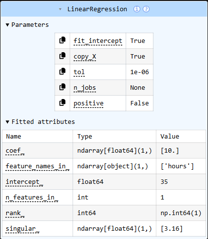
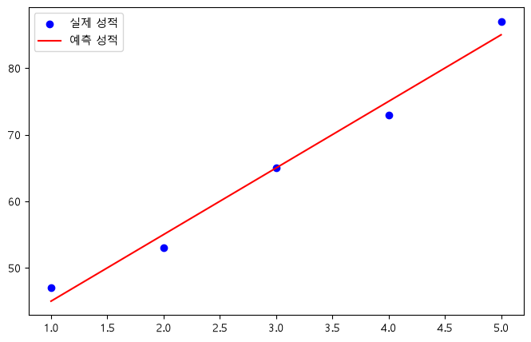
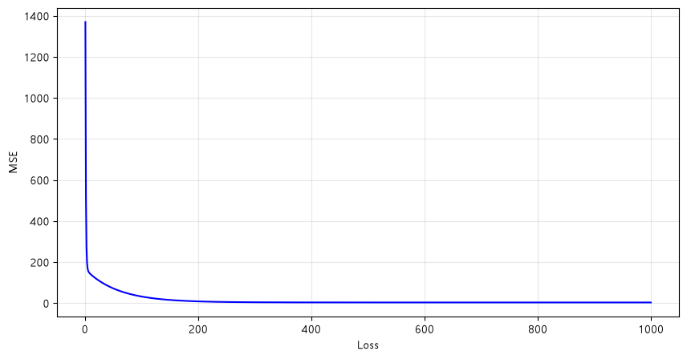
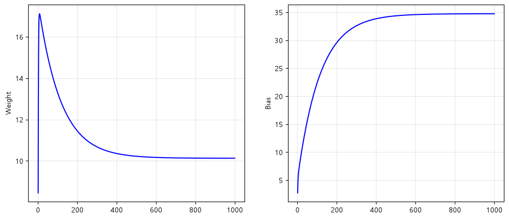
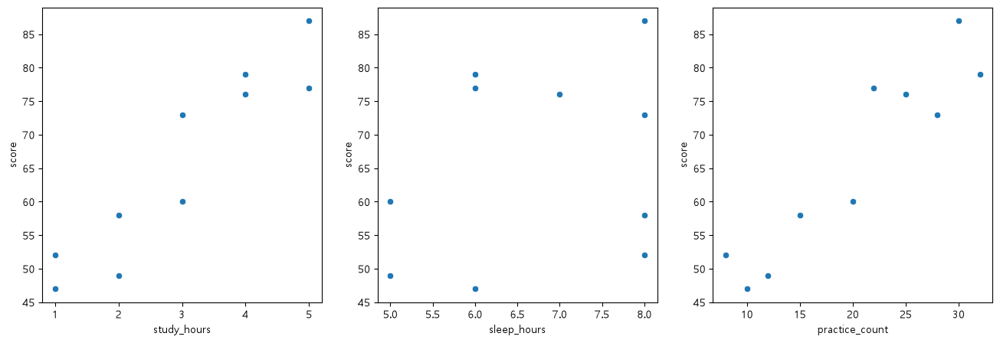
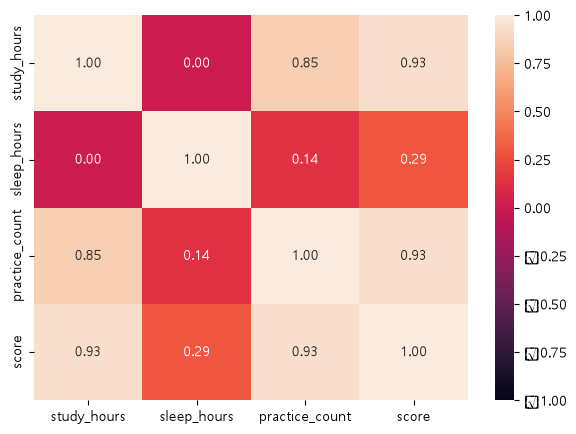
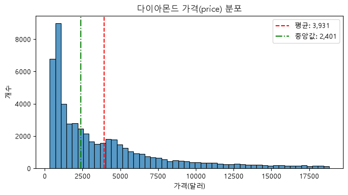
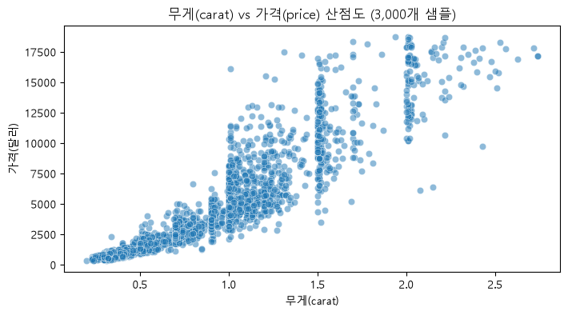
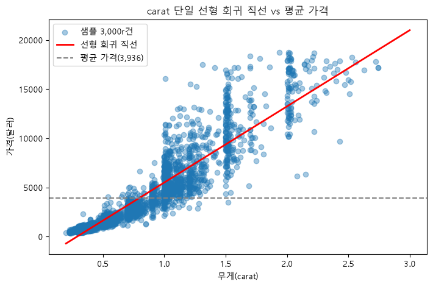
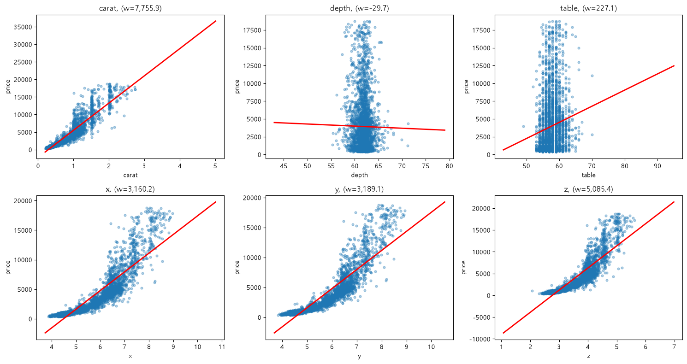

# [YBST] 26년11월25일 TIL
## 1-1. AI 요약│단순 선형회귀 실습 (복습)
## Action Items

- [ ]  수강생 전원: 어제 노트북은 그대로 두고 새 노트북(`03 ML` 계열)을 만들어, 실습 코드를 따라 작성하고 결과(기울기 10, 절편 35, 6시간 학습 시 95점)를 확인하기 (owner not stated)

## Decisions

- 오늘은 어제의 복잡한 데이터 대신 5개짜리 간소화 데이터로 선형회귀를 다시 실습함
    - 어제 강의가 "너무 복잡"했고 따라 하긴 해도 이해가 안 되는 부분이 많다는 의견이 있었음
- 오늘부터 노트북 마크다운 작성(`##`, `###`)에 더 신경 쓰기로 함
    - 노트북이 복습 자료가 될 수 있기 때문임

## Summary

### 진행 방식과 환경 준비

- 어제 선형회귀 실습을 간소화한 데이터로 다시 하고, 이어서 경사하강법(머신러닝의 핵심 알고리즘)을 다룰 예정임
- 새 노트북을 만들고 커널을 선택하며, 가상환경이 없으면 source로 실행함
- `##` 아래에 `###`를 두면 하위 섹션이 되어 접고 펼 수 있음
- 자동완성이 안 될 때는 Ctrl+Shift+P → Developer: Reload Window로 해결함
- 사이드바 아웃라인으로 마크다운 계층 구조를 보고 바로 이동할 수 있음
- 라이브러리는 pandas, matplotlib(`plt`), scikit-learn의 LinearRegression을 불러옴
- 한글 폰트는 Windows는 맑은 고딕, Mac은 AppleGothic으로 설정함

### 데이터 준비

- 딕셔너리로 데이터를 만들어 DataFrame(`df`)으로 변환함
    - hours: 1, 2, 3, 4, 5
    - scores: 47, 53, 65, 73, 87 (5시간 87점은 강의 중 정한 값. 65는 확인 질문 후 맞다고 함)
- DataFrame은 배열을 엑셀 표 형태로 바꿔 주는 개념이라고 설명함
- 입력과 정답을 분리함
    - X: 입력 데이터, 피처, 독립변수. 항상 대문자이며 2차원임. 단일 회귀라 컬럼은 하나(`df[['hours']]`)임
    - y: 정답, 타깃, 종속변수. 소문자이며 1차원임. 예측값은 y_hat이라고 부름
- 내일은 입력 데이터가 여러 개인 다중 선형회귀를 배울 예정임
- 셀 앞의 실행 번호(`[1]`, `[2]`)로 실행 순서를 확인할 수 있음

### 모델 생성과 학습

- `LinearRegression()` 객체를 만들고 `model.fit(X, y)`로 학습함
- 학습 결과는 기울기(coefficient) 10, 절편(intercept) 35임. 출력은 34.x로 보였고 반올림하면 35라고 함
- 기울기(`coef_`)는 배열로 반환되며 weight(W)라고도 함. 다중 회귀에서는 기울기가 여러 개 나옴
- 절편(`intercept_`)은 bias(b)라고 함
- 학습된 식은 ŷ = 10x + 35임
- 소수점 둘째 자리 출력에는 `:.2f` 포맷을 사용함

### 새 데이터 예측

- 학습 데이터에 없는 6시간을 DataFrame으로 만들어 `model.predict`에 넣으면 95점이 나옴
- 결과가 배열로 반환되므로 `[0]`으로 첫 값을 꺼내야 함 (처음엔 이를 빠뜨려 오류가 났음)
- 입력 값을 6, 7, 8처럼 여러 개 넣으면 결과도 여러 개 나옴. 100점을 넘는 값도 나올 수 있음
- 독립변수가 여러 개면 공부 장소나 문제집 풀이 횟수 등 다른 요인도 함께 학습하게 됨

### 학습 결과 시각화

- `model.predict(X)`로 학습 데이터에 대한 예측값(`y_pred`)을 구함
    - 원래 점수와 비교하면 대부분 비슷하고, 일부(특히 아래쪽) 점수만 조금 차이가 남
- matplotlib 차트 구성
    - 실제 성적은 파란색 산점도(scatter)임
    - 예측 성적은 빨간색 라인 그래프임
    - 범례를 추가하고 `plt.show()`로 출력함
- 수강생에게 어제 내용을 다시 하니 이해가 편한지 물었고, 숫자가 작아서 더 편할 것이라고 함
- 10분 휴식 후 재개함

---

## 1-2. AI 요약│모델 평가 지표와 경사하강법 실습
## Action Items

- [ ]  수강생 전원: 휴식 후 10분 뒤 재개 전까지 선형회귀 결과(가중치, 절편, MSE)를 강사와 똑같이 맞춰 두기 (owner not stated)

## Decisions

- 경사하강법 실습은 선형회귀 때와 같은 5건 데이터로 진행하기로 함
    - 선형회귀 결과와 경사하강법 결과가 같은지 비교하기 위함
- 경사하강법 실습에서는 scikit-learn이 제공하는 확률적 경사하강법(SGD) 기능을 사용하기로 함
    - 손실함수 수식 전개는 깊게 다루지 않고, 내부적으로 손실함수를 쓴다는 점까지만 기억하게 함

## Open Questions

- 확률적 경사하강법(SGD) 모델의 결과가 선형회귀 결과와 같게 나오는가?
    - 모델 생성 직전에 휴식에 들어가서 아직 실행하지 못함

## Summary

### 6시간 예측 성적 시각화

- 6시간 학습 시 예측 성적을 scatter로 초록색 점으로 찍어 추세선 위에 있는지 눈으로 확인함
    - 제목은 "공부 시간 대비 성적", X축은 공부 시간, Y축은 성적으로 설정함
    - 점이 추세선을 정확히 지나가는 것으로 확인함
    - predict는 값이 하나여도 배열로 반환된다는 점을 짚음

### 모델 평가 지표: MAE, MSE, R2

- 전날 다룬 평가 지표 MAE, MSE, RMSE, R2 스코어를 코드로 복습함. 모두 모델이 얼마나 정확한지 평가하는 지표임
- MAE(평균 절대 오차)
    - 오차에 절대값을 씌우는 이유는 +2, -2, +5, -5처럼 부호가 다른 오차를 더하면 0이 되어 오차를 판단할 수 없기 때문임
    - 제곱하지 않아서 오차 크기를 직관적으로 이해할 수 있다는 장점이 있음
    - 실습 결과는 1.6이며, 데이터가 적어 크다 작다를 평가하기는 이르다고 함
- MSE(평균 제곱 오차)
    - 제곱하면 큰 오차에 더 민감해져 이상 수치를 빨리 발견할 수 있음
    - 오차를 제곱하면 면적이 되고, 면적 합이 작을수록 학습이 잘 된 것임
    - 전날 넣은 아파트 매물값 이상 수치 5건처럼 크게 벗어난 값이 있으면 MSE가 훨씬 크게 튐
    - MAE와 MSE는 값 차이가 있음을 확인함
- R2(결정계수)
    - 1에 가까울수록 학습이 잘 된 것이고, 0에 가까울수록 좋지 않음. 음수이면 학습 실패로 판단함
    - 실습 결과는 0.98로 거의 1에 가까움. 데이터 건수가 적어 큰 의미는 없다고 함
- 복습 후 커밋함

### 경사하강법 개념

- 선형회귀에서 찾은 값은 기울기(weight) 10, 절편(bias) 35였고, 6시간 공부 시 예측은 95점이었음
- 경사하강법(Gradient Descent)은 최적의 weight와 bias를 찾아가는 방법임
    - 무작위 값에서 시작해 예측, 오차 계산, 값 수정을 반복함
    - 로지스틱 회귀, 딥러닝, 인공신경망에도 쓰이는 핵심 최적화 알고리즘임
- 손실함수(loss function)는 예측값과 실제 정답의 차이를 숫자로 나타내는 함수임. 선형회귀에서는 MSE를 사용함
    - 수식을 이미지로 보여주며 yi는 정답, yhat은 예측값이라고 설명함
- 차트로 본 원리
    - 무작위 지점에서 접선의 미분값을 구함. 마이너스면 왼쪽, 양수면 오른쪽으로 이동하고, 기울기가 0이 되는 골짜기 바닥이 최적점임
    - 이동 간격이 러닝 레이트(학습률)임. 너무 촘촘하면 오래 걸리고, 너무 크면 왔다 갔다 하는 문제가 생김
- 경사하강법 종류
    - 배치 경사하강법(BGD): 전체 데이터를 사용해 시간과 자원이 많이 듦
    - 확률적 경사하강법(SGD): 데이터를 확률적으로 골라 하나씩 업데이트해 속도가 빠름

### 경사하강법 실습 준비

- 새 노트북 영역에서 pandas, matplotlib, LinearRegression, SGDRegressor, 평가 지표를 import함
- 같은 5건 데이터로 DataFrame을 만들고 독립변수 X(공부 시간)와 종속변수 y(성적)를 분리함
- 기준 비교용으로 선형회귀를 먼저 학습함. 가중치, 절편, MSE(소수점 4자리)를 출력해 강사와 같은 결과가 나옴을 확인함
- 이어서 SGD 모델 생성을 시작하려던 시점에 10분 휴식에 들어감

---

## 1-3. AI 요약│SGDRegressor 학습 실습 (오전 수업)
## Action Items

- [ ]  점심시간 후 오후 수업에서 학습 기록(history)으로 차트를 그리고 각종 지표를 확인한다 (owner not stated)

## Decisions

- 학습 반복 횟수(epoch)는 1000번을 기준으로 한다
    - 2000번까지 돌려도 값 변화가 거의 없었고, 1000번 정도면 큰 무리가 없다고 판단했다.
- 결과를 동일하게 보기 위해 난수 시드(random_state)를 42로 고정한다
    - 수강생 모두가 같은 결과를 보기 위해서다.

## Summary

### SGDRegressor 모델 생성과 파라미터 설정

- 확률적 경사하강법(SGD) 모델을 `SGDRegressor`로 만들었다. 파라미터를 지정하지 않으면 기본값으로 학습한다고 설명했다.
- 설정한 파라미터는 다음과 같다.
    1. loss: `squared_error` (제곱 오차 기반 MSE 손실 함수)
    2. learning_rate: `constant` (학습률을 일정하게 유지)
    3. eta0: 0.01 (초기 학습률. constant라 계속 0.01로 학습) 
    4. max_iter: 1000 (학습 횟수) 
    5. random_state: 42 (난수 시드) 
    6. shuffle: False (학습 데이터를 섞지 않음) 
- 일부 수강생이 오타와 import 누락으로 오류를 겪어 함께 확인했다. 전체 실행(Run all)으로 해결했다.

### 학습 루프와 기록 저장

- 전체 데이터를 몇 번 반복할지를 뜻하는 용어로 에포크(epoch)를 소개했다. 에포크는 1000으로 설정했다.
- 학습 과정을 저장할 빈 리스트 `history`를 만들었다.
- for 루프로 에포크마다 아래 작업을 했다.
    1. `partial_fit`으로 1회 부분 학습
    2. `predict`로 예측값(y_hat) 계산
    3. `mean_squared_error`로 MSE 계산
    4. weight(`coef_[0]`), bias(`intercept_[0]`), MSE, epoch(+1)를 dictionary로 `history`에 append 
- 나중에 특정 에포크의 weight와 MSE를 쉽게 뽑아보기 위한 구조라고 설명했다.
- `history`를 DataFrame으로 변환해 출력했다. 실행 시간은 수강생마다 약 0.7~1.1초였다.

### 학습 결과 해석

- 목표값은 weight 10, bias 35였다.
    - 첫 에포크는 weight 8 정도이고 bias도 35와 거리가 멀었다.
    - 1000번째에는 weight가 거의 10에 수렴했고 bias는 34.74로 35에 근접했다.
- 시드를 같게 했으므로 수강생 결과도 거의 같아야 한다고 안내했다.
- 에포크를 2000으로 늘려도 후반부 값 차이가 거의 없었다. 이는 학습이 수렴했다는 뜻이다.
- 특정 에포크(1, 5, 10, 50, 100, 300, 500, 1000)만 `isin` 조건으로 골라 출력했다.
    - 1~50번은 의미 있는 결과가 아니었다.
    - 300번쯤부터 의미 있는 값이 나왔다.

### 재실행 시 주의점

- 셀을 다시 돌리면 SGD 객체에 이미 학습된 정보가 남아 결과가 처음부터 좋게 나온다.
- 원래 결과를 보려면 위로 올라가 SGD를 다시 선언한 뒤 재실행해야 한다.
    - 일부 수강생이 이 때문에 결과가 다르게 나왔다.

### 차트와 마무리

- 차트로 그리면 MSE는 초반에 가파르다가 500번 이후 수렴하는 형태가 될 것이라고 예고했다.
- 차트 작성은 점심 후 오후 수업으로 넘기고 오전 수업을 마쳤다.

---

## 1-4. AI 요약│머신러닝 실습: 경사하강법 시각화와 다중선형회귀 시작
## Action Items

- [ ]  수강생 전원: 다중선형회귀 실습(상관관계 확인 이후 단계)을 내일 오전에 이어서 진행 (owner not stated)

## Decisions

- 다중선형회귀는 오늘 상관관계 확인까지만 하고, 나머지는 내일 오전에 마무리한다
    - 남은 분량이 많은데 시간이 애매하게 남았기 때문이다

## Open Questions

- 내일 로지스틱 회귀까지 진행 가능한가?
    - 강사가 "아마 로지스틱 회기 여기까지는 넘어가셔야 될 것 같아요"라고 말했다. 다중선형회귀 마무리 속도에 달려 있어 확정은 아니다.

## Summary

### 손실 함수 차트 (에포크별 MSE)

- 오전에 확인한 에포크별 MSE 변화를 차트로 그렸다
    - 피겨 크기는 10x5, x축은 1부터 1000까지의 epoch, y축은 MSE, 색은 블루, 그리드 alpha는 0.3이다
    - 차트가 수평으로 나오는 사람은 위 셀부터 다시 실행하도록 안내했다. 아웃라인의 실행 버튼으로 셀별 또는 섹션 전체 실행이 가능하다
    - 1000 에포크 후 MSE가 0에 가깝게 수렴했다. 강사는 값을 "3.2 정도"로 기억한다고 했으나 확실하지 않다

### 기울기·절편 변화 시각화

- 한 장의 피겨에 차트 2개를 그렸다 (`subplots` 1행 2열, 크기 12x5)
    - 첫 번째 축은 weight(기울기), 두 번째 축은 bias(절편) 변화다. 둘 다 `plot`으로 그렸다
    - weight는 처음에 높다가 경사하강법을 따라 내려와 10 근처로 수렴했다

### 최종 모델 예측 검증

- 경사하강법으로 학습한 SGD 모델의 기울기와 절편을 출력했다
- 공부 6시간 데이터로 예측한 결과는 95.5점이다
    - 앞서 선형회귀 모델의 6시간 예측은 95점이었다. 강사는 "거의 동일하게" 나왔다고 설명했다

### 다중선형회귀 소개와 데이터 준비

- 시험 점수는 공부 시간만으로 정해지지 않는다. 수면, 문제 풀이 수, 집중력 등 여러 입력 특성을 함께 쓰는 알고리즘이 다중선형회귀다
- 기존 예제를 확장해 새 섹션을 만들고 필요한 import를 셀에 모두 넣었다
    - pandas, matplotlib, seaborn, `LinearRegression`, MAE, MSE, R2 score를 가져왔다
    - 다중선형회귀도 별도 클래스 없이 `LinearRegression`으로 처리한다
- 반복 작업이라 데이터 코드는 강사가 Slack 질문 채널에 올렸다
    - 컬럼은 study hour, sleep hour, practice count(문제 풀이 수), score다

### 상관관계 확인 (산점도, 히트맵)

- 1행 3열 산점도(크기 16x5)로 각 특성과 score의 관계를 확인했다
    - study hour와 practice count는 score와 추세가 보인다
    - sleep hour는 분포가 산만해 추세선을 그리기 어렵다
- `corr`로 상관계수를 계산하고 seaborn 히트맵으로 시각화했다 (크기 7x5, `annot=True`, vmin -1, vmax 1, 소수점 두 자리)
    - study hour는 score와 상관이 크다. study hour와 문제 풀이 수는 약 0.8이다
    - 수면 시간은 상관이 작다
    - 강사는 변수가 늘면 히트맵이 더 복잡해진다고 덧붙였다

### 마무리

- 다중선형회귀가 남은 분량이 많아 내일 오전에 마무리하기로 했다

---

## 2. 코드진행 흐름 파악│금일 수업 코드진행 흐름 파악
# 1교시│”03_ml.pynb” Editor 창 코드진행 흐름파악

```python
# 선형회귀 실습

## 학습 데이터 준비
```

```python
import pandas as pd
import matplotlib.pyplot as plt

# 선형회귀 모델 임포트
from sklearn.linear_model import LinearRegression

# 한글 폰트 설정
plt.rcParams["font.family"] = "Malgun Gothic" # Windows 사용자
# plt.rcParams["font.family"] = "Apple Gothic" # mac OS 사용자

# 데이터 (딕셔너리)
# 여기에 없는 점수와 시간이 바로 '독립변수'라고 한다.
data = {
    "hours": [1, 2, 3, 4, 5],
    "scores": [ 47, 53, 65, 73, 87]
}

# 판다스 데이터프레임으로 전환
df = pd.DataFrame(data)
df
```

| **hours** | **scores** |  |
| --- | --- | --- |
| 0 | 1 | 47 |
| 1 | 2 | 53 |
| 2 | 3 | 65 |
| 3 | 4 | 73 |
| 4 | 5 | 87 |

```python
### 입력 데이터와 정답데이터분리
```

```python
# 입력 데이터 (피쳐: feature) : 2차원 - 독립변수 # 다 동일한 말이다.
X =df[["hours"]]        # 공부 시간

# 출력 데이터 (Target) : 1차원 - 정답 데이터 : 종속변수 
# 'y hat'을 표현할 방법이 없어서 소문자 y를 사용한다고 함.
y = df["scores"]        # 시험 점수
```

```python
### 모델 생성 및 학습
```

```python
# 선형회귀 모델 객체 생성
model = LinearRegression()
# 모델 학습
model.fit(X, y)
```



```python
### 결과 확인
```

```python
# y hat = w x + b
# 10 x + 35

# 다중 선형회귀의 경우 결과값이 배열로 리턴
# 기울기는 배열 리턴
print(f"기울기: {model.coef_[0]:.2f}")      # 기울기: Weight
print(f"절편: {model.intercept_:.2f}")      # 절편 : Bias
```

- 기울기: 10.00
절편: 35.00

```python
### 새로운 데이터로 예측하기
```

```python
# 6시간 학습한 학생의 성적 예측
new_data = pd.DataFrame({"hours": [6]})     # X 독립변수 1개 추가

predicted_score = model.predict(new_data)
print(f"6시간 학습한 학생의 예상 성적: {predicted_score[0]:.2f}점")
```

- 6시간 학습한 학생의 예상 성적: 95.00점

```python
### 학습결과 시각화
```

```python
# 학습 데이터에 대한 예측값
y_pred = model.predict(X)
print("학습 데이터에 대한 예측값:", y_pred)

plt.figure(figsize=(8, 5))

# 실제 성적 (산점도)
plt.scatter(X["hours"], y, color="blue", label="실제 성적")

# 예측한 성적 (회귀직선)
plt.plot(X["hours"], y_pred, color="red", label="예측 성적")

plt.legend()
plt.show()
```

- 학습 데이터에 대한 예측값: [45. 55. 65. 75. 85.]
- 사진 제목: 학습데이터 / edu_data



---

# 2교시│”03_ml.pynb” Editor 창 코드진행 흐름파악

```python
### 모델 평가
```

```python
from sklearn.metrics import mean_absolute_error
from sklearn.metrics import mean_squared_error
from sklearn.metrics import r2_score

# MAE : 오차 절대 평균
# 오차의 크기를 직관적으로 이해
mae = mean_absolute_error(y, y_pred)
print(f"학습데이터에 대한 평균 절대 오차(MAE): {mae:.2f}")

# MSE : 오차 제곱 평균
# 제곱하는 이유는 큰 오차에 대해서 민감하게 반응 ★
mse = mean_squared_error(y, y_pred)
print(f"학습데이터에 대한 평균 제곱 오차(MSE): {mse:.2f}")

# R2 Score : 결정계수
# 모델이 실제 데이터를 얼마만큼 정확한지를 나타내는 지표
# 0 <==> 1
# 음수일 경우 학습 실패
r2 = r2_score(y, y_pred)
print(f"학습데이터에 대한 결정계수(R^2): {r2:.2f}")
```

- 학습데이터에 대한 평균 절대 오차(MAE): 1.60
학습데이터에 대한 평균 제곱 오차(MSE): 3.20
학습데이터에 대한 결정계수(R^2): 0.98

---

```python
## 경사하강법 (Gradient Descent)

- 기울기(Weight)        : 10
- 절편(Bias)            : 35
- 6시간 학습            : 96점

### 손실 함수 (Loss Function)

- 모델이 예측한 값이 실제 정답과 얼마나 차이가 나는지를 수치로 표현하는 함수
- MSE 를 대표적으로 사용
```

```python
import pandas as pd
import matplotlib.pyplot as plt

from sklearn.linear_model import LinearRegression

# 배치 하강법 (BGD) : 전체 데이터를 사용, 시간, 리소스 많이 사용
# 확률적 경사하강법 (SGD) : 확률적을 1개의 데이터를 추출해서 하강 방법
from sklearn.linear_model import SGDRegressor
from sklearn.metrics import mean_squared_error

# 학습 데이터 생성
df = pd.DataFrame({
    "hours": [1, 2, 3, 4, 5],
    "scores": [ 47, 53, 65, 73, 87]
})

# 독립변수 (입력번수: Feature)
X = df[["hours"]]
# 종속변수 (정답 : Target)
y = df["scores"]

df
```

| **hours** | **scores** |  |
| --- | --- | --- |
| 0 | 1 | 47 |
| 1 | 2 | 53 |
| 2 | 3 | 65 |
| 3 | 4 | 73 |
| 4 | 5 | 87 |


```python
# 선형회귀
model = LinearRegression()
# 모델 학습
model.fit(X, y)
# 예측값
y_pred = model.predict(X)
# 결과값
print(f"Weight: {model.coef_[0]:.2f}")
print(f"Bias: {model.intercept_:.2f}")
print(f"MSE: {mean_squared_error(y, y_pred):.4f}")
```

- Weight: 10.00
Bias: 35.00
MSE: 3.2000

---

# 3교시│”03_ml.pynb” Editor 창 코드진행 흐름파악


```python
### 확률적 경사하강법 모델 생성
- SGDRegressor 모델 생성
- SGD(Stochastic Gradient Descent)
```

```python
sgd = SGDRegressor(
    loss="squared_error",        # 제곱 오차 기반 손실함수
    learning_rate="constant",    # 학습률을 일정하게 유지
    eta0=0.01,                   # 초기 학습률
    max_iter=1000,               # 학습 횟수 fit() 반복 회수
    shuffle=False,               # 학습 데이터 섞지 않음
    random_state=42              # 난수 시드 설정
)
```

```python
# 전체 데이터를 기준으로 총 몇회 반복 할 것인가?
epochs = 1000

# 학습 과정을 저장하는 리스트
history = []

for epochs in range(epochs):
    # 전체 데이터 1회 학습 (1 epoch)
    sgd.partial_fit(X, y)

    # 1회 학습 후 예측
    y_pred = sgd.predict(X)

    # 현재 모델의 MSE 계산
    mse = mean_squared_error(y, y_pred)

    # 현재 학습 결과 저장(누적)
    history.append({
        "epoch": epochs + 1,
        "weight": sgd.coef_[0],
        "bias": sgd.intercept_[0],
        "mse": mse
    })

# 학습 기록 => DataFrame 으로 변환
history_df = pd.DataFrame(history)
history_df
```

| **epoch** | **weight** | **bias** | **mse** |  |
| --- | --- | --- | --- | --- |
| 0 | 1 | 8.455225 | 2.731163 | 1369.816039 |
| 1 | 2 | 12.813586 | 4.270770 | 515.808449 |
| 2 | 3 | 15.045308 | 5.190714 | 269.417813 |
| 3 | 4 | 16.173242 | 5.787904 | 193.744630 |
| 4 | 5 | 16.728403 | 6.216494 | 167.673523 |
| ... | ... | ... | ... | ... |
| 995 | 996 | 10.129378 | 34.741070 | 3.250171 |
| 996 | 997 | 10.129367 | 34.741113 | 3.250168 |
| 997 | 998 | 10.129357 | 34.741155 | 3.250165 |
| 998 | 999 | 10.129346 | 34.741197 | 3.250162 |
| 999 | 1000 | 10.129335 | 34.741238 | 3.250159 |
- 1000 rows × 4 columns

```python
# history_df[ 조건 ]
# history_df[ "history_df["epoch"].isin([1,5,10,50,100,300,500,1000])" ] => "○○○○" 이곳에 들어가는게 조건이다.

history_df[ history_df["epoch"].isin([1,5,10,50,100,300,500,1000]) ]
```

| **epoch** | **weight** | **bias** | **mse** |  |
| --- | --- | --- | --- | --- |
| 0 | 1 | 8.455225 | 2.731163 | 1369.816039 |
| 4 | 5 | 16.728403 | 6.216494 | 167.673523 |
| 9 | 10 | 17.060518 | 7.615610 | 141.377004 |
| 49 | 50 | 15.031795 | 15.629821 | 72.111791 |
| 99 | 100 | 13.294764 | 22.401342 | 32.278720 |
| 299 | 300 | 10.678818 | 32.599172 | 4.254356 |
| 499 | 500 | 10.223895 | 34.372614 | 3.302220 |
| 999 | 1000 | 10.129335 | 34.741238 | 3.250159 |

---

# 4교시│”03_ml.pynb” Editor 창 코드진행 흐름파악

```python
### 손실합수 차트
```

```python
plt.figure(figsize=(10,5))

# Epoch에 따른 MSE 변화
plt.plot(
    history_df["epoch"],
    history_df["mse"],
    color="blue",
    label="학습 손실(Traing Loss)"
)

plt.xlabel("Loss")
plt.ylabel("MSE")
plt.grid(alpha=0.3)
plt.show()
```



```python
### 기울기와 절편 변화 시각화
```

```python
fig, axes = plt.subplots(1, 2, figsize=(12, 5))

# 기울기 변화
axes[0].plot(
    history_df["epoch"],
    history_df["weight"],
    color="blue",
)
axes[0].grid(alpha=0.3)
axes[0].set_ylabel("Weight")

# 절편 변화
axes[1].plot(
    history_df["epoch"],
    history_df["bias"],
    color="blue"
)
axes[1].grid(alpha=0.3)
axes[1].set_ylabel("Bias")

plt.show()
```



```python
### 최종 모델로 시험 적적 예측하기
```

```python
# 최종 학습된 기울기, 절편
print(f"기울기(w): {sgd.coef_[0]:.2f}")
print(f"절편(b): {sgd.intercept_[0]:.2f}")

# 6시간 학습한 학생
new_data = pd.DataFrame({"hours": [6]})

# 경사하강법으로 학습한 모델로 예측
prediction = sgd.predict(new_data)

print(f"예측 성적: { prediction[0]:.2f}점")
```

- 기울기(w): 10.13
절편(b): 34.74
예측 성적: 95.52점

---

```python
## 다중 선형회귀 (Multiple Linear Regression)

### 라이브러리 임포트 및 데이터 준비
```

```python
import pandas as pd
import matplotlib.pyplot as plt
import seaborn as sns

from sklearn.linear_model import LinearRegression
from sklearn.metrics import mean_absolute_error
from sklearn.metrics import mean_squared_error
from sklearn.metrics import r2_score

# 데이터 생성
df = pd.DataFrame({
    "study_hours":    [1, 2, 3, 4, 5, 2, 3, 5, 4, 1],
    "sleep_hours":    [6, 8, 5, 7, 8, 5, 8, 6, 6, 8],
    "practice_count": [10, 15, 20, 25, 30, 12, 28, 22, 32, 8],
    "score":          [47, 58, 60, 76, 87, 49, 73, 77, 79, 52]
})

df
```

| **study_hours** | **sleep_hours** | **practice_count** | **score** |  |
| --- | --- | --- | --- | --- |
| 0 | 1 | 6 | 10 | 47 |
| 1 | 2 | 8 | 15 | 58 |
| 2 | 3 | 5 | 20 | 60 |
| 3 | 4 | 7 | 25 | 76 |
| 4 | 5 | 8 | 30 | 87 |
| 5 | 2 | 5 | 12 | 49 |
| 6 | 3 | 8 | 28 | 73 |
| 7 | 5 | 6 | 22 | 77 |
| 8 | 4 | 6 | 32 | 79 |
| 9 | 1 | 8 | 8 | 52 |

```python
### 상관계수 확인 (차트)
```

```python
# 1행 3열의 그래프 영역 생성
fig, axes = plt.subplots(1, 3, figsize=(16,5))

# 공부시간 + 성적
sns.scatterplot(
    data=df,
    x="study_hours",
    y="score",
    ax=axes[0]
)
# 수면시간 + 성적
sns.scatterplot(
    data=df,
    x="sleep_hours",
    y="score",
    ax=axes[1]
)
# 문제풀이 개수 + 성적
sns.scatterplot(
    data=df,
    x="practice_count",
    y="score",
    ax=axes[2]
)

plt.show()
```



```python
### 상관계수 확인
```

```python
# 모든 컬럼 사이의 상관계수 확인
corr = df.corr()

plt.figure(figsize=(7,5))

sns.heatmap(
    corr,
    annot=True,     # 상관계수 표시
    vmin=-1,        # 최소값
    vmax=1,         # 최대값
    fmt=".2f"       # 소수점 두자리
)

plt.show()
```

```python
c:\Users\miro2\kant_study\03_ML\kant_ml\.venv\Lib\site-packages\seaborn\utils.py:61: UserWarning: Glyph 8722 (\N{MINUS SIGN}) missing from font(s) Malgun Gothic.
  fig.canvas.draw()
c:\Users\miro2\kant_study\03_ML\kant_ml\.venv\Lib\site-packages\IPython\core\pylabtools.py:158: UserWarning: Glyph 8722 (\N{MINUS SIGN}) missing from font(s) Malgun Gothic.
  fig.canvas.print_figure(bytes_io, **kw)
```



---

## 4교시│”○○○○” 터미널 창 코드진행 흐름파악

```python
miro2@keon UCRT64 ~/kant_study/03_ML/kant_ml (main)
$ ls
01_ml.ipynb  02_ml.ipynb  03_ml.ipynb  datasets/  diamond.ipynb  main.py  pyproject.toml  README.md  uv.lock
(kant-ml) 
miro2@keon UCRT64 ~/kant_study/03_ML/kant_ml (main)
$ ls -al
total 767
drwxr-xr-x 1 miro2 197609      0 Nov 25 09:11 ./
drwxr-xr-x 1 miro2 197609      0 Nov 23 10:31 ../
drwxr-xr-x 1 miro2 197609      0 Nov 24 14:07 .git/
-rw-r--r-- 1 miro2 197609      5 Nov 23 10:33 .python-version
drwxr-xr-x 1 miro2 197609      0 Nov 23 10:35 .venv/
-rw-r--r-- 1 miro2 197609  64536 Nov 24 10:52 01_ml.ipynb
-rw-r--r-- 1 miro2 197609 182785 Nov 24 18:41 02_ml.ipynb
-rw-r--r-- 1 miro2 197609 236096 Nov 25 14:14 03_ml.ipynb
drwxr-xr-x 1 miro2 197609      0 Nov 24 11:19 datasets/
-rw-r--r-- 1 miro2 197609 152256 Nov 24 20:47 diamond.ipynb
-rw-r--r-- 1 miro2 197609     85 Nov 23 10:33 main.py
-rw-r--r-- 1 miro2 197609    295 Nov 24 11:27 pyproject.toml
-rw-r--r-- 1 miro2 197609      0 Nov 23 10:33 README.md
-rw-r--r-- 1 miro2 197609 125152 Nov 24 11:27 uv.lock
(kant-ml) 
miro2@keon UCRT64 ~/kant_study/03_ML/kant_ml (main)
$ git init
Reinitialized existing Git repository in C:/Users/miro2/kant_study/03_ML/kant_ml/.git/
(kant-ml) 
miro2@keon UCRT64 ~/kant_study/03_ML/kant_ml (main)
$ git status
On branch main
Untracked files:
  (use "git add <file>..." to include in what will be committed)
        03_ml.ipynb
        diamond.ipynb

nothing added to commit but untracked files present (use "git add" to track)
(kant-ml) 
miro2@keon UCRT64 ~/kant_study/03_ML/kant_ml (main)
$ git add 03_ml.ipynb
warning: in the working copy of '03_ml.ipynb', LF will be replaced by CRLF the next time Git touches it
(kant-ml) 
miro2@keon UCRT64 ~/kant_study/03_ML/kant_ml (main)
$ git add diamond.ipynb
warning: in the working copy of 'diamond.ipynb', LF will be replaced by CRLF the next time Git touches it
(kant-ml) 
miro2@keon UCRT64 ~/kant_study/03_ML/kant_ml (main)
$ git status
On branch main
Changes to be committed:
  (use "git restore --staged <file>..." to unstage)
        new file:   03_ml.ipynb
        new file:   diamond.ipynb

(kant-ml) 
miro2@keon UCRT64 ~/kant_study/03_ML/kant_ml (main)
$ git commit -m "feat: 261125 수업 실습내용 작성"
[main e261edb] feat: 261125 수업 실습내용 작성
 2 files changed, 3390 insertions(+)
 create mode 100644 03_ml.ipynb
 create mode 100644 diamond.ipynb
(kant-ml) 
miro2@keon UCRT64 ~/kant_study/03_ML/kant_ml (main)
$ git remote -v
origin  https://github.com/miro25800/kant_ml.git (fetch)
origin  https://github.com/miro25800/kant_ml.git (push)
(kant-ml) 
miro2@keon UCRT64 ~/kant_study/03_ML/kant_ml (main)
$ git remote add origin https://github.com/miro25800/kant_ml.git
error: remote origin already exists.
(kant-ml) 
miro2@keon UCRT64 ~/kant_study/03_ML/kant_ml (main)
$ git push origin main
Enumerating objects: 5, done.
Counting objects: 100% (5/5), done.
Delta compression using up to 24 threads
Compressing objects: 100% (4/4), done.
Writing objects: 100% (4/4), 221.40 KiB | 22.14 MiB/s, done.
Total 4 (delta 1), reused 0 (delta 0), pack-reused 0 (from 0)
remote: Resolving deltas: 100% (1/1), completed with 1 local object.
To https://github.com/miro25800/kant_ml.git
   99a7ece..e261edb  main -> main
(kant-ml)
```

---

## 3. 수작업 요약│실습 10회차
‘개인 과제│261124~25 제6차 개인 과제’로 대체.

---

## 4-1. 암기장│단어 암기장
# 단어 중요도 목차 (5단계 분배)

### [5단계 : 필수적으로 중요함]

- **선형회귀 (Linear Regression):** 입력 변수와 출력 변수 간의 선형 관계를 학습해 예측하는 기본 회귀 모델 (5단계 위치)
- **독립변수 / 피처(Feature) / 입력 데이터 (`X`):** 결과를 예측하기 위해 넣는 입력 값 (5단계 위치)
- **종속변수 / 타겟(Target) / 정답 데이터 (`y`):** 모델이 예측해야 하는 실제 정답 값 (5단계 위치)
- **기울기 / 가중치 (Weight, `w`):** 입력 변수가 변할 때 예측값이 얼마나 변하는지를 나타내는 값 (5단계 위치)
- **절편 (Bias, `b`):** 입력이 0일 때의 기본 기준값으로, 직선의 위치를 위아래로 이동시키는 값 (5단계 위치)
- **손실 함수 (Loss Function):** 예측값과 실제값의 차이를 수치화한 함수 (5단계 위치)

### [4단계 : 매우 중요함]

- **경사하강법 (Gradient Descent):** 손실 함수의 값을 줄이기 위해 기울기 반대 방향으로 파라미터를 조금씩 갱신하는 최적화 방법 (4단계 위치)
- **MAE (평균 절대 오차):** 실제값과 예측값 차이의 절댓값 평균으로, 오차 크기를 직관적으로 파악 (4단계 위치)
- **R² Score (결정계수):** 모델이 데이터를 얼마나 잘 설명하는지 나타내는 지표 (0~1 사이 값, 음수면 학습 실패 의심) (4단계 위치)
- **다중 선형회귀 (Multiple Linear Regression):** 여러 개의 독립변수(`study_hours`, `sleep_hours`, `practice_count` 등)를 사용해 예측하는 선형회귀 (4단계 위치)
- **상관계수 (`corr`):** 두 변수 간 선형 관계의 방향과 강도를 나타내는 값 (4단계 위치)
- **에포크 (Epoch):** 전체 학습 데이터를 한 번 처음부터 끝까지 학습시킨 횟수 (4단계 위치)

### [3단계 : 중요함]

- **SGD (확률적 경사하강법, Stochastic Gradient Descent):** 전체 데이터가 아니라 일부(또는 1개 샘플 단위 등)를 활용해 빠르게 파라미터를 업데이트하는 경사하강법 계열 (3단계 위치)
- **BGD (배치 경사하강법, Batch Gradient Descent):** 전체 데이터를 한 번에 사용해 기울기를 계산하는 방식으로, 데이터 크기에 따라 시간·리소스가 많이 들 수 있음 (3단계 위치)
- **예측값 (`y_pred`, `ŷ` / y hat):** 학습된 모델이 계산해 낸 추정치 (3단계 위치)

### [2단계 : 덜 중요한 것은 아님.]

- **난수 시드 (`random_state`):** 실험 재현성을 위해 난수 발생 기준을 고정하는 개념 (2단계 위치)
- **히트맵 (`heatmap`):** 행렬 형태의 수치(예: 상관계수)를 색상으로 시각화한 차트 (2단계 위치)

### [1단계 : 알고 있으면 나쁘지 않음.]

- **폰트 경고 (`UserWarning`, `Glyph 8722 missing`):** 한글 폰트(`Malgun Gothic`)에 일부 특수문자(마이너스 기호 등)가 없어 뜨는 시각화 경고 메시지 (1단계 위치)

---

## 4-2. 암기장│코드 (메서드 · 속성) 암기장
# 코드 (메서드) 중요도 목차 (5단계 분배)

### [5단계 : 필수적으로 중요함]

- **`LinearRegression()`:** 사이킷런에서 선형회귀 모델 객체를 생성하는 클래스/생성자 (5단계 위치)
- **`.fit(X, y)`:** 입력 데이터(`X`)와 정답(`y`)을 바탕으로 모델을 학습시키는 메서드 (5단계 위치)
- **`.predict(new_data)`:** 학습된 모델로 새로운 입력에 대한 예측값을 산출하는 메서드 (5단계 위치)
- **`pd.DataFrame(...)`:** 딕셔너리나 리스트 등의 데이터를 표 형태(DataFrame)로 변환하는 함수 (5단계 위치)

### [4단계 : 매우 중요함]

- **`mean_squared_error(y_true, y_pred)`:** MSE 값을 계산하는 평가 함수 (4단계 위치)
- **`mean_absolute_error(y_true, y_pred)`:** MAE 값을 계산하는 평가 함수 (4단계 위치)
- **`r2_score(y_true, y_pred)`:** 결정계수(R²)를 계산하는 평가 함수 (4단계 위치)
- **`.corr()`:** DataFrame 내 수치형 열들 간의 상관계수 행렬을 계산하는 메서드 (4단계 위치)

### [3단계 : 중요함]

- **`SGDRegressor(...)`:** 경사하강법 기반 선형회귀 모델 객체를 생성하는 클래스/생성자 (3단계 위치)
- **`.partial_fit(X, y)`:** 기존 학습 상태를 이어받아 배치/에포크 단위로 점진적 학습을 수행하는 메서드 (3단계 위치)
- **`plt.subplots(...)` / `plt.figure(...)` / `plt.plot(...)` / `plt.show()`:** matplotlib에서 그래프 영역을 만들고 선 그래프를 그리며 화면에 출력하는 함수들 (3단계 위치)
- **`.isin([...])`:** 시리즈/열의 값이 지정한 리스트 안에 포함되는지 불리언(True/False)으로 판별하는 메서드 (3단계 위치)

### [2단계 : 덜 중요한 것은 아님.]

- **`sns.scatterplot(...)`:** seaborn으로 산점도를 그리는 함수 (2단계 위치)
- **`sns.heatmap(...)`:** seaborn으로 히트맵을 그리는 함수 (2단계 위치)
- **`.append(...)`:** 파이썬 리스트에 요소를 추가하는 메서드 (2단계 위치)

### [1단계 : 알고 있으면 나쁘지 않음.]

- **`range(...)`:** 지정한 횟수만큼 반복 범위를 생성하는 파이썬 내장 함수 (1단계 위치)

---

# 코드 (속성) 중요도 목차 (5단계 분배)

### [5단계 : 필수적으로 중요함]

- **`model.coef_`:** 학습된 선형회귀 모델의 기울기(가중치, Weight)를 담고 있는 속성 (5단계 위치)
- **`model.intercept_`:** 학습된 선형회귀 모델의 절편(편향, Bias)을 담고 있는 속성 (5단계 위치)

### [4단계 : 매우 중요함]

- **`sgd.coef_` / `sgd.intercept_`:** SGDRegressor 학습 후 얻어진 가중치와 절편 속성 (4단계 위치)
- **`loss` (`SGDRegressor` 인자):** 손실 함수 종류를 지정하는 옵션 (예: `"squared_error"`) (4단계 위치)
- **`eta0` / `learning_rate` (`SGDRegressor` 인자):** 학습률 크기와 스케줄링 방식을 지정하는 옵션 (4단계 위치)

### [3단계 : 중요함]

- **`max_iter` (`SGDRegressor` 인자):** 최대 학습 반복 횟수 설정 옵션 (3단계 위치)
- **`random_state` (`SGDRegressor` 인자):** 난수 시드 고정 옵션 (3단계 위치)
- **`annot` / `fmt` (`sns.heatmap` 인자):** 히트맵 셀 안에 수치를 표시할지 여부(`annot=True`)와 소수점 형식(`fmt=".2f"`) 지정 옵션 (3단계 위치)

### [2단계 : 덜 중요한 것은 아님.]

- **`shuffle` (`SGDRegressor` 인자):** 에포크마다 데이터를 섞을지 결정하는 옵션 (2단계 위치)
- **`vmin` / `vmax` (`sns.heatmap` 인자):** 색상 스케일의 최솟값과 최댓값을 고정하는 옵션 (2단계 위치)
- **`figsize` / `color` / `label` / `alpha`:** 그래프 크기, 색상, 범례 이름, 투명도 등을 지정하는 시각화 옵션들 (2단계 위치)

### [1단계 : 알고 있으면 나쁘지 않음.]

- **`plt.rcParams["font.family"]`:** matplotlib 전역 설정에서 폰트 패밀리를 지정하는 키/설정 항목 (1단계 위치)

---

## 5. 개인 과제│261124~25 제6차 개인 과제
# “diamonds.ipynb” 파일 Editor 창 코드진행 흐름파악│제1차 연습

```python
# [ML 미니과제1] 다이아몬드가격예측

## KANT Jewelry · 다이아몬드 가격 예측
```

```python
#### 머신러닝 기초 · 미니과제(2일)
- KANT 쇼핑몰이 보석 카테고리를 엽니다. 새로 들어오는 다이아몬드마다 감정사가 가격을 매기기엔 시간이 너무 걸려서, MD 팀이 무게만 넣으면 적정 가격을 추천하는 모델을 요청했습니다. 공개 데이터 53,940개로 이 모델을 만들고, 얼마나 믿을 만한지 보고하세요.

#### 이 과제에서 증명할 것
- 1장 · 2장에서 배운 데이터 점검 · 그래프 · 선형 회귀만으로 하나의 예측 모델을 처음부터 끝까지 만들고, 그 한계를 그림으로 설명할 수 있다. 새로 배워야 하는 것은 없습니다.
```

```python
### 진행 방법과 규칙
```

```python
- 노트북 한 개(`diamond.ipynb`)로 M1 부터 M5 까지 순서대로 진행합니다. 미션마다 마크다운 셀로 제목을 달고, 그 미션의 생각해 볼 질문 답을 같은 마크다운 셀에 적어 주세요.
- 무작위가 들어가는 곳은 모두 `random_state=42` 로 고정합니다. 그래야 아래 확인용 기준값과 비교할 수 있습니다.
- 각 미션의 힌트는 막혔을 때만, 확인용 기준값은 다 하고 나서 펼치세요. 정답 코드는 없습니다. 수업 노트북을 다시 찾아보는 것이 가장 좋은 힌트입니다.
```

```python
### 데이터 소개
```

```python
- sns.load_dataset("diamonds") · 다이아몬드 53,940개의 무게 · 등급 · 크기 · 판매 가격. 각 행이 다이아몬드 하나입니다. 이번 과제에서 모델에 넣는 것은 숫자 열뿐이며, cut · color · clarity(글자 등급)는 3장에서 숫자로 바꾸는 방법을 배운 뒤 씁니다.
```

```python
| 열 | 뜻 | 종류 |
| --- | --- | --- |
| `carat` | 무게(캐럿, 1캐럿 = 0.2g) | 숫자 |
| `cut` | 연마 등급 · Ideal > Premium > Very Good > Good > Fair | 등급(category) |
| `color` | 색 등급 · D(무색, 최고) → J(노란빛, 최저) | 등급(category) |
| `clarity` | 투명도 등급 · IF(최고) > VVS1 > VVS2 > VS1 > VS2 > SI1 > SI2 > I1(최저) | 등급(category) |
| `depth` | 깊이 비율(%) = 높이 ÷ 평균 지름 × 100 | 숫자 |
| `table` | 윗면(테이블) 너비 ÷ 전체 너비 (%) | 숫자 |
| `x · y · z` | 가로 · 세로 · 높이 (mm) | 숫자 |
| `price` | **가격(달러) · 예측할 정답** | 숫자 |
```

---

```python
### M1 · 데이터 불러오기
```

```python
#### 생각해 볼 질문
- price의 평균과 중앙값 중 어느 쪽이 더 큰가?
  평균(약 3,933달러)이 중앙값(약 2,401달러)보다 훨씬 큽니다.
- 그 차이는 가격 분포에 대해 무엇을 말해 주는가?
  대부분의 다이아몬드는 비교적 저렴한 가격대에 몰려 있지만, 극도로 비싼 고가 다이아몬드들이 오른쪽으로 길게 늘어서며 평균을 위로 끌어올리고 있다는 뜻입니다(오른쪽으로 꼬리가 긴 분포).
```

```python
import numpy as np
import pandas as pd
import matplotlib.pyplot as plt
import seaborn as sns
from sklearn.linear_model import LinearRegression
from sklearn.model_selection import train_test_split

# 한글 폰트 설정 (Windows 기준, Mac 사용 시 "AppleGothic" 등으로 변경 가능)
plt.rcParams["font.family"] = "Malgun Gothic"
plt.rcParams["axes.unicode_minus"] = False  # 마이너스(-) 기호 깨짐 방지
```

```python
# diamonds 데이터 불러오기
df = sns.load_dataset("diamonds")

print("데이터 크기(행, 열):", df.shape)
display(df.head())

print("\n--- 자료형 및 빈칸(결측치) 확인 ---")
df.info()

print("\n--- 숫자 열 기초 통계 ---")
display(df.describe())
```

- 데이터 크기(행, 열): (53940, 10)

| **carat** | **cut** | **color** | **clarity** | **depth** | **table** | **price** | **x** | **y** | **z** |  |
| --- | --- | --- | --- | --- | --- | --- | --- | --- | --- | --- |
| 0 | 0.23 | Ideal | E | SI2 | 61.5 | 55.0 | 326 | 3.95 | 3.98 | 2.43 |
| 1 | 0.21 | Premium | E | SI1 | 59.8 | 61.0 | 326 | 3.89 | 3.84 | 2.31 |
| 2 | 0.23 | Good | E | VS1 | 56.9 | 65.0 | 327 | 4.05 | 4.07 | 2.31 |
| 3 | 0.29 | Premium | I | VS2 | 62.4 | 58.0 | 334 | 4.20 | 4.23 | 2.63 |
| 4 | 0.31 | Good | J | SI2 | 63.3 | 58.0 | 335 | 4.34 | 4.35 | 2.75 |

```python
--- 자료형 및 빈칸(결측치) 확인 ---
<class 'pandas.DataFrame'>
RangeIndex: 53940 entries, 0 to 53939
Data columns (total 10 columns):
 #   Column   Non-Null Count  Dtype   
---  ------   --------------  -----   
 0   carat    53940 non-null  float64 
 1   cut      53940 non-null  category
 2   color    53940 non-null  category
 3   clarity  53940 non-null  category
 4   depth    53940 non-null  float64 
 5   table    53940 non-null  float64 
 6   price    53940 non-null  int64   
 7   x        53940 non-null  float64 
 8   y        53940 non-null  float64 
 9   z        53940 non-null  float64 
dtypes: category(3), float64(6), int64(1)
memory usage: 3.0 MB

--- 숫자 열 기초 통계 ---
```

| **carat** | **depth** | **table** | **price** | **x** | **y** | **z** |  |
| --- | --- | --- | --- | --- | --- | --- | --- |
| count | 53940.000000 | 53940.000000 | 53940.000000 | 53940.000000 | 53940.000000 | 53940.000000 | 53940.000000 |
| mean | 0.797940 | 61.749405 | 57.457184 | 3932.799722 | 5.731157 | 5.734526 | 3.538734 |
| std | 0.474011 | 1.432621 | 2.234491 | 3989.439738 | 1.121761 | 1.142135 | 0.705699 |
| min | 0.200000 | 43.000000 | 43.000000 | 326.000000 | 0.000000 | 0.000000 | 0.000000 |
| 25% | 0.400000 | 61.000000 | 56.000000 | 950.000000 | 4.710000 | 4.720000 | 2.910000 |
| 50% | 0.700000 | 61.800000 | 57.000000 | 2401.000000 | 5.700000 | 5.710000 | 3.530000 |
| 75% | 1.040000 | 62.500000 | 59.000000 | 5324.250000 | 6.540000 | 6.540000 | 4.040000 |
| max | 5.010000 | 79.000000 | 95.000000 | 18823.000000 | 10.740000 | 58.900000 | 31.800000 |

```python
### M2 · 이상치 정리
```

```python
#### 생각해 볼 질문
- 어떤 행을 왜 지웠는가?
  1) 가로(`x`), 세로(`y`), 높이(`z`) 중 하나라도 `0`인 행(20개): 실제 다이아몬드 크기가 0mm일 수 없으므로 잘못 기록된 값입니다.
  2) 세로(`y`)나 높이(`z`)가 `20mm`를 넘는 행(3개): 다른 표본과 비교해 비정상적으로 큰 크기 값이라 이상치로 판단해 제거했습니다.
- 비싼 다이아몬드는 왜 지우면 안되는가?
  가격이 높다는 것 자체는 오류나 입력 실수가 아니라 실제로 비싸게 거래되는 진짜 값이기 때문입니다. 진짜 데이터를 지우면 실제 시장 가격 구조를 왜곡하게 됩니다.
```

```python
# 1) x, y, z 각각 0인 값 개수 세기
print("x == 0 개수:", (df["x"] == 0).sum())
print("y == 0 개수:", (df["y"] == 0).sum())
print("z == 0 개수:", (df["z"] == 0).sum())

# 2) x, y, z 중 하나라도 0인 행 개수 확인 및 조회
zero_rows = df[(df["x"] == 0) | (df["y"] == 0) | (df["z"] == 0)]
print("\nx, y, z 중 하나라도 0인 행 수:", len(zero_rows))
zero_rows
```

- x == 0 개수: 8
y == 0 개수: 7
z == 0 개수: 20

x, y, z 중 하나라도 0인 행 수: 20

| **carat** | **cut** | **color** | **clarity** | **depth** | **table** | **price** | **x** | **y** | **z** |  |
| --- | --- | --- | --- | --- | --- | --- | --- | --- | --- | --- |
| 2207 | 1.00 | Premium | G | SI2 | 59.1 | 59.0 | 3142 | 6.55 | 6.48 | 0.0 |
| 2314 | 1.01 | Premium | H | I1 | 58.1 | 59.0 | 3167 | 6.66 | 6.60 | 0.0 |
| 4791 | 1.10 | Premium | G | SI2 | 63.0 | 59.0 | 3696 | 6.50 | 6.47 | 0.0 |
| 5471 | 1.01 | Premium | F | SI2 | 59.2 | 58.0 | 3837 | 6.50 | 6.47 | 0.0 |
| 10167 | 1.50 | Good | G | I1 | 64.0 | 61.0 | 4731 | 7.15 | 7.04 | 0.0 |
| 11182 | 1.07 | Ideal | F | SI2 | 61.6 | 56.0 | 4954 | 0.00 | 6.62 | 0.0 |
| 11963 | 1.00 | Very Good | H | VS2 | 63.3 | 53.0 | 5139 | 0.00 | 0.00 | 0.0 |
| 13601 | 1.15 | Ideal | G | VS2 | 59.2 | 56.0 | 5564 | 6.88 | 6.83 | 0.0 |
| 15951 | 1.14 | Fair | G | VS1 | 57.5 | 67.0 | 6381 | 0.00 | 0.00 | 0.0 |
| 24394 | 2.18 | Premium | H | SI2 | 59.4 | 61.0 | 12631 | 8.49 | 8.45 | 0.0 |
| 24520 | 1.56 | Ideal | G | VS2 | 62.2 | 54.0 | 12800 | 0.00 | 0.00 | 0.0 |
| 26123 | 2.25 | Premium | I | SI1 | 61.3 | 58.0 | 15397 | 8.52 | 8.42 | 0.0 |
| 26243 | 1.20 | Premium | D | VVS1 | 62.1 | 59.0 | 15686 | 0.00 | 0.00 | 0.0 |
| 27112 | 2.20 | Premium | H | SI1 | 61.2 | 59.0 | 17265 | 8.42 | 8.37 | 0.0 |
| 27429 | 2.25 | Premium | H | SI2 | 62.8 | 59.0 | 18034 | 0.00 | 0.00 | 0.0 |
| 27503 | 2.02 | Premium | H | VS2 | 62.7 | 53.0 | 18207 | 8.02 | 7.95 | 0.0 |
| 27739 | 2.80 | Good | G | SI2 | 63.8 | 58.0 | 18788 | 8.90 | 8.85 | 0.0 |
| 49556 | 0.71 | Good | F | SI2 | 64.1 | 60.0 | 2130 | 0.00 | 0.00 | 0.0 |
| 49557 | 0.71 | Good | F | SI2 | 64.1 | 60.0 | 2130 | 0.00 | 0.00 | 0.0 |
| 51506 | 1.12 | Premium | G | I1 | 60.4 | 59.0 | 2383 | 6.71 | 6.67 | 0.0 |

```python
# 3) y 또는 z가 20mm를 넘는 행 조회
big_rows = df[(df["y"] > 20) | (df["z"] > 20)]
print("y 또는 z가 20mm 초과인 행 수:", len(big_rows))
big_rows
```

- y 또는 z가 20mm 초과인 행 수: 3

| **carat** | **cut** | **color** | **clarity** | **depth** | **table** | **price** | **x** | **y** | **z** |  |
| --- | --- | --- | --- | --- | --- | --- | --- | --- | --- | --- |
| 24067 | 2.00 | Premium | H | SI2 | 58.9 | 57.0 | 12210 | 8.09 | 58.90 | 8.06 |
| 48410 | 0.51 | Very Good | E | VS1 | 61.8 | 54.7 | 1970 | 5.12 | 5.15 | 31.80 |
| 49189 | 0.51 | Ideal | E | VS1 | 61.8 | 55.0 | 2075 | 5.15 | 31.80 | 5.12 |

```python
# 4) 두 종류의 이상한 행을 모두 제외한 clean 표 만들기
clean = df[
    ~((df["x"] == 0) | (df["y"] == 0) | (df["z"] == 0) | (df["y"] > 20) | (df["z"] > 20))
].copy()

print("제거 전 행 수:", len(df))
print("제거 후 clean 행 수:", len(clean))
print("제거된 행 수:", len(df) - len(clean))
```

- 제거 전 행 수: 53940
제거 후 clean 행 수: 53917
제거된 행 수: 23

---

```python
### M3 · 그래프와 상관계수
```

```python
#### 생각해 볼 질문
- 왜 carat을 골랐는가?
  숫자 열 중 `price`와의 상관계수가 약 `0.922`로 가장 높아, 무게(`carat`)가 커질수록 가격이 오르는 경향이 가장 뚜렷하기 때문입니다.
- 산점도에서 직선 하나로 맞추기 어려워 보이는 부분은 어디인가?
  무게가 커질수록 점들이 위아래로 넓게 퍼지는 구간(특히 큰 캐럿대)과, 작은 무게에서 완만하게 시작해 커지면서 살짝 위로 휘어지는 곡선 흐름 때문에 직선 하나만으로는 오차가 생깁니다.
```

```python
# 1) price 히스토그램 + 평균/중앙값 세로선
mean_price = clean["price"].mean()
median_price = clean["price"].median()

fig, ax = plt.subplots(figsize=(8, 4))
sns.histplot(data=clean, x="price", bins=50, ax=ax)
ax.axvline(mean_price, color="red", linestyle="--", label=f"평균: {mean_price:,.0f}")
ax.axvline(median_price, color="green", linestyle="-.", label=f"중앙값: {median_price:,.0f}")
ax.set_title("다이아몬드 가격(price) 분포")
ax.set_xlabel("가격(달러)")
ax.set_ylabel("개수")
ax.legend()
plt.show()

# 2) carat과 price 산점도 (3,000개 샘플)
sample_3000 = clean.sample(3000, random_state=42)
fig, ax = plt.subplots(figsize=(8, 4))
sns.scatterplot(data=sample_3000, x="carat", y="price", alpha=0.5, ax=ax)
ax.set_title("무게(carat) vs 가격(price) 산점도 (3,000개 샘플)")
ax.set_xlabel("무게(carat)")
ax.set_ylabel("가격(달러)")
plt.show()

# 3) 숫자 열 상관계수 정렬 (price 기준 내림차순)
num_df = clean.select_dtypes("number")
corr_price = num_df.corr()["price"].sort_values(ascending=False)
print("--- price와의 상관계수 순위 ---")
print(corr_price)
```





- -- price와의 상관계수 순위 ---
price 1.000000
carat 0.921586
y 0.888818
x 0.887221
z 0.882107
table 0.127241
depth -0.010653
Name: price, dtype: float64

---

```python
### M4 · 무게로 가격 예측
```

```python
#### 생각해 볼 질문
- 0.25캐럿 다이아몬드의 예상가가 음수인 이유는 무엇일까?
  직선 회귀식(`y_hat = w * x + b`)에서 기울기 `w`가 약 `7,750`, 절편 `b`가 약 `-2,252`로 계산되었기 때문입니다. `0.25 * 7750 - 2252`를 계산하면 약 `-314`가 나오며, 실제 데이터에는 없는 0캐럿 근처 직선 연장선이 음수 영역으로 내려가기 때문입니다.
- 직선이 실제 점들보다 아래 · 위로 지나가는 구간은 각각 어디인가?
  대략 `0.4캐럿`보다 작은 구간에서는 직선이 점들 아래(0 달러 아래까지)로 지나가고, `0.5~1캐럿` 부근에서는 직선이 점들 위로 지나가는 구간이 나타납니다.
- 평균 가격 가로선과 비교하면 직선은 무엇이 나아졌는가?
  평균 가격 가로선은 무게와 상관없이 항상 같은 가격만 내놓지만, 회귀직선은 무게(`carat`)가 늘수록 예측 가격도 함께 높여 주므로 실제 가격 흐름을 훨씬 잘 따라갑니다.
```

```python
from sklearn.linear_model import LinearRegression
from sklearn.model_selection import train_test_split

# 1) carat 하나로 학습용 데이터 분할 (X는 2차원 표, y는 1차원 정답)
X_carat = clean[["carat"]]
y_price = clean["price"]

X_train, X_test, y_train, y_test = train_test_split(
    X_carat, y_price, test_size=0.2, random_state=42
)

# 선형 회귀 모델 학습
model = LinearRegression()

model.fit(X_train, y_train)
model.fit(X_train, y_train)

w = model.coef_[0]
b = model.intercept_
print(f"기울기(w): {w:.2f}")
print(f"절편(b): {b:.2f}")

# 0.25, 0.5, 1.0, 2.0 캐럿 예측
new_carats = pd.DataFrame({"carat": [0.25, 0.5, 1.0, 2.0]})
pred = model.predict(new_carats)

for c, p in zip(new_carats["carat"], pred):
    print(f"{c:2f} 캐럿 예상가: {p:,.1} 달러")

# 산점도(3,000개) + 회귀직선(빨강) + 평균 가격 가로선(회색)
line_x = pd.DataFrame({"carat": [0.2, 3.0]})
line_y = model.predict(line_x)
mean_train_val = y_train.mean()

fig, ax = plt.subplots(figsize=(8, 5))
ax.scatter(sample_3000["carat"], sample_3000["price"], alpha=0.4, label="샘플 3,000r건")
ax.plot(line_x["carat"], line_y, color="red", linewidth=2, label="선형 회귀 직선")
ax.axhline(mean_train_val, color="gray", linestyle="--", label=f"평균 가격({mean_train_val:,.0f})")
ax.set_title("carat 단일 선형 회귀 직선 vs 평균 가격")
ax.set_xlabel("무게(carat)")
ax.set_ylabel("가격(달러)")
ax.legend()
plt.show()
```

- 기울기(w): 7749.59
절편(b): -2251.69
0.250000 캐럿 예상가: -3e+02 달러
0.500000 캐럿 예상가: 2e+03 달러
1.000000 캐럿 예상가: 5e+03 달러
2.000000 캐럿 예상가: 1e+04 달러



---

```python
### M5 · 특성 하나씩 직선 만들기
```

```python
#### 생각해 볼 질문
- 직선이 점들을 잘 따라가는 열과 못 따라가는 열은 무엇인가?
  `carat`은 점들이 직선 주변에 비교적 가깝게 모이며 흐름을 잘 따라갑니다. 반면 `x`, `y`, `z`는 곡선 형태로 휘어 직선 오차가 크고, `depth`는 거의 수평선이라 변화가 거의 없으며, `table`은 세로 띠 형태로 퍼져 직선으로 설명하기 어렵습니다.
- w(기울기)가 크면 더 좋은 열인가?
  아닙니다. `w`는 "x가 1단위 변할 때 y가 변하는 크기"일 뿐이어서, 열마다 측정 단위와 값의 범위(`min ~ max`)가 다르면 `w` 숫자만 보고 더 좋은 특성이라고 판단할 수 없습니다.
- M3의 상관계수 순서와 그림이 같은 이야기를 하는가?
  네, 같습니다. `price`와 상관계수가 가장 높았던 `carat`이 직선 추세를 가장 잘 나타내고, 상관관계가 거의 없던 `depth`와 `table`은 직선 설명력이 매우 낮게 나타납니다.
```

```python
# 숫자 6개 열 목록 (정답 열 price 제외)
num_cols = ["carat", "depth", "table", "x", "y", "z"]
y_target = clean["price"]

fig, axes = plt.subplots(2, 3, figsize=(15, 8))
summary_rows = []

for ax, col in zip(axes.ravel(), num_cols):
    # 열 1개씩 선형 회귀 학습
    m = LinearRegression()
    m.fit(clean[[col]], y_target)

    col_w = m.coef_[0]
    col_b = m.intercept_
    col_min = clean[col].min()
    col_max = clean[col].max()

    # 해당 열의 최소값 ~ 최대값 양 끝점으로 직선 그리기
    x_ends = pd.DataFrame({col: [col_min, col_max]})
    y_ends = m.predict(x_ends)

    ax.scatter(sample_3000[col], sample_3000["price"], alpha=0.35, s=12)
    ax.plot(x_ends[col], y_ends, color="red", linewidth=2)
    ax.set_title(f"{col}, (w={col_w:,.1f})")
    ax.set_xlabel(col)
    ax.set_ylabel("price")

    summary_rows.append({
        "열(feature)": col,
        "기울기(w)": round(col_w, 2),
        "절편(b)": round(col_b, 2),
        "최소값(min)": round(col_min, 2),
        "최대값(max)": round(col_max, 2),
        "범위(max-min)": round(col_max - col_min, 2),
    })

plt.tight_layout()
plt.show()

summary_df = pd.DataFrame(summary_rows)
display(summary_df)
```



| **열(feature)** | **기울기(w)** | **절편(b)** | **최소값(min)** | **최대값(max)** | **범위(max-min)** |  |
| --- | --- | --- | --- | --- | --- | --- |
| 0 | carat | 7755.89 | -2255.86 | 0.20 | 5.01 | 4.81 |
| 1 | depth | -29.65 | 5762.03 | 43.00 | 79.00 | 36.00 |
| 2 | table | 227.09 | -9117.08 | 43.00 | 95.00 | 52.00 |
| 3 | x | 3160.21 | -14182.15 | 3.73 | 10.74 | 7.01 |
| 4 | y | 3189.05 | -14353.31 | 3.68 | 10.54 | 6.86 |
| 5 | z | 5085.38 | -14068.32 | 1.07 | 6.98 | 5.91 |

---

### 마무리 │ GitHub push 완료 │ "diamonds.ipynb" 터미널 코드 진행 흐름 파악│제1차 연습

```python
miro2@keon UCRT64 ~/kant_study/03_ML/kant_ml (main)
$ ls
01_ml.ipynb  02_ml.ipynb  03_ml.ipynb  datasets/  diamond.ipynb  main.py  pyproject.toml  README.md  uv.lock
(kant-ml) 
miro2@keon UCRT64 ~/kant_study/03_ML/kant_ml (main)
$ ls -al
total 1175
drwxr-xr-x 1 miro2 197609      0 Nov 25 09:11 ./
drwxr-xr-x 1 miro2 197609      0 Nov 23 10:31 ../
drwxr-xr-x 1 miro2 197609      0 Nov 25 14:16 .git/
-rw-r--r-- 1 miro2 197609      5 Nov 23 10:33 .python-version
drwxr-xr-x 1 miro2 197609      0 Nov 23 10:35 .venv/
-rw-r--r-- 1 miro2 197609  64536 Nov 24 10:52 01_ml.ipynb
-rw-r--r-- 1 miro2 197609 182785 Nov 24 18:41 02_ml.ipynb
-rw-r--r-- 1 miro2 197609 236096 Nov 25 14:31 03_ml.ipynb
drwxr-xr-x 1 miro2 197609      0 Nov 24 11:19 datasets/
-rw-r--r-- 1 miro2 197609 571686 Nov 25 16:24 diamond.ipynb
-rw-r--r-- 1 miro2 197609     85 Nov 23 10:33 main.py
-rw-r--r-- 1 miro2 197609    295 Nov 24 11:27 pyproject.toml
-rw-r--r-- 1 miro2 197609      0 Nov 23 10:33 README.md
-rw-r--r-- 1 miro2 197609 125152 Nov 24 11:27 uv.lock
(kant-ml) 
miro2@keon UCRT64 ~/kant_study/03_ML/kant_ml (main)
$ git init
Reinitialized existing Git repository in C:/Users/miro2/kant_study/03_ML/kant_ml/.git/
(kant-ml) 
miro2@keon UCRT64 ~/kant_study/03_ML/kant_ml (main)
$ git status
On branch main
Changes not staged for commit:
  (use "git add <file>..." to update what will be committed)
  (use "git restore <file>..." to discard changes in working directory)
        modified:   diamond.ipynb

no changes added to commit (use "git add" and/or "git commit -a")
(kant-ml) 
miro2@keon UCRT64 ~/kant_study/03_ML/kant_ml (main)
$ git add .
warning: in the working copy of 'diamond.ipynb', LF will be replaced by CRLF the next time Git touches it
(kant-ml) 
miro2@keon UCRT64 ~/kant_study/03_ML/kant_ml (main)
$ git status
On branch main
Changes to be committed:
  (use "git restore --staged <file>..." to unstage)
        modified:   diamond.ipynb

(kant-ml) 
miro2@keon UCRT64 ~/kant_study/03_ML/kant_ml (main)
$ git commit -m "feat: 다이아몬드 가격 예측 미니과제 완료"
[main ce30310] feat: 다이아몬드 가격 예측 미니과제 완료
 1 file changed, 369 insertions(+), 72 deletions(-)
(kant-ml) 
miro2@keon UCRT64 ~/kant_study/03_ML/kant_ml (main)
$ git push origin main
Enumerating objects: 5, done.
Counting objects: 100% (5/5), done.
Delta compression using up to 24 threads
Compressing objects: 100% (3/3), done.
Writing objects: 100% (3/3), 398.71 KiB | 24.92 MiB/s, done.
Total 3 (delta 1), reused 0 (delta 0), pack-reused 0 (from 0)
remote: Resolving deltas: 100% (1/1), completed with 1 local object.
To https://github.com/miro25800/kant_ml.git
   e261edb..ce30310  main -> main
(kant-ml)
```

---

## 6. 데일리 퀘스트│데일리 퀘스트
---

# 1번 문항

- 비지도 학습(Unsupervised Learning) 에 대한 설명으로 가장 적절한 것은?
- [ ]  정답(레이블)이 주어진 데이터를 학습하여 미래 값을 예측하는 방식이다.
- [ ]  정답 없이 데이터만 주어지고, 데이터 간 ㅇ사성을 바탕으로 비슷한 것끼리 묶는 방식이다.
- [x]  보상을 최대화하는 행동을 스스로 학습하는 방식이다.
- [ ]  경사하강법을 사용하지 않는 유일한 학습 방식이다.
- 정답 풀이 : 오답 : 3번 / 정답 : 2번
    - 추가 해설 : 교안에서 비지도 학습은 '정답 없음' 상태에서 데이터만 주고 비슷한 것끼리 묶는 방식이라고 설명하며, 대표 사례로 군집화를 들었습니다. 정답이 주어진 학습은 지도 학습에 해당하므로 첫 번째 선지는 틀립니다.

---

# 2번 문항

- 고객들의 쇼핑 습관 데이터를 비슷한 성향의 그룹으로 나누는 대표적인 비지도 학습 기법의 이름은 무엇인가?
- [x]  주관식, 동일 데이터 통합 기법
- 정답 풀이 : 오답 : 동일 데이터 통합 기법 / 정답 : 군집화
    - 추가 해설 : 교안은 고객 쇼핑 습관을 비슷한 성향 그룹으로 나누는 대표적 비지도 학습 기법으로 군집화(Clustering)를 제시하며, 데이터 간 거리를 계산해 그룹 중심점을 이동시키며 최적의 그룹을 찾는다고 설명합니다.

---

# 3번 문항

- 경사하강법의 가중치 업데이트 공식에서, 기울기**(∂J/∂w) 앞에 마이너스(-)를 붙이는 이유로 가장 적절한 것은?**
- [ ]  학습률 값을 항상 음수로 만들기 위해서
- [ ]  기울기가 가리키는 오차 증가 방향의 반대로 이동해서 오차를 줄이기 위해서
- [ ]  계산 속도를 더 빠르게 하기 위해서
- [x]  가중치 값이 음수가 되는 것을 방지하기 위해서
- 정답 풀이 : 오답 : 4번 / 정답 : 2번
    - 추가 해설 : 교안에 따르면 기울기는 오차가 '늘어나는' 방향을 가리키므로, 오차를 줄이려면 그 반대 방향으로 이동해야 하며 이를 위해 마이너스 부호를 붙입니다. 나머지 선지들은 공식의 실제 목적과 무관한 설명입니다.

---

# 4번 문항

- 학습률(α, Learning Rate)이 지나치게 큰 값으로 설정되었을때 발생할 수 있는 문제로 가장 적절한 것은?
- [ ]  학습 속도가 너무 느려져서 최저점에 도달하지 못한다.
- [ ]  로컬 미니멈에 갇혀서 전역 최저점을 찾지 못하는 문제만 발생한다.
- [x]  최저점을 지나쳐 버리거나 오차가 점점 커지며 발산할 수 있다.
- [ ]  비용 함수 J의 값이 항상 0이 되어버린다.
- 정답 풀이 : 3번
    - 추가 해설 : 교안은 학습률이 너무 크면 보폭이 커서 골짜기 바닥을 조심스럽게 내려가지 못하고 최저점을 지나치거나(Overshooting) 오차가 커지며 발산할 수 있다고 설명합니다. 학습 속도 저하와 로컬 미니멈 문제는 오히려 학습률이 너무 작을 때 발생하는 현상입니다.

---

# 5번 문항

- 인공지능이 예측한 값과 실제 정답 사이의 오차를 수치화하여, 이 값이 0에 가까워질수록 모델이 똑똑해졌다고 판단하게 해주는 함수를 무이라고 하는가?
- [x]  주관식, 손실함수
- 정답 풀이 : 손실함수
    - 추가 해설 : 교안은 비용 함수(Cost Function)를 예측값과 실제 정답 사이의 오차를 수치화한 함수로 정의하며, 이 값이 0에 가까워질수록 모델이 똑똑해진다고 설명합니다. 경사하강법 공식에서도 J로 표기되며 손실 함수(Loss Function)와 같은 의미로 사용됩니다.

---

---
