# [YBST] 26년11월26일 TIL
## 1-1. AI 요약│다중선형회귀 모델 학습 및 예측 실습
## Decisions

- 다중선형회귀도 단순선형회귀와 같은 `LinearRegression` 객체를 사용한다
    - 입력 변수가 늘면 학습되는 가중치 개수도 같은 수만큼 늘기 때문이다
- 입력 데이터(X)는 `study_hours`, `sleep_hours`, `practice_count` 3개 특성으로, 정답 데이터(y)는 `score` 1개로 분리한다
    - 독립변수와 종속변수를 나눠 학습시키기 위해서이다

## Summary

### 전날 복습: 상관관계 확인

- 전날 만든 데이터프레임으로 `subplots`를 써서 1x3 크기 차트에 산점도 3개를 그렸다
    - 학습 시간과 성적은 육안으로 어느 정도 상관관계가 보였다
    - 수면 시간과 성적은 연관이 크지 않아 보였다
- `heatmap`으로 상관계수를 확인했다
    - 상관관계가 높다고 해서 인과관계도 높다고 판단하면 안 된다는 점을 강조했다

### 입력·정답 데이터 분리와 모델 학습

- 특성 리스트(`features`)로 X(10x3)와 y(길이 10, 1차원)를 만들고 `shape`로 차원을 확인했다
- `fit`으로 학습시킨 결과는 다음과 같다
    - 가중치(`coef_`)는 3개이며 값은 약 5.8, 2.68, 0.63이다
    - 절편(`intercept_`)은 17.66이다
- 단순선형회귀에서는 가중치가 1개였지만, 지금은 독립변수 개수만큼 3개가 나온다
- 특성(feature), 가중치, 기울기, weight는 같은 개념의 다른 용어라고 설명했다

### 가중치 시각화

- 특성과 가중치로 `coef_df` 데이터프레임을 만들고 `barh`로 가로 막대그래프(파란색, 8x4)를 그렸다
- 차트가 너무 굵어 크기를 조정했다

### 새 학생 성적 예측

- 새 학생 데이터는 공부 4시간, 수면 7시간, 문제풀이 30개이다
- `model.predict`로 예측한 성적은 약 78.6점이다
- 같은 값을 회귀 공식(w1*x1 + w2*x2 + w3*x3 + b)에 직접 넣어 계산했다
    - 수동 계산과 `predict` 결과가 정확히 일치했다
    - 독립변수가 3개라서 1차 방정식 형태로 확인할 수 있다고 설명했다

### 진행

- 10분 휴식 후 수업을 재개한다

---

---

## 1-2. AI 요약│다중선형회귀 평가와 특성 스케일링 실습
## Decisions

- 학습 데이터와 테스트 데이터를 7:3으로 분리하고, `random_state`는 42로 고정함
    - 모두가 같은 결과를 보기 위해서임
- 스케일러는 학습 데이터(X_train)에만 `fit_transform`을 쓰고, 테스트 데이터(X_test)에는 `transform`만 씀
    - 학습 데이터에서 구한 평균과 표준편차로 테스트 데이터도 표준화해야 하기 때문임

## Open Questions

- 스케일링한 데이터로 다시 학습하면 성능이 얼마나 좋아지는가?
    - 아직 열려 있음: 스케일링 데이터프레임(`X_train_scaled`, `X_test_scaled`)만 만들었고, 이를 이용한 재학습과 평가는 이 회의에서 하지 않음

## Summary

### 전체 데이터 예측값과 오차 확인

- 직접 회귀 공식으로 계산한 값과 모델이 예측한 값이 똑같이 나왔고, 전체 데이터에서 오차를 확인하기로 함
- 원본 데이터프레임을 `copy()`로 복사해 결과용 `result_df`를 만듦
    - "예측값" 열과 "오차" 열을 추가함
    - 오차는 y − y_hat이며, 제곱하면 MSE가 됨
    - 소수점 둘째 자리로 반올림함
- 산점도 시각화는 단일선형회귀에서 해봤으므로 건너뜀

### 전체 데이터 기준 모델 평가의 한계

- scikit-learn으로 MAE, MSE, R2를 계산함
    - MAE 약 1.17, MSE 약 1.8, R2 0.99
- 학습에 쓴 데이터로 그대로 평가했기 때문에 성능이 과대평가될 수 있음
- 강사는 이를 "시험 문제"와 학습 데이터가 같은 상황에 비유함
    - 실제 머신러닝에서는 모델이 한 번도 보지 못한 데이터에 대한 예측 성능이 가장 중요한 지표임

### 학습/테스트 분리와 재평가

- 총 10개 데이터를 `train_test_split`으로 나눔
    - `test_size=0.3`이고 `random_state=42`임
    - 결과는 X_train, X_test, y_train, y_test 4개임
    - 크기 확인: X_train 7x3, X_test 3x3, y_train 7, y_test 3
- 일반적인 분리 비율은 8:2 또는 7:3이라고 설명함
- 새 모델 `test_model`을 만들어 X_train과 y_train(70%)으로만 학습하고, X_test(30%)로 예측함
- 학습하지 않은 데이터 기준 재평가 결과 R2가 0.99에서 0.93으로 내려감
    - 새 데이터에서 얼마나 잘 예측하는지 확인하는 단계임
- 강사가 분리 개념 이미지를 커밋해 복습할 수 있게 하겠다고 함

### 특성 스케일링(Feature Scaling)

- 독립변수들의 값 범위가 매우 다름
    - 학습 시간은 1~5 정도, 수면 시간은 5~8시간 정도, 문제풀이 개수는 8~30임
- 범위 차이가 크면 경사하강법에서 기울기가 특성마다 달라져 결과가 크게 달라질 수 있음
    - 학습이 불안해지거나 수렴 속도가 느려질 수 있음
- 특성 스케일링은 단위나 크기가 다른 데이터를 비슷한 크기로 바꾸는 전처리 과정임
- `describe()`로 count, mean, std, min, 사분위수, max를 확인함

### StandardScaler 실습

- `sklearn.preprocessing`의 `StandardScaler`로 표준화함
    - X_train에는 `fit_transform`으로 평균과 표준편차를 계산해 표준화함
    - X_test에는 학습 데이터 기준으로 `transform`만 적용함
- 결과는 대략 −1~+1 범위이며, 0을 중심으로 분포함
    - 정확히 이 범위 안에 들어가는 것은 아니고 조금 넘을 수 있음
- 스케일링한 값을 `X_train_scaled`, `X_test_scaled` 데이터프레임으로 확인함
- 강사가 코드를 커밋한 뒤 휴식에 들어감

---

---

## 1-3. AI 요약│다중선형회귀 경사하강법 실습 (오전 수업)
## Action Items

- [ ]  수강생: 손실곡선(x축 epoch, y축 MSE)을 직접 그려보기
- [ ]  수강생: 가중치 W1, W2, W3 변화를 한 장의 차트에 그려보기

## Decisions

- 오후 수업에서 분류 모델(KNN)을 먼저 다루고, 로지스틱 회귀는 내일 진행
    - 3~4일간 회귀만 해서 지루할 수 있다는 이유
- 파이프라인은 오전에 다루지 않고 오후 분류 실습 중에 다룸
    - 매번 하는 전처리·학습 작업을 묶는 개념이므로 분류 실습과 함께 보기로 함

## Summary

### SGDRegressor로 다중선형회귀 실습

- 독립변수 3개, 출력 1개 데이터에 `SGDRegressor`를 사용
    - 표준화(StandardScaler)를 하지 않으면 변수 범위가 넓어 경사하강법이 잘 안 되므로 표준화된 데이터를 사용
- 설정한 파라미터
    - 손실함수: squared error (MSE 기반)
    - 학습률: constant, 초기 학습률 eta0 = 0.01
    - 최대 반복: 3000 epoch, random_state 42
- 이전에는 for loop 안에서 predict로 학습 이력을 저장했지만, 이번에는 `fit`과 `predict`로 바로 결과를 확인
    - 70% 학습 데이터로 학습하고 30% 테스트 데이터로 예측
- 모델 평가 결과는 앞서 직접 계산한 값과 거의 비슷하며, 결과치 0.93이 언급됨
    - 어떤 지표의 0.93인지는 녹취에서 명확하지 않음

### 500 epoch 학습 과정 추적

- 최대 반복을 500으로 줄이고 `partial_fit`으로 epoch마다 W1~W3, 절편(bias), MSE를 history에 저장
- DataFrame으로 확인하니 MSE가 계속 줄어 마지막에 약 0.14로 수렴
    - `head`는 상위 5개, `tail`은 하위 5개를 보여줌
    - 500번 근처에서는 값 변화가 아주 미세함

### 시각화

- 손실곡선: x축은 epoch, y축은 MSE로 그렸고 수렴하는 모습을 확인
- 가중치 차트: W1을 먼저 그린 뒤, 한 axes에 W1~W3를 함께 그림
    - 라벨은 study, sleep, count로 지정하고 grid(alpha=0.3)를 추가
    - 가중치마다 범위가 다르지만 500 epoch 근처에서 거의 안정화됨

### 파이프라인과 오후 일정

- 파이프라인은 데이터 분할, 표준화, 학습 같은 반복 작업을 하나로 묶는 개념으로 소개
- 오후에는 합격/불합격, 암 여부처럼 분류하는 KNN을 실습하고, 로지스틱 회귀는 내일 진행
- 오후 수업은 1시 10분에 시작

---

---

## 1-4. AI 요약│KNN 분류 개념과 Olivetti 얼굴 데이터 실습
## Action Items

- [ ]  강사: KNN 개념 자료를 복사해 교육생이 볼 수 있는 곳에 올리기
- [ ]  강사: 구분하기 어려운 사진(10번대, 30번대로 기억하는 같은 인물 사진)이 몇 번인지 확인해서 다시 안내하기
- [ ]  강사: 내일 오전에 KNN 실습을 이어서 진행하고 로지스틱 회귀로 넘어가기

## Decisions

- 실습 데이터로 숫자 대신 사이킷런의 Olivetti 얼굴 데이터셋(흑백)을 사용한다
    - 숫자 데이터는 재미없을 것 같아서 사람 얼굴 분류로 정했고, 컬러 유명인 사진(약 4,000장)은 너무 커서 흑백 데이터를 골랐다
- KNN 실습은 오늘 끝내지 않고 내일 오전에 이어서 진행한다
    - 별도 이유는 말하지 않았고 "천천히 진행할게요"라고만 했다

## Summary

### KNN 개념 소개

- 오늘 주제는 분류(Classification)이다. 데이터를 학습해 합격 여부나 암 가능성 같은 종류를 맞히는 알고리즘이다
- 선형회귀와 경사하강법은 숫자를 맞추는 문제였다. 기울기와 절편 같은 최적의 가중치를 찾는 과정이었다
- KNN은 fit 때 데이터를 저장만 하고 반복 학습이 없다
    - 새 데이터가 들어오면 가장 가까운 기존 데이터를 보고 분류한다. 예를 들어 강아지 쪽에 가까우면 강아지로 분류한다
- K는 "가장 가까이 있는 이웃의 개수"를 뜻한다
    - 선형회귀는 학습률, 에포크 횟수를 조절하지만 KNN은 이웃의 개수와 거리 계산 방법을 설정한다

### Olivetti 얼굴 데이터셋 이해

- 40명이 각각 10장씩, 총 400장이다. 사진은 흑백이고 64x64 픽셀(4,096칸)이다. 설명용 예시는 16x16(256칸)을 썼다
- 각 픽셀은 0에서 1 사이로 표준화된 밝기 값이다
- reshape으로 2차원 이미지를 한 줄로 펴서 4,096개 특성으로 만든다
    - 정답(target)은 사진마다 붙은 사람 번호(0~39)이고, 같은 사람인지 맞히는 것이 학습 목표이다

### 환경 설정과 데이터 불러오기

- 새 노트북(04번, KNN)을 만들고 기존 커널을 선택했다
- numpy와 matplotlib을 import했다. 자동완성이 안 되면 Ctrl+Shift+P에서 Developer: Reload Window를 실행한다
- `fetch_olivetti_faces`로 데이터를 받아 프로젝트의 `datasets` 폴더에 저장했다
    - 폴더 이름의 철자(s 포함)를 정확히 써야 한다. 파일은 PKZ 확장자로 저장된다
- 데이터를 확인했다
    - images는 (400, 64, 64), target은 400개 숫자이다. `numpy.unique`로 0~39번, 총 40명임을 확인했다
    - 코드 편집기에서 빨간 밑줄이 떠도 실행은 정상이었다

### 이미지와 픽셀 시각화

- `plt.imshow`로 첫 번째 이미지를 흑백(cmap=gray, vmin=0, vmax=1)으로 출력했고 제목에 target 번호를 넣었다
    
    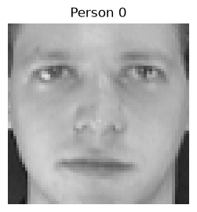
    
- 64x64라 해상도는 낮지만 얼굴 식별은 가능하다
- 중앙 8x8 영역(20~28)을 잘라 픽셀 값을 확인했다
    - 소수점 반올림은 값이 모두 1이 되어 의미가 없었다. 대신 최소·최대 값을 확인했다
    - 이중 for문으로 각 칸에 밝기 값을 텍스트로 찍어 숫자가 이미지로 바뀌는 과정을 확인했다
        
        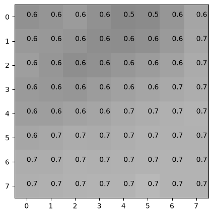
        

### 한 사람의 사진 10장 보기

- `show_person` 함수를 만들었다. 사람 번호를 받아 같은 target의 사진 10장을 한 줄(15x2 크기)로 보여 준다
- 0번과 7번 사람을 확인했다. 같은 사람이 각도를 달리해 찍힌 10장이다
- 강사는 구분하기 어려운 사진이 있다고 했지만 번호가 기억나지 않는다고 했다
- 다음 단계는 40명을 한 번에 보고, 이미지를 한 줄로 reshape한 뒤 KNN으로 분류하는 것이다
    
    
    
    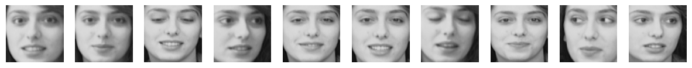


---

---

## 2. 코드진행 흐름 파악│금일 수업 코드진행 흐름 파악
# 1교시│”03_ml.ipynb” Editor 창 코드진행 흐름파악

```python
### 입력 데이터(X)와 정답데이터(y) 분리
```

```python
# 복수개의 입력데이터
features = ["study_hours", "sleep_hours", "practice_count"]

# 입력 데이터 (2차원)
X = df[features]
# 정답데이터 (1차원)
y = df["score"]

# 뎅터 차원 확인
print(X.shape)
print(y.shape)
```

- (10, 3)
(10,)

```python
### 다중 선형회귀 모델 생성 , 학습
```

```python
# 다중 선형회귀 모델 객체 생성
model = LinearRegression()

# 입력 데이터 3, 출력 데이터 1 사용해서 연습
model.fit(X, y)
```

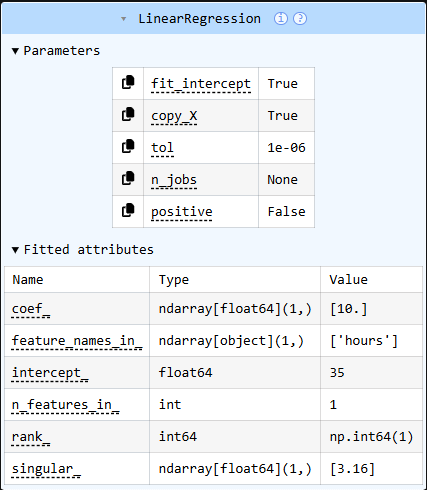

```python
### 학습된 가중치(wieght)와 절편(bias) 확인
- coef_=>1      # 1개 결과      # 갯수가 1개가 리턴이 됨
- coef_=>3      # 3개 결과      # 갯수가 3개가 리턴이 됨
```

```python
print("가중치", model.coef_)
print("절편", model.intercept_)
```

- 가중치 [5.80222725 2.68100001 0.63219852]
절편 17.66020808020665

```python
### 가중치 시각화
```

```python
# 입력변수(독립변수, Feature)와 가중치(기울기, Weight) DataFrame으로 생성
coef_df = pd.DataFrame({
    "feature": features,
    "weight": model.coef_
})

# coef_df

plt.figure(figsize=(6, 2))

# 가로바 막대 그래프
plt.barh(
    coef_df["feature"],     # 세로축에 표시
    coef_df["weight"],
    color="blue"
)
plt.show()
```

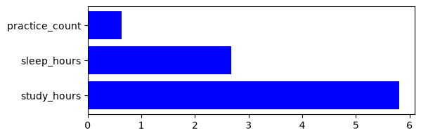

```python
### 새로운 학생의 데이터로 예측
- 공부시간 : 4시간
- 수면시간 : 7시간
- 문제풀이 : 30개
```

```python
# 새로운 데이터 생성
new_data = pd.DataFrame({
    "study_hours": [4],
    "sleep_hours": [7],
    "practice_count": [30]
})

# 학슴한 모델로 시험 성적 예측
prediction = model.predict(new_data)

# 예측 결과
print(f"예측 성적: {prediction[0]:.2f}점")
```

- 예측 성적: 78.60점

```python
# 5.80222725 2.68100001 0.63219852
# 17.66

# (4 * 5.80222725) + (7 * 2.68100001) + (30 * 0.63219852) + 17.66

x1 = 4
x2 = 7
x3 = 30

# 학습된 가중치(기울기)
w1, w2, w3 = model.coef_
# 학습된 절편(편향, Bias)
b = model.intercept_

# 회귀공식에 대입
result = w1 * x1 + w2 * x2 + w3 * x3 + b

print(f"직접 계산: {result:.4f}")
print(f"predict 계산: {prediction[0]:.4f}")
```

- 직접 계산: 78.6021
predict 계산: 78.6021

---

# 2교시│”03_ml.ipynb” Editor 창 코드진행 흐름파악

```python
### 실제 성적과 예측한 성적의 오차 비교
```

```python
# 전체 학습 데이터에 대한 예측값
y_pred = model.predict(X)
y_pred

# 실제 값하고 예측값을 비교하기 위해 복사본 생성
result_df = df.copy()

# 없는 열을 명시면 자동으로 추가된다.
result_df["예측값"] = y_pred
# 오차 계산 새로운 열로 추가
result_df["예측 오차"] = y - y_pred

result_df.round(2)
```

| **study_hours** | **sleep_hours** | **practice_count** | **score** | **예측값** | **예측 오차** |  |
| --- | --- | --- | --- | --- | --- | --- |
| 0 | 1 | 6 | 10 | 47 | 45.87 | 1.13 |
| 1 | 2 | 8 | 15 | 58 | 60.20 | -2.20 |
| 2 | 3 | 5 | 20 | 60 | 61.12 | -1.12 |
| 3 | 4 | 7 | 25 | 76 | 75.44 | 0.56 |
| 4 | 5 | 8 | 30 | 87 | 87.09 | -0.09 |
| 5 | 2 | 5 | 12 | 49 | 50.26 | -1.26 |
| 6 | 3 | 8 | 28 | 73 | 74.22 | -1.22 |
| 7 | 5 | 6 | 22 | 77 | 76.67 | 0.33 |
| 8 | 4 | 6 | 32 | 79 | 77.19 | 1.81 |
| 9 | 1 | 8 | 8 | 52 | 49.97 | 2.03 |

```python
### 모델 평가
```

```python
# 오차 절대 평균 (MAE)
mae = mean_absolute_error(y, y_pred)
# 오차 제곱 평균 (MSE)
mse = mean_squared_error(y, y_pred)
# R2 score 결정계수
r2 = r2_score(y, y_pred)

print(f"MAE: {mae:.4f}")
print(f"MSE: {mse:.4f}")
print(f"R2: {r2:.4f}")
```

- MAE: 1.1739
MSE: 1.8252
R2: 0.9900

```python
### 학습 데이터와 데스트 데이터 분리
```

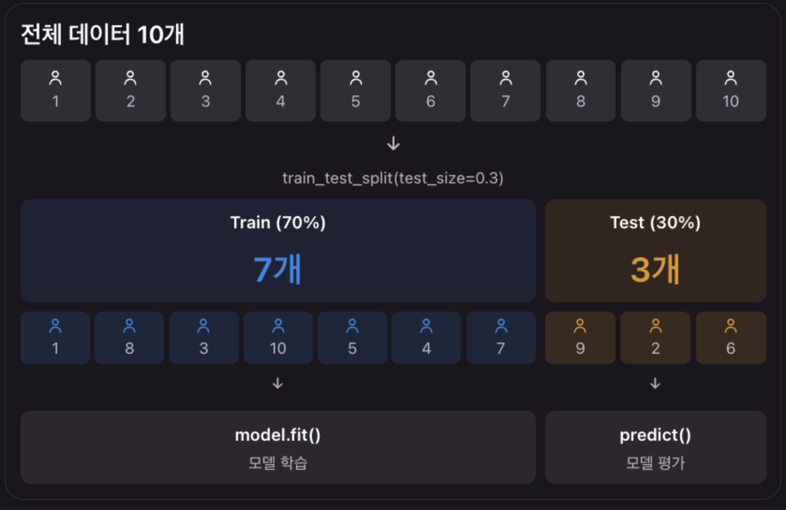

```python
# 학습 데이터와 테스트 데이터 분리
# x_train, X_test, y_train, y_test
from sklearn.model_selection import train_test_split

X_train, X_test, y_train, y_test = train_test_split(
    X,
    y,
    test_size=0.3,
    random_state=42
)

print("X_train", X_train.shape)
print("X_test", X_test.shape)
print("y_train", y_train.shape)
print("y_test", y_test.shape)
```

- X_train (7, 3)
X_test (3, 3)
y_train (7,
y_test (3,)

```python
### 모델 학습
```

```python
test_model = LinearRegression()
# 70% 데이터로 학습
test_model.fit(X_train, y_train)
# 학습하지 않은 데이터로 결과 예측
test_pred = test_model.predict(X_test)

print(f"MAE: {mean_absolute_error(y_test, test_pred):.4f}")
print(f"MSE: {mean_squared_error(y_test, test_pred):.4f}")
print(f"R2: {r2_score(y_test, test_pred):.4f}")
```

- MAE: 3.0870
MSE: 10.6380
R2: 0.9327

```python
### 특성 스케일링(Feature Scaling)
- 서로 다른 단위 또는 크기를 가진 데이터를 비슷한 척도로 변환하는 전처리 과정
```

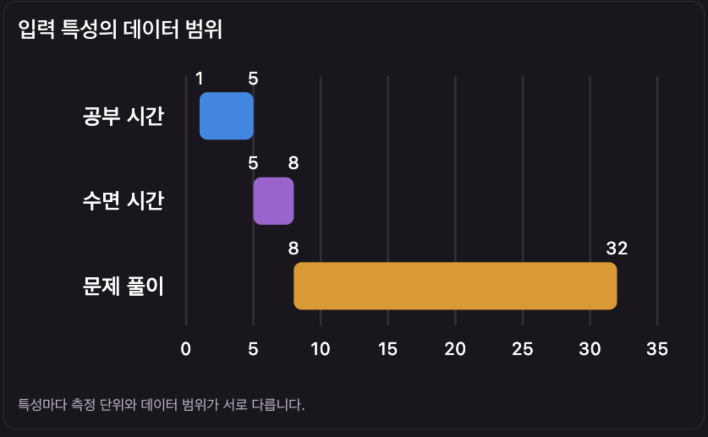

```python
# describe() : 기초적인 통계 수치 확인
X.describe().round(2)
```

| **study_hours** | **sleep_hours** | **practice_count** |  |
| --- | --- | --- | --- |
| count | 10.00 | 10.00 | 10.00 |
| mean | 3.00 | 6.70 | 20.20 |
| std | 1.49 | 1.25 | 8.63 |
| min | 1.00 | 5.00 | 8.00 |
| 25% | 2.00 | 6.00 | 12.75 |
| 50% | 3.00 | 6.50 | 21.00 |
| 75% | 4.00 | 8.00 | 27.25 |
| max | 5.00 | 8.00 | 32.00 |

```python
### StandardScaler (스탠다드 스케일러)
```

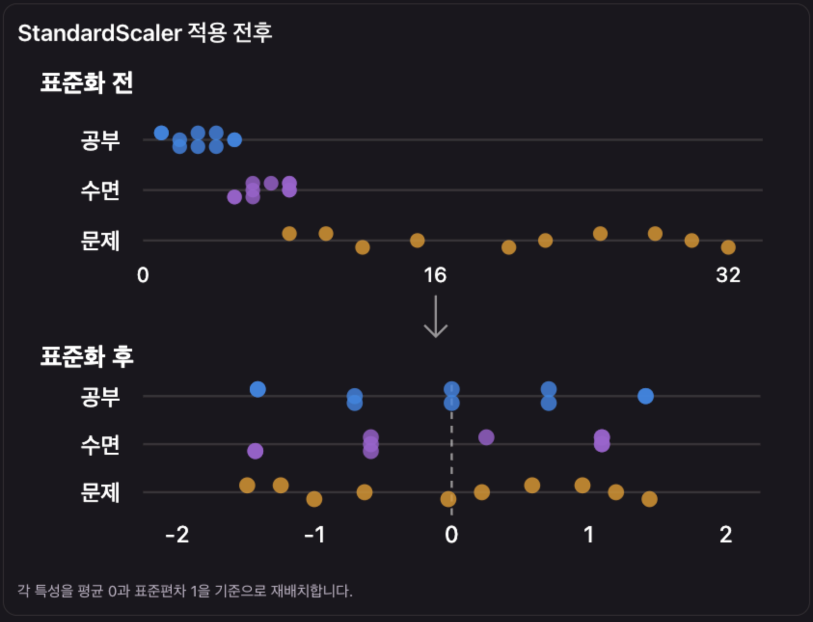

```python
from sklearn.preprocessing import StandardScaler

# 표준화 객체 생성
scaler = StandardScaler()

# 학습 데이터에대해 평균, 표준편차를 계산하고 데이터를 표준화(-1 ~ 0 ~ +1)
X_train_scaled = scaler.fit_transform(X_train)

X_test_scaled = scaler.transform(X_test)

scaled_df = pd.DataFrame(
    X_train_scaled,
    columns=features
)

scaled_df.round(2)
```

| **study_hours** | **sleep_hours** | **practice_count** |  |
| --- | --- | --- | --- |
| 0 | -1.38 | -0.76 | -1.32 |
| 1 | 1.20 | -0.76 | 0.20 |
| 2 | -0.09 | -1.65 | -0.05 |
| 3 | -1.38 | 1.02 | -1.58 |
| 4 | 1.20 | 1.02 | 1.21 |
| 5 | 0.55 | 0.13 | 0.58 |
| 6 | -0.09 | 1.02 | 0.96 |

---

# 3교시│”03_ml.ipynb” Editor 창 코드진행 흐름파악

```python
### 경사하강법을 이용한 다중 선형회귀
- SGDRegressor 사용
- 입력변수 3개, 출력변수 1개
```

```python
from sklearn.linear_model import SGDRegressor

sgd = SGDRegressor(
    loss="squared_error",           # MSE 손실함수
    learning_rate="constant",       # 일정하게 학습
    eta0=0.01,                      # 초기 학습률
    max_iter=3000,                  # 최대 Epoch 횟수
    random_state=42                 # 난수 발생 seed
)

# 표준화된 학습 데이터(70%)로 모델 학습
sgd.fit(X_train_scaled, y_train)

# 표준화된 검증 데이터(30%)로 모델 예측
sgd_pred = sgd.predict(X_test_scaled)

# 모델 평가
print(f"MAE: {mean_absolute_error(y_test, sgd_pred):.4f}")
print(f"MSE: {mean_squared_error(y_test, sgd_pred):.4f}")
print(f"R2: {r2_score(y_test, sgd_pred):.4f}")
```

- MAE: 2.8169
MSE: 8.5966
R2: 0.9456

```python
sgd = SGDRegressor(
    loss="squared_error",           # MSE 손실함수
    learning_rate="constant",       # 일정하게 학습
    eta0=0.01,                      # 초기 학습률
    random_state=42                 # 난수 발생 seed
)

history = []

# 500 Epoch 학습
for epoch in range(500):
    # 1 Epoch 한번 학습
    sgd.partial_fit(X_train_scaled, y_train)
    pred = sgd.predict(X_train_scaled)

    history.append({
        "epoch": epoch + 1,
        "w1": sgd.coef_[0],
        "w2": sgd.coef_[1],
        "w3": sgd.coef_[2],
        "bias": sgd.intercept_[0],
        "mse": mean_squared_error(y_train, pred)
    })

history_df = pd.DataFrame(history)
history_df.tail()
```

| **epoch** | **w1** | **w2** | **w3** | **bias** | **mse** |  |
| --- | --- | --- | --- | --- | --- | --- |
| 495 | 496 | 9.924025 | 3.620886 | 3.290704 | 67.424572 | 0.144615 |
| 496 | 497 | 9.924418 | 3.620984 | 3.290298 | 67.424569 | 0.144605 |
| 497 | 498 | 9.924807 | 3.621080 | 3.289895 | 67.424567 | 0.144594 |
| 498 | 499 | 9.925193 | 3.621176 | 3.289496 | 67.424564 | 0.144584 |
| 499 | 500 | 9.925575 | 3.621271 | 3.289101 | 67.424562 | 0.144573 |

```python
# 손실곡선
# X = epoch
# y = mse
# plot

plt.plot(
    history_df["epoch"],
    history_df["mse"]
)
plt.show()

# w1 가중치 차트
# X = epoch

plt.plot(
    history_df["epoch"],
    history_df["w1"]
)
plt.show()
```

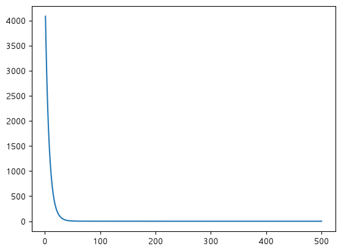

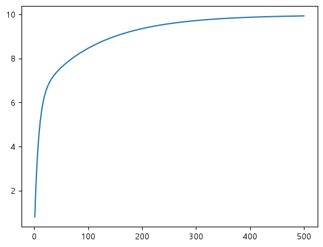

```python
fig, axe = plt.subplots(figsize=(10, 5))

plt.plot(
    history_df["epoch"],
    history_df["w1"],
    label="study"
)
plt.plot(
    history_df["epoch"],
    history_df["w2"],
    label="sleep"
)
plt.plot(
    history_df["epoch"],
    history_df["w3"],
    label="practice_count"
)
plt.legend()
plt.grid(alpha=0.3)
plt.show()
```

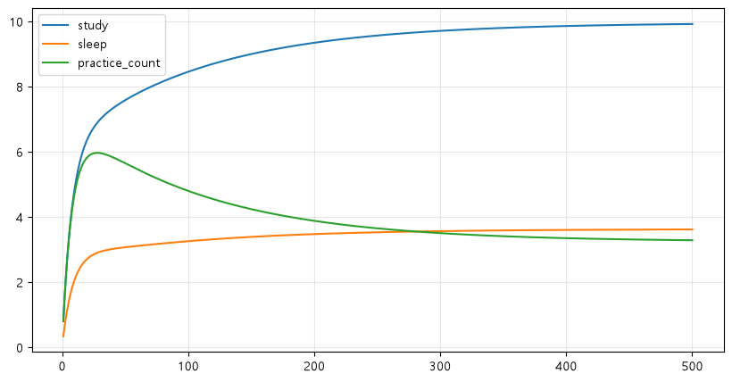

---

# 4교시│”03_ml.ipynb” Editor 창 코드진행 흐름파악

```python
# KNN

## 데이터 불러오기
```

```python
import numpy as np
import matplotlib.pyplot as plt
from sklearn.datasets import fetch_olivetti_faces

# 얼굴 데이터 다운로드
faces = fetch_olivetti_faces(data_home="./datasets")
```

- downloading Olivetti faces from https://ndownloader.figshare.com/files/5976027 to ./datasets

```python
### 데이터 Shape 조회
```

```python
print("사진 묶음 크기:", faces.images.shape)
print("정답 묶음 크기:", faces.target.shape)
# np.unique()
print("사람 종류:", np.unique(faces.target))
```

- 사진 묶음 크기: (400, 64, 64)
정답 묶음 크기: (400,)
사람 종류: [ 0  1  2  3  4  5  6  7  8  9 10 11 12 13 14 15 16 17 18 19 20 21 22 23
24 25 26 27 28 29 30 31 32 33 34 35 36 37 38 39]

```python
plt.figure(figsize=(3,3))

# 0번째 사진 출력
plt.imshow(faces.images[0], cmap="grey", vmin=0, vmax=1)
plt.title(f"Person {faces.target[0]}")
plt.axis("off")
plt.show()
```


```python
corner = faces.images[0][20:28, 20:28]

print("가장 어두운 값:", faces.images.min())
print("가장 밝은 값:", faces.images.max())
```

- 가장 어두운 값: 0.0
가장 밝은 값: 1.0

```python
fig, ax = plt.subplots(figsize=(5,5))
ax.imshow(corner, cmap="grey", vmin=0, vmax=1)
for r in range(8):
    for c in range(8):
        # r번째 행, c번째 행
        v = corner[r,c]
        ax.text(c,r, f"{v:.1f}")
plt.show()
```


```python
def show_persion(person):
    pics = faces.images[faces.target == person]

    fig, axes = plt.subplots(1, 10, figsize=(15, 2))
    for ax, img in zip(axes, pics):
        ax.imshow(img, cmap="grey", vmin=0, vmax=1)
        ax.axis("off")

    plt.show()

show_persion(0)
show_persion(7)
```


---

## 4교시│”○○○○” 터미널 창 코드진행 흐름파악

```python
miro2@keon UCRT64 ~/kant_study/03_ML/kant_ml (main)
$ ls
01_ml.ipynb  02_ml.ipynb  03_ml.ipynb  04_knn.ipynb  datasets/  diamond.ipynb  main.py  pyproject.toml  README.md  uv.lock
(kant-ml) 
miro2@keon UCRT64 ~/kant_study/03_ML/kant_ml (main)
$ ls -al
total 1567
drwxr-xr-x 1 miro2 197609      0 Nov 26 13:17 ./
drwxr-xr-x 1 miro2 197609      0 Nov 23 10:31 ../
drwxr-xr-x 1 miro2 197609      0 Nov 25 16:28 .git/
-rw-r--r-- 1 miro2 197609      5 Nov 23 10:33 .python-version
drwxr-xr-x 1 miro2 197609      0 Nov 23 10:35 .venv/
-rw-r--r-- 1 miro2 197609  64528 Nov 25 17:14 01_ml.ipynb
-rw-r--r-- 1 miro2 197609 182785 Nov 26 09:14 02_ml.ipynb
-rw-r--r-- 1 miro2 197609 389409 Nov 26 12:57 03_ml.ipynb
-rw-r--r-- 1 miro2 197609 242911 Nov 26 14:02 04_knn.ipynb
drwxr-xr-x 1 miro2 197609      0 Nov 26 13:21 datasets/
-rw-r--r-- 1 miro2 197609 571662 Nov 26 09:30 diamond.ipynb
-rw-r--r-- 1 miro2 197609     85 Nov 23 10:33 main.py
-rw-r--r-- 1 miro2 197609    295 Nov 24 11:27 pyproject.toml
-rw-r--r-- 1 miro2 197609      0 Nov 23 10:33 README.md
-rw-r--r-- 1 miro2 197609 125152 Nov 24 11:27 uv.lock
(kant-ml) 
miro2@keon UCRT64 ~/kant_study/03_ML/kant_ml (main)
$ git init
Reinitialized existing Git repository in C:/Users/miro2/kant_study/03_ML/kant_ml/.git/
(kant-ml) 
miro2@keon UCRT64 ~/kant_study/03_ML/kant_ml (main)
$ git status
On branch main
Changes not staged for commit:
  (use "git add <file>..." to update what will be committed)
  (use "git restore <file>..." to discard changes in working directory)
        modified:   01_ml.ipynb
        modified:   03_ml.ipynb
        modified:   diamond.ipynb

Untracked files:
  (use "git add <file>..." to include in what will be committed)
        04_knn.ipynb
        datasets/olivetti_py3.pkz

no changes added to commit (use "git add" and/or "git commit -a")
(kant-ml) 
miro2@keon UCRT64 ~/kant_study/03_ML/kant_ml (main)
$ git add .
warning: in the working copy of '01_ml.ipynb', LF will be replaced by CRLF the next time Git touches it
warning: in the working copy of '03_ml.ipynb', LF will be replaced by CRLF the next time Git touches it
warning: in the working copy of 'diamond.ipynb', LF will be replaced by CRLF the next time Git touches it
warning: in the working copy of '04_knn.ipynb', LF will be replaced by CRLF the next time Git touches it
(kant-ml) 
miro2@keon UCRT64 ~/kant_study/03_ML/kant_ml (main)
$ git add 01_ml.ipynb
(kant-ml) 
miro2@keon UCRT64 ~/kant_study/03_ML/kant_ml (main)
$ git add 03_ml.ipynb
(kant-ml) 
miro2@keon UCRT64 ~/kant_study/03_ML/kant_ml (main)
$ git add diamond.ipynb
(kant-ml) 
miro2@keon UCRT64 ~/kant_study/03_ML/kant_ml (main)
$ git add 04_knn.ipynb
(kant-ml) 
miro2@keon UCRT64 ~/kant_study/03_ML/kant_ml (main)
$ git status
On branch main
Changes to be committed:
  (use "git restore --staged <file>..." to unstage)
        modified:   01_ml.ipynb
        modified:   03_ml.ipynb
        new file:   04_knn.ipynb
        new file:   datasets/olivetti_py3.pkz
        modified:   diamond.ipynb

(kant-ml) 
miro2@keon UCRT64 ~/kant_study/03_ML/kant_ml (main)
$ git commit -m "feat: 03_ml 및 04_knn 추가"
[main 6dbc295] feat: 03_ml 및 04_knn 추가
 5 files changed, 2370 insertions(+), 10 deletions(-)
 create mode 100644 04_knn.ipynb
 create mode 100644 datasets/olivetti_py3.pkz
(kant-ml) 
miro2@keon UCRT64 ~/kant_study/03_ML/kant_ml (main)
$ git remote -v
origin  https://github.com/miro25800/kant_ml.git (fetch)
origin  https://github.com/miro25800/kant_ml.git (push)
(kant-ml) 
miro2@keon UCRT64 ~/kant_study/03_ML/kant_ml (main)
$ git push origin main
Enumerating objects: 13, done.
Counting objects: 100% (13/13), done.
Delta compression using up to 24 threads
Compressing objects: 100% (8/8), done.
Writing objects: 100% (8/8), 1.59 MiB | 2.34 MiB/s, done.
Total 8 (delta 4), reused 0 (delta 0), pack-reused 0 (from 0)
remote: Resolving deltas: 100% (4/4), completed with 4 local objects.
To https://github.com/miro25800/kant_ml.git
   ce30310..6dbc295  main -> main
(kant-ml)
```

---

---

## 3. 수작업 요약│실습 11회차
‘개인 과제│261126 제7차 개인 과제’로 대체.

---

---

## 4-1. 암기장│단어 암기장
# 단어 중요도 목차 (5단계 분배)

### [5단계 : 필수적으로 중요함]

- X (입력 데이터 / 피처 / 독립변수) — 모델에 넣는 설명 변수
- y (정답 데이터 / 타겟 / 종속변수) — 예측하려는 목표 값
- epoch (에폭) — 전체 학습 데이터를 한 번 학습하는 단위
- test_size — 학습/테스트 데이터 분리 비율 인자
- random_state — 재현성을 위한 난수 시드 인자

### [4단계 : 매우 중요함]

- `LinearRegression` (선형 회귀) — 연속형 값을 예측하는 기본 회귀 모델
- `train_test_split` — 학습용·검증(테스트)용 데이터 분할 개념
- `StandardScaler` (표준화 스케일러) — 평균 0, 표준편차 1 기준으로 척도를 맞추는 전처리
- `MAE` / `MSE` / `R2` — 회귀 모델 성능을 재는 핵심 평가지표

### [3단계 : 중요함]

- `SGDRegressor` — 경사하강법 기반 회귀 모델
- `learning_rate` / `eta0` — 학습률과 초기 학습률 설정
- `max_iter` — 최대 반복 횟수 설정
- `loss` (`squared_error`) — 손실함수 지정
- `KNN` — 이웃 기반 분류/회귀 알고리즘 개념

### [2단계 : 덜 중요한 것은 아님.]

- `subplots` / `figsize` — 다중 그래프 배치 및 전체 크기 지정
- `cmap` / `vmin` / `vmax` — 이미지 시각화 색상맵과 값 범위 지정

### [1단계 : 알고 있으면 나쁘지 않음.]

- `alpha` — 투명도 조절 인자
- `LF` / `CRLF` — 줄바꿈 문자 차이 안내 메시지

---

---

## 4-2. 암기장│코드 (메서드 · 속성) 암기장
# 코드 (메서드) 중요도 목차 (5단계 분배)

### [5단계 : 필수적으로 중요함]

- `model.fit(X, y)` / `test_model.fit(X_train, y_train)` / `sgd.fit(...)` — 모델 학습의 핵심
- `model.predict(...)` / `test_model.predict(...)` / `sgd.predict(...)` — 학습된 모델로 예측 수행
- `train_test_split(...)` — 데이터셋 분리 함수
- `scaler.fit_transform(X_train)` — 학습 데이터 기준 통계 산출 및 변환
- `scaler.transform(X_test)` — 동일 기준(데이터 누수 방지)으로 테스트 데이터 변환

### [4단계 : 매우 중요함]

- `mean_absolute_error(...)` / `mean_squared_error(...)` / `r2_score(...)` — 회귀 모델 평가 함수
- `pd.DataFrame(...)` / `df.copy()` — 표 구조 생성 및 원본 보호용 복사
- `df.describe()` / `df.round(...)` — 기초 통계 요약 및 소수점 반올림
- `plt.subplots(...)` / `plt.plot(...)` / `plt.show()` — 그래프 영역 생성, 선 그래프 그리기, 출력

### [3단계 : 중요함]

- `sgd.partial_fit(...)` — 에폭 단위 점진적 학습
- `np.unique(...)` — 고유 클래스(사람 ID 등) 목록 확인
- `plt.barh(...)` — 수평 막대그래프 시각화
- `plt.legend()` / `plt.grid(...)` / `plt.title(...)` / `plt.axis(...)` — 범례, 격자, 제목, 축 표시 제어

### [2단계 : 덜 중요한 것은 아님.]

- `fetch_olivetti_faces(...)` — 실습용 얼굴 데이터셋 로드
- `plt.figure(...)` / `plt.imshow(...)` — 도화지 생성 및 2차원 배열 이미지 출력
- `ax.imshow(...)` / `ax.text(...)` — 서브플롯 축 객체에 이미지 및 텍스트 표시

### [1단계 : 알고 있으면 나쁘지 않음.]

- `history.append(...)` — 에폭별 기록 리스트 추가
- `history_df.tail()` — 마지막 몇 개 행 확인
- `show_persion(...)` — 실습용 사용자 정의 시각화 함수 (`person` 오타 주의)

---

# 코드 (속성) 중요도 목차 (5단계 분배)

### [5단계 : 필수적으로 중요함]

- `.shape` (`X.shape`, `y.shape`, `X_train.shape`, `faces.images.shape` 등) — 데이터 차원과 샘플 수 확인의 기본
- `.coef_` (`model.coef_`, `sgd.coef_`) — 학습된 가중치(기울기) 벡터
- `.intercept_` (`model.intercept_`, `sgd.intercept_`) — 학습된 절편(편향, Bias)

### [4단계 : 매우 중요함]

- `faces.images` / `faces.target` — 데이터셋 객체 내 이미지 배열과 정답 레이블 속성

### [3단계 : 중요함]

- `.min()` / `.max()` (`faces.images.min()`, `faces.images.max()`) — 픽셀/수치 값의 최소·최댓값 범위 확인(메서드 형태이지만 값 범위 파악용 핵심)

### [2단계 : 덜 중요한 것은 아님.]

- 해당 코드 흐름에 등장한 순수 속성(`변수.속성`) 중에서는 `shape`, `coef_`, `intercept_`, `images`, `target` 외에 별도 2단계 전용 속성은 많지 않습니다.

### [1단계 : 알고 있으면 나쁘지 않음.]

- 금일 별도 해당 항목 없음

---

---

## 5. 개인 과제│261126 제7차 개인 과제
# **미니과제│머신러닝 복습 과제 — 선형회귀**

---

# “rpggame.ipynb” 파일 Editor 창 코드진행 흐름파악│제1차 연습

```python
# RPG GAME / 미니과제│머신러닝 복습 과제 — 선형회귀

## 공통 실습 데이터
```

```python
import pandas as pd
import matplotlib.pyplot as plt

# 게임 플레이 기록 20개
df = pd.DataFrame({
    "play_hours": [1, 2, 3, 4, 5, 1, 2, 3, 4, 5, 2, 4, 1, 5, 3, 2, 5, 4, 3, 1],
    "quests": [2, 3, 5, 6, 8, 4, 2, 6, 5, 7, 5, 8, 1, 6, 4, 3, 9, 7, 7, 3],
    "monsters": [10, 25, 30, 45, 60, 18, 35, 40, 55, 70, 20, 50, 15, 80, 25, 45, 65, 35, 55, 28],
    "xp": [410, 680, 965, 1240, 1620, 565, 755, 1100, 1280, 1660, 755, 1415, 395, 1690, 870, 885, 1700, 1210, 1290, 635],
})

df
```

| **play_hours** | **quests** | **monsters** | **xp** |  |
| --- | --- | --- | --- | --- |
| 0 | 1 | 2 | 10 | 410 |
| 1 | 2 | 3 | 25 | 680 |
| 2 | 3 | 5 | 30 | 965 |
| 3 | 4 | 6 | 45 | 1240 |
| 4 | 5 | 8 | 60 | 1620 |
| 5 | 1 | 4 | 18 | 565 |
| 6 | 2 | 2 | 35 | 755 |
| 7 | 3 | 6 | 40 | 1100 |
| 8 | 4 | 5 | 55 | 1280 |
| 9 | 5 | 7 | 70 | 1660 |
| 10 | 2 | 5 | 20 | 755 |
| 11 | 4 | 8 | 50 | 1415 |
| 12 | 1 | 1 | 15 | 395 |
| 13 | 5 | 6 | 80 | 1690 |
| 14 | 3 | 4 | 25 | 870 |
| 15 | 2 | 3 | 45 | 885 |
| 16 | 5 | 9 | 65 | 1700 |
| 17 | 4 | 7 | 35 | 1210 |
| 18 | 3 | 7 | 55 | 1290 |
| 19 | 1 | 3 | 28 | 635 |

```python
## 단순 선형회귀 — 플레이 시간으로 경험치 예측
```

```python
from sklearn.linear_model import LinearRegression

# 입력 특성과 정답 분리
X = df[["play_hours"]]
y = df["xp"]

# 모델 학습
simple_model = LinearRegression()
simple_model.fit(X, y)

print(f"기울기: {simple_model.coef_[0]:.2f}")
print(f"절편: {simple_model.intercept_:.2f}")

# 새로운 데이터 예측
new_player = pd.DataFrame({"play_hours": [3]})
print(f"예상 경험치: {simple_model.predict(new_player)[0]:.2f} XP")
```

- 기울기: 285.00
절편: 201.00
예상 경험치: 1056.00 XP

```python
## 다중 선형회귀 — 세 가지 특성으로 예측
```

```python
features = ["play_hours", "quests", "monsters"]
X = df[features]
y = df["xp"]
print("X shape:", X.shape)

# 다중 선형회귀 모델 학습
multiple_model = LinearRegression()
multiple_model.fit(X, y)

# 특성별 가중치와 절편 확인
for feature, weight in zip(features, multiple_model.coef_):
    print(f"{feature}: {weight:.2f}")
print(f"절편: {multiple_model.intercept_:.2f}")

new_player = pd.DataFrame({
    "play_hours": [3], "quests": [5], "monsters": [40]
})
print(f"예상 경험치: {multiple_model.predict(new_player)[0]:.2f} XP")
```

- X shape: (20, 3)
play_hours: 107.81
quests: 51.10
monsters: 9.36
절편: 97.41
예상 경험치: 1050.64 XP

```python
## 모델 평가 — 단순 회귀와 다중 회귀 비교
```

```python
from sklearn.model_selection import train_test_split
from sklearn.metrics import mean_absolute_error, mean_squared_error, r2_score

X = df[features]
y = df["xp"]
X_train, X_test, y_train, y_test = train_test_split(
    X, y, test_size=0.25, random_state=42
)

# 같은 학습·테스트 샘플로 두 모델 비교
simple_model = LinearRegression()
simple_model.fit(X_train[["play_hours"]], y_train)
simple_pred = simple_model.predict(X_test[["play_hours"]])

multiple_model = LinearRegression()
multiple_model.fit(X_train, y_train)
multiple_pred = multiple_model.predict(X_test)

for name, pred in [("단순 회귀", simple_pred), ("다중 회귀", multiple_pred)]:
    print(name)
    print(f"MAE: {mean_absolute_error(y_test, pred):.2f}")
    print(f"MSE: {mean_squared_error(y_test, pred):.2f}")
    print(f"R2: {r2_score(y_test, pred):.4f}")

# 테스트 MSE 비교
if mean_squared_error(y_test, multiple_pred) < mean_squared_error(y_test, simple_pred):
    print("다중 회귀 모델의 테스트 MSE가 더 작습니다.")
else:
    print("단순 회귀 모델의 데스트 MSE가 더 작거나 같습니다.")
```

- 단순 회귀
MAE: 104.32
MSE: 11450.96
R2: 0.8918
다중 회귀
MAE: 13.28
MSE: 255.66
R2: 0.9976
다중 회귀 모델의 테스트 MSE가 더 작습니다.

```python
## 특성 스케일링 — StandardScaler
```

```python
from sklearn.preprocessing import StandardScaler

# 학습 데이터만으로 표준화 기준 개선
scaler = StandardScaler()
X_train_scaled = scaler.fit_transform(X_train)
X_test_scaled = scaler.transform(X_test)

# 데이터프레임 변환
scaled_df = pd.DataFrame(X_train_scaled, columns=features)

print("평균")
print(scaled_df.mean().round(4).to_string())
print("표준편차")
print(scaled_df.std(ddof=0).round(4).to_string())
print("처음 5행:")
print(scaled_df.head().round(4).to_string(index=False))
```

- 평균
play_hours   -0.0
quests       -0.0
monsters      0.0
표준편차
play_hours    1.0
quests        1.0
monsters      1.0
처음 5행:
play_hours  quests  monsters
-1.4667 -0.6320   -1.2418
0.5959  1.1738    0.3868
0.5959  0.2709    0.1323
-0.0917  0.7223    0.6412
1.2834  1.6252    1.1502

```python
## 경사하강법 — SGDRegressor 학습 과정 관찰
```

```python
from sklearn.linear_model import SGDRegressor

sgd = SGDRegressor(
    loss="squared_error",
    penalty=None,
    learning_rate="constant",
    eta0=0.01,
    random_state=42
)

losses = []
for epoch in range(200):
    # 한 Epoch 학습
    sgd.partial_fit(X_train_scaled, y_train)
    # 학습 데이터 예측 및 MSE 저장
    pred = sgd.predict(X_train_scaled)
    losses.append(mean_squared_error(y_train, pred))

print(f"첫 번째 학습 MSE: {losses[0]:.2f}")
print(f"마지막 학습 MSE: {losses[-1]:.2f}")

# 손실 곡선 시각화
plt.figure(figsize=(8, 4))
plt.plot(range(1, 201), losses)
plt.xlabel("Epoch")
plt.ylabel("MSE")
plt.title("Training Loss Curve")
plt.show()

# 최종 테스트 데이터 평가
test_pred = sgd.predict(X_test_scaled)
print(f"최종 테스트 MSE: {mean_squared_error(y_test, test_pred):.2f}")
```

- 첫 번째 학습 MSE: 988559.48
마지막 학습 MSE: 82.32

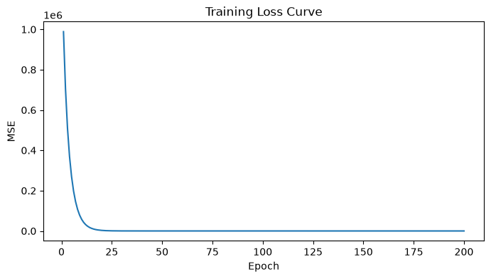

- 최종 테스트 MSE: 256.93

---

### 마무리 │ GitHub push 완료 │ "rpggame.ipynb" 터미널 코드 진행 흐름 파악│제1차 연습

```python
miro2@keon UCRT64 ~/kant_study/03_ML/kant_ml (main)
$ ls
01_ml.ipynb  02_ml.ipynb  03_ml.ipynb  04_knn.ipynb  datasets/  diamond.ipynb  main.py  pyproject.toml  README.md  rpggame.ipynb  uv.lock
(kant-ml) 
miro2@keon UCRT64 ~/kant_study/03_ML/kant_ml (main)
$ ls -al
total 1607
drwxr-xr-x 1 miro2 197609      0 Nov 26 15:03 ./
drwxr-xr-x 1 miro2 197609      0 Nov 23 10:31 ../
drwxr-xr-x 1 miro2 197609      0 Nov 26 14:04 .git/
-rw-r--r-- 1 miro2 197609      5 Nov 23 10:33 .python-version
drwxr-xr-x 1 miro2 197609      0 Nov 23 10:35 .venv/
-rw-r--r-- 1 miro2 197609  64528 Nov 25 17:14 01_ml.ipynb
-rw-r--r-- 1 miro2 197609 182785 Nov 26 09:14 02_ml.ipynb
-rw-r--r-- 1 miro2 197609 389409 Nov 26 15:13 03_ml.ipynb
-rw-r--r-- 1 miro2 197609 242911 Nov 26 14:18 04_knn.ipynb
drwxr-xr-x 1 miro2 197609      0 Nov 26 13:21 datasets/
-rw-r--r-- 1 miro2 197609 571662 Nov 26 09:30 diamond.ipynb
-rw-r--r-- 1 miro2 197609     85 Nov 23 10:33 main.py
-rw-r--r-- 1 miro2 197609    295 Nov 24 11:27 pyproject.toml
-rw-r--r-- 1 miro2 197609      0 Nov 23 10:33 README.md
-rw-r--r-- 1 miro2 197609  37214 Nov 26 16:53 rpggame.ipynb
-rw-r--r-- 1 miro2 197609 125152 Nov 24 11:27 uv.lock
(kant-ml) 
miro2@keon UCRT64 ~/kant_study/03_ML/kant_ml (main)
$ git init
Reinitialized existing Git repository in C:/Users/miro2/kant_study/03_ML/kant_ml/.git/
(kant-ml) 
miro2@keon UCRT64 ~/kant_study/03_ML/kant_ml (main)
$ git status
On branch main
Untracked files:
  (use "git add <file>..." to include in what will be committed)
        rpggame.ipynb

nothing added to commit but untracked files present (use "git add" to track)
(kant-ml) 
miro2@keon UCRT64 ~/kant_study/03_ML/kant_ml (main)
$ git add .
warning: in the working copy of 'rpggame.ipynb', LF will be replaced by CRLF the next time Git touches it
(kant-ml) 
miro2@keon UCRT64 ~/kant_study/03_ML/kant_ml (main)
$ git status
On branch main
Changes to be committed:
  (use "git restore --staged <file>..." to unstage)
        new file:   rpggame.ipynb

(kant-ml) 
miro2@keon UCRT64 ~/kant_study/03_ML/kant_ml (main)
$ git commit -m "fea: rpg game 내용 추가"
[main 0652efa] fea: rpg game 내용 추가
 1 file changed, 546 insertions(+)
 create mode 100644 rpggame.ipynb
(kant-ml) 
miro2@keon UCRT64 ~/kant_study/03_ML/kant_ml (main)
$ git remote -v
origin  https://github.com/miro25800/kant_ml.git (fetch)
origin  https://github.com/miro25800/kant_ml.git (push)
(kant-ml) 
miro2@keon UCRT64 ~/kant_study/03_ML/kant_ml (main)
$ git push origin main
Enumerating objects: 4, done.
Counting objects: 100% (4/4), done.
Delta compression using up to 24 threads
Compressing objects: 100% (3/3), done.
Writing objects: 100% (3/3), 20.15 KiB | 20.15 MiB/s, done.
Total 3 (delta 1), reused 0 (delta 0), pack-reused 0 (from 0)
remote: Resolving deltas: 100% (1/1), completed with 1 local object.
To https://github.com/miro25800/kant_ml.git
   6dbc295..0652efa  main -> main
(kant-ml)
```

---

---

---

## 6. 데일리 퀘스트│데일리 퀘스트
---

# 1번 문항

- 강화 학습(Reinforcement Learning)의 학습 방식에 대한 설명으로 가장 적절한 것은?
- [ ]  정답이 표시된 데이터를 미리 주고 입력과 출력의 관계를 학습한다.
- [ ]  레이블 없는 데이터에서 숨겨진 구조나 군집을 스스로 찾아낸다.
- [x]  행동을 시도한 결과로 얻는 보상과 벌을 통해 최적의 행동을 스스로 터득한다.
- [ ]  전체 데이터를 한 번에 암기하여 문제와 답을 그대로 저장한다.
- 정답 풀이 : 3번
    - 추가 해설 : 교안에 따르면 강화 학습은 처음엔 아무것도 모르는 상태에서 행동을 해보고 잘하면 보상, 못하면 벌을 받으며 최적의 방법을 스스로 깨우치는 방식입니다. 다른 선지들은 지도학습이나 비지도학습, 과적합 현상에 대한 설명으로 강화학습과는 다릅니다.

---

# 2번 문항

- 강화 학습에서 컴퓨터가 특정 상황에서의 행동이 앞으로 얻을 총점(가치)을 기록해두는 것을 무엇이라고 부르는지, 교안에서 사용한 표현으로 답하시오.
- [x]  주관식, 강화학습
- 정답 풀이 : 오답 : 강화학습 / 정답 : 가치 기록장
    - 추가 해설 : 교안에서는 컴퓨터가 특정 상황에서 어떤 행동을 했을 때 앞으로 얻을 수 있는 총점(가치)을 '가치 기록장'에 적어두고 이를 계속 업데이트한다고 설명합니다.

---

# 3번 문항

- 다중 선형 회귀 공식 y = w1x1 + w2x2 + w3x3 + b 에서 'b'가 의미하는 것은?
- [ ]  각 정보가 최종 성적에 미치는 영향력 크기
- [ ]  예측해 낼 최종 기말고사 시험 성적
- [ ]  기본적으로 깔고 가는 점수(편향)
- [x]  주당 자습 시간을 나타내는 입력 변수
- 정답 풀이 : 오답 : 4번 / 정답 : 3번
    - 추가 해설 : 교안에서 b는 '기본적으로 깔고 가는 점수(편향)'이라고 명시되어 있습니다. w1, w2, w3는 가중치(영향력)이고, y는 예측값, x1은 입력 변수이므로 나머지 선지는 오답입니다.

---

# 4번 문항

- 전체 데이터를 훈련/검증/테스트 세트로 나누는 가장 핵심적인 이유로 교안에서 제시한 것은?
- [ ]  모델의 연산 속도를 빠르게 하기 위해서
- [ ]  모델이 데이터를 통째로 외워 버리는 과적함을 방지하기 위해서
- [ ]  데이터의 용량을 줄여 저장 공간을 절약하기 위해서
- [x]  훈련 세트만으로는 가중치를 업데이트 할 수 없기 때문에
- 정답 풀이 : 오답 : 4번 / 정답 : 2번
    - 추가 해설 : 교안은 모든 데이터를 한 번에 주고 학습시키면 모델이 문제와 답을 통째로 외워버리는 과적합 현상이 발생하므로, 이를 방지하기 위해 훈련/검증/테스트 세트로 분리한다고 설명합니다. 나머지 선지는 교안에서 언급되지 않은 내용입니다.

---

# 5번 문항

- Scikit-learn의 train_test_split 함수에서 정답 데이터(y)의 클래스 비율이 훈련 세트와 테스트 세트에서도 동일하게 유지되도록 나눠주는 옵션의 이름은 무엇인가?
- [x]  주관식, ?
- 정답 풀이 : 오답 : ? / 정답 : stratify=y
    - 추가 해설 : 교안에서 stratify=y는 정답 데이터의 비율이 쪼개진 훈련/테스트 세트 안에서도 동일하게 유지되도록 나눠주는 옵션이라고 설명합니다. random_state는 재현성, shuffle은 데이터 섞기, test_size는 분할 비율을 담당하므로 다른 개념입니다.

---

---

---
